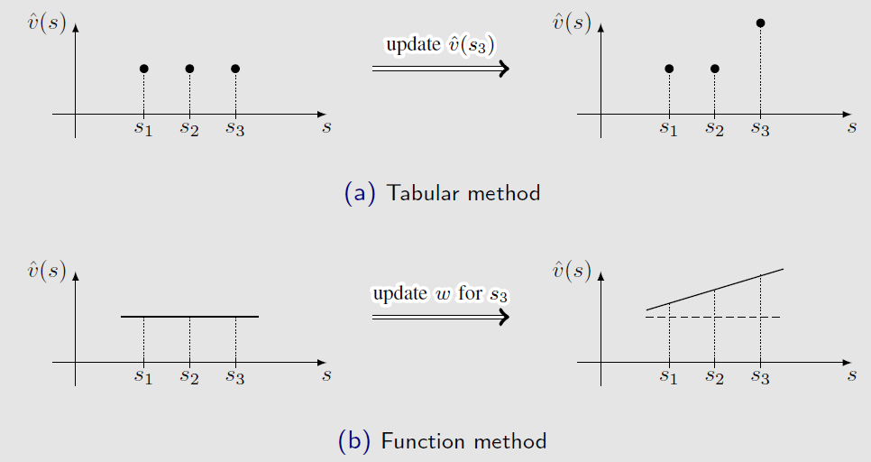

# 从表格到函数

## 表格型表示

在本书前述章节中，状态价值与动作价值均采用显式查找表进行存储与表示。

* **状态价值表（State Value Table）**：以一维离散向量形式维护，每个状态对应独立的存储单元：
  $$
  \begin{array}{c|cccc}
  \text{State} & s_1 & s_2 & \cdots & s_n \\
  \hline
  \text{Value} & v_\pi(s_1) & v_\pi(s_2) & \cdots & v_\pi(s_n)
  \end{array}
  $$

* **动作价值表（Action Value Table）**：以大小为 $|\mathcal{S}| \times |\mathcal{A}|$ 的二维矩阵网格维护：
  $$
  \begin{array}{c|ccccc}
  \text{State} \backslash \text{Action} & a_1 & a_2 & a_3 & a_4 & a_5 \\
  \hline
  s_1 & q_\pi(s_1, a_1) & q_\pi(s_1, a_2) & q_\pi(s_1, a_3) & q_\pi(s_1, a_4) & q_\pi(s_1, a_5) \\
  s_2 & q_\pi(s_2, a_1) & q_\pi(s_2, a_2) & q_\pi(s_2, a_3) & q_\pi(s_2, a_4) & q_\pi(s_2, a_5) \\
  \vdots & \vdots & \vdots & \vdots & \vdots & \vdots \\
  s_9 & q_\pi(s_9, a_1) & q_\pi(s_9, a_2) & q_\pi(s_9, a_3) & q_\pi(s_9, a_4) & q_\pi(s_9, a_5)
  \end{array}
  $$

* **核心优势**：形式直观，概念清晰。最根本的理论特性在于**状态之间是完全解耦的**——对任意单一表格项的读写操作完全独立，互不干涉，因而在数学上易于借助压缩映射定理或 Robbins-Monro 随机近似理论给出严格的收敛性证明。
* **致命缺陷**：无法应对大规模离散空间或连续状态/动作空间。
  1. **存储瓶颈（**：表格法要求为每一个状态或状态-动作对开辟独立的物理内存槽位，存储复杂度分别达到 $\mathcal{O}(|\mathcal{S}|)$ 与 $\mathcal{O}(|\mathcal{S}| \times |\mathcal{A}|)$。当状态空间呈指数级爆炸（如围棋状态数达 $10^{170}$）或为连续物理状态空间（$|\mathcal{S}| = \infty$）时，硬件内存根本无法分配如此庞大的查找表；
  2. **泛化缺失**：表格型表示下的各个状态是彼此孤立的信息孤岛。每一步交互采样只能更新当前被访问状态的值，无法将其更新成果传递给未被访问的状态。在复杂任务中，绝大多数状态智能体都无法访问，缺乏泛化能力将导致估值体系彻底瘫痪。

---

## 一阶线性函数逼近

考虑如下连续逼近问题：
* 设系统存在 $n$ 个离散状态 $s_1, \dots, s_n$，在给定策略 $\pi$ 下的真实状态价值分别为 $v_\pi(s_1), \dots, v_\pi(s_n)$；
* 当状态总数 $n$ 庞大时，将状态索引视为自变量横坐标，真实价值视为因变量纵坐标，整个价值函数可看作直角坐标系中的 $n$ 个离散散点 $\{(s_i, v_\pi(s_i))\}_{i=1}^n$；
* 核心思路是用一条平滑、简单的连续参数化曲线去**拟合**这些离散散点，从而用连续函数代替离散表格。

最简单的逼近形式是采用一阶直线拟合点集：
$$
\hat{v}(s, w) = as + b = \underbrace{[s, 1]}_{\phi^\top(s)} \underbrace{\begin{bmatrix} a \\ b \end{bmatrix}}_{w} = \phi^\top(s) w
$$

该一阶线性模型包含以下核心数学要素：
* **参数向量**：$w = [a, b]^\top \in \mathbb{R}^2$。它决定了拟合直线的斜率与截距，是整个系统唯一需要存储和学习的变量集合；
* **特征向量**：$\phi(s) = [s, 1]^\top \in \mathbb{R}^2$。它是对原始状态标量 $s$ 进行的特征变换与映射；
* **参数线性性**：估计值 $\hat{v}(s, w)$ 关于参数向量 $w$ 具有严格的线性依赖关系，即梯度 $\nabla_w \hat{v}(s, w) = \phi(s)$ 与参数 $w$ 本身无关。

表格表示与函数近似表示的本质差异集中体现在两个核心操作机制上：**如何检索状态价值**与**如何更新状态价值**。

**差异一：状态价值的检索机制**

* **表格法检索机制**：直接内存查表。根据输入状态的离散索引 $s$，直接在存储数组中读取该槽位对应的估计数值 $\hat{v}[s]$，单次检索为 $\mathcal{O}(1)$ 内存寻址。
* **函数法检索机制**：前向计算映射。输入状态标号或属性 $s$ 后，必须将其送入参数化函数中，经历前向计算流程输出标量估值：
  $$
  s \longrightarrow \phi(s) \longrightarrow \phi^\top(s) w = \hat{v}(s, w)
  $$
  在人工神经网络逼近器中，该过程对应于自输入层经各隐藏层至输出层的前向传播。
* **理论收益**： 
  极大地削减了内存需求。智能体无需在物理内存中固化存储所有 $|\mathcal{S}|$ 个状态的具体数值，**而仅需存储极低维度的参数向量 $w \in \mathbb{R}^m$**，彻底解除了大状态空间对物理存储的约束。

**差异二：状态价值的更新机制**

* **表格法更新机制**：
  * **单点就地覆写**：当智能体经历样本并决定更新状态 $s_3$ 的估计值时，算法直接覆写表格中对应槽位的数值：$\hat{v}(s_3) \leftarrow \hat{v}(s_3) + \alpha \delta$；
  * **孤立无影响**：更新操作严格局限在被访问单元内部，未被访问的状态（如 $s_1, s_2$）的估计值保持不变。
* **函数法更新机制**：
  * **间接参数调控**：在函数表示框架下，算法无法单独孤立地修改某个状态的值，所有状态价值的改变都必须**通过更新共享的底层参数向量 $w$ 间接实现**；
  * **整体协同联动**：当算法基于状态 $s_3$ 的经历样本调整参数向量 $w$ 时，函数曲线在全局或局部发生整体偏转与移动。其结果是：不仅 $\hat{v}(s_3, w)$ 发生了更新，**未曾经历采样的相邻状态（如 $s_1, s_2$）的估计值也同步发生了协同联动改变**。
* **泛化能力**： 
  为强化学习引入了强大的**泛化能力**。单一样本的更新经验可以自适应辐射至相邻及相似的状态，使得未访问状态也能获得合理的价值估计。

---

##  逼近代价与高阶多项式逼近

存储维度的压缩与泛化能力的获取不是免费的，它必须付出相应的理论代价：**状态价值无法再被完全精确地表示**。 
用低维度的参数向量去表征高维乃至无限维的数据集，在信息论层面必然发生信息损失。一条自由度极低的一阶直线几乎不可能同时精准穿过空间中分布复杂的离散散点，这正是该方法被称为“近似”的本质原因。为提高拟合精度，可以使用更高阶的多项式曲线：
$$
\hat{v}(s, w) = as^2 + bs + c = \underbrace{[s^2, s, 1]}_{\phi^\top(s)} \underbrace{\begin{bmatrix} a \\ b \\ c \end{bmatrix}}_{w} = \phi^\top(s) w
$$

* **特征与参数维度的扩张**：特征向量扩张为 $\phi(s) = [s^2, s, 1]^\top \in \mathbb{R}^3$，参数向量扩张为 $w = [a, b, c]^\top \in \mathbb{R}^3$；
* **模型容量与精度的权衡**：曲线阶数越高，模型对散点的表达能力越强，逼近误差越小；但参数维度也随之增加，需要占用更多的存储与计算资源；
* **线性逼近的本质**：虽然函数 $\hat{v}(s, w)$ 关于状态自变量 $s$ 是非线性的，但它**关于待求解的权重参数 $w$ 依然保持严格线性**。所有的非线性特征均被封装在特征向量 $\phi(s)$ 内部。

# 状态价值估计算法

## 目标函数

为了使参数化估计值 $\hat{v}(s, w)$ 在整个状态空间上尽可能逼近真实状态价值 $v_\pi(s)$，需要构造一个量化全局逼近误差的标量目标函数。最自然的度量准则是均方误差（Mean Squared Error, MSE）。定义目标函数为：

$$
J(w) = \mathbb{E}\big[ (v_\pi(S) - \hat{v}(S, w))^2 \big]
$$
其中，状态 $S$ 是取值于状态空间 $\mathcal{S}$ 的随机变量，期望 $\mathbb{E}[\cdot]$ 是关于随机变量 $S$ 的概率分布求取的。随机变量 $S$ 的概率分布直接决定了不同状态在优化目标中的重要性权重。针对 $S$ 的分布设定，存在两种主要方式：

* **均匀分布**： 
  视所有状态同等重要，设每个状态出现的概率均为 $1/|\mathcal{S}|$。此时目标函数退化为简单的算术平均误差：
  $$
  J(w) = \frac{1}{|\mathcal{S}|} \sum_{s \in \mathcal{S}} \big(v_\pi(s) - \hat{v}(s, w)\big)^2
  $$
  缺陷：脱离了马尔可夫决策过程在策略 $\pi$ 下的真实动态特性。在实际交互中，某些状态可能频繁经过，而另一些状态极少被访问甚至不可达，算术平均无法反映这种状态访问频次的客观差异。

* **平稳分布（Stationary Distribution）**： 
  采用马尔可夫过程在策略 $\pi$ 下的**平稳分布** $d_\pi(s)$ 作为权值。目标函数表示为加权均方误差：
  $$
  J(w) = \sum_{s \in \mathcal{S}} d_\pi(s) \big(v_\pi(s) - \hat{v}(s, w)\big)^2
  $$
  满足 $d_\pi(s) \ge 0$ 且 $\sum_{s \in \mathcal{S}} d_\pi(s) = 1$。访问概率越高的核心状态，赋予的优化权重越大；罕见状态的误差权重则相对较小。

### 平稳分布
平稳分布描述了智能体按照固定策略 $\pi$ 在环境中运行足够长时间后的长期渐进统计行为。

* **一状态转移概率矩阵**：设状态集合为 $\{s_1, \dots, s_n\}$，策略 $\pi$ 下的状态转移概率矩阵为 $P_\pi \in \mathbb{R}^{n \times n}$，其中第 $i$ 行第 $j$ 列元素 $[P_\pi]_{ij} = \sum_a \pi(a|s_i) p(s_j|s_i, a)$ 表示从状态 $s_i$ 转移至 $s_j$ 的概率。
* **分布的演化与收敛**：设初始状态概率分布为行向量 $d_0^\top \in \mathbb{R}^{1 \times n}$，则经过 $k$ 步转移后的分布为：
  $$
  d_k^\top = d_0^\top P_\pi^k
  $$
  在正则（非周期且不可约）马尔可夫链条件下，当步数 $k \to \infty$ 时，$P_\pi^k$ 收敛到行相同的常数矩阵 $\mathbf{1} d_\pi^\top$，从而状态分布收敛至与初始分布 $d_0$ 完全无关的极限分布：
  $$
  \lim_{k \to \infty} d_k^\top = d_0^\top (\mathbf{1} d_\pi^\top) = (d_0^\top \mathbf{1}) d_\pi^\top = d_\pi^\top
  $$
* **代数求解方程**：对等式 $d_k^\top = d_{k-1}^\top P_\pi$ 两端取极限，得到平稳分布满足的特征方程：
  $$
  d_\pi^\top = d_\pi^\top P_\pi \quad \iff \quad P_\pi^\top d_\pi = 1·d_\pi
  $$
  由此可知，平稳分布向量 $d_\pi$ 对应于状态转移矩阵 $P_\pi$ 的**与特征值 1 对应的左特征向量（经归一化 $\sum d_\pi(s)=1$）**。
* **经验数值估计**：在无模型实际采样中，可通过执行策略 $\pi$ 产生一段极长轨迹，用状态访问频次占比直接估计：
  $$
  d_\pi(s) \approx \frac{n_\pi(s)}{\sum_{s' \in \mathcal{S}} n_\pi(s')}
  $$
  其中 $n_\pi(s)$ 为长轨迹中状态 $s$ 被访问的累计次数。

---

## 优化算法

有了以平稳分布加权的目标函数 $J(w) = \mathbb{E}\big[(v_\pi(S) - \hat{v}(S, w))^2\big]$ 后，通过梯度优化求解最优参数 $w^*$。

### 真实梯度下降
应用标准负梯度下降更新：$w_{k+1} = w_k - \frac{1}{2}\alpha_k \nabla_w J(w_k)$（引入系数 $1/2$ 抵消微商产生的常数 2）。对包含数学期望的目标函数求关于参数 $w$ 的真实梯度：
$$
\begin{aligned}
\nabla_w J(w) &= \nabla_w \mathbb{E}\big[ (v_\pi(S) - \hat{v}(S, w))^2 \big] \\
&= \mathbb{E}\big[ \nabla_w (v_\pi(S) - \hat{v}(S, w))^2 \big] \\
&= 2 \mathbb{E}\big[ (v_\pi(S) - \hat{v}(S, w)) \cdot (-\nabla_w \hat{v}(S, w)) \big] \\
&= -2 \mathbb{E}\big[ (v_\pi(S) - \hat{v}(S, w)) \nabla_w \hat{v}(S, w) \big]
\end{aligned}
$$
带入负梯度下降更新律，得到理论梯度更新式：
$$
w_{k+1} = w_k + \alpha_k \mathbb{E}\big[ (v_\pi(S) - \hat{v}(S, w_k)) \nabla_w \hat{v}(S, w_k) \big]
$$
该式依赖全局数学期望计算，既需要遍历所有状态的概率分布，又需要已知的真实价值 $v_\pi(S)$，在免模型强化学习中无法直接执行。

### 随机梯度下降
依据 Robbins-Monro 随机近似理论，使用在时间步 $t$ 观测到的单样本状态 $s_t \sim d_\pi$ 处的随机梯度瞬时值，代替全局期望值：
$$
w_{t+1} = w_t + \alpha_t \big(v_\pi(s_t) - \hat{v}(s_t, w_t)\big) \nabla_w \hat{v}(s_t, w_t)
$$
虽然摆脱了对全局期望的积分求和，但式中的真实值 $v_\pi(s_t)$ 仍然是黑箱未知的（它正是强化学习要估计的对象）。必须寻找合适的估计量作为代用目标。

### 目标的引入：蒙特卡洛与时序差分
针对未知真值 $v_\pi(s_t)$，存在两种核心替代方案：

* **方案一：基于蒙特卡洛回报替代** 
  用状态 $s_t$ 之后的完整轨迹累积折扣回报 $g_t = \sum_{k=0}^\infty \gamma^k r_{t+1+k}$ 替代真实值 $v_\pi(s_t)$。由于 $\mathbb{E}[g_t \mid S_t = s_t] = v_\pi(s_t)$ 是严格无偏估计，算法为真正的随机梯度下降：
  $$
  w_{t+1} = w_t + \alpha_t \big(g_t - \hat{v}(s_t, w_t)\big) \nabla_w \hat{v}(s_t, w_t)
  $$
  代价：必须等待Episode结束才能计算 $g_t$，只能离线更新，且累积方差极大。

* **方案二：基于单步时序差分自举替代** 
  依据贝尔曼期望方程 $v_\pi(s_t) = \mathbb{E}[R_{t+1} + \gamma v_\pi(S_{t+1}) \mid S_t = s_t]$ 的思想，用单步自举目标 $r_{t+1} + \gamma \hat{v}(s_{t+1}, w_t)$ 代替未知真值 $v_\pi(s_t)$，得到**带值函数近似的 TD 状态价值估计算法**：
  $$
  w_{t+1} = w_t + \alpha_t \big[ \underbrace{r_{t+1} + \gamma \hat{v}(s_{t+1}, w_t) - \hat{v}(s_t, w_t)}_{\text{TD 误差 } \delta_t} \big] \nabla_w \hat{v}(s_t, w_t)
  $$
  该算法实现了纯在线、单步增量更新，无需等待回合结束，极大地拓展了实用范围。

## 函数逼近器

如何设计逼近函数 $\hat{v}(s, w)$ 是算法落地的核心工程与理论问题：

### 逼近器选型的两类范式
* **线性函数逼近**： 
  形式为 $\hat{v}(s, w) = \phi^\top(s)w$，其中 $\phi(s) \in \mathbb{R}^m$ 为预先选定的基特征向量（如多项式基、傅里叶基等）。  
  
  * 劣势：极度依赖人工特征工程，复杂任务下难以手工构建完备的特征向量 $\phi(s)$；  
  * 优势：梯度表达式极简，$\nabla_w \hat{v}(s, w) = \phi(s)$，数学性质优良，收敛理论完备。将梯度代入通用更新式即得到 **TD-Linear** 算法：
    $$
    w_{t+1} = w_t + \alpha_t \big[ r_{t+1} + \gamma \phi^\top(s_{t+1}) w_t - \phi^\top(s_t) w_t \big] \phi(s_t)
    $$
* **非线性函数逼近**： 
  使用神经网络拟合，以状态 $s$为网络输入，标量估计值 $\hat{v}(s, w)$ 为输出，全网可学习连接权与偏置构造成参数集 $w$。依靠梯度反向传播自动学习特征表征。

---

## 不同的误差目标函数

到目前为止，基于函数逼近的 TD 状态价值评估构建了一条直观而优美的算法推导故事线：

1. **起点**：设立均方误差目标函数 $J(w) = \mathbb{E}\big[(v_\pi(S) - \hat{v}(S, w))^2\big]$；
2. **中间跳板**：对目标函数求导并应用 SGD，导出带有真实价值的随机梯度下降公式：
   $$
   w_{t+1} = w_t + \alpha_t \big(v_\pi(s_t) - \hat{v}(s_t, w_t)\big) \nabla_w \hat{v}(s_t, w_t)
   $$
3. **闭环落地**：因真实值 $v_\pi$ 不可知，依据时序差分精神，将其替换为单步自举估计 $r_{t+1} + \gamma \hat{v}(s_{t+1}, w_t)$，最终得到工程可实现的实用 TD 算法：
   $$
   w_{t+1} = w_t + \alpha_t \big[ r_{t+1} + \gamma \hat{v}(s_{t+1}, w_t) - \hat{v}(s_t, w_t) \big] \nabla_w \hat{v}(s_t, w_t)
   $$

之所以说上述故事线在数学上不严格，核心矛盾在于：**最终得到的 TD 算法，根本没有在最小化最初设定的均方误差目标函数 $J(w)$！**在自举替换中，我们将目标项设为 $U_t(w) = r_{t+1} + \gamma \hat{v}(s_{t+1}, w)$。**这个目标自身显式地包含了待优化的参数向量 $w$** 。如果严格对二次损失 $\frac{1}{2}\big(U_t(w) - \hat{v}(s_t, w)\big)^2$ 关于 $w$ 求全导数，根据复合函数链式法则，导数应当包含两项：

$$
\nabla_w \left\{ \frac{1}{2}\big(U_t(w) - \hat{v}(s_t, w)\big)^2 \right\} = -\big( U_t(w) - \hat{v}(s_t, w) \big) \cdot \big[ \nabla_w \hat{v}(s_t, w) - \gamma \nabla_w \hat{v}(s_{t+1}, w) \big]
$$
但在实际执行的 TD 更新中，算法人为忽略了目标项对参数 $w$ 的导数项 $\gamma \nabla_w \hat{v}(s_{t+1}, w)$，假装自举目标是一个常数标签！这种处理在最优化理论中称为**半梯度方法**。既然梯度被截断了，算法的搜索方向就不再是原目标函数 $J(w)$ 的真实负梯度方向。

引入平稳分布对角加权矩阵 $D = \operatorname{diag}(d_\pi(s_1), \dots, d_\pi(s_n))$，向量关于平稳分布的加权范数定义为 $\|x\|_D^2 = x^\top D x = \sum_s d_\pi(s) x^2(s)$。定义贝尔曼期望算子为 $T_\pi(v) \doteq r_\pi + \gamma P_\pi v$。在此数学框架下，存在三种层次分明的优化目标：

* **目标一：真实价值误差**
  $$
  J_E(w) = \mathbb{E}\big[ (v_\pi(S) - \hat{v}(S, w))^2 \big] = \|\hat{v}(w) - v_\pi\|_D^2
  $$
  衡量估计值与未知的真实稳态价值之间的物理距离。
* **目标二：贝尔曼误差**
  $$
  J_{BE}(w) = \|\hat{v}(w) - T_\pi(\hat{v}(w))\|_D^2 = \|\hat{v}(w) - (r_\pi + \gamma P_\pi \hat{v}(w))\|_D^2
  $$
  衡量当前估计曲面与其经过贝尔曼算子变换后的新曲面之间的空间残差。
* **目标三：投影贝尔曼误差**
  $$
  J_{PBE}(w) = \|\hat{v}(w) - \Pi_D T_\pi(\hat{v}(w))\|_D^2
  $$
  其中 $\Pi_D = \Phi(\Phi^\top D \Phi)^{-1} \Phi^\top D$ 为将高维函数空间投影到由特征基矩阵 $\Phi$ 张成的低维线性子空间的加权正交投影矩阵。

在值函数逼近的几何投影理论中：由于贝尔曼算子变换 $T_\pi(\hat{v}(w))$ 作用后得到的向量通常会脱离低维特征子空间，无法被当前函数逼近器直接表示；投影算子 $\Pi_D$ 将其重新投影拉回特征子空间内部。**在线运行的 TD-Linear 算法，其实际最小化是投影贝尔曼误差 $J_{PBE}(w)$** 其不动点满足：

$$
\hat{v}(w^*) = \Pi_D T_\pi(\hat{v}(w^*))
$$
# 带有函数逼近的 Sarsa 算法

---

## 从状态价值到动作价值

在第 2 小节中，算法的核心目标是策略评估，即针对给定的策略 $\pi$，估计其状态价值：
$$
\hat{v}(s, w) \approx v_\pi(s), \quad \forall s \in \mathcal{S}
$$
然而，强化学习的终极目标是寻找**最优策略 $\pi^*$**。在免模型环境下，单纯知道状态价值 $\hat{v}(s, w)$ 并不足以直接改善策略。原因在于：
* 如果只有状态价值 $v(s)$，要通过贪心法选择使后续期望价值最大的动作，智能体必须知道转移概率 $p(s'|s, a)$：
  $$
  a^* = \arg\max_a \sum_{s'} p(s'|s, a) \big[ r(s, a, s') + \gamma v(s') \big]
  $$
  而在免模型设定中，环境的动态转移概率 $p(s'|s, a)$ 是未知的黑箱；
* 相反，如果直接学习**动作价值函数** $q_\pi(s, a)$，智能体只需对当前状态下的所有可选动作执行最大化检索：
  $$
  a^* = \arg\max_{a \in \mathcal{A}(s)} q(s, a)
  $$
  这一决策过程完全不需要环境转移模型参与。

因此，必须将值函数逼近的自变量从单一的状态 $s$ 拓展为**状态-动作对 $(s, a)$**，构造参数化的动作价值近似函数：
$$
\hat{q}(s, a, w) \approx q_\pi(s, a), \quad w \in \mathbb{R}^m
$$
其中 $w$ 为全局共享的低维参数矢量。

---

## 函数逼近 Sarsa 更新律

回顾第 2 小节中关于状态价值的时序差分（TD）参数更新公式：
$$
w_{t+1} = w_t + \alpha_t \big[ r_{t+1} + \gamma \hat{v}(s_{t+1}, w_t) - \hat{v}(s_t, w_t) \big] \nabla_w \hat{v}(s_t, w_t)
$$
在动作价值框架下，其推导逻辑完全平移：
1. **真实均方误差目标**：针对动作价值的加权均方误差目标为 $J(w) = \mathbb{E}\big[ (q_\pi(S, A) - \hat{q}(S, A, w))^2 \big]$；
2. **随机梯度下降（SGD）**：对单步经历样本 $(s_t, a_t)$ 处的瞬时梯度求导，得到：
   $$
   w_{t+1} = w_t + \alpha_t \big( q_\pi(s_t, a_t) - \hat{q}(s_t, a_t, w_t) \big) \nabla_w \hat{q}(s_t, a_t, w_t)
   $$
3. **时序差分自举替代**：由于真实动作价值 $q_\pi(s_t, a_t)$ 未知，根据贝尔曼期望方程，将其替换为单步自举估计目标：
   $$
   q_\pi(s_t, a_t) \approx r_{t+1} + \gamma \hat{q}(s_{t+1}, a_{t+1}, w_t)
   $$

由此导出**带有值函数近似的通用 Sarsa 算法更新律**：
$$
w_{t+1} = w_t + \alpha_t \underbrace{\big[ r_{t+1} + \gamma \hat{q}(s_{t+1}, a_{t+1}, w_t) - \hat{q}(s_t, a_t, w_t) \big]}_{\text{动作价值 TD 误差 } \delta_t} \nabla_w \hat{q}(s_t, a_t, w_t)
$$
即智能体在状态 $s_t$ 执行动作 $a_t$，环境反馈即时奖励 $r_{t+1}$ 并转移至新状态 $s_{t+1}$，随后智能体按照当前策略产生下一个动作 $a_{t+1}$，从而完成单步参数更新。

### Linear Sarsa
若选用线性函数逼近器，动作价值表示为联合特征向量 $\phi(s, a) \in \mathbb{R}^m$ 与参数矢量 $w \in \mathbb{R}^m$ 的内积：
$$
\hat{q}(s, a, w) = \phi^\top(s, a) w
$$
由于函数关于参数 $w$ 是线性的，其梯度直接等于特征向量本身：
$$
\nabla_w \hat{q}(s, a, w) = \phi(s, a)
$$
代入通用更新式，即可得到极为简洁的线性 Sarsa 更新方程：
$$
w_{t+1} = w_t + \alpha_t \big[ r_{t+1} + \gamma \phi^\top(s_{t+1}, a_{t+1}) w_t - \phi^\top(s_t, a_t) w_t \big] \phi(s_t, a_t)
$$

在利用样本完成参数 $w$ 的微调后，当前动作价值估计更新为 $\hat{q}(s, a, w_{t+1})$。策略采用 $\epsilon$-贪心方式进行动态提升：
$$
\pi_{t+1}(a \mid s_t) = \begin{cases}
1 - \dfrac{\epsilon}{|\mathcal{A}(s_t)|} \big( |\mathcal{A}(s_t)| - 1 \big), & \text{若 } a = \arg\max_{a' \in \mathcal{A}(s_t)} \hat{q}(s_t, a', w_{t+1}) \\[10pt]
\dfrac{\epsilon}{|\mathcal{A}(s_t)|}, & \text{若 } a \neq \arg\max_{a' \in \mathcal{A}(s_t)} \hat{q}(s_t, a', w_{t+1})
\end{cases}
$$
其中 $|\mathcal{A}(s_t)|$ 为当前状态下可选动作的总数。该机制确保贪心动作获得绝大部分选择概率（$1 - \epsilon + \frac{\epsilon}{|\mathcal{A}|}$），而其余各动作平分剩余的探索概率（各占 $\frac{\epsilon}{|\mathcal{A}|}$）。

# 带有函数逼近的 Q-learning 算法

## 算法核心机制参数更新律

在表格型强化学习中，Q-learning 与 Sarsa 的根本区别在于**目标动作的选择机制**：Sarsa 遵循同策略（On-policy）原则，使用当前行为策略实际采样生成的后续动作 $a_{t+1}$ 构造自举目标；而 Q-learning 则直接基于**贝尔曼最优方程**的思想，在后续状态 $s_{t+1}$ 的所有候选动作中选取能取得最大预估价值的动作进行自举。

将这一思想无缝迁移至参数化函数逼近体系，设参数化动作价值函数为 $\hat{q}(s, a, w) \approx q^*(s, a)$，其中 $w \in \mathbb{R}^m$ 为待优化的参数矢量。带有函数逼近的 Q-learning 参数更新方程为：
$$
w_{t+1} = w_t + \alpha_t \left[ r_{t+1} + \gamma \max_{a \in \mathcal{A}(s_{t+1})} \hat{q}(s_{t+1}, a, w_t) - \hat{q}(s_t, a_t, w_t) \right] \nabla_w \hat{q}(s_t, a_t, w_t)
$$

* **更新目标项对比**：
  $$
  \begin{aligned}
  \text{Sarsa 自举目标} &: \quad r_{t+1} + \gamma \hat{q}(s_{t+1}, a_{t+1}, w_t) \\
  \text{Q-learning 自举目标} &: \quad r_{t+1} + \gamma \max_{a \in \mathcal{A}(s_{t+1})} \hat{q}(s_{t+1}, a, w_t)
  \end{aligned}
  $$
* **线性函数逼近特例**：当动作价值表示为特征向量 $\phi(s, a) \in \mathbb{R}^m$ 与参数矢量 $w$ 的线性内积 $\hat{q}(s, a, w) = \phi^\top(s, a) w$ 时，梯度为 $\nabla_w \hat{q}(s, a, w) = \phi(s, a)$。
  $$
  w_{t+1} = w_t + \alpha_t \left[ r_{t+1} + \gamma \max_{a \in \mathcal{A}(s_{t+1})} \phi^\top(s_{t+1}, a) w_t - \phi^\top(s_t, a_t) w_t \right] \phi(s_t, a_t)
  $$

$$
\begin{array}{l}
\hline
\textbf{Algorithm 1: } \text{Q-learning with Value Function Approximation (On-policy Version)} \\
\hline
\textbf{Input: } \text{Differentiable function } \hat{q}(s, a, w), \text{ step sizes } \{\alpha_t\}, \text{ exploration } \epsilon \in (0, 1), \text{ discount } \gamma \in (0, 1] \\
\textbf{Initialize: } \text{Initial parameter } w_0 \in \mathbb{R}^m, \text{ initial behavior policy } \pi_0 \\
\textbf{Goal: } \text{Learn an optimal policy leading the agent to the target state from start state } s_0 \\
\hline
\textbf{for } \text{each episode } k = 1, 2, \dots \textbf{ do} \\
\quad \text{Initialize start state } s_0 \\
\quad \textbf{while } s_t \text{ is not terminal} \textbf{ do} \\
\quad\quad \text{Sample and execute action } a_t \sim \pi_t(s_t) \\
\quad\quad \text{Interact with environment, observe immediate reward } r_{t+1} \text{ and next state } s_{t+1} \\
\quad\quad \text{// Step 1: Parameter Update (TD learning with greedy target):} \\
\quad\quad w_{t+1} \leftarrow w_t + \alpha_t \left[ r_{t+1} + \gamma \max_{a \in \mathcal{A}(s_{t+1})} \hat{q}(s_{t+1}, a, w_t) - \hat{q}(s_t, a_t, w_t) \right] \nabla_w \hat{q}(s_t, a_t, w_t) \\
\quad\quad \text{// Step 2: Policy Improvement (}\epsilon\text{-greedy update):} \\
\quad\quad a^* \leftarrow \arg\max_{a \in \mathcal{A}(s_t)} \hat{q}(s_t, a, w_{t+1}) \\
\quad\quad \pi_{t+1}(a \mid s_t) \leftarrow \begin{cases} 
1 - \dfrac{\epsilon}{|\mathcal{A}(s_t)|} (|\mathcal{A}(s_t)| - 1), & \text{if } a = a^* \\[6pt]
\dfrac{\epsilon}{|\mathcal{A}(s_t)|}, & \text{if } a \neq a^*
\end{cases} \\
\quad\quad s_t \leftarrow s_{t+1} \\
\quad \textbf{end while} \\
\textbf{end for} \\
\hline
\end{array}
$$

---

# Deep Q-learning 

## 目标函数与梯度计算的数学困境

在 DQN 中，神经网络充当了**端到端的非线性函数逼近器**，避免了传统线性方法中极度依赖专家经验的手工特征工程。

**1. 均方贝尔曼最优误差目标**，DQN 在数学上试图最小化如下标量损失目标函数：
$$
J(w) = \mathbb{E}\left[ \left( R + \gamma \max_{a \in \mathcal{A}(S')} \hat{q}(S', a, w) - \hat{q}(S, A, w) \right)^2 \right]
$$
其中状态-动作元组 $(S, A, R, S')$ 为随机变量。根据贝尔曼最优性理论，若 $\hat{q}(s, a, w)$ 能完美收敛于真实最优动作价值 $q^*(s, a)$，则方括号内的贝尔曼最优残差在期望意义下恒等于 0。

**2.梯度计算的本质障碍**，当我们试图利用一阶梯度下降最小化 $J(w)$ 时，面临严峻的求导难题：
$$
y(w) \doteq R + \gamma \max_{a \in \mathcal{A}(S')} \hat{q}(S', a, w)
$$
待优化的参数矢量 $w$ **同时出现在被减数（当前估计网络）与减数（目标值 $y$）两端**，外层的 $\max$ 操作使得最优动作 $a^*$ 的选取直接依赖于 $w$。因此：
$$
\nabla_w y(w) \neq \gamma \max_{a \in \mathcal{A}(S')} \nabla_w \hat{q}(S', a, w)
$$
若强行对目标值求导，计算不仅高度复杂，而且由于优化过程在“自己追逐自己”，导致参数发散和严重震荡。

**3.半梯度与双网络设计**，DQN 假定在计算梯度的一小段时间内，**目标值 $y$ 中的参数 $w$ 是冻结固定的**。为此，算法引入了结构相同的两套神经网络：

* **主网络**：参数记为 $w$，负责实时拟合当前价值 $\hat{q}(s, a, w)$，每一个训练步均接受梯度更新；
* **目标网络**：参数记为 $w_T$，专门负责计算相对稳定的自举回归目标：
  $$
  y_T = R + \gamma \max_{a' \in \mathcal{A}(S')} \hat{q}(S', a', w_T)
  $$

在此架构下，目标函数被解耦为：
$$
J(w) = \mathbb{E}\left[ \left( y_T - \hat{q}(S, A, w) \right)^2 \right]
$$
由于 $w_T$ 被视作常数，关于主网络参数 $w$ 的梯度变得极其清晰规整：
$$
\nabla_w J(w) = -2 \mathbb{E}\left[ \left( y_T - \hat{q}(S, A, w) \right) \nabla_w \hat{q}(S, A, w) \right]
$$

深度强化学习的稳定性建立在以下两大核心技术的协同运作之上：

**技术一：双网络机制**

* 在迭代过程中，主网络参数 $w$ 在每个小批量步骤均利用反向传播快速更新；而目标网络参数 $w_T$ 则保持冻结，仅在每隔固定的 $C$ 步迭代后，将主网络的权重强制硬拷贝给目标网络（$w_T \leftarrow w$）。
* 该设计从根本上消除了“移动靶”效应。固定目标网络为回归提供了阶段性稳定的参考标签，极大平抑了函数逼近带来的自激振荡。

**技术二：经验回放**

* 智能体与环境交互产生转移样本 $(s, a, r, s')$ 后，**并不立即按时序送入网络进行单步训练**，而是将其压入固定容量的循环回放池 $\mathcal{B} = \{(s_i, a_i, r_i, s_i')\}_{i=1}^{|\mathcal{B}|}$。训练时，从池中**均匀随机抽取**一个小批量样本供网络反向传播更新。

* **深层数学与统计必然性**：
  1. **与目标函数定义保持统计一致**：在标量目标函数 $J(w) = \mathbb{E}_{(S, A)}[\cdot]$ 中，由于智能体缺乏环境全局先验，状态-动作对 $(S, A)$ 在理论定义上被设定为服从**均匀分布**；然而，智能体按连续时间步采集的原始轨迹天然带有强烈的局部策略偏向。通过对经验池进行均匀采样，使得样本分布在统计意义上逼近理论所要求的均匀分布；
  2. **破除连续样本的时序强相关性**：相继采集的状态序列 $(s_t, s_{t+1}, s_{t+2}, \dots)$ 具有极强的马尔可夫链自相关性。若直接用时序流样本更新网络，会导致深度神经网络产生灾难性遗忘并在局部参数空间剧烈振荡。随机打乱的均匀回放使其近似满足**独立同分布**假设；
  3. **数据复用效率最大化**：历史转移样本可以被多次重复抽取学习，在物理采样代价高昂的环境中极大提高了样本利用率。

$$
\begin{array}{l}
\hline
\textbf{Algorithm 2: } \text{Deep Q-Network (DQN) with Experience Replay and Target Network} \\
\hline
\textbf{Require: } \text{Evaluation network } \hat{q}(s, a, w), \text{ target network } \hat{q}(s, a, w_T), \text{ replay buffer } \mathcal{B}, \text{ batch size } B, \\
\phantom{\textbf{Require: }} \text{target sync frequency } C, \text{ step size } \alpha > 0, \text{ discount factor } \gamma \in (0, 1], \text{ behavior policy } \pi_b \\
\textbf{Initialize: } \text{Randomly initialize } w, \text{ set } w_T \leftarrow w; \text{ store transitions } (s, a, r, s') \text{ into } \mathcal{B} \text{ by running } \pi_b \\
\hline
\textbf{for } \text{each training iteration } t = 1, 2, \dots \textbf{ do} \\
\quad \text{Sample a random mini-batch of } B \text{ transitions } \{(s_j, a_j, r_j, s_j')\}_{j=1}^B \sim \mathcal{B} \text{ uniformly} \\
\quad \textbf{for } \text{each sample } j = 1, \dots, B \textbf{ do} \\
\quad\quad \text{Compute regression target with frozen target network } w_T\text{:} \\
\quad\quad y_j \leftarrow \begin{cases} 
r_j, & \text{if } s_j' \text{ is terminal} \\[4pt]
r_j + \gamma \max_{a' \in \mathcal{A}(s_j')} \hat{q}(s_j', a', w_T), & \text{if } s_j' \text{ is non-terminal}
\end{cases} \\
\quad \textbf{end for} \\
\quad \text{// Compute mini-batch mean squared loss:} \\
\quad L(w) \leftarrow \dfrac{1}{B} \sum_{j=1}^B \left( y_j - \hat{q}(s_j, a_j, w) \right)^2 \\
\quad \text{// Update main network parameters via gradient descent:} \\
\quad w \leftarrow w - \alpha \nabla_w L(w) \\
\quad \text{// Periodically synchronize target network:} \\
\quad \textbf{if } t \bmod C = 0 \textbf{ then} \quad w_T \leftarrow w \\
\textbf{end for} \\
\hline
\end{array}
$$

> * **单输出结构（赵书）**：网络输入为状态与动作拼接 $[s, a]$，输出单个标量 $\hat{q}(s, a, w)$。该结构符合经典函数逼近定义；  
> * **多输出结构（Mnih 等人 Nature 论文实现）**：网络输入仅为状态 $s$（如连续 4 帧游戏图像），输出层包含 $|\mathcal{A}|$ 个神经元，分别并行输出该状态下每一个可选动作的 Q 值。多输出结构的优势在于：计算 $\max_{a'} \hat{q}(s', a')$ 时仅需一次前向传播即可获取全部动作价值。