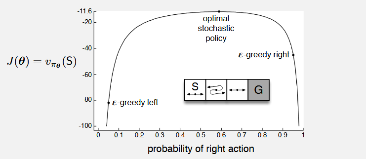
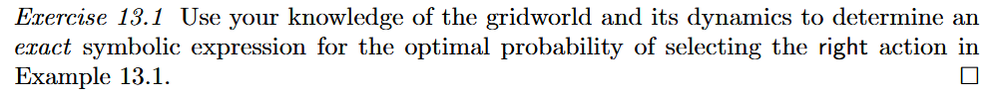
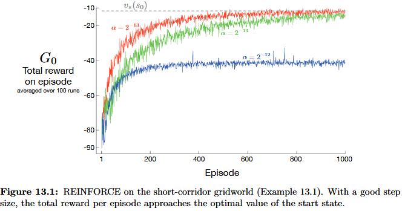
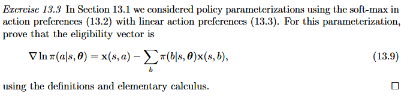
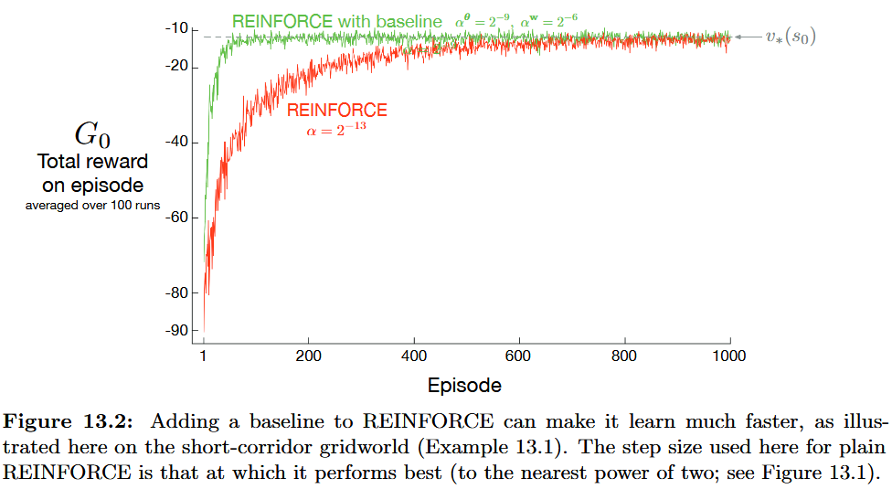
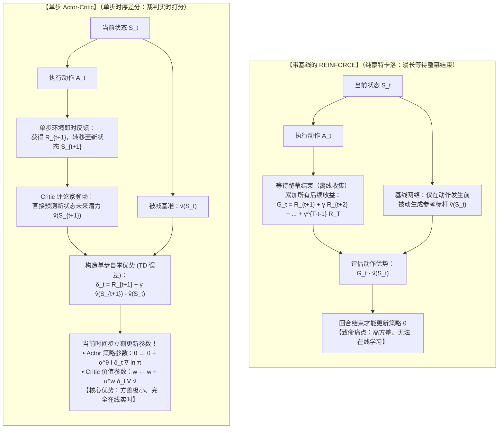

回顾全书前 12 章的内容，几乎所有算法（动态规划、蒙特卡洛、时序差分、Sarsa、Q-learning、DQN 等）在本质上都属于**动作价值方法**：
* 它们的运行逻辑高度依赖价值函数：先学习动作价值 $q(s, a)$，再基于估计出的动作价值通过 $\epsilon$-贪心或贪心机制选取动作；
* **没有动作价值估计，策略甚至无法单独存在**。

从第 13 章开始，一个全新的方法族——**基于策略的方法**：
* **核心转变**：直接对策略进行参数化建模，构造一个**不依赖价值函数即可直接选择动作的参数化策略**；

* **符号系统**：
  
  * 记 $\theta \in \mathbb{R}^{d'}$ 为策略的**参数向量**；参数化策略表示为条件概率分布：
    $$
    \pi(a \mid s, \theta) = \Pr\{A_t = a \mid S_t = s, \theta_t = \theta\}
    $$
    即在时间步 $t$、系统处于状态 $s$ 且策略参数为 $\theta$ 的条件下，智能体选择执行动作 $a$ 的概率；
  
  * 若算法同时学习了价值函数，则价值函数的参数向量仍沿用符号 $w \in \mathbb{R}^d$，记为 $\hat{v}(s, w)$。

1. **动作概率的获取机制**：表格法直接通过索引查表；函数法则输入状态 $s$，通过前向网络计算输出概率向量；
2. **策略的更新机制**：表格法直接修改表中的具体概率值；函数法则必须通过微调底层参数矢量 $\theta$ 间接改变概率；
3. **最优策略的定义方式**：表格法中，最优策略能同时最大化**每一个**状态的价值（$v_{\pi^*}(s) \ge v_\pi(s), \forall s$）；而在参数化函数逼近下，由于参数 $\theta$ 的维度有限，不同状态之间存在强耦合，通常无法使所有状态同时达到局部最大，因此**最优策略退化为最大化某个标量性能度量指标（ $J(\theta)$）**。

---

基于策略的方法将策略寻找问题抽象为关于参数 $\theta$ 的连续优化问题。设 $J(\theta)$ 为量化当前策略整体优劣的标量性能指标，算法的目标是**最大化 $J(\theta)$**。因此，其更新律采用**梯度上升**：

$$
\theta_{t+1} = \theta_t + \alpha \widehat{\nabla J(\theta_t)}
$$
其中：
* $\alpha > 0$ 为学习率；
* $\widehat{\nabla J(\theta_t)} \in \mathbb{R}^{d'}$ 为性能梯度 $\nabla_\theta J(\theta_t)$ 的**随机估计量**，满足在期望意义下逼近真实梯度：$\mathbb{E}\big[\widehat{\nabla J(\theta_t)}\big] \approx \nabla_\theta J(\theta_t)$。

所有遵循该通用更新架构的方法统称为**策略梯度方法**。

**Policy Gradient 与 Actor-Critic 的联系**

* **纯策略梯度方法**：仅维护策略参数 $\theta$，通过完整的轨迹回报直接更新策略；
* **行动器-评论家架构**：若算法在学习策略参数 $\theta$ 的同时，还引入了参数化的价值函数 $\hat{v}(s, w)$：
  * **行动器**：指代学到的参数化策略 $\pi(a|s, \theta)$，负责与环境交互并做出动作决策；
  * **评论家**：指代学到的价值函数 $\hat{v}(s, w)$，负责对行动器采样的动作表现进行客观打分，并辅助调整行动器的参数 $\theta$。

---

标量性能指标 $J(\theta)$ 针对两类不同的任务设定进行了数学形式化：
1. **Episodic Case**：性能指标定义为策略 $\pi_\theta$ 下**起始状态的期望累积价值**，即 $J(\theta) \doteq v_{\pi_\theta}(s_0)$；
2. **Continuing Case**：性能指标定义为策略 $\pi_\theta$ 在平稳分布下的**平均单步奖励率**，即 $J(\theta) \doteq r(\pi) = \sum_s d_{\pi}(s) \sum_a \pi(a|s, \theta) \mathcal{R}_s^a$。

---

# Policy Approximation and its Advantages

> 探讨离散动作空间下最主流的参数化建模方法，Softmax 动作偏好，并论证其相较于传统动作价值方法所具备的四大决定性优势。

---

## 策略参数化与 Softmax 

在策略梯度方法中，对策略的参数化形式并没有严苛的结构限制，但必须满足两个基本前提：
1. **数学可微性**：策略 $\pi(a \mid s, \theta)$ 关于参数向量 $\theta$ 处处可微，即偏导数梯度向量 $\nabla_\theta \pi(a \mid s, \theta)$ 存在且有限；
2. **探索性保障**：在实践中，为了确保智能体拥有持续探索环境的能力，通常要求策略永不退化为绝对的确定性选择，即对任意 $s, a, \theta$ 恒有 $\pi(a \mid s, \theta) \in (0, 1)$。

### 基于动作偏好的 Softmax 策略
对于**离散且规模不大**的动作空间，最通用、最自然的参数化方式是为每个状态-动作对构造一个连续实数标量——**数值动作偏好** $h(s, a, \theta) \in \mathbb{R}$。偏好值越高的动作，被选择的概率越大。动作概率由**指数 Softmax 分布**给出：

$$
\pi(a \mid s, \theta) \doteq \frac{e^{h(s, a, \theta)}}{\sum_{b \in \mathcal{A}(s)} e^{h(s, b, \theta)}}
$$
式中分母保证了该状态下所有可选动作的概率之和严格等于 1。

### 动作偏好函数 $h(s, a, \theta)$ 的参数化结构
动作偏好函数本身的计算结构可以根据任务灵活选型：
* **线性特征参数化**：
  $$
  h(s, a, \theta) = \theta^\top x(s, a)
  $$
  其中 $x(s, a) \in \mathbb{R}^{d'}$ 为人工设计的状态-动作联合特征向量；
* **非线性人工神经网络**：以状态 $s$为输入，输出层节点对应各个动作的偏好数值 $h(s, a)$，网络的所有内部连接权与偏置构成参数向量 $\theta$。

---

## 策略参数化优势

### 连续、平滑地无限逼近确定性策略

这是基于策略的方法在收敛特性上超越传统动作价值方法的重要特质。

* **$\epsilon$-贪心动作价值方法的死穴**： 在基于 $Q(s, a)$ 的 $\epsilon$-贪心方法中，智能体为了维持探索，在任何时刻都必须保留 $\epsilon$ 的概率随机乱选动作。这意味着策略**永远无法蜕变为完全确定性的最优策略**，始终存在由于非理性探索带来的次优抖动；
* **基于 $Q$ 值的 Softmax 分布为何依然失效？** 
  若考虑用动作价值构建 Softmax 分布 $\pi(a|s) \propto e^{Q(s, a) / \tau}$：
  * 当动作价值估计收敛至其真实值时，$Q(s, a_1)$ 与 $Q(s, a_2)$ 之间的差值是一个**固定的有限常数**；
  * 该有限常数代入 Softmax 后，折算出的概率必然是介于 0 和 1 之间的中间值，**依然无法成为确定性策略**；
  * 若引入温度参数 $\tau \to 0$ 进行退火，温度的衰减曲线调度极度依赖先验知识，极易破坏算法稳定性。
* **基于动作偏好 $h(s, a, \theta)$ 的根本解脱**： 动作偏好 $h(s, a, \theta)$ 与 $Q(s, a)$ 存在本质区别——**动作偏好不需要逼近任何特定的物理真值（不代表真实的累积期望回报）** 动作偏好的唯一使命就是驱动产生最优策略。当最优策略是确定性策略时，性能梯度的上升将自发推动最优动作的偏好值无限高于次优动作，从而使最优动作的选择概率自然、平滑地逼近 1，完美实现确定性最优控制。

---

### 能够自然发现并表达最优随机策略

在经典完全可观测的马尔可夫决策过程中，理论上总存在一个确定性的最优策略。然而，**在状态部分可观测、存在显著函数逼近导致状态不可区分、或者在博弈对抗场景中，最优策略本身往往是一个随机策略**

* **典型场景**：在不完全信息博弈中，最优秀的策略必然是“以一定的概率诈唬，以一定的概率放弃”，任何固定的确定性打法都会被对手摸清规律并针对性击溃；
* **动作价值方法的天然无能**：基于动作价值的方法本质上是对所有动作取 $\arg\max$，无法内生性地学出带有精确连续概率分布的最优随机策略；
* **策略参数化的绝对优势**：策略参数化赋予了算法以任意连续概率选择动作的能力，能够自然收敛至任意最优随机分布。

---

#### 经典算例：短走廊反转动作问题

* **环境机制设定**：
  
  * 走廊包含 3 个非终止状态（状态 1 为起点 S，状态 4 为目标 G），每走一步惩罚 $-1$；
  * 可选动作仅有两个：left和right；
  * **动作反转机制**：
    * 状态 1：动作正常（选 left 撞墙原地不动，选 right 进入状态 2）；
    * 状态 3：动作正常（选 left 进入状态 2，选 right 抵达终点 G）；
    * **状态 2**：动作效果相反，选 right 实际上向左退回状态 1，选 left 实际上向右前进至状态 3。
* **函数逼近导致的不可区分性**： 受限于粗糙的函数逼近，智能体无法区分这三个状态。在特征表示下，所有状态看起来完全相同：
  $$
  x(s, \text{right}) = \begin{bmatrix} 1 \\ 0 \end{bmatrix}, \quad x(s, \text{left}) = \begin{bmatrix} 0 \\ 1 \end{bmatrix}, \quad \forall s \in \{1, 2, 3\}
  $$
  意味着**智能体在三个状态下必须采取完全相同的策略！**

1. **基于动作价值的方法的彻底失败**： 
   动作价值方法只能在“大概率选 right”和“大概率选 left”两者之间做决断：
   * 若策略为“主要向右走”（概率 $1 - \epsilon/2$ 选 right）：智能体从状态 1 走到状态 2，但在状态 2 选 right 却被弹回状态 1！智能体陷入状态 1 与 2 之间的死循环振荡，极难抵达状态 3。当 $\epsilon = 0.1$ 时，起始状态价值低达 **$-44$** 以下；
   * 若策略为“主要向左走”：智能体不断向左撞墙，性能更差，起始价值低达 **$-82$** 以下。
2. **策略参数化方法的完胜**： 
   策略梯度方法直接优化向右选择的概率 $p$。分析表明，系统性能指标 $J(\theta) = v_{\pi_\theta}(S_0)$ 随向右概率 $p$ 呈现单峰凹函数曲线：
   * 向右的概率学到约 **$p \approx 0.59$** 时，智能体以最优的随机混合概率在走廊中穿梭，此时取得的最佳性能高达 **$-11.6$**。

---

### 策略函数形态比动作价值函数更简洁

对于许多实际复杂控制任务，动作价值函数 $q(s, a)$ 的形态极其曲折复杂，难以用参数化函数精准拟合；然而，**最优策略本身所遵循的规则可能极其简洁明了**。

* **典型实例（如俄罗斯方块）**： 要精确预测某个复杂砖块堆叠状态下的绝对动作价值（未来还能消除多少行）极其困难；但要判断“当前这块方块应该往左移还是旋转”这一决策逻辑，其决策面边界可能非常清晰平滑；
* **理论收益**：在这种情况下，直接对策略函数进行逼近，往往比迂回学习复杂的动作价值函数学得更快，参数效率更高，且能取得更优的渐进控制性能。

---

### 便于融入领域先验知识

策略参数化的选择为工程人员提供了一种**将关于最优策略形态的先验知识直接注入强化学习系统的最自然通道**：
* 工程师往往预先知道期望的控制律形态（例如机械臂控制中的阻尼运动特征、对称性约束、或是带有确定物理含义的反馈控制器）；
* 在基于策略的方法中，可以直接将策略网络设计为符合这些物理先验的特定函数结构，从而极大地压缩参数搜索空间，加速收敛并提高控制安全性。

## Exercise 13.1

* **策略设定**：受限于状态混淆，智能体在所有三个状态下只能采取相同概率分布的策略：设选择向右的概率为 $p \in (0, 1)$，则选择向左的概率为 $1 - p$；
* **奖励与折扣**：每走一步获得确定性奖励 $r = -1$，任务为分幕式未折扣任务（$\gamma = 1$）。

1. **状态 1（起点 S，动作正常）**：
   * 选 $\text{left}$（概率 $1-p$）：撞左侧墙壁，停留在状态 1；
   * 选 $\text{right}$（概率 $p$）：正常向右移动，转移到状态 2；
2. **状态 2（动作反转）**：
   * 选 $\text{right}$（概率 $p$）：**由于反转，实际向左移动**，退回状态 1；
   * 选 $\text{left}$（概率 $1-p$）：**由于反转，实际向右移动**，前进到状态 3；
3. **状态 3（动作正常）**：
   * 选 $\text{left}$（概率 $1-p$）：正常向左移动，退回状态 2；
   * 选 $\text{right}$（概率 $p$）：正常向右移动，**到达终止状态 G**。

设状态 $s_1, s_2, s_3$ 的真实状态价值分别记为 $v_1, v_2, v_3$。  根据贝尔曼期望方程 $v(s) = \sum_a \pi(a|s) \big[ r + \sum_{s'} p(s'|s, a) v(s') \big]$，列出三元线性方程组：
$$
v_1 = (1 - p)(-1 + v_1) + p(-1 + v_2) = -1 + (1 - p)v_1 + p v_2 \tag{1}
$$

$$
v_2 = p(-1 + v_1) + (1 - p)(-1 + v_3) = -1 + p v_1 + (1 - p) v_3 \tag{2}
$$

$$
v_3 = (1 - p)(-1 + v_2) + p(-1 + 0) = -1 + (1 - p)v_2 \tag{3}
$$

我们的目标是最大化起始状态价值 $v_1$（策略性能度量指标 $J(p) = v(s_1)$）。

$$
\begin{aligned}
v_1(p) &= v_2 - \frac{1}{p} \\
       &= \frac{p - 3}{p(1 - p)} - \frac{1 - p}{p(1 - p)} \\
       &= \frac{(p - 3) - (1 - p)}{p(1 - p)} \\
       &= \frac{2p - 4}{p(1 - p)}
\end{aligned}
$$
为了找到使 $v_1(p)$ 达到最大的最优概率 $p^*$，对 $v_1(p)$ 关于 $p$ 求一阶导数：

$$
\begin{aligned}
\frac{d v_1(p)}{dp} &= \frac{2(p - p^2) - (2p - 4)(1 - 2p)}{[p(1 - p)]^2} \\
&= \frac{(2p - 2p^2) - (2p - 4p^2 - 4 + 8p)}{[p(1 - p)]^2} \\
&= \frac{2p - 2p^2 - 10p + 4p^2 + 4}{[p(1 - p)]^2} \\
&= \frac{2p^2 - 8p + 4}{[p(1 - p)]^2} \\
&= \frac{2(p^2 - 4p + 2)}{[p(1 - p)]^2}
\end{aligned}
$$

令一阶导数等于零 $\frac{d v_1(p)}{dp} = 0$，即分子项为零：
$$
p^2 - 4p + 2 = 0
$$

* $p_1 = 2 + \sqrt{2} \approx 3.414 > 1$（超出概率定义域，舍去）；
* $p_2 = 2 - \sqrt{2} \approx 2 - 1.4142 = 0.5858 \in (0, 1)$（合法根）。

* **最优概率数值**：
  $$
  p^* = 2 - \sqrt{2} \approx 0.585786 \approx \mathbf{0.59}
  $$
  
* **最优状态价值**： 将 $p^* = 2 - \sqrt{2}$ 代入 $v_1(p)$，其精确最大价值为：
  $$
  v_1(p^*) = \frac{2(2 - \sqrt{2}) - 4}{(2 - \sqrt{2})(1 - (2 - \sqrt{2}))} = \frac{-2\sqrt{2}}{(2 - \sqrt{2})(\sqrt{2} - 1)} = -(4 + 4\sqrt{2}) \approx \mathbf{-11.65685} \approx \mathbf{-11.6}
  $$
  

# The Policy Gradient Theorem

## 平滑性与强收敛保证

* **动作价值方法（$\epsilon$-greedy）的非连续突变性**： 在基于动作价值的方法中，动作的选择依赖于对 Q 值取 $\arg\max$。即使动作价值估计仅发生任意微小的扰动，一旦导致两个动作的大小次序发生颠倒，$\epsilon$-贪心策略所输出的动作概率分布就会发生**剧烈跳变**；
* **参数化策略的平滑连续性**：在参数化策略（如 Softmax 偏好模型）中，动作概率 $\pi(a \mid s, \theta)$ 是参数矢量 $\theta$ 的**连续光滑函数**。参数 $\theta$ 的微小变动只会导致动作概率发生平滑渐变；
* **更强的收敛保证**：这种策略对参数的连续光滑依赖性，使得我们可以将性能优化严格建立在微积分基础之上，利用梯度上升法逼近最优解。

---

## 状态分布依赖难题

为了通过梯度上升优化策略参数 $\theta_{t+1} = \theta_t + \alpha \nabla_\theta J(\theta)$，首先必须建立量化策略优劣的标量性能指标 $J(\theta)$。在Episodic Case中，假设每一幕均从某个固定的非随机初始状态 $s_0$ 出发，且设无折扣（$\gamma = 1$），性能指标定义为**初始状态的真实状态价值**：

$$
J(\theta) \doteq v_{\pi_\theta}(s_0)
$$
此时，优化策略面临一个**根本性理论障碍**：

1. **双重影响机制**：系统的性能指标不仅取决于在每个状态下做出的**动作选择**，还取决智能体访问各个状态的**状态分布概率**。而**这两者同时受到策略参数 $\theta$ 影响**：
   $$
   \theta \text{ 发生改变} \implies \begin{cases}
   \text{影响 1：直接改变当前状态下的动作概率 } \pi(a \mid s, \theta) \\[4pt]
   \text{影响 2：连锁改变未来轨迹走向，进而改变状态访问分布 } \mu(s)
   \end{cases}
   $$
2. **环境模型未知的死穴**：  在给定某个状态时，参数 $\theta$ 对动作选择（以及即时奖励）的影响，可以直接通过已知的策略函数求导 $\nabla_\theta \pi(a \mid s, \theta)$ 计算出来；**但是，策略参数 $\theta$ 对状态分布的影响，深度依赖于环境底层的多步状态转移概率矩阵 $P(s' \mid s, a)$**，而Model-free强化学习中，环境动态转移概率是未知的。

> 当性能梯度显式依赖于“策略改变对未知状态分布的影响”时，我们如何在完全不依赖环境转移模型的前提下计算出性能梯度？

---

## 策略梯度定理的表述

策略梯度定理为上述难题提供了一个极其优美的理论答案：**给出了性能梯度 $\nabla_\theta J(\theta)$ 的解析表达式，而该表达式不包含状态分布对参数的导数项 $\nabla_\theta \mu(s)$**

对于任意可微的参数化策略 $\pi(a \mid s, \theta)$，分幕式性能指标 $J(\theta) = v_{\pi_\theta}(s_0)$ 关于参数 $\theta$ 的梯度满足如下正比关系：
$$
\nabla_\theta J(\theta) \propto \sum_{s \in \mathcal{S}} \mu(s) \sum_{a \in \mathcal{A}} q_\pi(s, a) \nabla_\theta \pi(a \mid s, \theta)
$$
式中：
* $\nabla_\theta \pi(a \mid s, \theta)$ 为动作概率关于参数分量的偏导数列向量；
* $q_\pi(s, a)$ 为在策略 $\pi_\theta$ 下的真实动作价值；
* $\mu(s)$ 为策略 $\pi_\theta$ 下的**同策略状态分布（On-policy）**，定义为从起点 $s_0$ 出发在全幕中处于状态 $s$ 的加权时间占比：
  $$
  \mu(s) \doteq \frac{\eta(s)}{\sum_{s'} \eta(s')}, \quad \text{其中 } \eta(s) \doteq \sum_{k=0}^\infty \Pr(s_0 \to s, k, \pi)
  $$
  $\eta(s)$ 表示从 $s_0$ 开始在整幕中访问到状态 $s$ 的期望步数；
* 在分幕任务中，正比符号 $\propto$ 的常数因子恰好为**单幕的平均期望步长** $\sum_{s'} \eta(s')$；在连续不分幕任务中，该常数因子为 1，正比关系严格转为等号。

---

## 第一性原理严格数学证明

**对单状态价值关于参数求导：**由状态价值与动作价值的定义式 $v_\pi(s) = \sum_a \pi(a \mid s) q_\pi(s, a)$，应用微积分乘积法则展开：
$$
\begin{aligned}
\nabla_\theta v_\pi(s) &= \nabla_\theta \left[ \sum_{a \in \mathcal{A}} \pi(a \mid s) q_\pi(s, a) \right] \\
&= \sum_{a \in \mathcal{A}} \left[ \nabla_\theta \pi(a \mid s) q_\pi(s, a) + \pi(a \mid s) \nabla_\theta q_\pi(s, a) \right]
\end{aligned}
$$

**展开动作价值的梯度 $\nabla_\theta q_\pi(s, a)$：**利用贝尔曼单步转移方程展开 $q_\pi(s, a) = \sum_{s', r} p(s', r \mid s, a) [r + v_\pi(s')]$：，即时转移概率 $p(s', r \mid s, a)$ 与奖励 $r$ 属于客观物理环境，**与策略参数 $\theta$ 无关**（即 $\nabla_\theta p = 0, \nabla_\theta r = 0$）。因此求导穿透到内部的未来状态价值项：
$$
\nabla_\theta q_\pi(s, a) = \nabla_\theta \left[ \sum_{s', r} p(s', r \mid s, a)(r + v_\pi(s')) \right] = \sum_{s'} p(s' \mid s, a) \nabla_\theta v_\pi(s') \tag{2}
$$

将式 (2) 代入式 (1)，得到状态价值梯度的单步递推关系：
$$
\nabla_\theta v_\pi(s) = \sum_{a \in \mathcal{A}} \nabla_\theta \pi(a \mid s) q_\pi(s, a) + \sum_{a \in \mathcal{A}} \pi(a \mid s) \sum_{s'} p(s' \mid s, a) \nabla_\theta v_\pi(s') \tag{3}
$$

**前向递归展开：**式 (3) 展现了一个优雅的自相似结构：当前的导数 $\nabla v_\pi(s)$ 依赖于后续所有可能到达的状态的导数 $\nabla v_\pi(s')$。 持续将 $\nabla v_\pi(s')$ 递归展开：
$$
\begin{aligned}
\nabla_\theta v_\pi(s) &= \sum_a \nabla \pi(a \mid s) q_\pi(s, a) + \sum_a \pi(a \mid s) \sum_{s'} p(s' \mid s, a) \left[ \sum_{a'} \nabla \pi(a' \mid s') q_\pi(s', a') + \dots \right] \\
&= \sum_{x \in \mathcal{S}} \sum_{k=0}^\infty \Pr(s \to x, k, \pi) \sum_{a \in \mathcal{A}} \nabla \pi(a \mid x) q_\pi(x, a) 
\end{aligned}
$$
其中 $\Pr(s \to x, k, \pi)$ 表示在策略 $\pi$ 下，从状态 $s$ 经历恰好 $k$ 步后转移至状态 $x$ 的多步转移概率。

将起始状态 $s = s_0$ 代入式 (4)，求取目标性能梯度 $\nabla_\theta J(\theta) = \nabla_\theta v_\pi(s_0)$：
$$
\begin{aligned}
\nabla_\theta J(\theta) &= \sum_{s \in \mathcal{S}} \underbrace{\left( \sum_{k=0}^\infty \Pr(s_0 \to s, k, \pi) \right)}_{\doteq \eta(s)} \sum_{a \in \mathcal{A}} \nabla \pi(a \mid s) q_\pi(s, a) \\
&= \sum_{s \in \mathcal{S}} \eta(s) \sum_{a \in \mathcal{A}} \nabla \pi(a \mid s) q_\pi(s, a)
\end{aligned}
$$
> [!IMPORTANT]
>
> * 定义状态 $s$ 处的**瞬时策略导数项**：
>   $$
>   \phi(s) \doteq \sum_{a \in \mathcal{A}} \nabla_\theta \pi(a \mid s) q_\pi(s, a)
>   $$
>
> * 定义在策略 $\pi$ 下，从状态 $s$ 转移到状态 $s'$ 的**一步马尔可夫转移概率**：
>   $$
>   P_\pi(s \to s') \doteq \sum_{a \in \mathcal{A}} \pi(a \mid s) p(s' \mid s, a) = \Pr(s \to s', 1, \pi)
>   $$
>
> 此时，步骤二得到的单步递推公式可简写为：
> $$
> \nabla v_\pi(s) = \phi(s) + \sum_{s'} P_\pi(s \to s') \nabla v_\pi(s') \tag{*}
> $$
>
> * **第 0 步（当前式子本身）**：
>   $$
>   \nabla v_\pi(s) = \phi(s) + \sum_{s'} P_\pi(s \to s') \nabla v_\pi(s')
>   $$
>
> * **第 1 次代入展开（将后继状态 $s'$ 处的导数 $\nabla v_\pi(s')$ 按公式 (*) 展开）**：
>   $$
>   \begin{aligned}
>   \nabla v_\pi(s) &= \phi(s) + \sum_{s'} P_\pi(s \to s') \left[ \phi(s') + \sum_{s''} P_\pi(s' \to s'') \nabla v_\pi(s'') \right] \\
>   &= \phi(s) + \sum_{s'} P_\pi(s \to s') \phi(s') + \sum_{s'} \sum_{s''} P_\pi(s \to s') P_\pi(s' \to s'') \nabla v_\pi(s'')
>   \end{aligned}
>   $$
>   根据Chapman-Kolmogorov方程，中间状态求和 $\sum_{s'} P_\pi(s \to s') P_\pi(s' \to s'')$ 等于**走两步转移到 $s''$ 的两步转移概率** $\Pr(s \to s'', 2, \pi)$！整理得到：
>   $$
>   \nabla v_\pi(s) = \phi(s) + \sum_{s'} \Pr(s \to s', 1, \pi) \phi(s') + \sum_{s''} \Pr(s \to s'', 2, \pi) \nabla v_\pi(s'')
>   $$
>
> * **第 2 次代入展开（将 $s''$ 处的导数继续展开）**：
>   $$
>   \begin{aligned}
>   \nabla v_\pi(s) = \phi(s) &+ \sum_{s'} \Pr(s \to s', 1, \pi) \phi(s') \\
>   &+ \sum_{s''} \Pr(s \to s'', 2, \pi) \phi(s'') \\
>   &+ \sum_{s'''} \Pr(s \to s''', 3, \pi) \nabla v_\pi(s''')
>   \end{aligned}
>   $$
>
> * **归纳到无穷步展开（$k \to \infty$）**：
>   在分幕式任务中，智能体最终必然进入终止状态（终止状态价值恒为 0，导数为 0），因此当步数 $k \to \infty$ 时，残余项 $\nabla v_\pi(s^{(k)}) \to 0$。  统一用状态哑变量 $x \in \mathcal{S}$ 表示遍历的状态，并注意到第 0 步项 $\phi(s)$ 可以写为 $\sum_x \Pr(s \to x, 0, \pi) \phi(x)$（因为经历 0 步留在原地的概率为 1，去其他状态为 0）：
>   $$
>   \begin{aligned}
>   \nabla v_\pi(s) &= \sum_{k=0}^\infty \sum_{x \in \mathcal{S}} \Pr(s \to x, k, \pi) \phi(x) \\
>   &= \sum_{x \in \mathcal{S}} \sum_{k=0}^\infty \Pr(s \to x, k, \pi) \sum_{a \in \mathcal{A}} \nabla_\theta \pi(a \mid x) q_\pi(x, a)
>   \end{aligned}
>   $$

对常数总步长 $\sum_{s'} \eta(s')$ 进行配凑归一化：
$$
\begin{aligned}
\nabla_\theta J(\theta) &= \left( \sum_{s'} \eta(s') \right) \sum_{s \in \mathcal{S}} \underbrace{\frac{\eta(s)}{\sum_{s'} \eta(s')}}_{\doteq \mu(s)} \sum_{a \in \mathcal{A}} \nabla \pi(a \mid s) q_\pi(s, a) \\
&= \left( \sum_{s'} \eta(s') \right) \sum_{s \in \mathcal{S}} \mu(s) \sum_{a \in \mathcal{A}} \nabla \pi(a \mid s) q_\pi(s, a) \\
&\propto \sum_{s \in \mathcal{S}} \mu(s) \sum_{a \in \mathcal{A}} \nabla \pi(a \mid s) q_\pi(s, a)
\end{aligned}
$$
---

## 策略梯度定理的期望形式与对数

为了利用实际采样数据实现免模型更新，策略梯度定理通常转换为更利于蒙特卡洛采样的**数学期望形式**。利用恒等式 $\nabla \ln x = \frac{\nabla x}{x} \implies \nabla x = x \nabla \ln x$：

$$
\nabla_\theta \pi(a \mid s, \theta) = \pi(a \mid s, \theta) \frac{\nabla_\theta \pi(a \mid s, \theta)}{\pi(a \mid s, \theta)} = \pi(a \mid s, \theta) \nabla_\theta \ln \pi(a \mid s, \theta)
$$
将此项代入定理公式中：
$$
\begin{aligned}
\nabla_\theta J(\theta) &\propto \sum_{s \in \mathcal{S}} \mu(s) \sum_{a \in \mathcal{A}} \pi(a \mid s, \theta) \big[ \nabla_\theta \ln \pi(a \mid s, \theta) q_\pi(s, a) \big] \\
&= \mathbb{E}_{S \sim \mu, A \sim \pi(\cdot \mid S)}\left[ \nabla_\theta \ln \pi(A \mid S, \theta) q_\pi(S, A) \right]
\end{aligned}
$$

1. **摆脱对环境模型的依赖**：公式右侧变成了一个标准形式的双重数学期望 $\mathbb{E}_{S \sim \mu, A \sim \pi}[\cdot]$；
2. **支持纯交互无偏采样更新**：智能体只需要在环境中按照当前策略 $\pi_\theta$ 真实运行交互，收集状态序列 $S_t$ 并采取动作 $A_t$，括号内的瞬时量即可直接作为性能梯度的**无偏估计量**：
   $$
   \widehat{\nabla J(\theta_t)} = \nabla_\theta \ln \pi(A_t \mid S_t, \theta_t) q_\pi(S_t, A_t)
   $$
   **动作价值 $q_\pi(s, a)$ 在定理中的角色**： 在策略梯度的最终表达式中，依然赫然保留着动作价值 $q_\pi(s, a)$。  

* 在定理中，$q_\pi(s, a)$ 充当了**评判该动作好坏的权重因子（Critic 打分）**：如果某个动作的 $q$ 值为正且极大，梯度就会沿着 $\nabla_\theta \ln \pi$ 方向大幅拉高选择该动作的对数概率；
* 在实际算法落地中，若用单幕蒙特卡洛完整回报 $G_t$ 代替 $q_\pi(S_t, A_t)$，即得到 **REINFORCE 算法**；若用参数化价值网络 $\hat{q}(s, a, w)$ 或时序差分优势函数代替，即演进为 **Actor-Critic 架构**。

# REINFORCE: Monte Carlo Policy Gradient

## 从策略梯度定理到可采样的随机梯度上升

分幕式策略梯度定理：
$$
\nabla_\theta J(\theta) \propto \sum_{s \in \mathcal{S}} \mu(s) \sum_{a \in \mathcal{A}} q_\pi(s, a) \nabla_\theta \pi(a \mid s, \theta)
$$
为了利用**随机梯度上升**进行无模型优化，必须构造期望正比于真实梯度的单样本估计量（常数比例因子直接由学习率 $\alpha$ 吸收）。注意到状态求和项的前缀 $\mu(s)$ 对应同策略下的状态访问时间占比分布，因此外层求和可转化为关于随机变量 $S_t \sim \mu$ 的数学期望：

$$
\nabla_\theta J(\theta) \propto \mathbb{E}_\pi \left[ \sum_{a \in \mathcal{A}} q_\pi(S_t, a) \nabla_\theta \pi(a \mid S_t, \theta) \right] \tag{13.6}
$$

> 若直接在此处停步，用采样状态 $S_t$ 代替外层期望，并用学到的价值网络 $\hat{q}(S_t, a, \mathbf{w})$ 替代未知的 $q_\pi$，得到：
> $$
> \theta_{t+1} \doteq \theta_t + \alpha \sum_{a \in \mathcal{A}} \hat{q}(S_t, a, \mathbf{w}) \nabla_\theta \pi(a \mid S_t, \theta) \tag{13.7}
> $$
> 这种方法被称为**全动作方法**。其核心缺陷在于：单步更新必须评估当前状态下的所有候选动作，在动作空间庞大或连续时无法计算。而经典 **REINFORCE 算法**追求的是**仅针对实际采样的单步动作 $A_t$ 进行轻量级更新**。

---

## REINFORCE 核心推导：单样本动作采样

为了将式 (13.6) 内部对所有动作的求和 $\sum_a$ 转化为对实际采样动作 $A_t \sim \pi(\cdot \mid S_t, \theta)$ 的单样本期望：

**重要性配凑（分子分母同乘同除动作概率）**：在式 (13.6) 内部求和项中，每一项缺乏概率加权 $\pi(a \mid S_t, \theta)$。为此，在内部同时乘除该概率：
$$
\begin{aligned}
\nabla_\theta J(\theta) &\propto \mathbb{E}_\pi \left[ \sum_{a \in \mathcal{A}} \pi(a \mid S_t, \theta) \cdot \left( q_\pi(S_t, a) \frac{\nabla_\theta \pi(a \mid S_t, \theta)}{\pi(a \mid S_t, \theta)} \right) \right] \\
&= \mathbb{E}_\pi \left[ q_\pi(S_t, A_t) \frac{\nabla_\theta \pi(A_t \mid S_t, \theta)}{\pi(A_t \mid S_t, \theta)} \right] \quad \big(\text{将 } \sum_a \pi(a) \text{ 折叠为关于 } A_t \sim \pi \text{ 的期望}\big)
\end{aligned}
$$

**蒙特卡洛无偏回报替代：**式中的真实动作价值 $q_\pi(S_t, A_t)$ 依然未知。根据动作价值定义，从该时刻起直到整幕结束的实际累积折扣回报 $G_t \doteq \sum_{k=t+1}^T \gamma^{k-t-1} R_k$ 是动作价值的严格无偏估计：
$$
\mathbb{E}_\pi [G_t \mid S_t, A_t] = q_\pi(S_t, A_t)
$$
根据全期望定律，用单幕实际采样的回报标量 $G_t$ 直接替代 $q_\pi(S_t, A_t)$，期望值依然保持完全无偏。

**似然比对数技巧**：利用对数求导法则 $\nabla \ln x = \frac{\nabla x}{x}$，分式向量可以紧凑表示为对数梯度：
$$
\frac{\nabla_\theta \pi(A_t \mid S_t, \theta)}{\pi(A_t \mid S_t, \theta)} = \nabla_\theta \ln \pi(A_t \mid S_t, \theta)
$$
该向量在统计学中被称为**得分函数**，在强化学习中被称为**资格向量**。由此导出 **REINFORCE 算法的基础参数更新方程**：

$$
\theta_{t+1} \doteq \theta_t + \alpha G_t \nabla_\theta \ln \pi(A_t \mid S_t, \theta_t) \tag{13.8}
$$

---

## 一阶微分与探索平衡机制

为了更透彻地理解式 (13.8) 究竟在参数空间做了什么：

**引入步长缩放因子 $\beta_t$**：将更新式展开回分式形式，并将标量部分归并在一起：
$$
\theta_{t+1} = \theta_t + \alpha \underbrace{\left( \frac{G_t}{\pi(A_t \mid S_t, \theta_t)} \right)}_{\doteq \beta_t} \nabla_\theta \pi(A_t \mid S_t, \theta_t)
$$
此时，算法更新方程呈现出极度工整的几何结构：
$$
\mathbf{\theta_{t+1} = \theta_t + \alpha \beta_t \nabla_\theta \pi(A_t \mid S_t, \theta_t)}
$$
* $\nabla_\theta \pi(A_t \mid S_t, \theta_t)$ 是**方向向量**：指明在参数空间中使当前动作 $A_t$ 概率增长最快的几何方向；
* $\alpha \beta_t$ 是**有效更新步长**：由标量 $\beta_t \doteq \frac{G_t}{\pi(A_t \mid S_t, \theta_t)}$ 动态决定移动距离与正反方向。

### 动作概率是如何被定向改变的？
当学习率 $\alpha$ 足够小时，参数增量 $\theta_{t+1} - \theta_t = \alpha \beta_t \nabla_\theta \pi$ 是一个微小扰动。根据多元微积分的一阶微分：
$$
\begin{aligned}
\pi(A_t \mid S_t, \theta_{t+1}) &\approx \pi(A_t \mid S_t, \theta_t) + \big( \nabla_\theta \pi(A_t \mid S_t, \theta_t) \big)^\top (\theta_{t+1} - \theta_t) \\
&= \pi(A_t \mid S_t, \theta_t) + \big( \nabla_\theta \pi(A_t \mid S_t, \theta_t) \big)^\top \big[ \alpha \beta_t \nabla_\theta \pi(A_t \mid S_t, \theta_t) \big] \\
&= \pi(A_t \mid S_t, \theta_t) + \alpha \beta_t \underbrace{\|\nabla_\theta \pi(A_t \mid S_t, \theta_t)\|_2^2}_{\ge 0 \text{（梯度欧氏范数平方，恒非负）}}
\end{aligned}
$$
由于梯度的内积模长平方 $\|\nabla \pi\|_2^2 \ge 0$ 且 $\alpha > 0$，这一简洁的推导揭示出：**动作选择概率在新策略下的增减，完全由标量 $\beta_t$ 的正负号决定！**

$$
\begin{aligned}
\beta_t > 0 \implies \pi(A_t \mid S_t, \theta_{t+1}) > \pi(A_t \mid S_t, \theta_t) \quad &(\text{该动作在新策略下的概率严格单调上升}) \\
\beta_t < 0 \implies \pi(A_t \mid S_t, \theta_{t+1}) < \pi(A_t \mid S_t, \theta_t) \quad &(\text{该动作在新策略下的概率严格单调下降})
\end{aligned}
$$

展开考察缩放系数的分子与分母：
$$
\beta_t = \frac{G_t}{\pi(A_t \mid S_t, \theta_t)} = \frac{\text{累积回报 (价值估计)}}{\text{当前采样概率}}
$$

* **分子 $G_t$ 驱动“利用”**： 回报 $G_t$ 越高，$\beta_t$ 越大，参数沿梯度方向前进步长越大，使该优质动作在后续被选择的概率大幅提升。算法具备天然利用高价值动作的贪心趋势；
* **分母 $\pi(A_t \mid S_t, \theta_t)$ 驱动“探索”**： 当 $G_t > 0$ 时，动作被选中的先验概率 $\pi$ 越小（即一个极少被选中的冷门动作、探索性动作），分母越小，导致的 **$\beta_t$ 爆发性增大**，这意味着：**如果智能体偶尔尝试了一个低概率的冷门动作，并且发现它获得了正向回报，算法会以极大的步长重奖该动作，迅速拉高其概率！**  反之，如果某个动作已经拥有高达 0.9 的概率，分母会大幅缩减更新幅度，防止因频繁被选而产生盲目自强化。

$$
\begin{array}{l}
\hline
\textbf{Algorithm: } \text{REINFORCE: Monte-Carlo Policy-Gradient Control (Episodic) for } \pi_* \\
\hline
\textbf{Input: } \text{A differentiable policy parameterization } \pi(a \mid s, \theta) \\
\textbf{Algorithm Parameters: } \text{Step size } \alpha > 0, \text{ discount factor } \gamma \in (0, 1] \\
\textbf{Initialize: } \text{Policy parameter vector } \theta \in \mathbb{R}^{d'} \text{ (e.g., to } \mathbf{0}\text{)} \\
\hline
\textbf{Loop forever } \text{(for each episode):} \\
\quad \text{Generate an episode } S_0, A_0, R_1, S_1, A_1, \dots, S_{T-1}, A_{T-1}, R_T \text{ following } \pi(\cdot \mid \cdot, \theta) \\
\quad \textbf{Loop for } \text{each step of the episode } t = 0, 1, \dots, T - 1\textbf{:} \\
\quad\quad \text{// Step 1: Compute empirical discounted return from step } t\text{:} \\
\quad\quad G \leftarrow \sum_{k=t+1}^T \gamma^{k-t-1} R_k \\
\quad\quad \text{// Step 2: Policy parameter update via stochastic gradient ascent:} \\
\quad\quad \theta \leftarrow \theta + \alpha \gamma^t G \nabla_\theta \ln \pi(A_t \mid S_t, \theta) \\
\hline
\end{array}
$$

> 在未折扣设定中（$\gamma = 1$），该项为 1；在通用带折扣任务中（$\gamma < 1$），时间步 $t$ 的即时动作对于以初始时刻 $t=0$ 定义的全局性能指标 $J(\theta) = v_{\pi}(S_0)$ 的梯度贡献需要衰减贴现，因而严格推导会显式引入 $\gamma^t$ 权重。

---

## 算例验证与蒙特卡洛高方差缺陷

短走廊问题中应用 REINFORCE：在不同步长 $\alpha \in \{2^{-12}, 2^{-13}, 2^{-14}\}$ 下，每幕总回报从初期的 $-80$ 快速上升并收敛至理论最优虚线 $v_*(s_0) \approx -11.6$。

* 由于由第一性原理严格推导而来，其单幕更新的期望方向严格与性能梯度的真实方向一致，在充分小步长下保证以概率 1 收敛至局部极值；
* **蒙特卡洛高方差**：回报标量 $G_t = R_{t+1} + \gamma R_{t+2} + \dots + \gamma^{T-t-1} R_T$ 级联累加了从当前时刻直到回合终止的整条轨迹上的**全部环境状态转移随机性与策略动作采样随机性**。导致样本梯度的方差极大，极易造成参数更新剧烈振荡，迫使算法必须使用微小的学习率并依赖海量样本，训练效率极低。

## Exercise 13.3

1. **线性动作偏好函数**： 对于任意状态-动作对 $(s, a)$，其动作偏好值由特征向量 $\mathbf{x}(s, a) \in \mathbb{R}^{d'}$ 与策略参数向量 $\theta \in \mathbb{R}^{d'}$ 的内积给出：
   $$
   h(s, a, \theta) \doteq \theta^\top \mathbf{x}(s, a) = \sum_{i=1}^{d'} \theta_i x_i(s, a)
   $$
   偏好函数关于参数 $\theta$ 的梯度为常数特征向量：
   $$
   \nabla_\theta h(s, a, \theta) = \mathbf{x}(s, a) \tag{1}
   $$
   
2. **指数 Softmax 策略分布**： 动作概率定义为动作偏好的指数归一化分布：
   $$
   \pi(a \mid s, \theta) \doteq \frac{e^{h(s, a, \theta)}}{\sum_{b \in \mathcal{A}(s)} e^{h(s, b, \theta)}} \tag{2}
   $$

---

我们要计算的目标是**资格向量** $\nabla_\theta \ln \pi(a \mid s, \theta)$。

将式 (2) 代入自然对数中，应用对数商法则 $\ln(u / v) = \ln u - \ln v$：
$$
\begin{aligned}
\ln \pi(a \mid s, \theta) &= \ln \left( \frac{e^{h(s, a, \theta)}}{\sum_{b \in \mathcal{A}(s)} e^{h(s, b, \theta)}} \right) \\
&= \ln \big( e^{h(s, a, \theta)} \big) - \ln \left( \sum_{b \in \mathcal{A}(s)} e^{h(s, b, \theta)} \right)
\end{aligned}
$$
$$
\ln \pi(a \mid s, \theta) = h(s, a, \theta) - \ln \left( \sum_{b \in \mathcal{A}(s)} e^{h(s, b, \theta)} \right) \tag{3}
$$

两端应用梯度算子 $\nabla_\theta$：
$$
\nabla_\theta \ln \pi(a \mid s, \theta) = \underbrace{\nabla_\theta h(s, a, \theta)}_{\text{第一项}} - \underbrace{\nabla_\theta \ln \left( \sum_{b \in \mathcal{A}(s)} e^{h(s, b, \theta)} \right)}_{\text{第二项}} \tag{4}
$$

分别展开计算这两项：

* **计算第一项**： 由式 (1)，直接得到：
  $$
  \nabla_\theta h(s, a, \theta) = \mathbf{x}(s, a) \tag{5}
  $$
  
* **计算第二项**： 利用多元复合函数求导链式法则 $\nabla_\theta \ln(u) = \frac{1}{u} \nabla_\theta u$。 设内层函数 $u(\theta) = \sum_{b \in \mathcal{A}(s)} e^{h(s, b, \theta)}$，则：
  $$
  \nabla_\theta \ln \left( \sum_{b \in \mathcal{A}(s)} e^{h(s, b, \theta)} \right) = \frac{1}{\sum_{b \in \mathcal{A}(s)} e^{h(s, b, \theta)}} \cdot \nabla_\theta \left( \sum_{b \in \mathcal{A}(s)} e^{h(s, b, \theta)} \right)
  $$
  由于求和与微分可交换次序，对指数项继续应用链式法则：
  $$
  \begin{aligned}
  \nabla_\theta \left( \sum_{b \in \mathcal{A}(s)} e^{h(s, b, \theta)} \right) &= \sum_{b \in \mathcal{A}(s)} \nabla_\theta \big( e^{h(s, b, \theta)} \big) \\
  &= \sum_{b \in \mathcal{A}(s)} e^{h(s, b, \theta)} \cdot \nabla_\theta h(s, b, \theta) \\
  &= \sum_{b \in \mathcal{A}(s)} e^{h(s, b, \theta)} \mathbf{x}(s, b)
  \end{aligned}
  $$
  将上述结果带回分式中：
  $$
  \nabla_\theta \ln \left( \sum_{b \in \mathcal{A}(s)} e^{h(s, b, \theta)} \right) = \frac{\sum_{b \in \mathcal{A}(s)} e^{h(s, b, \theta)} \mathbf{x}(s, b)}{\sum_{b' \in \mathcal{A}(s)} e^{h(s, b', \theta)}} = \sum_{b \in \mathcal{A}(s)} \underbrace{\left( \frac{e^{h(s, b, \theta)}}{\sum_{b' \in \mathcal{A}(s)} e^{h(s, b', \theta)}} \right)}_{\text{恰好为策略定义 } \pi(b \mid s, \theta)} \mathbf{x}(s, b)
  $$
  根据式 Softmax 概率定义，括号内的分式正是动作 $b$ 的概率 $\pi(b \mid s, \theta)$，故第二项严格等于：
  $$
  \nabla_\theta \ln \left( \sum_{b \in \mathcal{A}(s)} e^{h(s, b, \theta)} \right) = \sum_{b \in \mathcal{A}(s)} \pi(b \mid s, \theta) \mathbf{x}(s, b) \tag{6}
  $$

将式 (5) 与式 (6) 代回式 (4)，即得：
$$
\nabla_\theta \ln \pi(a \mid s, \theta) = \mathbf{x}(s, a) - \sum_{b \in \mathcal{A}(s)} \pi(b \mid s, \theta) \mathbf{x}(s, b)
$$
---

###  物理直觉

该公式在强化学习中拥有极其深刻且优美的直观物理意义：

1. **“实际动作特征”减去“期望平均特征”**：  
   $$
   \nabla_\theta \ln \pi(a \mid s, \theta) = \mathbf{x}(s, a) - \mathbb{E}_{b \sim \pi(\cdot \mid s, \theta)} [\mathbf{x}(s, b)]
   $$
   资格向量本质上是**当前所选动作的特征向量，与其在当前策略下所有可能动作的加权平均特征向量之间的“中心化偏差（残差）”**！
   * 如果当前采样的动作 $a$ 在某些特征维度上高于平均期望，该维度的梯度为正，参数更新将提升该动作出现的概率；
   * 反之，若某个特征维度低于平均期望，梯度为负，参数将被反向调整。

2. **零均值守恒特性**： 对式 (13.9) 在整个动作分布上求期望，结果恒等于 0：
   $$
   \mathbb{E}_{a \sim \pi} \big[ \nabla_\theta \ln \pi(a \mid s, \theta) \big] = \sum_a \pi(a \mid s, \theta) \left( \mathbf{x}(s, a) - \sum_b \pi(b \mid s, \theta) \mathbf{x}(s, b) \right) = \sum_a \pi(a \mid s) \mathbf{x}(s, a) - \sum_b \pi(b \mid s) \mathbf{x}(s, b) = \mathbf{0}
   $$
   是后续第 13.4 节证明**“引入与动作无关的状态基线（Baseline）不会对策略梯度的无偏性产生任何破坏”**的底层数学根源。

# REINFORCE with Baseline

## 消除高方差与引入基线机制

原始 REINFORCE 算法中，参数更新直接由实际采样的全轨迹累积回报 $G_t$ 驱动：
$$
\theta_{t+1} = \theta_t + \alpha G_t \nabla_\theta \ln \pi(A_t \mid S_t, \theta_t)
$$
这种纯蒙特卡洛采样的更新机制面临着严峻的**方差困境**：
* 回报标量 $G_t$ 串联累加了从时间步 $t$ 直至回合终止的整条轨迹上的所有环境转移随机性与动作探索随机性，数值波动极其剧烈；
* **常数偏移带来的更新失真**：设想一个环境的所有奖励均为正数（例如每步 $+100$），即使智能体采取了一个极其平庸甚至较差的动作，该动作算出的累积回报 $G_t$ 依然是一个很大的正数，从而导致算法在该步依然会错误地大幅提升该动作的选择概率；
* 为了消除回报中的绝对基准偏移、平抑样本方差，策略梯度定理被推广为引入一个**与动作无关的状态基线** $b(s)$，将动作价值与该基准线进行对比：
  $$
  \nabla_\theta J(\theta) \propto \sum_{s \in \mathcal{S}} \mu(s) \sum_{a \in \mathcal{A}} \big( q_\pi(s, a) - b(s) \big) \nabla_\theta \pi(a \mid s, \theta) \tag{13.10}
  $$

**只要基线 $b(s)$ 不显式依赖于动作 $a$（它可以是状态 $s$ 的任意复杂函数，甚至可以是一个随机变量），减去 $b(s)$ 后的期望梯度严格等于原始梯度**

考察在状态 $s$ 处，减去项对所有动作求和的代数展开：
$$
\sum_{a \in \mathcal{A}} b(s) \nabla_\theta \pi(a \mid s, \theta) \\
= b(s) \sum_{a \in \mathcal{A}} \nabla_\theta \pi(a \mid s, \theta) \\
 = b(s) \nabla_\theta \left( \sum_{a \in \mathcal{A}} \pi(a \mid s, \theta) \right)
$$
根据概率分布的基本公理，任何状态下所有可选动作的概率之和恒等于 1（$\sum_a \pi(a \mid s, \theta) \equiv 1$），而常数 1 关于参数 $\theta$ 的梯度**严格恒等于零向量**：
$$
b(s) \nabla_\theta (1) = b(s) \cdot \mathbf{0} = \mathbf{0}
$$
因此，在公式 (13.10) 中，减去的项在求和之后恰好是零：
$$
\sum_a \big( q_\pi(s, a) - b(s) \big) \nabla \pi(a \mid s) = \sum_a q_\pi(s, a) \nabla \pi(a \mid s) - \underbrace{\sum_a b(s) \nabla \pi(a \mid s)}_{\equiv \mathbf{0}}
$$
---

## 基线REINFORCE 更新律与优势函数

应用与 13.3 节完全相同的单样本动作采样与似然比对数技巧，导出**带基线的 REINFORCE 参数更新方程**：
$$
\theta_{t+1} \doteq \theta_t + \alpha \big( G_t - b(S_t) \big) \frac{\nabla_\theta \pi(A_t \mid S_t, \theta_t)}{\pi(A_t \mid S_t, \theta_t)} = \theta_t + \alpha \big( G_t - b(S_t) \big) \nabla_\theta \ln \pi(A_t \mid S_t, \theta_t) \tag{13.11}
$$

* **广义包含性**：若令 $b(S_t) \equiv 0$，式 (13.11) 严格退化为无基线的原始 REINFORCE，因此该算法是原始版本的一个严格泛化；
* **从多臂赌博机到 MDP 的基线演进**： 
  在第 2 章 2.8 节的梯度赌博机中，基线只是一个固定标量（所有已见历史奖励的简单数值平均）；但在马尔可夫决策过程中，**基线必须随状态 $S_t$ 发生动态改变**。原因在于不同状态的价值基底截然不同：在某些高价值状态下，所有动作回报都很高，需要设定高基线才能把“优秀动作”从“普通动作”中剥离出来；在濒临惩罚的危险状态下，所有动作都很差，需要设定低基线以识别出“惩罚最小的相对较优动作”；
* **基线的自然最佳选型：状态价值函数 $\hat{v}(S_t, \mathbf{w})$**： 
  既然基线应当反映状态 $S_t$ 下所有动作的普遍收益基准，那么最自然的选择就是**当前策略在该状态下的真实状态价值估计**：
  $$
  b(S_t) \doteq \hat{v}(S_t, \mathbf{w})
  $$
  此时，括号内部的驱动差值转化为：
  $$
  \delta_t \doteq G_t - \hat{v}(S_t, \mathbf{w})
  $$
  这在概念上严格对应于**优势函数**的蒙特卡洛样本实现：$\delta_t$ 衡量的是**“当前采样的动作 $A_t$ 所获得的实际回报，相比于该状态下所有动作的平均预期收益 $\hat{v}(S_t)$，到底高出还是低出了多少”**。

在带基线的 REINFORCE 中，系统需要**联合学习两套模型参数**：
1. **策略网络**：参数为 $\theta \in \mathbb{R}^{d'}$，学习率为 $\alpha^\theta > 0$；
2. **状态价值基线网络**：参数为 $\mathbf{w} \in \mathbb{R}^d$，学习率为 $\alpha^\mathbf{w} > 0$。

既然策略参数通过蒙特卡洛回报进行训练，状态价值基线也自然采用蒙特卡洛均方回归进行同步更新：

$$
\begin{array}{l}
\hline
\textbf{Algorithm: } \text{REINFORCE with Baseline (Episodic) for Estimating } \pi_\theta \approx \pi_* \\
\hline
\textbf{Input: } \text{A differentiable policy parameterization } \pi(a \mid s, \theta) \\
\textbf{Input: } \text{A differentiable state-value parameterization } \hat{v}(s, \mathbf{w}) \\
\textbf{Algorithm Parameters: } \text{Step sizes } \alpha^\theta > 0, \; \alpha^\mathbf{w} > 0, \text{ discount factor } \gamma \in (0, 1] \\
\textbf{Initialize: } \text{Policy parameter } \theta \in \mathbb{R}^{d'} \text{ and state-value weights } \mathbf{w} \in \mathbb{R}^d \text{ (e.g., to } \mathbf{0}\text{)} \\
\hline
\textbf{Loop forever } \text{(for each episode):} \\
\quad \text{Generate an episode } S_0, A_0, R_1, S_1, A_1, \dots, S_{T-1}, A_{T-1}, R_T \text{ following } \pi(\cdot \mid \cdot, \theta) \\
\quad \textbf{Loop for } \text{each step of the episode } t = 0, 1, \dots, T - 1\textbf{:} \\
\quad\quad \text{// Step 1: Compute cumulative discounted return from step } t\text{:} \\
\quad\quad G \leftarrow \sum_{k=t+1}^T \gamma^{k-t-1} R_k \\
\quad\quad \text{// Step 2: Compute advantage error (baseline subtraction):} \\
\quad\quad \delta \leftarrow G - \hat{v}(S_t, \mathbf{w}) \\
\quad\quad \text{// Step 3: Update state-value baseline weights (via semi-gradient MSE):} \\
\quad\quad \mathbf{w} \leftarrow \mathbf{w} + \alpha^\mathbf{w} \delta \nabla_\mathbf{w} \hat{v}(S_t, \mathbf{w}) \\
\quad\quad \text{// Step 4: Update policy parameters (via baseline-subtracted policy gradient):} \\
\quad\quad \theta \leftarrow \theta + \alpha^\theta \gamma^t \delta \nabla_\theta \ln \pi(A_t \mid S_t, \theta) \\
\hline
\end{array}
$$

* **双学习率调节准则**： 价值权重的步长 $\alpha^\mathbf{w}$ 相对容易设定，在线性逼近情况下存在经典的经验准则 $\alpha^\mathbf{w} \approx \frac{0.1}{\mathbb{E}[\|\nabla \hat{v}\|_2^2]}$；策略步长 $\alpha^\theta$ 则通常要求更小，其最佳取值受奖励尺度与策略参数化结构的制约。

教材在短走廊实验（Example 13.1）中直接对比了引入基线前后的收敛速度：
* **实验配置**：状态价值基线仅采用最简陋的单参数常数模型 $\hat{v}(s, \mathbf{w}) = w$；
* **收敛速度的戏剧性飞跃**： 如图 13.2 ，未加基线的普通 REINFORCE（红线）需要经过超过 200 幕的震荡才逐渐逼近最优水平；而**带有基线的 REINFORCE（绿线，$\alpha^\theta = 2^{-9}, \alpha^\mathbf{w} = 2^{-6}$）在约 50 幕以内便近乎垂直地飞速收敛至最优策略 $v_*(s_0) \approx -11.6$**！方差的抑制直接带来了数倍的学习效率飞跃。

REINFORCE with Baseline 标志着算法架构设计上的一个重要转折点：
* 虽然它已经同时维护了“策略网络 $\pi(a|s, \theta)$”与“价值网络 $\hat{v}(s, \mathbf{w})$”，**但它在本质上依然是一个纯粹的蒙特卡洛算法**，还不是严格意义上的 Actor-Critic；
* 其核心局限在于：这里的价值网络 $\hat{v}$ 仅仅充当被动的减法基线，更新仍然依赖整幕结束后的实际回报 $G_t$；
* 如果我们不再等待整幕结束计算 $G_t$，而是直接用学到的价值网络通过**单步时序差分自举**构造优势项 $R_{t+1} + \gamma \hat{v}(S_{t+1}, \mathbf{w}) - \hat{v}(S_t, \mathbf{w})$，算法将发生本质蜕变—— **Actor-Critic**。

# Actor–Critic Methods

## 带基线的 REINFORCE”到“Actor-Critic”的本质

在 13.4 节中，我们已经见到了同时维护策略网络 $\pi(a|s, \theta)$ 与价值网络 $\hat{v}(s, \mathbf{w})$ 的算法。其关键在于价值网络如何介入四元状态转移组 $(S_t, A_t, R_{t+1}, S_{t+1})$。

1. **带基线的 REINFORCE 中，$\hat{v}$ 仅仅评价前序状态**： $\hat{v}(S_t, \mathbf{w})$ 的估计在动作 $A_t$ **发生之前**就做出的，不知道智能体接下来会选什么动作，**无法直接评价动作 $A_t$ 本身是好是坏**；仅仅是一个被动的基准刻度。评估动作到底有多好，算法依然只能等整个 Episode 结束，去收集后面的全部奖励算出 $G_t$。

2. **Actor-Critic 中，$\hat{v}$ 同时评估后序状态**： 智能体采取动作 $A_t$ 转移到 $S_{t+1}$ 后，算法**直接调用价值网络去预测新状态的未来期望潜力 $\hat{v}(S_{t+1}, \mathbf{w})$**！将即时奖励与后序价值贴现相加，便构成了**单步截断回报**：
   $$
   G_{t:t+1} \doteq R_{t+1} + \gamma \hat{v}(S_{t+1}, \mathbf{w})
   $$

## Actor-Critic 更新公式

将 13.4 节带基线更新式中的全轨迹回报 $G_t$，替换为单步截断自举回报 $G_{t:t+1}$：

$$
\begin{aligned}
\theta_{t+1} &\doteq \theta_t + \alpha \big( G_{t:t+1} - \hat{v}(S_t, \mathbf{w}) \big) \frac{\nabla_\theta \pi(A_t \mid S_t, \theta_t)}{\pi(A_t \mid S_t, \theta_t)} \quad &(13.12) \\
&= \theta_t + \alpha \big( R_{t+1} + \gamma \hat{v}(S_{t+1}, \mathbf{w}) - \hat{v}(S_t, \mathbf{w}) \big) \frac{\nabla_\theta \pi(A_t \mid S_t, \theta_t)}{\pi(A_t \mid S_t, \theta_t)} \quad &(13.13)
\end{aligned}
$$

### 优势函数（Advantage Function）与 TD 误差的等价性

请仔细观察括号内部的项：
$$
\delta_t \doteq R_{t+1} + \gamma \hat{v}(S_{t+1}, \mathbf{w}) - \hat{v}(S_t, \mathbf{w})
$$
理论上，评估一个动作比平均水平好多少的真理指标是**优势函数**：
$$
A_\pi(s, a) \doteq q_\pi(s, a) - v_\pi(s)
$$
对条件期望展开：
$$
\begin{aligned}
\mathbb{E} [ \delta_t \mid S_t = s, A_t = a ] &= \mathbb{E} [ R_{t+1} + \gamma v_\pi(S_{t+1}) - v_\pi(S_t) \mid S_t = s, A_t = a ] \\
&= \underbrace{\mathbb{E} [ R_{t+1} + \gamma v_\pi(S_{t+1}) \mid S_t = s, A_t = a ]}_{根据贝尔曼方程，严格等于动作价值 q_\pi(s, a)} - v_\pi(s) \\
&= q_\pi(s, a) - v_\pi(s) \\
&\equiv A_\pi(s, a)
\end{aligned}
$$
**结论**：单步 TD 误差 $\delta_t$ 在数学期望上**严格等于真实的优势函数 $A_\pi(s, a)$**，因此，Actor-Critic 在文献中又被广泛称为 **Advantage Actor-Critic（A2C）**。将 $\delta_t$ 与对数导数技巧代入，公式简化为优雅的最终形式：
$$
\theta_{t+1} = \theta_t + \alpha \delta_t \nabla_\theta \ln \pi(A_t \mid S_t, \theta_t) \quad (13.14)
$$

---

## 微分分析与探索利用平衡

将更新式改写为带有缩放系数的形式：
$$
\theta_{t+1} = \theta_t + \alpha \underbrace{\left( \frac{\delta_t(S_t, A_t)}{\pi(A_t \mid S_t, \theta_t)} \right)}_{\beta_t} \nabla_\theta \pi(A_t \mid S_t, \theta_t)
$$
利用一阶泰勒展开，动作概率在更新后的改变量为：
$$
\pi(A_t \mid S_t, \theta_{t+1}) - \pi(A_t \mid S_t, \theta_t) \approx \alpha \beta_t \| \nabla_\theta \pi(A_t \mid S_t, \theta_t) \|_2^2
$$
由于学习率 $\alpha > 0$ 且梯度的模平方恒非负，**动作概率是增加还是减少，完全由 $\beta_t$ 的正负号决定**：

| 条件情形                            | 物理含义                                                     | 算法自适应调整行为                                           |
| :---------------------------------- | :----------------------------------------------------------- | :----------------------------------------------------------- |
| **$\delta_t > 0$**                  | 动作带来的实际单步收益与后续状态估值高于当前基准：$R_{t+1} + \gamma \hat{v}(S_{t+1}) > \hat{v}(S_t)$ | $\beta_t > 0$ $\implies$ **大幅提高**未来在状态 $S_t$ 下选择该动作的概率 $\pi(A_t \mid S_t)$ |
| **$\delta_t < 0$**                  | 动作导致后续陷入更差的境地：$R_{t+1} + \gamma \hat{v}(S_{t+1}) < \hat{v}(S_t)$ | $\beta_t < 0$ $\implies$ **果断降低**未来选择该动作的概率 $\pi(A_t \mid S_t)$ |
| **分母 $\pi(A_t \mid S_t)$ 的调节** | 若某个好动作原本选择的概率很低                               | 分母极小使得 $\beta_t$ 很大 $\implies$ **强力提升冷门好动作的权重，自适应激励智能体积极探索** |

1. **方差的毁灭性暴跌**：  
   
   * REINFORCE 的 $G_t$ 累加了从时间步 $t$ 一直到游戏通关或失败的全部随机性，随着步数增加，轨迹方差指数级爆炸；
   * One-step Actor-Critic 仅包含**单次状态转移的一步转移随机性**与后序状态预测值 $\hat{v}(S_{t+1})$。方差被极度压缩，算法参数更新极其平稳。
   
2. **偏差的引入**： 
   
   > *"Note that the bias in the gradient estimate is not due to bootstrapping as such; the actor would be biased even if the critic was learned by a Monte Carlo method."* 
   > （请注意：梯度估计中的偏差并非本质上由于自举本身所致；哪怕 Critic 价值网络是用纯蒙特卡洛方法学出来的，Actor 的更新依然带有偏差。）

   **深度剖析这一论断的深层机理**：
   * **自举偏差**：用未成熟的猜测更新猜测，会带来初始阶段的系统性估计误差；
   * **函数逼近表达能力偏差**：这才是最根本的偏差来源！在连续或高维状态空间中，由于特征参数有限，价值网络 $\hat{v}(s, \mathbf{w})$ 几乎不可能在所有状态上都 $100\%$ 精确吻合真实价值 $v_\pi(s)$。只要网络存在逼近误差，我们拿 $\hat{v}(S_t, \mathbf{w})$ 去代换真实的 $v_\pi(S_t)$，梯度公式就不可避免地带有微小偏差。现代深度强化学习实践证明，函数逼近带来的微小偏差是完全可控的，而消除蒙特卡洛高方差所带来的数倍学习提速，具有压倒性的工程价值！

---

算法是**完全在线、按步增量式**的，智能体每迈出一步，就实时处理并丢弃当前的转移样本，无需回溯存储整条轨迹。

$$
\begin{array}{l}
\hline
\textbf{Algorithm: } \text{One-step Actor–Critic (Episodic) for Estimating } \pi_\theta \approx \pi_* \\
\hline
\textbf{Input: } \text{A differentiable policy parameterization } \pi(a \mid s, \theta) \\
\textbf{Input: } \text{A differentiable state-value function parameterization } \hat{v}(s, \mathbf{w}) \\
\textbf{Algorithm Parameters: } \text{Step sizes } \alpha^\theta > 0, \; \alpha^\mathbf{w} > 0, \text{ discount factor } \gamma \in (0, 1] \\
\textbf{Initialize: } \text{Policy parameter } \theta \in \mathbb{R}^{d'} \text{ and state-value weights } \mathbf{w} \in \mathbb{R}^d \text{ (e.g., to } \mathbf{0}\text{)} \\
\hline
\textbf{Loop forever } \text{(for each episode):} \\
\quad \text{Initialize } S \text{ (first state of episode)} \\
\quad I \leftarrow 1 \quad \text{// Initialize discount weighting factor } I = \gamma^0 = 1 \\
\quad \textbf{Loop while } S \text{ is not terminal (for each time step):} \\
\quad\quad \text{// Step 1: Actor samples an action from current policy:} \\
\quad\quad A \sim \pi(\cdot \mid S, \theta) \\
\quad\quad \text{// Step 2: Execute action, observe reward and next state:} \\
\quad\quad \text{Take action } A, \text{ observe } S', R \\
\quad\quad \text{// Step 3: Critic evaluates the transition via one-step TD error:} \\
\quad\quad \delta \leftarrow R + \gamma \hat{v}(S', \mathbf{w}) - \hat{v}(S, \mathbf{w}) \quad (\text{if } S' \text{ is terminal, then } \hat{v}(S', \mathbf{w}) \doteq 0) \\
\quad\quad \text{// Step 4: Critic parameter update (semi-gradient TD(0) value learning):} \\
\quad\quad \mathbf{w} \leftarrow \mathbf{w} + \alpha^\mathbf{w} \delta \nabla_\mathbf{w} \hat{v}(S, \mathbf{w}) \\
\quad\quad \text{// Step 5: Actor parameter update (advantage policy gradient with discount weighting):} \\
\quad\quad \theta \leftarrow \theta + \alpha^\theta I \delta \nabla_\theta \ln \pi(A \mid S, \theta) \\
\quad\quad \text{// Step 6: Decay discount weighting factor and transition state:} \\
\quad\quad I \leftarrow \gamma I \quad \text{// Maintains } I = \gamma^t \text{ incrementally} \\
\quad\quad S \leftarrow S' \\
\hline
\end{array}
$$

# Policy Gradient for Continuing Problems

在真实工业控制、恒温调节、网络路由或金融持续做市等场景中，系统**永不终止（$T \to \infty$）**。此时面临两难困境：
1. **若不加折扣（$\gamma = 1$）**：无穷步累加的期望总回报 $\sum_{t=1}^\infty R_t$ 会发散至无穷大，无法用于策略间的优劣比较；
2. **若引入折扣（$\gamma < 1$）**：虽然总和收敛，但由于持续性任务没有天然的起始时刻，智能体的终极表现会极度依赖于人为规定的那个“初始状态 $S_0$”。当时间运行到非常久之后（如 $t = 10000$），$\gamma^t \approx 0$，导致算法在后期几乎丧失学习动力。

因此，在持续性任务中，最合理、最具物理意义的目标是**最大化每个时间步的平均奖励产出率**

---

## 平均奖励率与差分回报

### 性能度量指标：平均奖励率 $r(\pi)$（ $\bar{r}_\pi$）
定义性能度量函数 $J(\theta)$ 为长期的单步平均期望奖励：

$$
\begin{aligned}
J(\theta) \doteq r(\pi) 
&\doteq \lim_{h \to \infty} \frac{1}{h} \sum_{t=1}^h \mathbb{E} \big[ R_t \;\big|\; S_0, A_{0:t-1} \sim \pi \big] \\[6pt]
&= \lim_{t \to \infty} \mathbb{E} \big[ R_t \;\big|\; S_0, A_{0:t-1} \sim \pi \big] \\[6pt]
&= \sum_{s \in \mathcal{S}} \mu(s) \sum_{a \in \mathcal{A}} \pi(a \mid s, \theta) \sum_{s', r} p(s', r \mid s, a) r \quad (13.15)
\end{aligned}
$$

其中：
* $\mu(s)$ 为策略 $\pi$ 下的**平稳稳态分布**（ $d_\pi(s)$），定义为在无穷时间步后访问到状态 $s$ 的极限概率：
  $$
  \mu(s) \doteq \lim_{t \to \infty} \Pr\{S_t = s \mid A_{0:t} \sim \pi\}
  $$
* **遍历性假设**：假定马尔可夫决策过程是各态历经的，即无论智能体从哪一个初始状态 $S_0$ 出发，长期运行后都会收敛到同一个与 $S_0$ 无关的唯一稳态分布 $\mu$；
* **平稳分布的不变性方程**：如果状态当前服从分布 $\mu$，按照策略 $\pi$ 采取动作并发生状态转移后，下一个状态的分布仍然是 $\mu$：
  $$
  \sum_{s \in \mathcal{S}} \mu(s) \sum_{a \in \mathcal{A}} \pi(a \mid s, \theta) p(s' \mid s, a) = \mu(s'), \quad \forall s' \in \mathcal{S} \quad \tag{13.16}
  $$

---

### 价值函数的重塑：差分回报
在没有折扣因子持续性任务中（$\gamma = 1$），为了避免累加回报发散，不再累加原始奖励 $R_t$，而是累加**即时奖励超出平均奖励的“相对差额”**。这被称为**差分回报**：
$$
G_t \doteq \big( R_{t+1} - r(\pi) \big) + \big( R_{t+2} - r(\pi) \big) + \big( R_{t+3} - r(\pi) \big) + \dots \quad \tag{13.17}
$$
基于差分回报，状态价值函数与动作价值函数被严格重塑为：
$$
v_\pi(s) \doteq \mathbb{E}_\pi [G_t \mid S_t = s], \quad q_\pi(s, a) \doteq \mathbb{E}_\pi [G_t \mid S_t = s, A_t = a]
$$
其满足持续性问题的**贝尔曼期望方程**：
$$
q_\pi(s, a) = \sum_{s', r} p(s', r \mid s, a) \Big[ r - r(\pi) + v_\pi(s') \Big]
$$

> $v_\pi(s)$ 表示从状态 $s$ 出发，相比于整个环境的基准平均水平，在未来能够额外多获得（或少获得）的累积超额收益。

---

## 持续性策略梯度定理证明

在持续性设定下，策略梯度定理依然保持完全相同的形式：
$$
\nabla_\theta J(\theta) = \sum_{s \in \mathcal{S}} \mu(s) \sum_{a \in \mathcal{A}} \nabla_\theta \pi(a \mid s, \theta) q_\pi(s, a)
$$
根据全期望展开 $v_\pi(s) = \sum_a \pi(a \mid s) q_\pi(s, a)$，运用导数的乘积法则：
$$
\begin{aligned}
\nabla_\theta v_\pi(s) 
&= \nabla_\theta \left[ \sum_{a \in \mathcal{A}} \pi(a \mid s) q_\pi(s, a) \right] \\
&= \sum_{a \in \mathcal{A}} \Big[ \nabla_\theta \pi(a \mid s) q_\pi(s, a) + \pi(a \mid s) \nabla_\theta q_\pi(s, a) \Big] 
\end{aligned} \tag{1}
$$

将持续性贝尔曼方程代入：
$$
\begin{aligned}
\nabla_\theta q_\pi(s, a) 
&= \nabla_\theta \left( \sum_{s', r} p(s', r \mid s, a) \big[ r - r(\theta) + v_\pi(s') \big] \right)
\end{aligned}
$$
由于环境状态转移概率 $p(s', r \mid s, a)$ 与奖励 $r$ 均不依赖于策略参数 $\theta$，梯度算子可穿透到括号内部：
$$
\begin{aligned}
\nabla_\theta q_\pi(s, a)
&= \sum_{s', r} p(s', r \mid s, a) \Big[ -\nabla_\theta r(\theta) + \nabla_\theta v_\pi(s') \Big] \\
&= -\nabla_\theta r(\theta) \underbrace{\sum_{s', r} p(s', r \mid s, a)}_{= 1} + \sum_{s'} p(s' \mid s, a) \nabla_\theta v_\pi(s') \\
&= -\nabla_\theta r(\theta) + \sum_{s'} p(s' \mid s, a) \nabla_\theta v_\pi(s') 
\end{aligned} \tag{2}
$$

将式 (2) 代入式 (1) 中：
$$
\begin{aligned}
\nabla_\theta v_\pi(s) 
&= \sum_{a \in \mathcal{A}} \left[ \nabla_\theta \pi(a \mid s) q_\pi(s, a) + \pi(a \mid s) \left( -\nabla_\theta r(\theta) + \sum_{s'} p(s' \mid s, a) \nabla_\theta v_\pi(s') \right) \right] \\
&= \sum_{a \in \mathcal{A}} \nabla_\theta \pi(a \mid s) q_\pi(s, a) - \nabla_\theta r(\theta) \underbrace{\sum_{a \in \mathcal{A}} \pi(a \mid s)}_{= 1} + \sum_{a \in \mathcal{A}} \pi(a \mid s) \sum_{s'} p(s' \mid s, a) \nabla_\theta v_\pi(s') \\
&= \sum_{a \in \mathcal{A}} \nabla_\theta \pi(a \mid s) q_\pi(s, a) - \nabla_\theta r(\theta) + \sum_{a \in \mathcal{A}} \pi(a \mid s) \sum_{s'} p(s' \mid s, a) \nabla_\theta v_\pi(s')
\end{aligned}
$$

移项解出性能指标梯度 $\nabla_\theta r(\theta)$：
$$
\nabla_\theta r(\theta) = \sum_{a \in \mathcal{A}} \left[ \nabla_\theta \pi(a \mid s) q_\pi(s, a) + \pi(a \mid s) \sum_{s'} p(s' \mid s, a) \nabla_\theta v_\pi(s') \right] - \nabla_\theta v_\pi(s) \tag{3}
$$
**左端 $\nabla_\theta r(\theta) \equiv \nabla_\theta J(\theta)$ 是一个标量指标的梯度，与具体的初始状态 $s$ 没有任何关系！**因此，右端的取值对任意状态 $s$ 也恒为定值。我们在两端同时乘以平稳分布概率 $\mu(s)$ 并对所有状态 $s \in \mathcal{S}$ 求和（由于 $\sum_s \mu(s) = 1$，加权求和不会改变左端的值）：
$$
\begin{aligned}
\nabla_\theta J(\theta) 
&= \sum_{s \in \mathcal{S}} \mu(s) \left( \sum_{a \in \mathcal{A}} \left[ \nabla_\theta \pi(a \mid s) q_\pi(s, a) + \pi(a \mid s) \sum_{s'} p(s' \mid s, a) \nabla_\theta v_\pi(s') \right] - \nabla_\theta v_\pi(s) \right) \\
&= \sum_{s \in \mathcal{S}} \mu(s) \sum_{a \in \mathcal{A}} \nabla_\theta \pi(a \mid s) q_\pi(s, a) \\
&\quad + \sum_{s \in \mathcal{S}} \mu(s) \sum_{a \in \mathcal{A}} \pi(a \mid s) \sum_{s'} p(s' \mid s, a) \nabla_\theta v_\pi(s') - \sum_{s \in \mathcal{S}} \mu(s) \nabla_\theta v_\pi(s) 
\end{aligned} \tag{4}
$$

仔细观察式 (4) 中的第二项：交换关于 $s$ 和 $s'$ 的求和次序：
$$
\sum_{s \in \mathcal{S}} \mu(s) \sum_{a \in \mathcal{A}} \pi(a \mid s) \sum_{s'} p(s' \mid s, a) \nabla_\theta v_\pi(s') = \sum_{s'} \underbrace{\left[ \sum_{s \in \mathcal{S}} \mu(s) \sum_{a \in \mathcal{A}} \pi(a \mid s) p(s' \mid s, a) \right]}_{\text{根据平稳分布不变性定义 (13.16)，恰好等于 } \mu(s')} \nabla_\theta v_\pi(s')
$$
因此，第二项严格化简为：
$$
\sum_{s'} \mu(s') \nabla_\theta v_\pi(s')
$$
将其与式 (4) 中的第三项 $-\sum_{s} \mu(s) \nabla_\theta v_\pi(s)$ 相减： 由于 $s'$ 和 $s$ 只是遍历集合 $\mathcal{S}$ 的哑变量符号，这两项完全相同，**互相抵消为 0**.
$$
\sum_{s'} \mu(s') \nabla_\theta v_\pi(s') - \sum_{s} \mu(s) \nabla_\theta v_\pi(s) \equiv \mathbf{0}
$$

最终得到：
$$
\nabla_\theta J(\theta) = \sum_{s \in \mathcal{S}} \mu(s) \sum_{a \in \mathcal{A}} \nabla_\theta \pi(a \mid s, \theta) q_\pi(s, a) \quad
$$

> 因为在持续性任务中，样本状态分布严格天然符合平稳分布 $\mu(s)$，不仅没有任何近似截断，而且**彻底摆脱了初始状态 $S_0$ 和折扣因子衰减项 $\gamma^t$ 的纠缠**！

---

## 单步持续性 Actor–Critic 算法推导

算法在每一步同时维护并更新三个量：
1. **平均奖励率估计标量 $\bar{R}$**：动态维护真实平均产出率 $r(\pi)$ 的移动平均估计：
   $$
   \bar{R} \leftarrow \bar{R} + \alpha^R \delta
   $$
2. **持续性差分 TD 误差（评论家打分）**：
   $$
   \delta \leftarrow R - \bar{R} + \hat{v}(S', \mathbf{w}) - \hat{v}(S, \mathbf{w})
   $$

   * 对比分幕式：这里用即时奖励偏离均值的超额收益 $R - \bar{R}$ 替换了分幕式的 $R$，并且**没有折扣因子 $\gamma$（相当于 $\gamma = 1$）**！
3. **评论家权重更新**：

$$
\mathbf{w} \leftarrow \mathbf{w} + \alpha^\mathbf{w} \delta \nabla_\mathbf{w} \hat{v}(S, \mathbf{w})
$$

1. **行动器策略更新**：
   $$
   \theta \leftarrow \theta + \alpha^\theta \delta \nabla_\theta \ln \pi(A \mid S, \theta)
   $$
   

   * **这里没有任何折扣权重因子 $I = \gamma^t$** 每一个时间步的更新地位是完全平等平稳的。

$$
\begin{array}{l}
\hline
\textbf{Algorithm: } \text{One-step Actor–Critic (Continuing) for Estimating } \pi_\theta \approx \pi_* \\
\hline
\textbf{Input: } \text{A differentiable policy parameterization } \pi(a \mid s, \theta) \\
\textbf{Input: } \text{A differentiable state-value function parameterization } \hat{v}(s, \mathbf{w}) \\
\textbf{Algorithm Parameters: } \text{Step sizes } \alpha^\theta > 0, \; \alpha^\mathbf{w} > 0, \; \alpha^R > 0 \\
\textbf{Initialize: } \text{Average reward estimate } \bar{R} \in \mathbb{R} \text{ (e.g., to } 0\text{)} \\
\textbf{Initialize: } \text{Policy parameter } \theta \in \mathbb{R}^{d'} \text{ and state-value weights } \mathbf{w} \in \mathbb{R}^d \text{ (e.g., to } \mathbf{0}\text{)} \\
\textbf{Initialize: } \text{Initial state } S \in \mathcal{S} \text{ (e.g., to } s_0\text{)} \\
\hline
\textbf{Loop forever } \text{(for each time step):} \\
\quad \text{// Step 1: Actor samples an action from current stochastic policy:} \\
\quad A \sim \pi(\cdot \mid S, \theta) \\
\quad \text{// Step 2: Execute action, observe immediate reward and next state:} \\
\quad \text{Take action } A, \text{ observe } S', R \\
\quad \text{// Step 3: Critic computes the differential one-step TD error:} \\
\quad \delta \leftarrow R - \bar{R} + \hat{v}(S', \mathbf{w}) - \hat{v}(S, \mathbf{w}) \\
\quad \text{// Step 4: Update average reward estimate (tracking global performance):} \\
\quad \bar{R} \leftarrow \bar{R} + \alpha^R \delta \\
\quad \text{// Step 5: Critic parameter update (semi-gradient TD(0) for differential value):} \\
\quad \mathbf{w} \leftarrow \mathbf{w} + \alpha^\mathbf{w} \delta \nabla_\mathbf{w} \hat{v}(S, \mathbf{w}) \\
\quad \text{// Step 6: Actor parameter update (policy gradient via differential TD error):} \\
\quad \theta \leftarrow \theta + \alpha^\theta \delta \nabla_\theta \ln \pi(A \mid S, \theta) \\
\quad \text{// Step 7: Transition to next state:} \\
\quad S \leftarrow S' \\
\hline
\end{array}
$$

# Policy Parameterization for Continuous Actions

## 从概率质量到概率密度

在 13.1 节介绍的离散动作 Softmax 策略中，智能体维护的是一个**概率质量函数**：
$$
\pi(a \mid s, \theta) = \frac{e^{h(s, a, \theta)}}{\sum_{b \in \mathcal{A}} e^{h(s, b, \theta)}}
$$
在机器人关节力矩控制、自动驾驶方向盘转角、无人机推力矢量或连续油门等物理控制任务中，动作空间是**连续实数空间（$\mathcal{A} \subseteq \mathbb{R}$ 或 $\mathbb{R}^k$）**：
* 连续区间内的可能动作数量是**不可数无穷大**的；
* 我们无法对无穷多个动作逐一计算打分并求和归一化（分母求和 $\sum_{b \in \mathcal{A}}$ 直接发散或无法遍历）；
* 若对连续空间进行粗暴网格离散化，动作维度稍高就会引发致命的“维度灾难”。

策略梯度方法面对连续动作拥有无可比拟的理论优势：**不学习每一个单独动作的离散概率，而是学习连续概率密度函数的统计特征参数**。 

---

## 高斯策略分布

高斯分布的概率密度函数标准定义为：
$$
p(x) \doteq \frac{1}{\sigma \sqrt{2\pi}} \exp \left( - \frac{(x - \mu)^2}{2\sigma^2} \right)
$$
将连续实数动作 $a \in \mathbb{R}$ 建模为服从以状态 $s$ 为条件的高斯分布：
$$
\pi(a \mid s, \theta) \doteq \frac{1}{\sigma(s, \theta) \sqrt{2\pi}} \exp \left( - \frac{\big(a - \mu(s, \theta)\big)^2}{2\sigma(s, \theta)^2} \right) \quad \tag{13.19}
$$
其中均值网络 $\mu$ 与方差网络 $\sigma$ 是两个由策略参数 $\theta$ 决定的函数逼近器：

* **均值函数** $\mu: \mathcal{S} \times \mathbb{R}^{d'} \to \mathbb{R}$：输出在当前状态下最推荐执行的**中心基准动作**；
* **标准差函数** $\sigma: \mathcal{S} \times \mathbb{R}^{d'} \to \mathbb{R}^+$：输出在当前状态下的**动作探索扩散范围**。

为了清晰控制均值与方差的学习，通常将策略参数向量解耦为两组独立的参数 $\theta \doteq [\theta_\mu^\top, \theta_\sigma^\top]^\top$：

1. **均值模型（线性特征逼近）**：均值可以在全实数范围 $(-\infty, +\infty)$ 内取值。
   $$
   \mu(s, \theta) \doteq \theta_\mu^\top \mathbf{x}_\mu(s)
   $$
   **标准差模型（指数线性特征逼近）**：
   $$
   \sigma(s, \theta) \doteq \exp \big( \theta_\sigma^\top \mathbf{x}_\sigma(s) \big)
   $$

---

## 高斯策略资格向量

为了将高斯策略代入 REINFORCE 或 Actor–Critic 算法中，必须求出其对数导数（资格向量）$\nabla_\theta \ln \pi(a \mid s, \theta)$。对式 (13.19) 两端取对数，展开乘积与幂次：

$$
\begin{aligned}
\ln \pi(a \mid s, \theta) 
&= \ln \left[ \frac{1}{\sigma(s, \theta) \sqrt{2\pi}} \exp \left( - \frac{(a - \mu(s, \theta))^2}{2\sigma(s, \theta)^2} \right) \right] \\[6pt]
&= \ln \left( \frac{1}{\sigma(s, \theta)} \right) + \ln \left( \frac{1}{\sqrt{2\pi}} \right) + \ln \left[ \exp \left( - \frac{(a - \mu(s, \theta))^2}{2\sigma(s, \theta)^2} \right) \right] \\[6pt]
&= -\ln \sigma(s, \theta) - \frac{1}{2} \ln(2\pi) - \frac{(a - \mu(s, \theta))^2}{2\sigma(s, \theta)^2}
\end{aligned}
$$
代入 $\ln \sigma(s, \theta) = \theta_\sigma^\top \mathbf{x}_\sigma(s)$，得到紧凑形式：
$$
\ln \pi(a \mid s, \theta) = -\theta_\sigma^\top \mathbf{x}_\sigma(s) - \frac{1}{2} \ln(2\pi) - \frac{(a - \mu(s, \theta))^2}{2} \exp\big( -2 \theta_\sigma^\top \mathbf{x}_\sigma(s) \big)
$$

---

利用多元微积分链式法则，注意到只有第三项含有 $\mu(s, \theta) = \theta_\mu^\top \mathbf{x}_\mu(s)$：
$$
\begin{aligned}
\nabla_{\theta_\mu} \ln \pi(a \mid s, \theta) 
&= \frac{\partial \ln \pi(a \mid s, \theta)}{\partial \mu(s, \theta)} \cdot \nabla_{\theta_\mu} \mu(s, \theta) \\[6pt]
&= \left( -\frac{1}{2\sigma(s, \theta)^2} \cdot 2 \big(a - \mu(s, \theta)\big) \cdot (-1) \right) \cdot \mathbf{x}_\mu(s) \\[6pt]
&= \frac{a - \mu(s, \theta)}{\sigma(s, \theta)^2} \mathbf{x}_\mu(s)
\end{aligned}
$$

---

对 $\theta_\sigma$ 求导（第一项和第三项均依赖 $\theta_\sigma$）：
$$
\begin{aligned}
\nabla_{\theta_\sigma} \ln \pi(a \mid s, \theta) 
&= \nabla_{\theta_\sigma} \big[ -\theta_\sigma^\top \mathbf{x}_\sigma(s) \big] - \nabla_{\theta_\sigma} \left[ \frac{(a - \mu(s, \theta))^2}{2} \exp\big( -2 \theta_\sigma^\top \mathbf{x}_\sigma(s) \big) \right] \\[6pt]
&= -\mathbf{x}_\sigma(s) - \frac{(a - \mu(s, \theta))^2}{2} \cdot \exp\big( -2 \theta_\sigma^\top \mathbf{x}_\sigma(s) \big) \cdot \big( -2 \mathbf{x}_\sigma(s) \big) \\[6pt]
&= -\mathbf{x}_\sigma(s) + \frac{(a - \mu(s, \theta))^2}{\sigma(s, \theta)^2} \mathbf{x}_\sigma(s) \\[6pt]
&= \left( \frac{\big(a - \mu(s, \theta)\big)^2}{\sigma(s, \theta)^2} - 1 \right) \mathbf{x}_\sigma(s)
\end{aligned}
$$

---

###  均值梯度的物理机制：纠偏与牵引
$$
\Delta \theta_\mu \propto \delta_t \cdot \frac{a - \mu(s, \theta)}{\sigma(s, \theta)^2} \mathbf{x}_\mu(s)
$$

* **$(a - \mu)$ 项**：记录了本次采样的实际动作 $a$ 相比于中心基准 $\mu$ 的偏离方向；
* **若本次动作表现优异（优势 $\delta_t > 0$）**：更新量为正，参数会被朝着让 $\mu$ 靠近 $a$ 的方向拉动；
* **若本次动作表现糟糕（优势 $\delta_t < 0$）**：更新量为负，参数会驱动中心基准 $\mu$ 远离这个错误动作；
* **分母 $\sigma^2$ 项**：当方差很小时，说明策略很自信，此时一旦发现动作有偏差，梯度更新力度会被放大，迅速纠偏。

### 标准差梯度的物理机制：自适应探索与收敛利用
$$
\Delta \theta_\sigma \propto \delta_t \cdot \left( \frac{(a - \mu)^2}{\sigma^2} - 1 \right) \mathbf{x}_\sigma(s)
$$

核心项 $\frac{(a - \mu)^2}{\sigma^2} - 1$：

* 当 $|a - \mu| > \sigma$（采取了一个远离中心的激进探索动作）：该括号项为正数；
  * 若这个冒险动作带来了惊喜超额收益（$\delta_t > 0$）：$\Delta \theta_\sigma > 0$ $\implies$ **算法主动增大方差 $\sigma$，激励智能体在该状态下进一步扩大探索视野**
* 当 $|a - \mu| < \sigma$（采取了一个贴近中心的保守动作）：该括号项为负数；
  * 若保守动作表现良好（$\delta_t > 0$）：$\Delta \theta_\sigma < 0$ $\implies$ **算法主动压缩方差 $\sigma$，让动作概率密度高度收敛收缩于均值周围，锁定最优成果**

---

## 随机高斯策略 vs. 确定性策略

| 评估维度          | 随机高斯策略                                                 | 确定性策略                                                   |
| :---------------- | :----------------------------------------------------------- | :----------------------------------------------------------- |
| **策略输出形态**  | 输出分布统计参数：$\mu(s)$ 与 $\sigma(s)$，动作经采样得到 $a \sim \mathcal{N}(\mu, \sigma^2)$ | 输出确定的动作值：$a = \mu(s, \theta)$，无内生概率分布       |
| **探索机制**      | **内生探索**：由高斯分布自身的方差 $\sigma$ 天然产生随机探索 | **外加噪声**：必须人为在确定性动作上叠加探索噪声             |
| **梯度求解路径**  | 似然比对数技巧：$\mathbb{E}[\delta \nabla_\theta \ln \pi(A \mid S)]$，动作空间无需可微 | 链式法则：$\mathbb{E}[\nabla_\theta \mu(S) \nabla_a q(S, a)|_{a=\mu(S)}]$，**Critic 对动作必须可导** |
| **同策略/异策略** | 天然为同策略                                                 | 天然支持完全异策略                                           |

