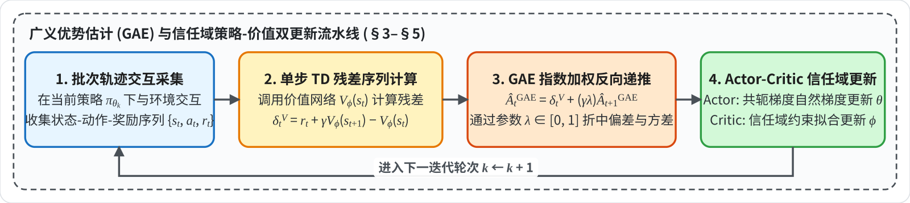

# High-Dimensional Continuous Control Using Generalized Advantage Estimation (GAE)

**核心问题**：长时域连续控制中，纯蒙特卡洛回报方差过大、1 步 TD 自举偏差显著；GAE 通过参数 $\lambda \in [0,1]$ 在所有 $k$ 步 TD 残差上做指数加权平均，实现连续的偏差-方差权衡。

> * **研究机构**：University of California, Berkeley (UC Berkeley)
> * **发表出处**：*International Conference on Learning Representations (ICLR 2016)* / `arXiv:1506.02438`

## 全文工作流程

为串联全文理论推导与算法执行步骤，以下给出 GAE 在三维高自由度机器人连续控制中的完整闭环数据流图及各阶段对照表：

| 阶段 | 模块 | 输入 | 核心方程 / 算子 | 输出 | 章节 |
| :--- | :--- | :--- | :--- | :--- | :--- |
| **阶段 1** | **轨迹采样（$\gamma$-无偏建模）** | 当前策略 $\pi_{\theta_k}$、折现因子 $\gamma$ | 采集轨迹 $\{s_t, a_t, r_t\}$；利用基线不变性（Proposition 1）消去状态依赖基线 $b_t(s_t) = V_\phi(s_t)$ | 采样轨迹批次 $\{s_{0:T}^n, a_{0:T}^n, r_{0:T}^n\}_{n=1}^N$ | §1.1–1.2、§2.1–2.3 |
| **阶段 2** | **单步 TD 残差（势能重塑奖励）** | 即时奖励 $r_t$、状态价值 $V_\phi(s_t), V_\phi(s_{t+1})$ | $\delta_t^V = r_t + \gamma V_\phi(s_{t+1}) - V_\phi(s_t)$（等价于以 $\Phi = V_\phi$ 对原 MDP 做势能奖励重塑 $\tilde{r}_t$） | 时间步残差序列 $\{\delta_0^V, \delta_1^V, \dots, \delta_{T-1}^V\}$ | §3、§4.1–4.2 |
| **阶段 3** | **多步指数加权优势 $\hat{A}_t^{\text{GAE}(\gamma,\lambda)}$** | 残差序列 $\{\delta_t^V\}$、超参数 $\lambda \in [0, 1]$ | 几何级数加权全部 $k$-步估计器：$\hat{A}_t^{\text{GAE}(\gamma,\lambda)} = \sum_{l=0}^{\infty}(\gamma\lambda)^l \delta_{t+l}^V = \delta_t^V + \gamma\lambda \hat{A}_{t+1}^{\text{GAE}}$ | 低方差优势序列 $\{\hat{A}_t^{\text{GAE}}\}$、时间折叠有效窗口 $\frac{1}{1-\gamma\lambda}$ | §3.1–3.2、§4.3 |
| **阶段 4** | **信任域策略 / 价值网络更新** | 优势序列 $\{\hat{A}_t^{\text{GAE}}\}$、对数梯度 $\nabla_\theta \log \pi_\theta$ | 代入经验策略梯度 $\hat{g} = \frac{1}{N}\sum_{n,t}\nabla_\theta \log \pi_\theta(a_t^n \mid s_t^n)\hat{A}_t^{\text{GAE}}$，配合 [[重要性采样与TRPO信任域\|TRPO]] / [[PPO]] 更新 $\theta_k$ 并拟合 $V_\phi$ | 更新后参数 $\theta_{k+1}, \phi_{k+1}$ | §2.1、§3.2 |

---

# 1. 动机

## 1.1 时间信用分配难题
在强化学习中，智能体执行了一个动作 $a_t$，但真正的奖励信号往往严重滞后（例如：机器人迈出关键一步，但直到几百步后摔倒才产生惩罚）。算法如何准确衡量“当前这一步动作到底是好是坏”？这就是信用分配问题。

## 1.2 方差 vs 偏差

| **派系**                          | **核心机制**                       | **核心优势** | **致命缺陷**                                       |
| --------------------------------- | ---------------------------------- | ------------ | -------------------------------------------------- |
| **经典策略梯度 (MC / REINFORCE)** | 累加整条轨迹的实际回报             | **绝对无偏** | **方差爆炸**：多步随机累积致梯度震荡，样本效率极低 |
| **传统 Actor-Critic (1-step TD)** | 单步即时回报 + 神经网络估计 $V(s)$ | **方差极低** | **高偏差**：强依赖价值网络，估计失真会导致策略发散 |

**GAE（广义优势估计）的本质**：构建一个**偏差与方差的连续调节滑块（$\lambda$）**——在 1-step TD 与全轨迹 MC 之间加权折中，以可控的轻微局部偏差，换取方差的大幅下降。

---

# 2. $\gamma$-无偏策略梯度估计理论

## 2.1 寻找最佳的策略更新方向

我们要最大化期望累积回报 $J(\theta) = \mathbb{E}[\sum_{t=0}^\infty r_t]$。通过似然比技巧求导后，策略梯度的通式可以写为：

$$
g = \mathbb{E}_{\substack{s_{0:\infty} \sim P, \\ a_{0:\infty} \sim \pi}} \left[ \sum_{t=0}^\infty \Psi_t \nabla_\theta \log \pi_\theta(a_t \mid s_t) \right] \tag{1}
$$
这里的 $\Psi_t$ 是“打分标尺”，决定了我们多大程度上鼓励或惩罚动作 $a_t$。论文系统梳理了历史上 $\Psi_t$ 的 **6 种形态**：
1. $\sum_{t=0}^\infty r_t$：连 $a_t$ 发生之前的历史奖励都算进来了，噪声极大；
2. $\sum_{t'=t}^\infty r_{t'}$：利用因果律剔除了历史奖励，方差减小；
3. $\sum_{t'=t}^\infty r_{t'} - b(s_t)$：进一步减去与动作无关的基线，再次削减方差；
4. $Q^\pi(s_t, a_t)$：用积分期望代替随机采样；
5. $A^\pi(s_t, a_t)$：**理论上能取得最低方差的标尺**；
6. $r_t + V^\pi(s_{t+1}) - V^\pi(s_t)$（[[时序差分与自举|单步 TD 残差]]）：完全靠单步估计自举。

为了准确定义[[广义优势估计GAE|优势函数]]，作者给出了状态价值与动作价值的积分形式：
$$
V^\pi(s_t) \triangleq \mathbb{E}_{\substack{s_{t+1:\infty} \sim P, \\ a_{t:\infty} \sim \pi}} \left[ \sum_{l=0}^\infty r_{t+l} \right] \\
Q^\pi(s_t, a_t) \triangleq \mathbb{E}_{\substack{s_{t+1:\infty} \sim P, \\ a_{t+1:\infty} \sim \pi}} \left[ \sum_{l=0}^\infty r_{t+l} \right] \tag{2}
$$

$$
A^\pi(s_t, a_t) \triangleq Q^\pi(s_t, a_t) - V^\pi(s_t) \tag{3}
$$

---

## 2.2 折现因子 $\gamma$ 的无偏理论

在无限时间步中，累积和可能发散，**$\gamma$ 的本质不是物理环境的要求，而是一个纯粹的“人工方差截断参数”！** 引入[[贝尔曼方程与值迭代|折现因子]] $\gamma \in [0, 1)$：
$$
V^{\pi, \gamma}(s_t) \triangleq \mathbb{E}_{\substack{s_{t+1:\infty} \sim P, \\ a_{t:\infty} \sim \pi}} \left[ \sum_{l=0}^\infty \gamma^l r_{t+l} \right], \quad Q^{\pi, \gamma}(s_t, a_t) \triangleq \mathbb{E}_{\substack{s_{t+1:\infty} \sim P, \\ a_{t+1:\infty} \sim \pi}} \left[ \sum_{l=0}^\infty \gamma^l r_{t+l} \right] \tag{4}
$$

$$
A^{\pi, \gamma}(s_t, a_t) \triangleq Q^{\pi, \gamma}(s_t, a_t) - V^{\pi, \gamma}(s_t) \tag {5}
$$

此时我们要估计的折现策略梯度为：
$$
g^\gamma \triangleq \mathbb{E}_{\substack{s_{0:\infty} \sim P, \\ a_{0:\infty} \sim \pi}} \left[ \sum_{t=0}^\infty A^{\pi, \gamma}(s_t, a_t) \nabla_\theta \log \pi_\theta(a_t \mid s_t) \right] \tag {6}
$$
在实际中，我们根本不知道真实的 $A^{\pi, \gamma}$，必须用采样数据构造一个估计量 $\hat{A}_t$。**Definition 1** 中定义：如果一个估计量 $\hat{A}_t$ 代入后，**在数学期望上不给 $g^\gamma$ 引入任何额外偏差**，即：
$$
\mathbb{E}_{\substack{s_{0:\infty} \sim P, \\ a_{0:\infty} \sim \pi}} \left[ \hat{A}_t(s_{0:\infty}, a_{0:\infty}) \nabla_\theta \log \pi_\theta(a_t \mid s_t) \right] = \mathbb{E}_{\substack{s_{0:\infty} \sim P, \\ a_{0:\infty} \sim \pi}} \left[ A^{\pi, \gamma}(s_t, a_t) \nabla_\theta \log \pi_\theta(a_t \mid s_t) \right] \tag {7}
$$
则称 $\hat{A}_t$ 为 **$\gamma$-无偏估计量**。求和后自然成立：
$$
\mathbb{E}_{\substack{s_{0:\infty} \sim P, \\ a_{0:\infty} \sim \pi}} \left[ \sum_{t=0}^\infty \hat{A}_t(s_{0:\infty}, a_{0:\infty}) \nabla_\theta \log \pi_\theta(a_t \mid s_t) \right] = g^\gamma \quad \text{—— 公式 (8)}
$$

---

## 2.3 命题 1：基线不变性

我们在估计优势时，减去一个基线到底会不会把梯度算偏？需要满足什么条件？

> **Proposition 1**：若估计量可拆分为 $\hat{A}_t = Q_t(s_{t:\infty}, a_{t:\infty}) - b_t(s_{0:t}, a_{0:t-1})$，只要 $Q_t$ 是真实 $Q^{\pi, \gamma}$ 的无偏估计，且基线 $b_t$ **只取决于当前动作 $a_t$ 发生之前的历史状态和动作**，那么 $\hat{A}_t$ 严格是 $\gamma$-无偏的。

展开梯度与优势估计乘积的全期望：
$$
\begin{aligned}
&\mathbb{E}_{\substack{s_{0:\infty}, \\ a_{0:\infty}}} \left[ \nabla_\theta \log \pi_\theta(a_t \mid s_t) \Big( Q_t(s_{t:\infty}, a_{t:\infty}) - b_t(s_{0:t}, a_{0:t-1}) \Big) \right] \\
&= \mathbb{E} \left[ \nabla_\theta \log \pi_\theta(a_t \mid s_t) Q_t \right] - \mathbf{\mathbb{E}_{\substack{s_{0:\infty}, \\ a_{0:\infty}}} \left[ \nabla_\theta \log \pi_\theta(a_t \mid s_t) b_t(s_{0:t}, a_{0:t-1}) \right]} 
\end{aligned} \tag{33}
$$
看加粗的第二项：应用重期望法则，固定历史 $(s_{0:t}, a_{0:t-1})$，单独对当前动作 $a_t$ 求条件期望：
$$
\mathbb{E}_{s_{0:t}, a_{0:t-1}} \left[ b_t(s_{0:t}, a_{0:t-1}) \cdot \mathbf{\mathbb{E}_{a_t \sim \pi_\theta} \left[ \nabla_\theta \log \pi_\theta(a_t \mid s_t) \mid s_t \right]} \right]
$$

> **重期望法则（Law of Total Expectation）证明细节**：
> “重期望法则”在概率论中也常被称为**全期望公式**或**迭代期望定律**。
>
> 它的核心数学表达是：
> $$
>  \mathbb{E}[X] = \mathbb{E}[\mathbb{E}[X|Y]] 
> $$
> 简单来说，它的意思是：**想要计算一个随机变量 $X$ 的总期望，可以先把 $Y$ 固定下来（求条件期望），然后再对 $Y$ 求期望。**
>
> ---
>
> **1. 原本需要求的期望是什么？**
> 原本的式子大概率是求关于**整个轨迹** $(s_{0:t}, a_{0:t})$ 的联合期望：
> $$
>  \mathbb{E}_{s_{0:t}, a_{0:t}} [ b_t(s_{0:t}, a_{0:t-1}) \cdot \nabla_\theta \log \pi_\theta(a_t | s_t) ] 
> $$
> **2. 为什么能应用重期望法则？**
> 因为联合概率分布可以分解为：
> $$
>  P(s_{0:t}, a_{0:t}) = P(s_{0:t}, a_{0:t-1}) \cdot P(a_t | s_{0:t}, a_{0:t-1}) 
> $$
> 根据[[马尔可夫决策过程MDP|马尔可夫]]性，当前动作 $a_t$ 只取决于当前状态 $s_t$，所以 $P(a_t | s_{0:t}, a_{0:t-1}) = P(a_t | s_t) = \pi_\theta(a_t | s_t)$。因此，我们可以把对 $(s_{0:t}, a_{0:t})$ 的联合期望，**拆解为两层**：外层是对历史 $(s_{0:t}, a_{0:t-1})$ 的期望，内层是在给定历史条件下，对当前动作 $a_t$ 的条件期望。
>
> **3. 具体应用过程：**
> *   固定历史 $(s_{0:t}, a_{0:t-1})$。
> *   此时，项 $b_t(s_{0:t}, a_{0:t-1})$ **里面没有 $a_t$**，所以对于内层关于 $a_t$ 的期望来说，它是一个**常数**，可以提到内层期望符号的外面。
> *   内层的期望变成了：$\mathbb{E}_{a_t \sim \pi_\theta} [\nabla_\theta \log \pi_\theta(a_t | s_t) \mid s_{0:t}, a_{0:t-1}]$。又因为给定历史包含了 $s_t$，所以条件可以简化为 $\mid s_t$。
>
> 于是得到了最终的式子：
> $$
> \mathbb{E}_{s_{0:t}, a_{0:t-1}} \Big[ b_t(s_{0:t}, a_{0:t-1}) \cdot \mathbb{E}_{a_t \sim \pi_\theta} [ \nabla_\theta \log \pi_\theta(a_t | s_t) \mid s_t ] \Big]
> $$
> 在强化学习中，$b_t$（通常是一个基线 baseline 或[[广义优势估计GAE|优势函数]]）是用来评估在状态 $s_t$ 下采取动作 $a_t$ 的好坏的。这个评估值 $b_t$ 在采取动作 $a_t$ **之前**就已经根据历史计算出来了，它**不依赖于**当前具体采样出的动作 $a_t$。通过重期望法则，我们可以**把跟动作 $a_t$ 无关的权重 $b_t$ 提出来**，让内层期望专心处理 $\nabla_\theta \log \pi_\theta(a_t|s_t)$。这是推导策略梯度中“对数导数技巧”（$\nabla \pi = \pi \nabla \log \pi$）非常关键的一步，它让期望和梯度能够交换位置。
>

因为对数似然对策略自身的积分恒为零：
$$
\mathbb{E}_{a_t \sim \pi_\theta} \left[ \nabla_\theta \log \pi_\theta(a_t \mid s_t) \mid s_t \right] = \int \pi_\theta \frac{\nabla_\theta \pi_\theta}{\pi_\theta} da_t = \nabla_\theta \int \pi_\theta da_t = \nabla_\theta (1) = \mathbf{0}
$$

* **理论意义**：从数学上证明了——**在优势估计器中减去状态依赖的基线项（如 $V(s_t)$），不会给策略梯度引入任何偏差**，从而在不改变优化期望的前提下显著降低方差。

---

# 3. GAE 

在实际工程中，我们通过采样 $N$ 条轨迹批次来计算经验梯度：
$$
\hat{g} = \frac{1}{N} \sum_{n=1}^N \sum_{t=0}^\infty \hat{A}_t^n \nabla_\theta \log \pi_\theta(a_t^n \mid s_t^n) \tag{9}
$$
现在，如何构造一个完美的 $\hat{A}_t$？设 $V$ 是我们训练的神经网络价值函数。定义折现 TD 残差为：
$$
\delta_t^V \triangleq r_t + \gamma V(s_{t+1}) - V(s_t) 
$$
如果网络是完美的（$V = V^{\pi, \gamma}$），对下一状态 $s_{t+1}$ 求条件期望：
$$
\begin{aligned}
\mathbb{E}_{s_{t+1} \sim P} \left[ \delta_t^{V^{\pi, \gamma}} \;\Big|\; s_t, a_t \right]
&= \mathbb{E}_{s_{t+1} \sim P} \left[ r_t + \gamma V^{\pi, \gamma}(s_{t+1}) - V^{\pi, \gamma}(s_t) \;\Big|\; s_t, a_t \right] \\
&= Q^{\pi, \gamma}(s_t, a_t) - V^{\pi, \gamma}(s_t) = A^{\pi, \gamma}(s_t, a_t)
\end{aligned} \tag{10}
$$

* **物理含义**：**[[时序差分与自举|单步 TD 残差]] $\delta_t^V$ 是真实优势函数的一个单步抽样估计**。
* **致命问题**：它只有在 $V$ 绝对精确时才无偏；一旦神经网络有拟合误差，$\delta_t^V$ 就会产生极大的单步偏差。

---

## 3.1 $k$-步优势估计器

单步 $\delta_t^V$ 太依赖 $V(s_{t+1})$ 的单点精度了。怎样能让估计器多依赖真实的物理奖励 $r$，少依赖神经网络的脑补？作者将未来的 TD 残差按折现率累加，定义 $k$-步估计器 $\hat{A}_t^{(k)}$：

* **1 步估计**：
  $$
  \hat{A}_t^{(1)} \triangleq \delta_t^V = -V(s_t) + r_t + \gamma V(s_{t+1})
  $$
* **2 步估计**：
  $$
  \hat{A}_t^{(2)} \triangleq \delta_t^V + \gamma \delta_{t+1}^V = -V(s_t) + r_t + \gamma r_{t+1} + \gamma^2 V(s_{t+2})
  $$
  *(观察：中间的 $+\gamma V(s_{t+1})$ 与下一项展开的 $-\gamma V(s_{t+1})$ 发生了**正负抵消**！)*
* **3 步估计**：
  $$
  \hat{A}_t^{(3)} \triangleq \delta_t^V + \gamma \delta_{t+1}^V + \gamma^2 \delta_{t+2}^V = -V(s_t) + r_t + \gamma r_{t+1} + \gamma^2 r_{t+2} + \gamma^3 V(s_{t+3})
  $$
* **通式**：
  $$
  \hat{A}_t^{(k)} \triangleq \sum_{l=0}^{k-1} \gamma^l \delta_{t+l}^V = -V(s_t) + r_t + \gamma r_{t+1} + \dots + \gamma^{k-1} r_{t+k-1} + \gamma^k V(s_{t+k}) \tag{14}
  $$
  **随着步数 $k$ 增加**：真实的物理奖励采样 $r_t, \gamma r_{t+1}, \dots$ 越来越多，神经网络脑补项退缩到了遥远的未来 $\gamma^k V(s_{t+k})$。

* **当 $k \to \infty$ 时**：
  $$
  \hat{A}_t^{(\infty)} \triangleq \sum_{l=0}^\infty \gamma^l \delta_{t+l}^V = -V(s_t) + \sum_{l=0}^\infty \gamma^l r_{t+l} \tag{15}
  $$
  尾部项 $\gamma^k V \to 0$ 彻底消失！估计器完全变成了纯[[Chapter_5_Monte Carlo Methods|蒙特卡洛]]经验回报减基线。**此时偏差彻底为 0，但所有随机奖励累加导致方差巨大**

---

## 3.2 GAE 指数加权平均

既然 $k=1$ 偏差大方差小，而 $k=\infty$ 偏差零方差大，那到底选 $k=几$ 最好？选任何固定的整数 $k$ 都太死板了！受经典 $\text{TD}(\lambda)$ 启发，作者提出：**将所有步数 $k \in [1, \infty)$ 的估计器，按照几何级数权重 $(1-\lambda)\lambda^{k-1}$ 进行凸组合加权平均！**

$$
\hat{A}_t^{\text{GAE}(\gamma, \lambda)} \triangleq (1 - \lambda) \left( \hat{A}_t^{(1)} + \lambda \hat{A}_t^{(2)} + \lambda^2 \hat{A}_t^{(3)} + \dots \right)
$$

$$
\begin{aligned}
\hat{A}_t^{\text{GAE}(\gamma, \lambda)} &= (1 - \lambda) \Big[ \delta_t^V + \lambda(\delta_t^V + \gamma \delta_{t+1}^V) + \lambda^2(\delta_t^V + \gamma \delta_{t+1}^V + \gamma^2 \delta_{t+2}^V) + \cdots \Big] \\
&= (1 - \lambda) \Big[
  \delta_t^V \underbrace{(1 + \lambda + \lambda^2 + \cdots)}_{= \frac{1}{1-\lambda}}
  + \gamma \delta_{t+1}^V \underbrace{(\lambda + \lambda^2 + \cdots)}_{= \frac{\lambda}{1-\lambda}}
  + \cdots
\Big] \\
&= (1 - \lambda) \left[ \delta_t^V \left(\frac{1}{1-\lambda}\right) + \gamma \delta_{t+1}^V \left(\frac{\lambda}{1-\lambda}\right) + \gamma^2 \delta_{t+2}^V \left(\frac{\lambda^2}{1-\lambda}\right) + \cdots \right]
\end{aligned}
$$

**分母的 $(1-\lambda)$ 与外层的 $(1-\lambda)$ 完美对消！** 最终得到了整篇论文的皇冠公式：
$$
\hat{A}_t^{\text{GAE}(\gamma, \lambda)} = \sum_{l=0}^\infty (\gamma \lambda)^l \delta_{t+l}^V \tag{16}
$$

* **特例 1：$\lambda = 0$（公式 17）**
  $$
  \hat{A}_t^{\text{GAE}(\gamma, 0)} = \delta_t^V = r_t + \gamma V(s_{t+1}) - V(s_t) \quad (\text{纯 1 步 TD，方差最小，偏差最大})
  $$
* **特例 2：$\lambda = 1$（公式 18）**
  $$
  \hat{A}_t^{\text{GAE}(\gamma, 1)} = \sum_{l=0}^\infty \gamma^l r_{t+l} - V(s_t) \quad (\text{纯 MC 减基线})
  $$
  *(特性：严格无偏，但累积整条轨迹噪声导致方差最大。)*

将 GAE 代入策略梯度的近似算式为：
$$
g^\gamma \approx \mathbb{E}_{\substack{s_{0:\infty}, \\ a_{0:\infty}}} \left[ \sum_{t=0}^\infty \nabla_\theta \log \pi_\theta(a_t \mid s_t) \sum_{l=0}^\infty (\gamma \lambda)^l \delta_{t+l}^V \right] \tag{19}
$$

* $\lambda \in [0, 1]$ 变成了一个**连续无缝的“旋钮”**。只要选取一个折中的 $\lambda$（如 $0.95$），就能在保留极其微小偏差的同时，瞬间削去绝大部分高频方差噪声！

---

# 4. 奖励重塑理论依据

## 4.1 经典奖励重塑

Ng 等人 (1999) 提出了势能奖励重塑定理：对 MDP 引入任意状态标量势能函数 $\Phi(s)$，在数学和统计物理中，当你对系统做了一个坐标变换或变量替换后，通常会给新系统打上波浪号 $\sim$（Tilde）以示区分：

* **原版真实世界**：
  即时奖励是 $r$；状态价值是 $V^{\pi, \gamma}$；动作价值是 $Q^{\pi, \gamma}$；优势函数是 $A^{\pi, \gamma}$。
* **重塑后的新世界**：
  经过人工修改后的奖励记为 **$\tilde{r}$**；新世界里的状态价值记为 **$\tilde{V}^{\pi, \gamma}$**；动作价值记为 **$\tilde{Q}^{\pi, \gamma}$**；优势函数记为 **$\tilde{A}^{\pi, \gamma}$**。

定义重塑奖励，实际上这里就是上面的TD误差的原型：
$$
\tilde{r}(s, a, s') \triangleq r(s, a, s') + \gamma \Phi(s') - \Phi(s) \tag{20}
$$
将其沿轨迹折现求和，展开后中间的项会被清除：
$$
\sum_{l=0}^\infty \gamma^l \tilde{r}(s_{t+l}, a_{t+l}, s_{t+l+1}) = \sum_{l=0}^\infty \gamma^l r(s_{t+l}, a_{t+l}, s_{t+l+1}) - \Phi(s_t) \tag {21}
$$
由此导致重塑后 MDP 的价值函数整体平移：在新世界里，状态价值 $\tilde{V}^{\pi, \gamma}(s_t)$ 的定义就是对新奖励 $\tilde{r}$ 的折现和求期望：
$$
\tilde{V}^{\pi, \gamma}(s_t) \triangleq \mathbb{E} \left[ \sum_{l=0}^\infty \gamma^l \tilde{r}_{t+l} \right]
$$
直接把公式 (21) 的结果代入进去：
$$
\begin{aligned}
\tilde{V}^{\pi, \gamma}(s_t) &= \mathbb{E} \left[ \sum_{l=0}^\infty \gamma^l r_{t+l} - \Phi(s_t) \right] \\
&= \underbrace{\mathbb{E} \left[ \sum_{l=0}^\infty \gamma^l r_{t+l} \right]}_{V^{\pi, \gamma}(s_t)} - \Phi(s_t) \\
\tilde{V}^{\pi, \gamma}(s) &= V^{\pi, \gamma}(s) - \Phi(s)
\end{aligned} \tag{23}
$$
同理，对动作价值函数 $\tilde{Q}^{\pi, \gamma}$ 求期望，：
$$
\tilde{Q}^{\pi, \gamma}(s, a) = Q^{\pi, \gamma}(s, a) - \Phi(s) \tag{22}
$$

* **物理含义**：在环境中任意加一个势能函数 $\Phi(s)$ 去修改奖励，新世界里的价值函数 $\tilde{V}$ 和 $\tilde{Q}$，仅仅是把原世界的函数整体向下平移了一个高度 $\Phi(s)$！

但是，**二者相减得到的优势函数绝对不变**：
$$
\tilde{A}^{\pi, \gamma}(s, a) = \tilde{Q}^{\pi, \gamma}(s, a) - \tilde{V}^{\pi, \gamma}(s) = A^{\pi, \gamma}(s, a) \tag{24}
$$

---

## 4.2 势能重塑下的 GAE 等价形式

如果我们把势能函数设为神经网络价值估计 $\Phi = V$，看看重塑奖励变成了什么：
$$
\tilde{r} = r_t + \gamma V(s_{t+1}) - V(s_t) = \delta_t^V \quad (\textbf{重塑奖励正好就是 TD 残差！})
$$
此时，如果在这个重塑的 MDP 中，使用一个**更激进的[[贝尔曼方程与值迭代|折现因子]] $\gamma\lambda$** 求回报：
$$
\sum_{l=0}^\infty (\gamma \lambda)^l \tilde{r}(s_{t+l}, a_{t+l}, s_{t+l+1}) = \sum_{l=0}^\infty (\gamma \lambda)^l \delta_{t+l}^V = \hat{A}_t^{\text{GAE}(\gamma, \lambda)} \tag{25}
$$

* **GAE 并非凭空构造，它本质上是先用价值网络对环境做了势能重塑，然后在重塑后的空间里，以更陡峭的折扣率 $\gamma\lambda$ 计算收益！**

---

## 4.3 响应函数（时间折叠视野）

为了量化动作 $a_t$ 对未来每一步奖励的真实因果贡献，论文定义**响应函数（Response Function）**：
$$
\chi(l; s_t, a_t) \triangleq \mathbb{E}\left[ r_{t+l} \mid s_t, a_t \right] - \mathbb{E}\left[ r_{t+l} \mid s_t \right], \quad l = 0, 1, 2, \dots
$$

- 当动作 $a_t$ 的影响随着时间推进快速衰减（即对于较大的 $l$，$\chi(l; s_t, a_t) \approx 0$）时，精确计算无限远步奖励只会白白引入与当前动作无关的环境噪声。
- 将有效衰减乘子 $\gamma\lambda < 1$ 视作一个时间折叠系数，等价于把有效信用分配窗口压缩到约 $\frac{1}{1 - \gamma\lambda}$ 步之内（例如 $\gamma=0.99, \lambda=0.95$ 时有效视野约 $17$ 步）：既滤除了远期随机噪声，又保留了对核心因果回报的敏感度。
