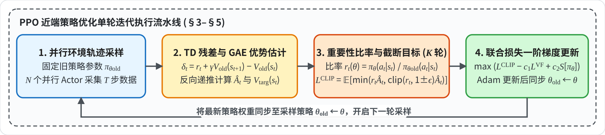
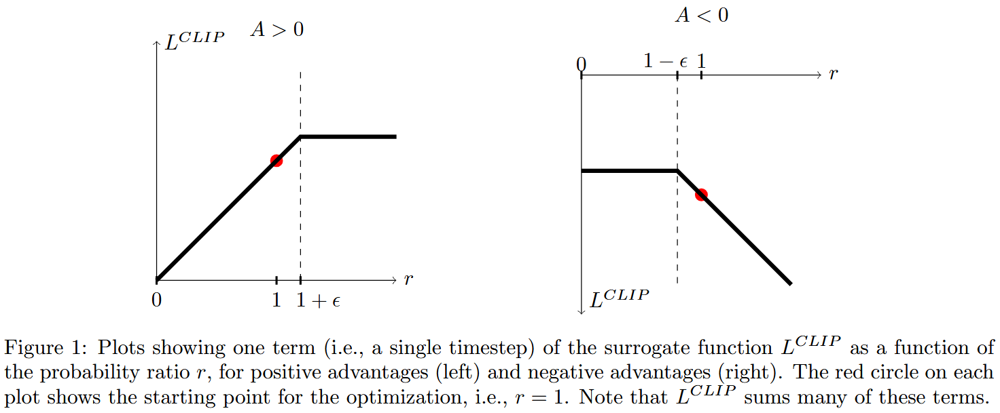

# Proximal Policy Optimization Algorithms (PPO)

**核心问题**：经典策略梯度（Vanilla PG）一步更新幅度过大易引发策略性能崩溃；TRPO 引入二阶共轭梯度求解 KL 约束计算开销过高。PPO 用一阶可微的**比率裁剪目标 $L^{\text{CLIP}}$**（与自适应 KL 惩罚）近似单调信任域改进，成为四足机器人强化学习（如 Isaac Lab / ANYmal）的标准训练算法。

> * **研究机构**：OpenAI
> * **发表出处**：*arXiv Preprint*（`arXiv:1707.06347`, 2017 年 7 月）

## 全文工作流程

以下给出 PPO 算法的端到端主循环数据流图及各阶段对照表：

| 阶段 | 模块 | 输入 | 核心方程 / 算子 | 输出 | 章节 |
| :--- | :--- | :--- | :--- | :--- | :--- |
| **阶段 1** | **环境交互采样（Rollout）** | 当前状态 $s_t$、旧策略网络 $\pi_{\theta_{\text{old}}}$ | 采样动作 $a_t \sim \pi_{\theta_{\text{old}}}(\cdot \mid s_t)$，记录对数概率 $\log \pi_{\theta_{\text{old}}}(a_t \mid s_t)$、旧价值 $V_{\theta_{\text{old}}}(s_t)$ | 长度为 $T$ 的轨迹缓存 $\{s_t, a_t, r_t, \log \pi_{\theta_{\text{old}}}, V_{\theta_{\text{old}}}\}_{t=1}^T$ | §1.1–1.3、§2.1 |
| **阶段 2** | **广义优势估计（GAE）** | 奖励序列 $r_t$、状态价值 $V_{\theta_{\text{old}}}(s_t)$ | 单步 TD 残差 $\delta_t = r_t + \gamma V(s_{t+1}) - V(s_t)$；指数加权优势 $\hat{A}_t = \sum_{l=0}^{T-t-1}(\gamma\lambda)^l \delta_{t+l}$ | 归一化优势 $\hat{A}_t$、价值回归标签 $V_t^{\text{targ}} = \hat{A}_t + V_{\theta_{\text{old}}}(s_t)$ | §6.1–6.2 |
| **阶段 3** | **重要性比率 / 裁剪下界** | 小批量样本 $(s_t, a_t, \hat{A}_t)$、待优化参数 $\theta$ | 重要性比率 $r_t(\theta) = \frac{\pi_\theta(a_t \mid s_t)}{\pi_{\theta_{\text{old}}}(a_t \mid s_t)}$；悲观裁剪算子 $\min\big(r_t\hat{A}_t, \operatorname{clip}(r_t, 1-\epsilon, 1+\epsilon)\hat{A}_t\big)$ | 标量替代损失 $L_t^{\text{CLIP}}(\theta)$（或自适应 KL 损失 $L^{\text{KLPEN}}$） | §2.2、§3、§4、§5 |
| **阶段 4** | **Actor-Critic 联合更新** | $L_t^{\text{CLIP}}(\theta)$、价值预测 $V_\theta(s_t)$、策略熵 $S[\pi_\theta]$ | 联合目标 $L^{\text{CLIP+VF+S}}(\theta) = \hat{\mathbb{E}}_t[L_t^{\text{CLIP}} - c_1(V_\theta - V_t^{\text{targ}})^2 + c_2 S[\pi_\theta]]$，执行 $K$ 轮 Mini-batch SGD | 更新后参数 $\theta$（随后 $\theta_{\text{old}} \leftarrow \theta$） | §6.1 |

---

# 1. 经典策略梯度（PG）的局限性

## 1.1 强化学习的目标
在强化学习中，智能体的策略 $\pi_\theta(a|s)$ 是一个由参数 $\theta$（通常是神经网络权重）决定的概率分布，表示在状态 $s$ 下采取动作 $a$ 的概率。智能体的目标是最大化整个轨迹的期望累积折扣回报：
$$
J(\theta) = \mathbb{E}_{\tau \sim \pi_\theta} \left[ R(\tau) \right] = \mathbb{E}_{\tau \sim \pi_\theta} \left[ \sum_{t=0}^\infty \gamma^t r(s_t, a_t) \right]
$$

## 1.2 经典策略梯度定理（Vanilla Policy Gradient）
根据策略梯度定理，目标函数关于参数 $\theta$ 的梯度可以表示为：
$$
g = \nabla_\theta J(\theta) = \mathbb{E}_{s_t, a_t \sim \pi_\theta} \left[ \nabla_\theta \log \pi_\theta(a_t | s_t) A^{\pi_\theta}(s_t, a_t) \right]
$$
其中 $A^{\pi_\theta}(s_t, a_t) = Q^{\pi_\theta}(s_t, a_t) - V^{\pi_\theta}(s_t)$ 是**优势函数（Advantage Function）**，直观理解为：**“在当前状态 $s_t$ 下，选择动作 $a_t$ 比平均表现好多少”**。若 $A > 0$，说明该动作表现优于平均，应该提高其概率；若 $A < 0$，则应降低其概率。在实际代码中，深度学习框架通过自动微分来计算梯度，因此会构造一个“虚拟伪损失函数”：
$$
L^{PG}(\theta) = \hat{\mathbb{E}}_t \left[ \log \pi_\theta(a_t | s_t) \hat{A}_t \right]
$$
对其求导刚好得到策略梯度。

## 1.3 经典策略梯度缺陷
1. **数据效率极低（On-Policy 限制）**：期望 $\mathbb{E}_{s_t, a_t \sim \pi_\theta}$ 是在当前策略 $\pi_\theta$ 下采样的。一旦参数更新了一步（变成 $\theta_{new}$），旧策略采集的所有样本数据全部作废，必须重新在环境中与环境交互采集样本。这导致样本利用率极低。
2. **步长极度敏感（破坏性更新，Policy Collapse）**：
   - 在传统的监督学习中，参数更新过大导致 loss 升高，后续批次还可以纠正回来；
   - 但在强化学习中，**训练数据是由当前策略采集来的**。如果某一步梯度更新过大，导致策略崩溃（比如一个走平衡木的机器人突然学会了直接倒地），那么后续采集到的全都是崩溃状态的数据，算法将永远无法恢复。
3. **不能做多轮 Mini-batch 更新**：若用同一批采集的数据在 $L^{PG}(\theta)$ 上训练多个 Epoch，策略会很快过拟合这一批旧数据，偏离采样分布，造成灾难性后果。

---

# 2. TRPO 信任域方法

## 2.1 重要性采样
为了复用旧策略 $\pi_{\theta_{old}}$ 采集的数据，必须引入[[重要性采样与TRPO信任域|重要性采样]]：
$$
\mathbb{E}_{x \sim P}[f(x)] = \mathbb{E}_{x \sim Q}\left[ \frac{P(x)}{Q(x)} f(x) \right]
$$
利用此性质，目标函数可以改写为以旧策略 $\pi_{\theta_{old}}$ 采样的替代目标（Surrogate Objective）：
$$
L^{CPI}(\theta) = \hat{\mathbb{E}}_t \left[ \frac{\pi_\theta(a_t | s_t)}{\pi_{\theta_{old}}(a_t | s_t)} \hat{A}_t \right] = \hat{\mathbb{E}}_t \left[ r_t(\theta) \hat{A}_t \right]
$$
其中定义**概率比值（Probability Ratio）**：
$$
r_t(\theta) = \frac{\pi_\theta(a_t | s_t)}{\pi_{\theta_{old}}(a_t | s_t)}
$$

- 当 $\theta = \theta_{old}$ 时，$r_t(\theta_{old}) = 1$。
- 对 $L^{CPI}(\theta)$ 在 $\theta_{old}$ 处求导，与经典策略梯度完全等价。

## 2.2 TRPO 的约束优化
虽然[[重要性采样与TRPO信任域|重要性采样]]允许我们使用旧策略数据，但只有在 **$\pi_\theta$ 与 $\pi_{\theta_{old}}$ 足够接近** 时，重要性采样的方差才可控。因此，TRPO 引入了一个硬约束：
$$
\max_\theta \hat{\mathbb{E}}_t \left[ r_t(\theta) \hat{A}_t \right] \quad \text{s.t.} \quad \hat{\mathbb{E}}_t \left[ \text{KL}\left[\pi_{\theta_{old}}(\cdot | s_t), \, \pi_\theta(\cdot | s_t)\right] \right] \le \delta
$$
这就是“信任域”：要求新旧策略在动作概率分布上的平均 [[KL散度]]不超过阈值 $\delta$。

## 2.3 TRPO 缺陷
1. **二阶计算开销极大**：为了求解带约束的非线性优化问题，TRPO 需要对目标函数进行一阶泰勒展开，对 KL 约束进行二阶泰勒展开，涉及计算**费舍尔信息矩阵**的逆。它不得不采用共轭梯度法和线搜索，实现极其繁琐。
2. **架构不兼容**：无法直接利用现代深度学习的自适应梯度优化器；不兼容网络层中的随机噪声；当策略网络与价值网络共享底层特征表示时，TRPO 无法直接统一联合优化。

> 能否完全不用二阶导数、不用求解复杂的约束，**只用最简单的一阶梯度**，同时达到 TRPO 的稳定性和信任域效果？

---

# 3. PPO 核心原理：截断替代目标（Clipped Surrogate Objective）

PPO 提出了一个极其简单而精妙的目标函数：

$$
L^{CLIP}(\theta) = \hat{\mathbb{E}}_t \left[ \min\left( r_t(\theta)\hat{A}_t, \, \text{clip}(r_t(\theta), 1-\epsilon, 1+\epsilon)\hat{A}_t \right) \right]
$$
其中：
- $r_t(\theta) = \frac{\pi_\theta(a_t | s_t)}{\pi_{\theta_{old}}(a_t | s_t)}$ 是当前策略与生成数据时的旧策略的概率比。
- $\epsilon$ 是截断超参数（论文推荐 $\epsilon = 0.2$），这意味着将概率比限制在 $[1-\epsilon, 1+\epsilon] = [0.8, 1.2]$ 的合理范围内。
- 函数 $\text{clip}(x, a, b)$ 将 $x$ 截断在 $[a, b]$ 区间内。
- $\min$ 表示取两项中的较小值。

---

# 4. 悲观下界

**情况一：$\hat{A}_t > 0$（优势为正，当前动作带来了高于预期的收益）**

- **目标**：这是一个好动作，优化器理应增大该动作的概率，即希望 $r_t(\theta) > 1$。
- **未截断部分**：$r_t(\theta)\hat{A}_t$ 是关于 $r_t$ 单调递增的线性函数。
- **截断部分**：当 $r_t(\theta)$ 增长到大于 $1+\epsilon$ 时，$\text{clip}(r_t, 1-\epsilon, 1+\epsilon) = 1+\epsilon$，该项变为常数 $(1+\epsilon)\hat{A}_t$。
- **取 $\min$ 的效果**：
  - 当 $r_t(\theta) \in [1, 1+\epsilon]$ 时，两项相等，梯度正常传导，鼓励增大该动作的概率。
  - 一旦 $r_t(\theta) > 1+\epsilon$，$\min$ 操作选择了较小的截断常数项 $(1+\epsilon)\hat{A}_t$。**常数项的梯度为 0！**
  - **物理意义**：梯度直接被切断，优化器失去了继续增大该动作概率的动力。这防止了智能体因为一次采样得到高分，就盲目将该动作概率直接拉高到饱和，从而避免了策略突变。

**情况二：$\hat{A}_t < 0$（优势为负，当前动作带来了低于预期的收益）**

- **目标**：这是一个坏动作，优化器理应降低该动作的概率，即希望 $r_t(\theta) < 1$。
- **注意负数的乘法规则**：由于 $\hat{A}_t < 0$，乘上越小的数结果反而越大！
- **当 $r_t(\theta) < 1-\epsilon$ 时**：
  - 截断项为 $(1-\epsilon)\hat{A}_t$。
  - 未截断项为 $r_t(\theta)\hat{A}_t$。因为 $r_t < 1-\epsilon$ 且 $\hat{A}_t < 0$，所以 $r_t(\theta)\hat{A}_t > (1-\epsilon)\hat{A}_t$。
  - **取 $\min$ 会选出更小的那一项**，即截断项 $(1-\epsilon)\hat{A}_t$！
  - 同样，其梯度变为 0。
  - **物理意义**：当坏动作的概率已经降低了超过 $20\%$（即 $r < 0.8$）时，不再过度惩罚该动作，避免梯度过大引起数值震荡。

> $$
> \begin{aligned}
> L^{\text{CLIP}}(\theta) = \hat{\mathbb{E}}_t \Big[ \min\Big(
>   &\underbrace{r_t(\theta)\hat{A}_t}_{\text{未截断项}}, \\
>   &\underbrace{\operatorname{clip}(r_t(\theta), 1-\epsilon, 1+\epsilon)\hat{A}_t}_{\text{截断项}}
> \Big) \Big]
> \end{aligned}
> $$
> 我们假设设置截断超参数 $\epsilon = 0.2$（因此截断区间是 $[0.8, 1.2]$），且当前动作是一个好动作，**优势值 $\hat{A}_t = +10 > 0$**。
>
> 在更新刚开始时，当前策略等于旧策略，所以 $r_t(\theta_{old}) = \frac{\pi_{\theta_{old}}}{\pi_{\theta_{old}}} = 1.0$。随着反向传播，优化器希望调高好动作的概率，使得 $r_t(\theta)$ 从 $1.0$ 开始增加。
>
> **1. 两项相等的情形**：
>
> * 假设通过更新，当前 $r_t(\theta) = 1.1$（处于安全范围 $[0.8, 1.2]$ 之内）：
>   * **第一项**：$r_t(\theta)\hat{A}_t = 1.1 \times 10 = 11$
>   * **第二项**：因为 $1.1$ 在 $[0.8, 1.2]$ 之内，$\text{clip}(1.1, 0.8, 1.2) = 1.1$。所以第二项也是 $1.1 \times 10 = 11$。
> * **这就是“两项相等”**：只要比值在 $[1-\epsilon, 1+\epsilon]$ 之间，截断操作根本没起作用，第一项和第二项完全相同，公式简化为原版的 $r_t(\theta)\hat{A}_t$。
>
> **2. 选中截断项后梯度清零的数学机理**：
>
> * 现在假设优化器继续更新，把好动作的概率推得太高了，使得 **$r_t(\theta) = 1.3$（超过了 $1+\epsilon = 1.2$）**：
>
>   * **第一项（未截断）**：$r_t(\theta)\hat{A}_t = 1.3 \times 10 = 13$
>   * **第二项（截断项）**：$\text{clip}(1.3, 0.8, 1.2)\hat{A}_t = 1.2 \times 10 = 12$
>   * **外层取 $\min(13, 12) = 12$**：此时公式选出了更小的**第二项**！
>
> * 此时的目标函数值变成了：
>   $$
>   L_t(\theta) = 1.2 \times \hat{A}_t
>   $$
>
> * **核心数学细节**：考察上式是否还包含变量 $\theta$：
>
>   - $1.2$ 是一个固定数字（$1+\epsilon$）；
>   - $\hat{A}_t$ 是用旧数据算出来的固定优势值，不依赖 $\theta$；
>   - 也就是说，**式子中带有网络参数 $\theta$ 的部分全部被截断成常数 $1.2$ 了！**
>
> * 当深度学习框架对该项关于参数 $\theta$ 求导时：
>   $$
>   \nabla_\theta L_t(\theta) = \nabla_\theta \Big( (1+\epsilon)\hat{A}_t \Big) = \mathbf{0}
>   $$
>
> * **物理意义**：导数变成了 $0$，意味着**该样本上的参数更新停滞**。优化器发现虽然继续增大概率能带来名义上的收益，但由于梯度为 0，无法再继续推高该动作的概率，从而有效遏制了策略更新幅度过大。

**如果坏动作（$\hat{A}_t < 0$）的概率在更新后反而大幅上升（比如 $r_t > 1+\epsilon$），会发生什么？**

- 此时：截断项为 $(1+\epsilon)\hat{A}_t$，而未截断项为 $r_t(\theta)\hat{A}_t$。
- 因为 $r_t > 1+\epsilon$ 且 $\hat{A}_t < 0$，所以未截断项 $r_t(\theta)\hat{A}_t$ 是一个**绝对值极大、数值极小的负数**！
- 此时 $\min$ 操作会保留**未截断的项** $r_t(\theta)\hat{A}_t$！
- 这会带来一个显著的负向目标值和负向梯度，将策略拉回安全区域。

> **核心总结**：
> 取 $\min$ 表达了一种**悲观下界估计（Pessimistic Bound）**：
>
> - 当策略更新带来目标改善时，采取保守态度（一旦超界就截断梯度）；
> - 当策略更新导致变差时，不掩盖最坏情况（保留极低的目标值，实施纠偏惩罚）。
> 这使得 $L^{CLIP}$ 成为真实性能的一个下界近似。

> **数值推演示例（负优势动作概率异常上升时的反向纠偏）**：
> 假设智能体执行了一个劣质动作，**优势值 $\hat{A}_t = -10 < 0$**。
> 正常情况下，优化器应该把该动作概率降低（使 $r_t(\theta) < 1.0$）。
> 但神经网络的梯度更新是非线性的，由于某个 mini-batch 梯度的耦合扰动，这个劣质动作的概率反而**上升到了 $r_t(\theta) = 2.0$**：
>
> 1. **第一项（未截断项）**：
>    $$
>    r_t(\theta)\hat{A}_t = 2.0 \times (-10) = -20
>    $$
>
> 2. **第二项（截断项）**：
>    $$
>    \text{clip}(2.0, 0.8, 1.2)\hat{A}_t = 1.2 \times (-10) = -12
>    $$
>
> 3. **外层取 $\min(\text{第一项}, \text{第二项})$**：
>    $$
>    \min(-20, -12) = -20 
>    $$
>
> * 此时 $\min$ **并没有**选择被截断的第二项（$-12$），而是**选择了未截断的第一项（$-20$）**！
>
> * 因为它选的是未截断的第一项，所以公式保留了变量 $\theta$：
>   $$
>   L_t(\theta) = r_t(\theta)\hat{A}_t = \frac{\pi_\theta(a_t|s_t)}{\pi_{\theta_{old}}(a_t|s_t)} \times (-10)
>   $$
>
> * 此时**梯度不为 0**。由于优化器执行梯度上升（最大化 $L$），而系数为负数（$-10$），求导后得到的梯度会**大幅降低 $\pi_\theta(a_t|s_t)$**，从而迅速把异常升高的概率反向拉回合理区间。
>
> * **悲观下界机制总结**：
>   * 如果策略向正向改进但超出信任域，立刻截断梯度（梯度清零）；
>   * 如果策略向负向恶化，保留未截断项以产生纠偏梯度将参数拉回。

---

# 5.自适应 KL 散度惩罚

除了 Clip 机制，论文第 4 节还讨论了另一种模拟 TRPO 的方法：**直接在无约束目标中加入 [[KL散度]]惩罚项，并动态调节惩罚因子 $\beta$**。目标函数为：
$$
L^{KLPEN}(\theta) = \hat{\mathbb{E}}_t \left[ \frac{\pi_\theta(a_t | s_t)}{\pi_{\theta_{old}}(a_t | s_t)} \hat{A}_t - \beta \cdot \text{KL}\left[\pi_{\theta_{old}}(\cdot | s_t), \, \pi_\theta(\cdot | s_t)\right] \right]
$$
每次策略更新（经过若干个 Epoch 的 SGD）后，计算当前批次新旧策略的平均 KL 散度 $d = \hat{\mathbb{E}}_t [\text{KL}[\pi_{\theta_{old}}, \pi_\theta]]$：
- 若 $d < d_{targ} / 1.5$：说明策略变化太保守，惩罚过严，令 $\beta \leftarrow \beta / 2$；
- 若 $d > d_{targ} \times 1.5$：说明策略变化太大，越过了信任域，令 $\beta \leftarrow \beta \times 2$。

虽然自适应 KL 惩罚也能 work，但作者在大量实验中发现，**截断版本（PPO-Clip）的表现明显优于 KL 惩罚版本**，且实现更加纯粹，不需要在网络输出上显式计算解析解的 KL 散度。

---

# 6. Actor-Critic 联合损失架构

在实际代码工程中，PPO 通常采用 **[[策略梯度定理与Actor-Critic|Actor-Critic]]** 架构，并共享一部分网络特征提取层。

### 6.1 联合目标函数
训练时需要同时最大化策略收益、最小化价值函数误差，并维持一定的探索度：
$$
L_t^{CLIP+VF+S}(\theta) = \hat{\mathbb{E}}_t \left[ L_t^{CLIP}(\theta) - c_1 L_t^{VF}(\theta) + c_2 S[\pi_\theta](s_t) \right]
$$
各部分含义：
1. **$L_t^{CLIP}(\theta)$**：前面推导的策略剪切替代目标（最大化）。
2. **$L_t^{VF}(\theta) = (V_\theta(s_t) - V_t^{targ})^2$**：Critic（价值网络）的均方误差损失（最小化，因此带负号）。$V(s)$ 负责预测状态的累积折现回报。
3. **$S[\pi_\theta](s_t)$**：策略分布的 **[[最大熵强化学习与重参数化|香农熵]]（Entropy Bonus）**（最大化）。熵越大代表动作选择越随机，加入这一项能防止策略过早收敛到局部最优。

> **价值网络均方误差与 $V_t^{\text{targ}}$ 的构造方式**：
> 在监督学习中，若预测值为 $y_{\text{pred}}$，目标标签为 $y_{\text{true}}$，均方误差损失为：
> $$
> \text{MSE} = \frac{1}{M}\sum (y_{\text{pred}} - y_{\text{true}})^2
> $$
> 这里 $V_\theta(s_t)$ 是 Critic 预测当前状态 $s_t$ 的价值，而 $V_t^{\text{targ}}$ 是目标参考值。在 PPO 的工程实现中，$V_t^{\text{targ}}$ 通常有两种计算方式：
>
> * **方式 A：蒙特卡洛折现回报（$\text{TD}(\lambda=1)$）**
>   直接累加从 $t$ 时刻开始往后实际获得的折现奖励：
>   $$
>   V_t^{\text{targ}} = r_t + \gamma r_{t+1} + \gamma^2 r_{t+2} + \dots + \gamma^{T-t} V(s_T)
>   $$
>
> * **方式 B：利用 GAE（[[广义优势估计GAE]]）自举构造（PPO 标准实现）**
>   由优势定义 $A(s_t, a_t) = Q(s_t, a_t) - V(s_t)$，目标状态价值直接写为：
>   $$
>   V_t^{\text{targ}} = \hat{A}_t + V_{\theta_{\text{old}}}(s_t)
>   $$
>   其中 $\hat{A}_t$ 是用 GAE 算出的优势值，$V_{\theta_{\text{old}}}(s_t)$ 是采样时旧网络对该状态的评估。Critic 网络通过最小化均方误差逼近 $V_t^{\text{targ}}$。

---

### 6.2 优势函数估计：GAE
在公式中，$\hat{A}_t$ 是通过**偏差-方差权衡**算出来的。
- 用蒙特卡洛累积回报：无偏，但方差极大（受整条轨迹的随机性影响）；
- 用 1-step TD 误差：方差小，但有偏差（依赖未收敛的价值网络）。

论文采用此前提出的 **GAE（[[广义优势估计GAE]]）**，定义单步 TD 误差：
$$
\delta_t = r_t + \gamma V(s_{t+1}) - V(s_t)
$$
GAE 通过指数加权滑动平均将多步 TD 误差综合起来：
$$
\hat{A}_t = \sum_{l=0}^\infty (\gamma \lambda)^l \delta_{t+l} = \delta_t + (\gamma \lambda)\delta_{t+1} + (\gamma \lambda)^2\delta_{t+2} + \dots
$$

- $\gamma \in [0, 1]$ 是环境的折现因子（Discount factor）；
- $\lambda \in [0, 1]$ 是 GAE 超参数：
  - 当 $\lambda = 0$ 时，$\hat{A}_t = \delta_t = r_t + \gamma V(s_{t+1}) - V(s_t)$（纯 TD，偏差最大，方差最小）；
  - 当 $\lambda = 1$ 时，$\hat{A}_t = \sum_{l=0}^\infty \gamma^l r_{t+l} - V(s_t)$（纯蒙特卡洛残差，偏差为零，方差最大）；
  - 论文取 $\lambda = 0.95$，在偏差与方差之间取得极佳平衡。
