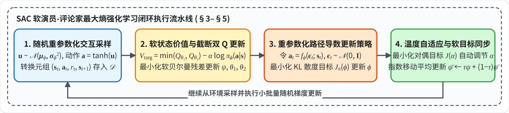
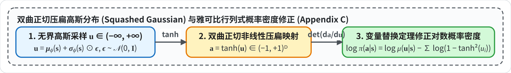

# Soft Actor-Critic (SAC)

**核心问题**：同策略算法（PPO）样本效率较低，异策略确定性算法（DDPG）探索能力受限且存在 Q 值高估。SAC 将 **[[最大熵强化学习与重参数化|最大熵目标]]** 融入异策略 Actor-Critic 框架，结合**重参数化梯度传导**、**双曲正切有界雅可比修正**与 **[[确定性策略梯度与截断双Q学习|截断双 Q 学习]]**，兼顾高样本利用率、多模态探索与数值稳定性。

> * **研究机构**：University of California, Berkeley (UC Berkeley), Google Brain
> * **发表出处**：`arXiv:1812.05905`（2018 年 12 月，基于 *ICML 2018* SAC 原论文扩展自动温度调节与实机应用）

## 全文工作流程

以下给出 SAC 异策略训练主循环的数据流图及各阶段对照表：



| 阶段 | 模块 | 输入 | 核心方程 / 算子 | 输出 | 章节 |
| :--- | :--- | :--- | :--- | :--- | :--- |
| **阶段 1** | **Tanh 高斯采样（雅可比修正）** | 当前状态 $s_t$、Actor 参数 $\phi$、标准正态噪声 $\epsilon_t \sim \mathcal{N}(0, I)$ | 重参数化 $u_t = \mu_\phi(s_t) + \sigma_\phi(s_t)\odot \epsilon_t, \, a_t = \tanh(u_t)$；对数概率修正 $\log\pi(a_t\mid s_t) = \log\mu(u_t\mid s_t) - \sum_i \log(1-\tanh^2(u_{t,i}))$ | 有界物理动作 $a_t \in (-1, 1)^D$，经验池缓存 $\mathcal{D}$ | §5.2、§6.1–6.2 |
| **阶段 2** | **双软 Q / 软价值评估** | 经验池小批量 $(s_t, a_t, r_t, s_{t+1}) \sim \mathcal{D}$、目标价值 $V_{\bar{\psi}}$ | 软贝尔曼目标 $\hat{Q}(s_t,a_t) = r_t + \gamma V_{\bar{\psi}}(s_{t+1})$；软状态价值回归目标 $\min_{i=1,2} Q_{\theta_i}(s_t, \tilde{a}_t) - \alpha \log \pi_\phi(\tilde{a}_t \mid s_t)$ | 更新双软 Q 参数 $\theta_1, \theta_2$、软价值参数 $\psi$ | §3.1–3.2、§4.1–4.3 |
| **阶段 3** | **重参数化策略提升** | 状态批次 $s_t \sim \mathcal{D}$、噪声 $\epsilon_t \sim \mathcal{N}(0, I)$ | 最小化玻尔兹曼分布 KL 散度 $J_\pi(\phi) = \mathbb{E}_{s_t, \epsilon_t}[\alpha \log \pi_\phi(f_\phi(\epsilon_t;s_t)\mid s_t) - \min_{i=1,2}Q_{\theta_i}(s_t, f_\phi(\epsilon_t;s_t))]$ | 更新策略参数 $\phi$ | §3.3–3.4、§5.1–5.3 |
| **阶段 4** | **目标网络 Polyak 软更新** | 在线价值参数 $\psi$、平滑系数 $\tau$ | 指数移动平均 $\bar{\psi} \leftarrow \tau \psi + (1 - \tau)\bar{\psi}$（无 $V$ 版直接软更新双 Q 目标网络 $\bar{\theta}_i$） | 目标价值参数 $\bar{\psi}$ | §4.1–4.3 |

---

# 1. SAC 研究动因

在深度强化学习中，算法通常分为两大派系：

| 派系                     | 代表算法       | 核心优势                                         | 致命缺陷                                                     |
| :----------------------- | :------------- | :----------------------------------------------- | :----------------------------------------------------------- |
| **On-Policy（同策略）**  | TRPO, PPO, A3C | 训练非常稳定，对超参数不敏感                     | **样本效率极低**。旧数据更新一次就扔，训练复杂的机器人往往需要上千万步交互。 |
| **Off-Policy（异策略）** | DQN, DDPG      | 拥有经验回放池（Replay Buffer），数据可重复利用，**样本效率高** | **极其脆弱不稳定**。DDPG 对超参和随机种子极度敏感，在复杂高维连续动作空间极难收敛。 |

## 1.1 DDPG 的收敛脆弱性分析
1. **确定性策略的探索缺陷**：DDPG 输出一个确定性的动作 $a = \mu_\theta(s)$，只能靠在动作上叠加外部高斯噪声或 OU 噪声来探索。这是一种状态无关的局部抖动，一旦环境奖励稀疏，智能体极易陷入局部最优。
2. **Q 值系统性高估**：基于[[贝尔曼方程与值迭代|贝尔曼方程]]的贪婪最大化操作会导致价值估计被系统性推高，形成正反馈偏差累积并引发策略崩溃。

> **SAC 的核心使命**：能否构建一个既具有 **Off-Policy 的极高样本利用率**，又拥有超越 PPO 的**极致稳定性**，还能**自主智能探索**的连续控制算法？
> 答案就是：**将“最大熵”数学原理与“异策略 [[策略梯度定理与Actor-Critic|Actor-Critic]]”完美融合**。

---

# 2. 最大熵强化学习数学框架

## 2.1 信息熵（Entropy）
在信息论中，一个随机变量 $X$ 的概率分布为 $P(X)$，其**香农熵**定义为：
$$
\mathcal{H}(P) = \mathbb{E}_{x \sim P} [-\log P(x)] = -\int P(x) \log P(x) dx
$$

- 熵衡量的是分布的**不确定性（随机性/混乱度）**。
- 如果分布极其集中（如狄拉克脉冲函数，确定性选择某个动作），熵为极小值；
- 如果分布极其均匀平坦（探索所有可能性），熵达到极大值。

---

## 2.2 有限时间步的最大熵目标函数
传统的 RL 只追求累积奖励期望最大化：$\max_\pi \sum_t \mathbb{E}[r_t]$。SAC 引入了 **[[最大熵强化学习与重参数化]]** 目标：
$$
J(\pi) = \sum_{t=0}^T \mathbb{E}_{(s_t, a_t) \sim \rho_\pi} \left[ r(s_t, a_t) + \alpha \mathcal{H}(\pi(\cdot | s_t)) \right] \tag{1}
$$

* **$r(s_t, a_t)$**：环境给予的即时奖励（Exploitation）。
* **$\mathcal{H}(\pi(\cdot | s_t)) = \mathbb{E}_{a_t \sim \pi}[-\log \pi(a_t|s_t)]$**：策略在当前状态下动作分布的熵（Exploration）。
* **$\alpha$（Temperature Parameter)**：控制熵与奖励之间的平衡。
  - 当 $\alpha \to 0$ 时，退化为传统强化学习；
  - $\alpha$ 越大，智能体越喜欢尝试探索各种未知的不同动作。

1. **防止策略过早收敛**：神经网络不会轻易变成确定性的，方差不会骤降，永远保持探索能力。
2. **多模态最优行为捕获**：如果去往终点有“左路”和“右路”两条一模一样通畅的路径，传统 RL 会随机强行收敛到其中一条；而最大熵 RL 会以各 $50\%$ 的概率同时掌握这两种通关方案！
3. **超强的鲁棒性**：面对外界意外扰动时，因为智能体平时探索过多种动作，它能更从容地应对意外状态。

---

## 2.3 无限时间步折现最大熵目标
当时间步 $T \to \infty$ 时，需要引入折现因子 $\gamma \in [0, 1)$。由于策略梯度算法通常不折现状态访问分布 $\rho_\pi$，论文附录 A 给出了严格的无限时间步折现目标定义：

$$
\begin{aligned}
J(\pi) = \sum_{t=0}^\infty &\mathbb{E}_{(s_t, a_t) \sim \rho_\pi} \Big[ \sum_{l=t}^\infty \gamma^{l-t} \mathbb{E}_{s_l \sim p, a_l \sim \pi} \\
&\big[ r(s_l, a_l) + \alpha \mathcal{H}(\pi(\cdot | s_l)) \mid s_t, a_t \big] \Big]
\end{aligned} \tag{14}
$$
该式明确了从任意状态-动作对 $(s_t, a_t)$ 出发，未来的**未来折现奖励和未来折现熵的总和**都被纳入优化。为了行文简洁，后续推导中作者将 $\alpha$ 吸收到奖励比例中（令 $r \leftarrow r/\alpha$），相当于暂设 $\alpha=1$。

---

# 3. 软策略迭代

在将算法用神经网络拟合之前，作者首先在**表格型**环境下证明：在最大熵框架下，交替进行“评估”与“改进”必然能收敛到全局最优策略。这被称为**软策略迭代**。

## 3.1 软状态价值 / 软贝尔曼算子

传统[[贝尔曼方程与值迭代|贝尔曼方程]]中，$V(s) = \mathbb{E}_{a}[Q(s, a)]$。而在最大熵框架下，价值中必须加上熵：

$$
V(s_t) = \mathbb{E}_{a_t \sim \pi} \left[ Q(s_t, a_t) - \log \pi(a_t | s_t) \right] \tag{3}
$$

> **注**：因为 $-\log \pi(a_t|s_t)$ 的期望就是熵 $\mathcal{H}$，所以这里实际上就是 $\mathbb{E}[Q] + \mathcal{H}$。由于带上了熵，它被称为**软状态价值函数**。

由此定义**软贝尔曼期望算子（ $\mathcal{T}^\pi$）**：

$$
\mathcal{T}^\pi Q(s_t, a_t) \triangleq r(s_t, a_t) + \gamma \mathbb{E}_{s_{t+1} \sim p} \left[ V(s_{t+1}) \right] \tag{2}
$$

---

## 3.2 软策略评估的收敛性

> **Soft Policy Evaluation**：从任意初始函数 $Q^0: \mathcal{S} \times \mathcal{A} \to \mathbb{R}$ 开始，反复应用算子 $Q^{k+1} = \mathcal{T}^\pi Q^k$，当 $k \to \infty$ 时，序列 $Q^k$ 必收敛到策略 $\pi$ 的真实软 Q 值。

将公式 (3) 代入公式 (2)，定义修正后的“广义奖励”：
$$
r_\pi(s_t, a_t) \triangleq r(s_t, a_t) + \gamma \mathbb{E}_{s_{t+1} \sim p} \left[ \mathcal{H}(\pi(\cdot | s_{t+1})) \right]
$$
此时软贝尔曼更新可以改写为标准贝尔曼形式：
$$
Q(s_t, a_t) \leftarrow r_\pi(s_t, a_t) + \gamma \mathbb{E}_{s_{t+1} \sim p, a_{t+1} \sim \pi} \left[ Q(s_{t+1}, a_{t+1}) \right] \tag{15}
$$
只要动作空间有界（$|\mathcal{A}| < \infty$），熵项就是有界的，修正后的广义奖励 $r_\pi$ 也是有界的。根据标准动态规划理论，由于 $\gamma < 1$，该算子在无穷范数下是一个**压缩映射**，根据巴拿赫不动点定理，必然收敛到唯一不动点 $Q^\pi$。 

---

## 3.3 软策略提升

知道了当前的 $Q^{\pi_{old}}$，如何更新策略产生新的更好策略 $\pi_{new}$？在无约束情况下，最大化期望回报加熵的最优解服从**玻尔兹曼分布（吉布斯分布）**：
$$
\pi(a|s) \propto \exp\left( \frac{1}{\alpha} Q(s, a) \right)
$$
但在连续控制中，我们通常将策略限制在某个容易采样的分布族 $\Pi$ 中（例如高斯分布族）。为了让新策略尽可能逼近理想的能量分布，作者使用 **[[KL散度]]** 来定义策略提升：
$$
\pi_{new} = \arg\min_{\pi' \in \Pi} D_{\text{KL}} \left( \pi'(\cdot | s_t) \;\Big\|\; \frac{\exp\left( Q^{\pi_{old}}(s_t, \cdot) \right)}{Z^{\pi_{old}}(s_t)} \right) \tag{4}
$$

其中：
- $Z^{\pi_{old}}(s_t) = \int \exp\left( Q^{\pi_{old}}(s_t, a) \right) da$ 是**配分函数**，起归一化常数的作用。
- $D_{\text{KL}}(P \parallel Q) = \mathbb{E}_{x \sim P}\left[\log \frac{P(x)}{Q(x)}\right]$ 衡量两个分布的差异。

> **信息投影与高斯策略族约束的数学解析**：
> **一、 策略 $\pi$ 与玻尔兹曼分布 $\frac{\exp(Q)}{Z}$ 最小化 KL 散度的等价性证明**
>
> $\pi(a|s)$ 是一个概率分布，而 $Q(s, a)$ 是动作价值函数，将 $Q$ 映射为玻尔兹曼分布 $\frac{\exp(Q)}{Z}$ 后用 [[KL散度]]逼近，是“最大化期望奖励 + 最大化熵”在数学上严格推导出的等价形式。
>
> 在[[最大熵强化学习与重参数化]]中，当前状态 $s_t$ 下的单步策略优化目标为：
> $$
> \max_{\pi} \left[ \mathbb{E}_{a_t \sim \pi}[Q(s_t, a_t)] + \alpha \mathcal{H}(\pi(\cdot | s_t)) \right]
> $$
> 为推导简洁，令 $\alpha = 1$（其他值等价于缩放 $Q$）。根据香农熵定义 $\mathcal{H}(\pi) = \mathbb{E}_{a_t \sim \pi}[-\log \pi(a_t | s_t)]$，原目标化为：
> $$
> \max_{\pi} \mathbb{E}_{a_t \sim \pi} \big[ Q(s_t, a_t) - \log \pi(a_t | s_t) \big]
> $$
> 将最大化目标等价改写为最小化其相反数：
> $$
> \min_{\pi} \mathbb{E}_{a_t \sim \pi} \big[ \log \pi(a_t | s_t) - Q(s_t, a_t) \big] \tag {A}
> $$
> 写出 **$\pi$ 与玻尔兹曼分布 $P^*(a|s) = \frac{\exp(Q(s_t, a))}{Z(s_t)}$ 之间的 KL 散度**定义式：
> $$
> \begin{aligned}
> &D_{\text{KL}}\left( \pi(\cdot \mid s_t) \;\Big\|\; \frac{\exp(Q(s_t, \cdot))}{Z(s_t)} \right) \\
> &\qquad = \mathbb{E}_{a_t \sim \pi} \left[ \log \left( \frac{\pi(a_t \mid s_t)}{\exp(Q(s_t, a_t)) / Z(s_t)} \right) \right]
> \end{aligned}
> $$
> 利用对数运算法则展开：
> $$
> \begin{aligned}
> &= \mathbb{E}_{a_t \sim \pi} \left[ \log \pi(a_t | s_t) - \log \left( \exp(Q(s_t, a_t)) \right) + \log Z(s_t) \right] \\
> &= \mathbb{E}_{a_t \sim \pi} \big[ \log \pi(a_t | s_t) - Q(s_t, a_t) \big] + \mathbb{E}_{a_t \sim \pi} \big[ \log Z(s_t) \big]
> \end{aligned}
> $$
> 因为配分函数 $Z(s_t) = \int \exp(Q(s_t, a)) da$ 是对动作空间积分后的状态相关常数，不依赖于变量 $a_t$，外层关于 $a_t$ 的期望可直接省去：
> $$
> D_{\text{KL}}\left( \pi \;\Big\|\; \frac{\exp(Q)}{Z} \right) = \underbrace{\mathbb{E}_{a_t \sim \pi} \big[ \log \pi(a_t | s_t) - Q(s_t, a_t) \big]}_{\text{恰好等于式 (A)}} + \; \log Z(s_t)
> $$
> 因此：
> $$
> \arg\min_\pi D_{\text{KL}}\left( \pi \;\Big\|\; \frac{\exp(Q)}{Z} \right) \;\equiv\; \arg\max_\pi \Big( \mathbb{E}[Q] + \mathcal{H} \Big)
> $$
> **两者在数学上完全等价。** 写成 KL 散度形式提供了清晰的**统计物理与信息几何解释**：策略提升过程本质上是在参数化策略族中寻找一个策略 $\pi$，使其向理想玻尔兹曼能量分布做**信息投影（Information Projection）**。
>
> ---
>
> **二、 候选策略族 $\Pi$ 的数学含义**
>
> $\Pi$（Capital Pi）在强化学习和泛函分析中表示**候选策略族 / 策略假设空间（Policy Class / Policy Family）**。
>
> 1. **无约束分布空间的情形**：
>    若 $\Pi$ 包含所有合法概率分布，由 KL 散度的非负性可知，当且仅当两个分布处处相等时 KL 散度取最小值 $0$，此时最优解即吉布斯分布：
>    $$
>    \pi^*(a|s) = \frac{\exp(Q(s, a))}{Z(s)}
>    $$
>    但在连续动作空间中，神经网络需将策略限制在可解析求导与快速采样的参数化分布族 $\Pi$ 内（例如重参数化高斯分布族）：
>    $$
>    \Pi = \left\{ \pi_\phi(a|s) = \mathcal{N}\big(\mu_\phi(s), \, \Sigma_\phi(s)\big) \;\Big|\; \phi \in \mathbb{R}^d \right\}
>    $$
> 2. **信息投影的几何含义**：当理想分布 $\frac{\exp(Q)}{Z}$ 为复杂非高斯分布时，公式 (4) 在高斯参数化策略集合 $\Pi$ 中挑选与理想分布在 KL 散度意义下距离最近的高斯分布。
>
> ---
>
> **三、 理想吉布斯分布与工程高斯分布的权衡**
>
> **1. 吉布斯分布的多模态特性**：
> 吉布斯分布 $\pi(a|s) \propto \exp(Q(s, a))$ 具备天然的多模态（Multimodal）表达能力。
> * **避障多模态算例**：设机器人在走廊行进，正前方存在柱状障碍。
>   * 最优绕行方案有两个：“向左绕行（动作 $a = -1$）”或“向右绕行（动作 $a = +1$）”，两者动作价值均较高（$Q = 100$）；
>   * 而“直行碰撞（动作 $a = 0$）”动作价值极低（$Q = -100$）。
> * **吉布斯分布 vs 单峰高斯分布**：吉布斯分布因概率正比于 $\exp(Q)$，在 $a = -1$ 与 $a = +1$ 处形成双峰，在 $a=0$ 处概率接近 0；而单峰高斯分布若试图同时覆盖双峰，其均值可能落在中间 $\mu = 0$，因此实际训练中单峰高斯策略会在对称打破后收敛至其中一个高价值模式。
>
> **2. 工程实现选用重参数化 Tanh-高斯分布的原因**：
>
> | 维度 | 理想吉布斯分布 $\propto \exp(Q)$ | 重参数化高斯分布 $\mathcal{N}(\mu, \sigma)$ |
> | :--- | :--- | :--- |
> | **动作采样效率** | 连续空间无法直接采样，需依赖 MCMC 或朗之万动力学（SVGD）多步迭代，计算开销大。 | 直接利用重参数化 $a = \mu + \sigma \odot \epsilon$，单次前向即可完成。 |
> | **对数概率 $\log \pi(a\|s)$ 计算** | 配分函数 $Z(s) = \int \exp(Q)da$ 在高维连续空间难以解析积分。 | 具备闭式解析解，可直接代入高斯密度与雅可比行列式精确求值。 |
> | **端到端求导** | 难以直接计算低方差路径导数。 | 契合重参数化技巧（公式 13），梯度传导方差低。 |
>
> 作者在 2017 年的前作 Soft Q-Learning 中曾使用 Stein 变分梯度下降（SVGD）网络拟合多模态吉布斯分布，但在高维控制中计算复杂；因此在 2018 年 SAC 中采用 Tanh-高斯分布结合截断双 Q，显著提升了训练效率与收敛鲁棒性。后续 2023 年兴起的扩散策略（Diffusion Policy）则进一步结合了多模态表达能力与稳定采样训练。

---

## 3.4 软策略单调提升证明

> 设 $\pi_{new}$ 是公式 (4) 的最优化解，则对所有状态-动作对，必然有：
> $$
> Q^{\pi_{new}}(s_t, a_t) \ge Q^{\pi_{old}}(s_t, a_t)
> $$

根据公式 (4)，新策略的目标定义为：
$$
\begin{aligned}
\pi_{\text{new}}(\cdot \mid s_t)
&= \arg\min_{\pi' \in \Pi} D_{\text{KL}}\left( \pi'(\cdot \mid s_t) \;\Big\|\; \exp\big(Q^{\pi_{\text{old}}}(s_t, \cdot) - \log Z^{\pi_{\text{old}}}(s_t)\big) \right) \\
&\triangleq \arg\min_{\pi' \in \Pi} J_{\pi_{\text{old}}}\big(\pi'(\cdot \mid s_t)\big)
\end{aligned} \tag{16}
$$
因为 $\pi_{\text{new}}$ 是使上述目标最小化的最优解，所以它算出的目标值必定小于等于选旧策略 $\pi_{\text{old}}$ 时的目标值：
$$
J_{\pi_{old}}(\pi_{new}(\cdot | s_t)) \le J_{\pi_{old}}(\pi_{old}(\cdot | s_t))
$$
将 KL 散度展开写出（根据期望定义）：
$$
\begin{aligned}
&\mathbb{E}_{a_t \sim \pi_{\text{new}}} \big[ \log \pi_{\text{new}}(a_t \mid s_t) - Q^{\pi_{\text{old}}}(s_t, a_t) + \log Z^{\pi_{\text{old}}}(s_t) \big] \\
&\qquad \le \mathbb{E}_{a_t \sim \pi_{\text{old}}} \big[ \log \pi_{\text{old}}(a_t \mid s_t) - Q^{\pi_{\text{old}}}(s_t, a_t) + \log Z^{\pi_{\text{old}}}(s_t) \big]
\end{aligned} \tag{17}
$$
注意！$\log Z^{\pi_{old}}(s_t)$ **只依赖于状态 $s_t$，不依赖于动作 $a_t$**！因此不等式两边的 $\log Z$ 完全相同，可以直接消去，移项整理得到：
$$
\begin{aligned}
\mathbb{E}_{a_t \sim \pi_{\text{new}}} \big[ Q^{\pi_{\text{old}}}(s_t, a_t) - \log \pi_{\text{new}}(a_t \mid s_t) \big]
&\ge \mathbb{E}_{a_t \sim \pi_{\text{old}}} \big[ Q^{\pi_{\text{old}}}(s_t, a_t) - \log \pi_{\text{old}}(a_t \mid s_t) \big] \\
&= V^{\pi_{\text{old}}}(s_t)
\end{aligned} \tag{18}
$$
公式 (18) 说明：**在旧的 Q 函数评价下，新策略的综合软价值已经全面超越了旧的软状态价值 $V^{\pi_{old}}$！** 最后一步，利用软贝尔曼方程反复展开：

$$
\begin{aligned}
Q^{\pi_{old}}(s_t, a_t) &= r(s_t, a_t) + \gamma \mathbb{E}_{s_{t+1}} \left[ V^{\pi_{old}}(s_{t+1}) \right] \\
&\le r(s_t, a_t) + \gamma \mathbb{E}_{s_{t+1}, a_{t+1} \sim \pi_{new}} \big[ Q^{\pi_{old}}(s_{t+1}, a_{t+1}) - \log \pi_{new}(a_{t+1} | s_{t+1}) \big] \\
&\le \dots \quad (\text{无限递推代入公式 (18)}) \\
&\le Q^{\pi_{new}}(s_t, a_t) 
\end{aligned} \tag{19}
$$
至此，严格证明了 $Q^{\pi_{new}} \ge Q^{\pi_{old}}$ 单调递增。

---

# 4. Soft Actor-Critic 体系架构
理论证明了在表格型环境下可以收敛，但面对连续高维状态空间，必须用**深度神经网络**对函数进行参数化拟合。

## 4.1 系统的 5 个神经网络定义
在SAC 中，维护了 **5 套神经网络权重**：
1. **$V_\psi(s)$**：状态价值网络（State-Value Network），参数为 $\psi$；
2. **$V_{\bar{\psi}}(s)$**：目标状态价值网络（Target Value Network），参数为 $\bar{\psi}$（延迟平滑更新，用于稳定贝尔曼目标）；
3. **$Q_{\theta_1}(s, a)$**：第一个软 Q 网络，参数为 $\theta_1$；
4. **$Q_{\theta_2}(s, a)$**：第二个软 Q 网络，参数为 $\theta_2$（Twin Q 机制，用于缓解高估）；
5. **$\pi_\phi(a|s)$**：策略网络（Actor），参数为 $\phi$。

---

## 4.2 软状态价值网络 $V_\psi$ 的训练

理论上，由公式 (3) 可知 $V(s) = \mathbb{E}_a[Q(s, a) - \log \pi(a|s)]$，实际可以直接用 Q 和 $\pi$ 估算。但在实践中，单独设一个网络 $V_\psi$ 能极大平滑训练动态。目标是让 $V_\psi(s_t)$ 逼近右侧的软价值，构建**均方误差损失**：

$$
J_V(\psi) = \mathbb{E}_{s_t \sim \mathcal{D}} \left[ \frac{1}{2} \left( V_\psi(s_t) - \mathbb{E}_{a_t \sim \pi_\phi} \left[ Q_\theta(s_t, a_t) - \log \pi_\phi(a_t | s_t) \right] \right)^2 \right] \tag{5}
$$

* $\mathcal{D}$ 是**经验回放池（Replay Buffer）**。注意：状态 $s_t$ 来自离线数据池 $\mathcal{D}$，但动作 $a_t$ 是**由当前策略 $\pi_\phi$ 最新采样出来的**！对其求梯度，得到无偏梯度估计器：

$$
\hat{\nabla}_\psi J_V(\psi) = \nabla_\psi V_\psi(s_t) \left( V_\psi(s_t) - Q_\theta(s_t, a_t) + \log \pi_\phi(a_t | s_t) \right) \tag{6}
$$

---

## 4.3 软 Q 网络 $Q_\theta$ 的训练

Q 网络的训练基于标准的 **[[时序差分与自举|时序差分]]（TD）贝尔曼残差最小化**：

$$
J_Q(\theta) = \mathbb{E}_{(s_t, a_t) \sim \mathcal{D}} \left[ \frac{1}{2} \left( Q_\theta(s_t, a_t) - \hat{Q}(s_t, a_t) \right)^2 \right] \tag{7}
$$
其中目标 Q 值（Target Value）$\hat{Q}$ 采用**目标价值网络 $V_{\bar{\psi}}$** 计算：

$$
\hat{Q}(s_t, a_t) = r(s_t, a_t) + \gamma \mathbb{E}_{s_{t+1} \sim p} \left[ V_{\bar{\psi}}(s_{t+1}) \right] \tag{8}
$$
其随机梯度更新式为：

$$
\hat{\nabla}_\theta J_Q(\theta) = \nabla_\theta Q_\theta(s_t, a_t) \left( Q_\theta(s_t, a_t) - r(s_t, a_t) - \gamma V_{\bar{\psi}}(s_{t+1}) \right) \tag{9}
$$
受到 TD3 论文的启发，作者同时训练了两个独立的 Q 网络 $Q_{\theta_1}$ 和 $Q_{\theta_2}$。在计算公式 (6) 的 $V$ 网络更新和后续策略提升时，**永远取两个 Q 网络的最小值**：
$$
Q_\theta(s_t, a_t) \triangleq \min\left( Q_{\theta_1}(s_t, a_t), \; Q_{\theta_2}(s_t, a_t) \right)
$$
这一“悲观保守”设计彻底解决了 Q 学习中的价值虚高问题。

---

# 5. 策略网络优化

## 5.1 策略损失目标
根据公式 (4)，我们希望策略逼近玻尔兹曼分布，在采样状态分布下的期望损失为：

$$
J_\pi(\phi) = \mathbb{E}_{s_t \sim \mathcal{D}} \left[ D_{\text{KL}}\left( \pi_\phi(\cdot | s_t) \;\Big\|\; \frac{\exp(Q_\theta(s_t, \cdot))}{Z_\theta(s_t)} \right) \right] \tag{10}
$$
我们尝试将 KL 散度在数学上完整展开：
$$
\begin{aligned}
D_{\text{KL}}\left( \pi_\phi \;\Big\|\; \frac{\exp(Q_\theta)}{Z_\theta} \right) &= \mathbb{E}_{a_t \sim \pi_\phi} \left[ \log \pi_\phi(a_t | s_t) - \log \left( \frac{\exp(Q_\theta(s_t, a_t))}{Z_\theta(s_t)} \right) \right] \\
&= \mathbb{E}_{a_t \sim \pi_\phi} \left[ \log \pi_\phi(a_t | s_t) - Q_\theta(s_t, a_t) + \log Z_\theta(s_t) \right]
\end{aligned}
$$
配分函数 $Z_\theta(s_t)$ 与策略参数 $\phi$ 毫无关系！所以对 $\phi$ 求导时，$\nabla_\phi \log Z_\theta(s_t) = 0$。因此 $Z$ 可以直接扔掉！

---

## 5.2 重参数化技巧
观察目标项：
$$
\mathbb{E}_{a_t \sim \pi_\phi} \left[ \log \pi_\phi(a_t | s_t) - Q_\theta(s_t, a_t) \right]
$$
注意：**期望操作下标依赖于待求导参数 $\phi$（$a_t \sim \pi_\phi$）！**

- 如果直接用策略梯度定理：$\nabla_\phi \mathbb{E}_{a \sim \pi_\phi}[f(a)] = \mathbb{E}[\nabla_\phi \log \pi_\phi \cdot f(a)]$，其**方差极其巨大**，训练极其缓慢。
- **重参数化技巧（Pathwise Derivative）**：将随机采样与网络参数**解耦**！引入一个独立于网络参数的基础随机噪声 $\epsilon_t \sim \mathcal{N}(0, I)$，让动作变成确定性神经网络变换：

$$
a_t = f_\phi(\epsilon_t; s_t) \tag{11}
$$

例如，对于高斯策略，网络输出均值 $\mu_\phi(s_t)$ 和标准差 $\sigma_\phi(s_t)$，则动作表示为：
$$
a_t = \mu_\phi(s_t) + \sigma_\phi(s_t) \odot \epsilon_t, \quad \epsilon_t \sim \mathcal{N}(0, I)
$$
将公式 (11) 代入公式 (10) 并丢弃 $Z$，期望的随机性完全转移到了外层的无参数噪声分布 $\epsilon_t$ 上：

$$
J_\pi(\phi) = \mathbb{E}_{s_t \sim \mathcal{D}, \, \epsilon_t \sim \mathcal{N}} \left[ \log \pi_\phi\left( f_\phi(\epsilon_t; s_t) \,\big|\, s_t \right) - Q_\theta\left( s_t, f_\phi(\epsilon_t; s_t) \right) \right] \tag{12}
$$
现在，我们可以直接把求导符号 $\nabla_\phi$ 放入期望内部！我们要求导的目标函数形式为：
$$
g(\phi) = \log \pi_\phi(a_t | s_t) - Q_\theta(s_t, a_t), \quad \text{其中 } a_t = f_\phi(\epsilon_t; s_t)
$$
注意，**$\phi$ 出现在了两个地方**：

1. $\log \pi_\phi$ 函数本身的显式参数 $\phi$；
2. 动作 $a_t = f_\phi(\epsilon_t; s_t)$ 内部隐式依赖 $\phi$。

根据多元微积分的**全导数公式**：
$$
\begin{aligned}
\frac{d}{d\phi} \Big[ \log \pi_\phi(a_t \mid s_t) \Big]
&= \underbrace{\nabla_\phi \log \pi_\phi(a_t \mid s_t)}_{\text{显式参数偏导}} \\
&\quad + \underbrace{\nabla_{a_t} \log \pi_\phi(a_t \mid s_t) \cdot \nabla_\phi f_\phi(\epsilon_t; s_t)}_{\text{经动作输出层传导的链式偏导}}
\end{aligned}
$$
而第二项对 $Q$ 求导，由于 $Q_\theta$ 不显式依赖 $\phi$，导数完全通过动作 $a_t$ 链式传导：
$$
\frac{d}{d\phi} \Big[ -Q_\theta(s_t, a_t) \Big] = -\nabla_{a_t} Q(s_t, a_t) \cdot \nabla_\phi f_\phi(\epsilon_t; s_t)
$$
将上述结果合并提取公因式 $\nabla_\phi f_\phi(\epsilon_t; s_t)$，便得到了论文中的公式 (13)：

$$
\hat{\nabla}_\phi J_\pi(\phi) = \nabla_\phi \log \pi_\phi(a_t | s_t) + \left( \nabla_{a_t} \log \pi_\phi(a_t | s_t) - \nabla_{a_t} Q(s_t, a_t) \right) \nabla_\phi f_\phi(\epsilon_t; s_t) \tag{13}
$$

* 这个梯度估计是**完全无偏且低方差的**！
* 它把 DDPG 式的确定性策略梯度（通过 $\nabla_a Q$ 寻找 Q 值最大方向）优雅地泛化到了任意可导的随机分布上。

> **重参数化路径导数与确定性策略梯度的内在联系**：
> **一、 SAC 如何将 DDPG 的确定性策略梯度推广至连续随机分布**
>
> [[确定性策略梯度与截断双Q学习|DDPG]] 仅适用于**确定性策略**，策略网络直接输出确定性动作向量 $a = \mu_\phi(s)$，最大化 $Q(s, \mu_\phi(s))$ 时直接应用微积分链式法则：
> $$
> \nabla_\phi J_{\text{DDPG}}(\phi) = \mathbb{E}_{s \sim \mathcal{D}} \left[ \nabla_a Q(s, a)\big|_{a=\mu_\phi(s)} \cdot \nabla_\phi \mu_\phi(s) \right]
> $$
> 但若策略改为直接采样 $a \sim \pi_\phi(\cdot | s)$，采样算子内部包含参数 $\phi$，导致关于动作的逐路径链式导数无法直接穿过黑盒随机数发生器。
>
> SAC 引入重参数化技巧，将随机源分离为独立于网络参数的标准正态变量 $\epsilon \sim \mathcal{N}(0, I)$，将动作表达为确定性可微变换 $a = f_\phi(\epsilon; s)$。考察公式 (13) 中的价值梯度项：
> $$
> \hat{\nabla}_\phi J_{\text{SAC}}(\phi) \approx \mathbb{E}_{\epsilon} \left[ \nabla_a Q(s, a) \cdot \nabla_\phi f_\phi(\epsilon; s) \right]
> $$
> 1. **退化一致性**：若令方差 $\sigma \to 0$ 且温度系数 $\alpha \to 0$，则 $f_\phi(\epsilon; s)$ 退化为确定性函数 $\mu_\phi(s)$，SAC 策略梯度公式精确还原为 DDPG 确定性策略梯度。
> 2. **随机分布扩展**：借助重参数化，SAC 在保留 $\nabla_a Q$ 低方差路径导数优势的同时，将其推广到了具有非零方差与熵正则的连续概率分布族。
>
> ---
>
> **二、 数值对比例子（黑盒采样断裂 vs 重参数化导数联通）**
>
> * **参数与评价函数设定**：设待更新网络标量权重为 $\phi$（当前值 $\phi = 1$），策略均值 $\mu_\phi = 2\phi = 2$，真实动作价值函数为 $Q(a) = -(a - 3)^2$（在 $a = 3$ 处取极大值 $0$）。
> * **1. DDPG 确定性链式求导**：
>   前向计算图：$\phi \xrightarrow{\text{前向}} a = 2\phi \xrightarrow{\text{Critic}} Q(a) = -(a - 3)^2$。
>   在 $a = 2$ 处，$\frac{\partial Q}{\partial a} = -2(a - 3) = +2$，$\frac{\partial a}{\partial \phi} = 2$，链式法则直接给出 $\frac{dQ}{d\phi} = (+2) \times 2 = +4$。
> * **2. 黑盒随机采样的导数阻断机理**：
>   若直接调用含参正态采样 $a \sim \mathcal{N}(2\phi, 1^2)$：
>   ```python
>   mu = 2 * phi
>   a = torch.normal(mean=mu, std=1.0)  # 假设抽样值为 2.4
>   Q = -(a - 3) ** 2
>   ```
>   在积分期望 $J(\phi) = \int Q(a) p_\phi(a) da$ 中，算子 $\nabla_\phi$ 作用在密度函数 $p_\phi(a)$ 上而非积分哑变量 $a$ 上。经典策略梯度通过似然比恒等式 $\nabla_\phi J(\phi) = \mathbb{E}[Q(a)\nabla_\phi \log p_\phi(a)]$ 绕过该问题，但完全未使用 Critic 关于动作的一阶导数 $\nabla_a Q(a)$，仅将 $Q(a)$ 作为标量权重，因此在远端采样点处方差显著增大。
> * **3. SAC 重参数化计算图导数传导**：
>   将动作写为 $a = 2\phi + \epsilon, \, \epsilon \sim \mathcal{N}(0, 1)$：
>   ```python
>   eps = torch.randn(1)  # 独立标准正态采样，假设抽到 0.4
>   a = 2 * phi + eps     # 关于 phi 处处可微的代数映射
>   Q = -(a - 3) ** 2
>   ```
>   此时计算图为 $\phi \xrightarrow{\times 2} 2\phi \xrightarrow{+\epsilon} a \xrightarrow{\text{Critic}} Q(a)$。因 $\frac{\partial \epsilon}{\partial \phi} = 0$，链式法则完整贯通：
>   $$
>   \frac{dQ}{d\phi} = \frac{\partial Q}{\partial a} \cdot \frac{\partial a}{\partial \phi} = -2(a - 3) \times 2 = -2(2.4 - 3) \times 2 = +2.4
>   $$
>   从而将不可导的采样步骤转移至无参数外生噪声分布 $\epsilon \sim \mathcal{N}(0, 1)$ 上，恢复了端到端路径导数。

## 5.3 高斯分布熵平衡机理

掌握了重参数化技巧后，策略可通过 $a = \mu_\phi(s) + \sigma_\phi(s) \odot \epsilon$ 对均值与标准差参数求导。此时若**不引入熵正则项**，仅单纯最大化期望 $Q$ 值：
$$
\max_\phi \mathbb{E}_{\epsilon} \left[ Q\big(s, \mu_\phi(s) + \sigma_\phi(s) \odot \epsilon\big) \right]
$$
考察方差参数 $\sigma_\phi(s)$ 的演化趋势：
1. 假设 Critic 在当前状态下存在局部峰值动作 $a^* = 3$，优化器会将均值 $\mu_\phi(s)$ 推向 $3$；
2. 对于方差 $\sigma_\phi(s)$：只要 $\sigma > 0$，叠加噪声 $\epsilon$ 后的采样动作就会偏离峰值点 $3$，导致凹曲面上的期望价值 $\mathbb{E}[Q(\mu + \sigma\epsilon)] < Q(\mu)$；
3. 因此，单纯最大化期望 $Q$ 值会驱动优化器**将标准差 $\sigma_\phi(s)$ 迅速压缩至 0**；
4. **方差坍塌后果**：一旦缺乏熵惩罚，策略标准差 $\sigma$ 会在极短训练步内坍缩归零，随机策略退化为单点确定性输出，丧失自适应探索能力。

回忆一维高斯分布的微分熵解析公式：
$$
\mathcal{H}(\mathcal{N}(\mu, \sigma^2)) = \frac{1}{2} \log\left(2\pi e \sigma^2\right)
$$
**高斯分布的微分熵仅取决于方差 $\sigma^2$；当 $\sigma \to 0$ 时，微分熵趋向 $-\infty$。** 当 SAC 将熵纳入优化目标后（论文公式 12）：
$$
\min_\phi \mathbb{E} \Big[ \underbrace{-Q(s, a)}_{\text{追求高价值动作}} + \underbrace{\alpha \log \pi_\phi(a|s)}_{\text{最大化熵（抑制坍缩）}} \Big]
$$
* **价值项 $-Q(s, a)$** 驱动分布向高价值区域集中（收缩方差）；
* **熵项 $\alpha \log \pi_\phi(a|s)$** 在 $\sigma \to 0$ 时产生趋于无穷大的排斥梯度（扩张方差）。
> **结论**：重参数化赋予了策略网络直接调节标准差 $\sigma_\phi(s)$ 的梯度通路，而最大熵正则提供了维持 $\sigma_\phi(s) > 0$ 的数学平衡力。

# 6. 动作空间约束

在机器人控制中，关节力矩具有严格的物理饱和上下界，通常需要将归一化动作限制在 $[-1, 1]$ 区间内。若对无界高斯采样直接施加硬截断 $a = \text{clip}(u, -1, 1)$，会导致边界 $[-1, 1]$ 处的概率密度退化为奇异脉冲，破坏连续概率密度的可微性与良定义。

## 6.1 双曲正切函数（Tanh）压缩
SAC 的做法是：让神经网络先输出一个无界高斯分布随机变量 $u \sim \mu(u|s) = \mathcal{N}(\mu(s), \sigma^2(s))$，然后通过平滑可微的双曲正切映射：
$$
a = \tanh(u)
$$
将实数轴 $(-\infty, +\infty)$ 双射压缩至有界开区间 $(-1, 1)$。



---

## 6.2 概率测度变换定理

当随机变量经历可逆非线性变换 $a = g(u) = \tanh(u)$ 时，**概率密度函数必须乘以雅可比行列式的倒数**，即概率论中的变量替换公式：

$$
P(a) |da| = P(u) |du| \implies \pi(a|s) = \mu(u|s) \left| \det\left( \frac{da}{du} \right) \right|^{-1} \tag{20}
$$
由标量导数 $\frac{d}{du}\tanh(u) = 1 - \tanh^2(u)$，对于 $D$ 维逐元素独立变换的动作向量，其[[雅可比矩阵与微分逆运动学|雅可比矩阵]]为对角矩阵：
$$
\frac{da}{du} = \text{diag}\left( 1 - \tanh^2(u_1), \; 1 - \tanh^2(u_2), \; \dots, \; 1 - \tanh^2(u_D) \right)
$$
对角矩阵的行列式等于对角线元素的乘积 $\det(da/du) = \prod_{i=1}^D (1 - \tanh^2(u_i))$。代入公式 (20) 并在两边取对数：
$$
\begin{aligned}
\log \pi(a|s) &= \log \left( \mu(u|s) \cdot \prod_{i=1}^D \left( 1 - \tanh^2(u_i) \right)^{-1} \right) \\
&= \log \mu(u|s) - \sum_{i=1}^D \log\left( 1 - \tanh^2(u_i) \right) 
\end{aligned} \tag{21}
$$

> **硬截断（Clip）破坏概率测度与梯度传导的数学原因**：
> 假设关节力矩归一化上下限为 $[-1, 1]$，原始高斯采样为 $u \sim \mathcal{N}(0, 1^2)$。若采用硬截断：
> $$
> a = \text{clip}(u, -1, 1) = \begin{cases} 1, & u > 1 \\ u, & -1 \le u \le 1 \\ -1, & u < -1 \end{cases}
> $$
> 则在数学上引发以下三个问题：
> 1. **边界狄拉克脉冲奇点**：标准正态分布中 $P(u > 1) \approx 15.87\%$，硬截断将区间 $(1, +\infty)$ 的全部概率质量压缩至单点 $a = 1.0$，使边界点处的连续概率密度函数退化为无穷大狄拉克脉冲 $\delta(a - 1)$；
> 2. **对数密度与微分熵发散**：在边界点 $a = \pm 1.0$ 处，密度 $\pi(\pm 1.0 | s) = +\infty$，导致对数概率 $\log \pi(a|s)$ 与熵估计出现数值无穷大（`Inf`/`NaN`）；
> 3. **饱和区零梯度死区**：当 $|u| > 1$ 时，硬截断导数 $\frac{da}{du} = 0$，链式法则反向传播在此处乘零截断，网络无法通过梯度更新将超出范围的原始输出 $u$ 拉回线性区。而双曲正切映射 $a = \tanh(u)$ 在整个实数域严格单调可微（$1 - \tanh^2(u) > 0$），完整保留了概率密度良定义与梯度通路。
