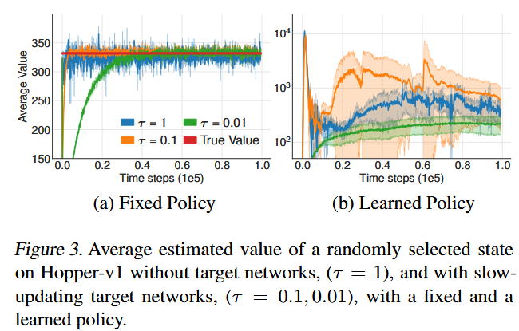

# 1. DDPG 为何频繁崩溃

在强化学习中，智能体使用神经网络来逼近真实的价值函数（函数近似）。神经网络天生具有拟合误差。在传统的 Actor-Critic（如 DDPG）中，这种近似误差会引发两个毁灭性的恶性循环：

在深度强化学习中，真实的动作价值曲面极其复杂。当我们使用深度神经网络去拟合这个价值函数（Critic）时，受限于网络容量、采样批次的有限性以及梯度更新的随机性，神经网络的预测**绝对不可能做到处处百分之百精准**。
它在某些动作点上的打分会偏高一点，在某些点上会偏低一点。这种**不可避免的“函数近似误差”和预测噪声，引发后续所有灾难的导火索**。

---

## 1.1 过估计偏差与自欺欺人的“恶性闭环”
这个本该是零均值的随机噪声，一旦遇上了 Actor-Critic 的更新机制，就会立刻演变成一种**系统性的“正向过估计偏差”**：

* **Actor 的本能是“趋炎附势”**：策略网络（Actor）的任务是沿着 Critic 的打分梯度，寻找 Q 值最大的动作。当真实的两个动作优劣难分时，如果 Critic 网络因为近似误差，碰巧把动作 A 的分数高估了一点，Actor 就会受其诱导，坚定地认为“动作 A 是个神级动作”，并在参数更新中大幅增加动作 A 的出现概率。
* **恶性闭环的形成**：Actor 被误导去频繁选择次优的动作 A；而下一次 Critic 在通过时序差分更新目标值时，又拿这个已经被偏爱的动作 A 来估算未来的收益。
* **后果**：**错误的决策反过来加固了错误的估值，形成了一个正反馈闭环**。Critic 对价值的评估越来越虚高，最终彻底脱离物理现实。

---

## 1.2 时序差分的“滚雪球效应”与剧烈方差

与此同时，时序差分（TD Learning）的本质缺陷在此时被进一步引爆：

* **用明天的猜测，修正今天的预估**：TD 学习是一种“自举”算法——它用下一时刻的 Q 估值作为基准来更新当前时刻的 Q 估值。这意味着，任何一次微小的不准确估计，都会通过折现因子 $\gamma$ 被无条件地打包传导给前一个时间步。
* **误差累积**：单步留下的残差 $\delta$ 会沿着整条轨迹像“滚雪球”一样指数级向下累积（$\sum \gamma^t \delta_t$）。
* 如果目标网络随着 Actor 的频繁变动而快速更新，相当于**“枪靶子在剧烈晃动，打枪的人也在乱晃”**。整个系统的评估方差瞬间爆炸，学习目标不再平稳，梯度方向四处乱撞。

> **方差越来越大 $\implies$ 随机波动的噪点峰值越来越高 $\implies$ Actor 越容易跌入虚高的假极值孤峰 $\implies$ Actor 做出越来越离谱的物理动作 $\implies$ 收集到更极端更混乱的数据 $\implies$ Critic 的方差进一步失控爆炸。**

在数学上，神经网络预测出的 Q 曲线呈现出脱轨式的暴涨或剧烈震荡；
在物理表现上，机器人在仿真环境里可能几万步前还在正常行走，突然就在某一步彻底发散崩溃，瘫倒在地不断抽搐，再也无法收敛。这就是 DDPG 曾经让无数科研人员极度头疼的“脆弱性”本质。

TD3 的核心贡献，正是针对这两个病灶：
1. **Twin Critics（双 Critic 截断）** $\to$ 根治过估计偏差；
2. **Delayed Updates（延迟更新）** $\to$ 阻断策略与价值的剧烈耦合震荡；
3. **Policy Smoothing（策略平滑）** $\to$ 消除高方差与窄峰过拟合。

---

# 2. 连续动作空间中的过估计偏差

### 2.1 DDPG 

* **确定性策略梯度定理（DPG）**，智能体策略是确定性函数 $a = \pi_\phi(s)$，目标是最大化期望累积回报 $J(\phi) = \mathbb{E}[R_0]$。参数 $\phi$ 的更新梯度为：
  $$
  \nabla_\phi J(\phi) = \mathbb{E}_{s \sim p_\pi} \left[ \nabla_a Q^\pi(s, a)\big|_{a=\pi(s)} \cdot \nabla_\phi \pi_\phi(s) \right] \tag{1}
  $$
  *(直观含义：Critic 网络告诉 Actor 动作往哪移动 Q 值增大，Actor 就往该方向更新参数)*。
  
* **连续状态下的贝尔曼方程**
  $$
  Q^\pi(s, a) = r + \gamma \mathbb{E}_{s', a'} \left[ Q^\pi(s', a') \right], \quad a' \sim \pi(s') \tag{2}
  $$
  
* **DDPG 的 Critic 训练目标值**，使用参数为 $\theta'$ 的目标 Critic 网络和参数为 $\phi'$ 的目标 Actor 网络：
  $$
  y = r + \gamma Q_{\theta'}(s', a'), \quad a' \sim \pi_{\phi'}(s') \tag{3}
  $$

---

## 2.2 过估计偏差

在离散 Q-learning 中，因为有显式的贪婪取最大值操作 $y = r + \gamma \max_{a'} Q(s', a')$，早就证明过：
$$
\mathbb{E}\left[ \max_a (Q(s, a) + \epsilon) \right] \ge \max_a Q(s, a)
$$
*(因为 $\max$ 总是倾向于挑出那些碰巧带有正向随机噪声的估计值，导致期望必然被推高)*。

但在连续控制中，**根本没有 $\max$ 操作，Actor 是通过梯度上升一步一步更新的**。为什么这样也会发生系统性过估计？

设当前 Actor 参数为 $\phi$。
* **$\phi_{approx}$**：由**近似的 Critic $Q_\theta$** 引导更新得到的新参数；
* **$\phi_{true}$**：由**上帝视角的真实价值 $Q^\pi$** 引导更新得到的新参数。
  $$
  \phi_{approx} = \phi + \frac{\alpha}{Z_1} \mathbb{E}_{s \sim p_\pi} \left[ \nabla_\phi \pi_\phi(s) \nabla_a Q_\theta(s, a)\big|_{a=\pi_\phi(s)} \right] \tag{4.1}
  $$

  $$
  \phi_{true} = \phi + \frac{\alpha}{Z_2} \mathbb{E}_{s \sim p_\pi} \left[ \nabla_\phi \pi_\phi(s) \nabla_a Q^\pi(s, a)\big|_{a=\pi_\phi(s)} \right] \tag{4.2}
  $$

  其中 $\alpha$ 是步长，$Z_1, Z_2$ 是梯度归一化常数，使得更新步长的欧氏长度相同。记新策略分别为 $\pi_{approx}$ 和 $\pi_{true}$。

**在 $Q_\theta$ 眼里，$\pi_{approx}$ 是最优的**：因为 $\phi_{approx}$ 恰恰是沿着 $Q_\theta$ 的梯度方向迈出的，根据微积分局部极值原理，存在足够小的步长 $\epsilon_1$，只要 $\alpha \le \epsilon_1$：
$$
\mathbb{E}\left[ Q_\theta(s, \pi_{approx}(s)) \right] \ge \mathbb{E}\left[ Q_\theta(s, \pi_{true}(s)) \right] \tag{5}
$$
**在真实 $Q^\pi$ 眼里，$\pi_{true}$ 才是最优的**：同理，$\phi_{true}$ 是沿着真实 $Q^\pi$ 梯度方向迈出的，存在足够小的步长 $\epsilon_2$，只要 $\alpha \le \epsilon_2$：
$$
\mathbb{E}\left[ Q^\pi(s, \pi_{true}(s)) \right] \ge \mathbb{E}\left[ Q^\pi(s, \pi_{approx}(s)) \right] \tag{6}
$$
**过估计**：
假设在更新点附近，Critic 对真实策略的打分没有系统性低估，即 $\mathbb{E}[Q_\theta(s, \pi_{true}(s))] \ge \mathbb{E}[Q^\pi(s, \pi_{true}(s))]$。将公式 (5) 和公式 (6) 连立串联：
$$
\mathbb{E}\left[ Q_\theta(s, \pi_{approx}(s)) \right] \stackrel{\text{公式 5}}{\ge} \mathbb{E}\left[ Q_\theta(s, \pi_{true}(s)) \right] \ge \mathbb{E}\left[ Q^\pi(s, \pi_{true}(s)) \right] \stackrel{\text{公式 6}}{\ge} \mathbb{E}\left[ Q^\pi(s, \pi_{approx}(s)) \right]
$$

$$
\implies \mathbb{E}\left[ Q_\theta(s, \pi_{approx}(s)) \right] \ge \mathbb{E}\left[ Q^\pi(s, \pi_{approx}(s)) \right] \tag{7}
$$

> **在连续动作空间中，只要 Actor 沿着近似 Critic 的梯度更新，Critic 给这个新策略打的分数，在数学期望上必然高于该策略的真实价值！**

---

若在代码中我们没有对梯度做归一化（即没有除以 $Z_1, Z_2$），结论是否依然成立？假设在初始参数 $\phi$ 沿着真实更新方向的线段区间内，Critic 在期望上是无偏的：
$$
\mathbb{E}_{s \sim \pi} \left[ Q_\theta(s, \pi_{new}(s)) \right] = \mathbb{E}_{s \sim \pi} \left[ Q^\pi(s, \pi_{new}(s)) \right], \quad \forall \phi_{new} \in [\phi, \phi + \beta(\phi_{true} - \phi)] \tag{22}
$$
因为 $\phi_{true}$ 是使真实价值变化率最大的方向：$\Delta_{true}^\pi \ge \Delta_{approx}^\pi$。近似价值在极值点处的最大变化率必定不小于真实最大变化率：$\Delta_{approx}^\theta \ge \Delta_{true}^\pi$。同样可推出：
$$
Q_\theta(s, \pi_{approx}(s)) \ge Q^\pi(s, \pi_{true}(s)) \ge Q^\pi(s, \pi_{approx}(s))
$$
证明了即使在无归一化的情况下，过估计偏差依然是不可避免的系统性存在。

---

# 3. 截断双 Q 学习（CDQ）

## 3.1 为什么直接搬用 Double DQN 会失效？
在离散控制中，Double DQN 的做法是：用当前网络选动作，用目标网络打分。如果搬到 Actor-Critic 中，目标值应该写为：
$$
y = r + \gamma Q_{\theta'}(s', \pi_\phi(s')) \tag{8}
$$

* **为什么在连续控制中失效了？**：
  在 Actor-Critic 中，策略网络 $\pi_\phi$ 的参数变化是非常缓慢的，导致当前策略 $\pi_\phi$ 和目标策略 $\pi_{\phi'}$ 极其相似。当前 Critic 和目标 Critic 之间缺乏独立性，根本起不到解耦过估计的作用！

退一步，如果采用最纯粹的 Double Q-learning，用两套独立的 Actor 和两套独立的 Critic：
$$
y_1 = r + \gamma Q_{\theta'_2}(s', \pi_{\phi_1}(s')), \quad y_2 = r + \gamma Q_{\theta'_1}(s', \pi_{\phi_2}(s')) \tag{9}
$$

* **问题依然存在**：因为两个 Critic 都在拟合同一个经验回放池，它们并不是绝对统计独立的。在某些状态下仍然会出现 $Q_{\theta_2} > Q_{\theta_1}$，局部的过估计仍然会被跨网络传播。

---

## 3.2 TD3 截断双 Q 学习

既然 $Q_1$ 存在过估计，我们可以把 $Q_1$ 作为上限，用 $Q_2$ 去约束它，反之亦然。**取二者的最小值**。

$$
y_1 = r + \gamma \min_{i=1,2} Q_{\theta'_i}\left( s', \pi_{\phi_1}(s') \right) \tag{10}
$$

1. **彻底阻断过估计传播**：
   取 $\min$ 可能会带来微弱的**低估偏差**。但是在强化学习中，**低估远远好于高估**
   
   - 如果一个动作被高估了，Actor 会高频次地盲目选择它，错误通过贝尔曼更新不断扩散；
   - 如果一个动作被低估了，Actor 会倾向于避开它，这个低估的错误**绝不会被主动放大和传播**
2. **巧妙的方差惩罚**：
   在统计学中，设有两个均值相同的独立随机变量 $X_1, X_2 \sim \mathcal{N}(\mu, \sigma^2)$。其最小值的期望满足：
   $$
   \mathbb{E}[\min(X_1, X_2)] = \mu - \frac{\sigma}{\sqrt{\pi}}
   $$
   **注意看减号后面的项！方差 $\sigma$ 越大，最小值的期望越小！**这意味着：**对于那些 Critic 估计不确定、方差巨大的危险状态，$\min$ 操作会自动给予更低的价值打分！** 这迫使策略倾向于选择那些 Critic 认知清晰、估计方差小的安全状态。

---

## 3.3 截断双 Q 学习在表格型环境下的完全数学收敛证明

考虑有限状态 MDP，维护两张表格 $Q^A, Q^B$：
$$
a^* = \arg\max_a Q^A(s', a) \tag{16.1}
$$

$$
y = r + \gamma \min\left( Q^A(s', a^*), \; Q^B(s', a^*) \right) \tag{16.2}
$$

更新式为：
$$
Q^A(s, a) \leftarrow Q^A(s, a) + \alpha_t \left( y - Q^A(s, a) \right) \tag{17}
$$
作者引入了随机逼近理论的经典工具考虑随机过程：
$$
\Delta_{t+1}(x) = (1 - \zeta_t(x))\Delta_t(x) + \zeta_t(x) F_t(x) \tag{18}
$$

| 符号                | 论文中的名字                 | 在强化学习中的真实身份                                       |
| :------------------ | :--------------------------- | :----------------------------------------------------------- |
| **$x_t$**           | 状态空间中的元素 $x_t \in X$ | **当前访问到的“状态-动作对” $(s_t, a_t)$**。 这里的集合 $X = \mathcal{S} \times \mathcal{A}$（所有可能的状态和动作构成的离散空间）。 |
| **$\Delta_t(x_t)$** | 误差函数（Delta）            | **当前步的估计误差**：$\Delta_t(s_t, a_t) = Q_t(s_t, a_t) - Q^*(s_t, a_t)$。 表示当前估算的 Q 值距离上帝视角的真实最优 Q* 差了多少。 |
| **$\zeta_t(x_t)$**  | 步长序列（Zeta）             | **其实就是学习率（Learning Rate）$\alpha_t(s_t, a_t)$！** 论文只是换了一个希腊字母 $\zeta$ 来表示通用步长，它是一个在 $[0, 1]$ 之间的小数。 |
| **$F_t(x_t)$**      | 扰动算子 / 驱动项            | **新计算出的目标值相对于真实 $Q^*$ 的偏差**： $F_t = \text{Target}_t - Q^*$。 它负责给下一次误差更新提供动力。 |

只要满足学习率发散且平方和收敛，且误差算子满足收缩条件：$\|\mathbb{E}[F_t | \mathcal{P}_t]\| \le \kappa \|\Delta_t\| + c_t$（其中 $\kappa < 1$，$c_t \to 0$），则误差 $\Delta_t$ 必以概率 1 收敛到 0。

> [!IMPORTANT]
>
> ### 三、 为什么公式 (18) 长这个样子？它是怎么从 Q 学习变出来的？
>
> 在强化学习的 Q-learning 中，表格更新公式：
> $$
> Q_{t+1}(s_t, a_t) = Q_t(s_t, a_t) + \alpha_t \Big( \text{Target}_t - Q_t(s_t, a_t) \Big) \\
> \implies Q_{t+1}(s_t, a_t) = (1 - \alpha_t) Q_t(s_t, a_t) + \alpha_t \cdot \text{Target}_t
> $$
> 现在，我们在**等号两边同时减去同一个常数——真实最优值 $Q^*(s_t, a_t)$**：
> $$
> \begin{aligned}
> Q_{t+1} - Q^* &= (1 - \alpha_t) Q_t + \alpha_t \cdot \text{Target}_t - Q^* \\
> &= (1 - \alpha_t) Q_t + \alpha_t \cdot \text{Target}_t - \Big( (1 - \alpha_t) Q^* + \alpha_t Q^* \Big) \\
> &= (1 - \alpha_t) \underbrace{(Q_t - Q^*)}_{\text{记作 } \Delta_t} + \alpha_t \underbrace{(\text{Target}_t - Q^*)}_{\text{记作 } F_t}
> \end{aligned}
> $$
> 把代号换掉：令 $\Delta = Q - Q^*$，令 $\zeta = \alpha$，令 $F = \text{Target} - Q^*$：
> $$
> \Delta_{t+1} = (1 - \zeta_t) \Delta_t + \zeta_t F_t
> $$
> **它本质上就是 Q-learning 更新公式在两边同时减去 $Q^*$ 之后的等价变体！就是在看$t$趋于无穷的时候误差是否为0。**
>
> ---
>
> ###  $\mathcal{P}_t$ 是什么
>
> 论文在附录 A 的 Lemma 1 下方写了一句话：
>
> > *"Let $P_t$ be a sequence of increasing $\sigma$-fields such that $\dots$ "*$$\mathcal{P}_t = \big\{ Q_0^A, Q_0^B, s_0, a_0, \alpha_0, r_1, s_1, \dots, s_t, a_t \big\}$$
>
> 在现代概率论（测度论）中，$\sigma$-代数（$\sigma$-field）代表“可观测到的信息”。带有下标 $t$ 且逐步扩大的序列 $\mathcal{P}_0 \subset \mathcal{P}_1 \subset \dots \subset \mathcal{P}_t$（专业术语叫**滤波，Filtration**）就是：
>
> > **$\mathcal{P}_t$ 代表“从游戏开始到当前时刻 $t$ 为止，系统经历过的全部历史记忆（所有历史状态、历史动作、历史奖励和学习率的集合）”。**
>
> #### 为什么公式里要写条件期望 $\mathbb{E}[F_t \mid \mathcal{P}_t]$？
>
> 因为强化学习是充满随机性的（环境状态转移是随机的、奖励是有随机波动的）。在求期望时加上“以 $\mathcal{P}_t$ 为条件”，意思是：
> **“假设过去的全部历史都已经发生、成为确定的既定事实，在已知所有历史的前提下，去预测下一步的动作价值期望。”**

设 $\Delta_t = Q^A_t - Q^*$。展开更新式：
$$
\Delta_{t+1}(s_t, a_t) = (1 - \alpha_t)\Delta_t(s_t, a_t) + \alpha_t F_t(s_t, a_t) \tag{19}
$$
构造算子 $F_t$，并加上和减去标准 Q-learning 算子项 $\gamma Q^A_t(s_{t+1}, a^*)$：
$$
\begin{aligned}
F_t(s_t, a_t) &= r_t + \gamma \min\big( Q^A_t(s_{t+1}, a^*), Q^B_t(s_{t+1}, a^*) \big) - Q^*(s_t, a_t) \\
&= \underbrace{r_t + \gamma Q^A_t(s_{t+1}, a^*) - Q^*(s_t, a_t)}_{F_t^Q \text{ (标准 Q-learning 算子)}} \;+\; \underbrace{\gamma \min\big( Q^A_t, Q^B_t \big) - \gamma Q^A_t}_{c_t \text{ (扰动残差项)}} 
\end{aligned} \tag{20}
$$
因为已知标准算子收缩：$\|\mathbb{E}[F_t^Q]\| \le \gamma \|\Delta_t\|$（$\gamma < 1$）。现在只需证明扰动项 $c_t$ 最终收敛到 0。定义两张表的差值 $\Delta_t^{BA} = Q_t^B - Q_t^A$，两表更新之差为：
$$
\begin{aligned}
\Delta_{t+1}^{BA}(s_t, a_t) &= \Delta_t^{BA} + \alpha_t \Big[ (y - Q_t^B) - (y - Q_t^A) \Big] \\
&= (1 - \alpha_t) \Delta_t^{BA}(s_t, a_t) 
\end{aligned} \tag{21}
$$
根据标准级数收敛定理，$\Delta_t^{BA}$ 必然以概率 1 衰减收敛到 0！这意味两张表的差异归零，$c_t \to 0$。因此：截断双 Q 学习必然以概率 1 收敛到全局最优价值函数 $Q^*$

---

# 4. 误差累积与延迟策略更新

## 4.1 单步 TD 误差的滚雪球效应

在深度强化学习中，贝尔曼方程永远无法精确满足，每一步更新总会残留一个时序差分残差（TD-error）$\delta(s, a)$：
$$
Q_\theta(s, a) = r + \gamma \mathbb{E}\left[ Q_\theta(s', a') \right] - \delta(s, a) \tag{11}
$$
如果我们把这个式子沿着整条时间轴展开：
$$
\begin{aligned}
Q_\theta(s_t, a_t) &= r_t + \gamma \mathbb{E}[Q_\theta(s_{t+1}, a_{t+1})] - \delta_t \\
&= r_t + \gamma \mathbb{E}\big[ r_{t+1} + \gamma \mathbb{E}[Q_\theta(s_{t+2}, a_{t+2}) - \delta_{t+1}] \big] - \delta_t \\
&= \mathbb{E}_{s_i, a_i \sim \pi} \left[ \sum_{i=t}^T \gamma^{i-t} (r_i - \delta_i) \right] 
\end{aligned} \tag{12}
$$

> 估计出来的 $Q$ 值，**本质上等于真实预期回报减去未来所有时序差分误差的折现累积和！**当折扣因子 $\gamma = 0.99$ 很大时，由于未来步数极长，单步微小的误差 $\delta$ 会被指数级放大并累积，导致价值估计产生极大的方差。

---

## 4.2 双时间尺度延迟更新

* **图 3(a) 固定策略**：如果策略不更新，只更新 Critic，无论用不用目标网络，Q 值最终都能收敛。
* **图 3(b) 联动更新策略**：一旦允许策略根据当前不准确的 Q 值实时更新，且目标网络更新过快（$\tau=1$），Q 值直接发散暴涨到 $10^4$ 以上

**这是因为 Actor 和 Critic 之间形成了恶性耦合**：

1. Critic 刚跑了一两个 batch，还没把当前局势评判清楚，误差 $\delta$ 很大；
2. 此时 Actor 就迫不及待地根据这个错误的 Q 梯度更新了策略；
3. Actor 策略变了，导致以前采样的分布失效，Critic 更加摸不着头脑，误差进一步放大；
4. 这种互为因果的正反馈震荡最终彻底摧毁训练。

作者提出：**大幅降低 Actor 的更新频率！**
* 策略更新频率必须**低于**价值网络的更新频率。
* **规则**：Critic 每更新 $d$ 次（通常 $d=2$），Actor 和目标网络才更新 1 次！
* 让 Critic 先沉下心来多拟合几次，把 TD 误差 $\delta$ 压到足够小、方差足够低之后，再以更加可信、平稳的 Q 曲面来指导 Actor 迈出稳健的一步。

---

# 5. 目标策略平滑正则化

## 5.1 确定性策略的“尖峰过拟合”陷阱

在确定性 Actor-Critic 中，目标值 $y = r + \gamma Q(s', \pi(s'))$ 直接拿单个动作点 $\pi(s')$ 去查 Q 表。在函数近似下，深度神经网络拟合出来的 Q 表面往往存在很多**狭窄尖锐的虚高孤峰**：Actor 很容易被梯度吸引，死死卡在这些虚假的尖峰上无法自拔。

---

## 5.2  SARSA 思想的平滑正则化

如何抹平这些尖峰？作者提出了**目标策略平滑**：
**核心假设**：在物理世界中，相似的动作应该产生相似的价值！如果在动作 $\pi(s')$ 附近稍微抖动一下，Q 值就断崖式下跌，说明这个动作根本不可靠。因此，理想的目标 Q 值应该在目标动作周围的一个小邻域内**求期望积分**：
$$
y = r + \gamma \mathbb{E}_\epsilon \left[ Q_{\theta'}(s', \pi_{\phi'}(s') + \epsilon) \right] \tag{13}
$$
作者通过在目标动作上**外加一段截断高斯噪声**来蒙特卡洛近似这个期望：

$$
y = r + \gamma Q_{\theta'}\big(s', \pi_{\phi'}(s') + \epsilon\big), \quad \epsilon \sim \text{clip}\big(\mathcal{N}(0, \tilde{\sigma}), -c, c\big) \tag{14}
$$

* **$\epsilon \sim \mathcal{N}(0, \tilde{\sigma})$**：为动作注入探索扰动（论文取 $\tilde{\sigma} = 0.2$）；
* **$\text{clip}(\cdot, -c, c)$**：将噪声截断在 $[-c, c]$ 范围内，防止噪声太大脱离了当前动作的邻域范围。

这相当于对 Q 价值曲面做了一层**低通滤波器卷积**，把尖锐的伪极值孤峰彻底抹平，强迫价值函数向平缓、安全的区域靠拢。将上述创新合为一体，得到了 TD3 计算 Target 的**一统公式**：

$$
y = r + \gamma \min_{i=1,2} Q_{\theta'_i}\Big( s', \; \text{clip}\big(\pi_{\phi'}(s') + \epsilon, \; a_{low}, \; a_{high}\big) \Big), \quad \epsilon \sim \text{clip}\big(\mathcal{N}(0, \sigma), -c, c\big) \tag{15}
$$
