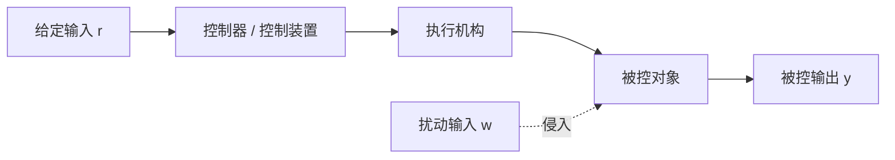
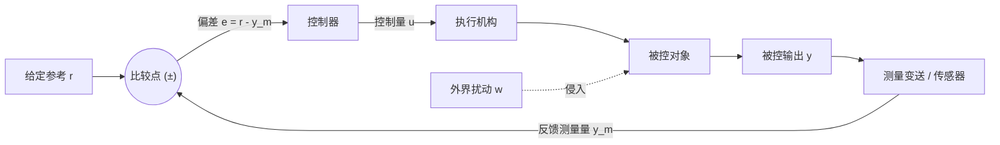
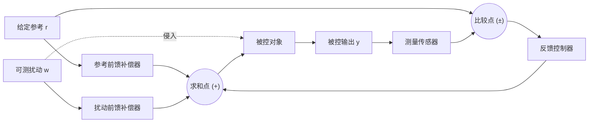
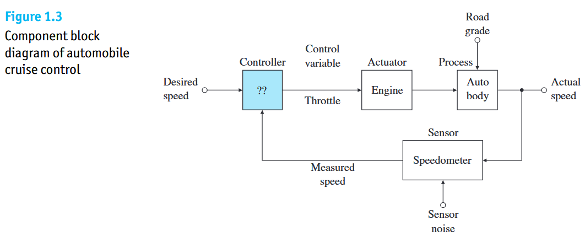
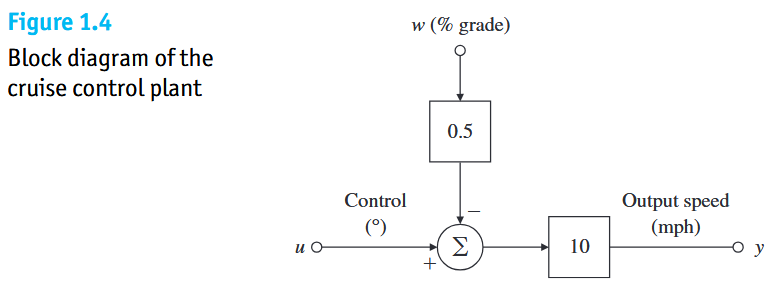
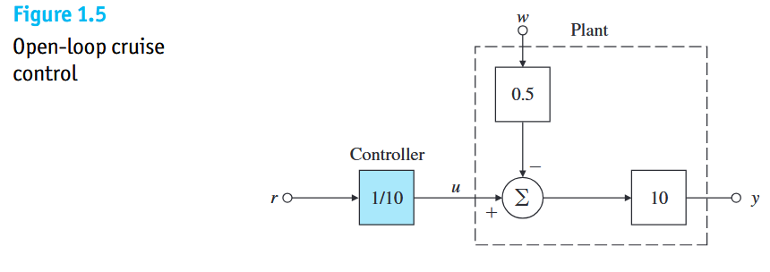
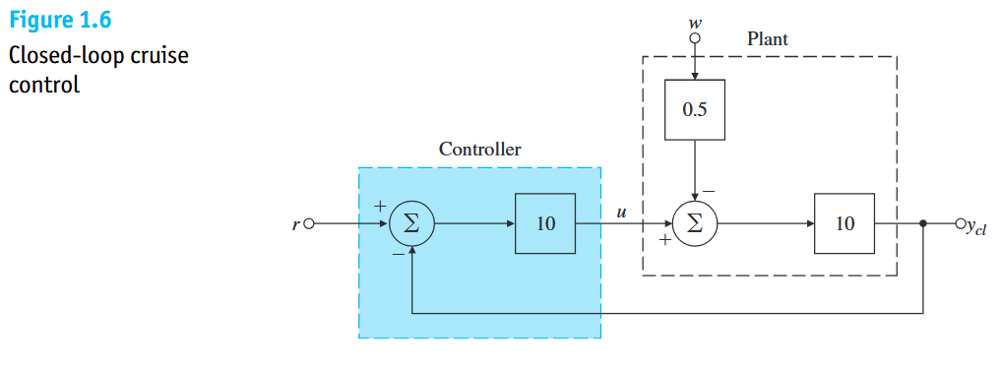
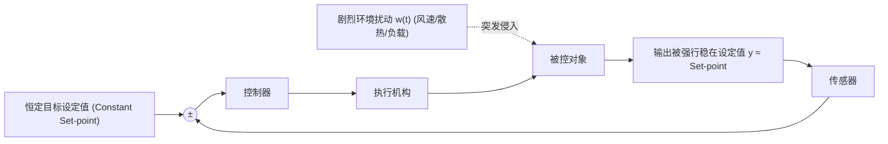

# A Perspective on Feedback Control

## Basic Concepts

* **Manual Control**：人作为回路核心，完成观测、决策并操作执行机构。
* **Automatic Control**：在**无人直接参与**的前提下，利用物理控制装置驱使被控对象的特定物理量按照预定规律运行（如温控器调温）。

## 反馈控制
测量动态系统的实际输出，并将其回传至控制器以计算控制动作，最终施加于被控系统。反馈的底层机制为**负反馈（Negative Feedback）**：以输出与给定的**偏差**作为调控信号，通过闭环动作减小或消除偏差。

* **恒值调节系统 (Regulators)**：给定输入为恒定基准值，核心任务为**抵抗未知外扰，维持输出恒定**（如工业恒温、发电机稳压）。
* **随动 / 伺服系统 (Tracking / Servo Systems)**：给定输入为任意未知变化的时间函数，核心任务为**快速、高精度地跟踪参考指令**（如火炮瞄准、雷达跟踪、机械臂轨迹跟随）。
* **程序控制系统 (Programmed Control Systems)**：给定输入按预先确定的时间程序规律变化（如热处理炉退火过程）。

---

## 控制系统的结构形态

### Open-loop Control

控制器在计算控制动作时**不使用**被控输出量的测量信息。


* **特点**：信息单向流动，无回路；系统无法感知输出偏差，**对模型失配及外界扰动无自纠偏能力**；但结构简单且绝对不会引发闭环自激失稳。

### Closed-loop / Feedback Control
控制器实时获取被控输出量的测量值，并引入控制计算。


* **特点**：
  1. 信号在系统内部流动构成**闭回路**；
  2. 控制作用直接由**偏差**驱动（“检测偏差，消除偏差”）；
  3. 可大幅抑制外部不可预测扰动，并降低对被控对象参数摄动的敏感度。

### 复合控制系统 (Compound Control)
针对开环抗扰弱、闭环响应存在滞后的特点，结合**前馈补偿**与**闭环反馈**的复合拓扑。



---

## 纯反馈机制与前馈/预测控制

### 纯反馈的因果律滞后
* **物理机制**：纯负反馈完全依赖**当前已产生并测得的偏差**进行纠偏。
* **局限性**：
  * 该机制等效于**在浓雾中驾驶汽车**——驾驶员只能看清车头当前偏移了路面多少，却无法看清前方弯道走向。
  * 纯反馈本质上属于**“后发响应”**：扰动必须已经引起输出变化并被传感器检测到，控制器才会动作。在具备大惯性或时间滞后的物理系统中，单纯依赖高增益反馈极易引发震荡或发散。

### 预测控制与前馈控制机制
* **预测控制 (Predictive Control)**：前瞻感知未来轨迹或变化趋势，提前优化控制动作（相当于在晴朗天气下看清前方道路规划路线）。
* **前馈控制 (Feedforward Control)**：若系统能够提前测得外界扰动或参考轨迹规律，直接将该信息“前馈”注入控制器做提前响应，而无需等待偏差出现。
  * **经典实例**：日用电负荷具有已知的周期性需求曲线。在用电高峰到来之前，系统可将负荷激增信息直接前馈给锅炉控制器，提前加大燃料与蒸汽流量，从而在扰动造成气压下跌前对冲其影响。

# A Simple Feedback System

控制理论的研究并非始于抽象的传递函数，而是始于对物理世界动态过程的观测与干预。在反馈控制中，**被控变量（如温度、速度、压力）由传感器进行检测，测量信号被回传至控制器与预设目标比对，控制器根据比对结果产生调节作用，从而改变被控变量的动态演化**。

---

## 室内恒温控制系统

设想一套带有燃气加热炉与壁挂温控器的住宅供暖系统：
1. **启动阶段**：初始时刻室内外温度均为 $50^\circ\text{F}$，居民将温控器设定为目标温度（Set-point）$55^\circ\text{F}$。由于室温低于目标值，温控器内部开关闭合（状态为 *On*），控制逻辑打开燃气阀门并点燃燃烧室。
2. **升温阶段**：燃气炉燃烧向房屋注入热量，供热速率记为 $Q_{in}$。由于 $Q_{in}$ 显著大于房屋向外部环境的散热损失速率 $Q_{out}$，室内温度开始持续爬升。
3. **阶跃切换与超调截断**：清晨 6:00，居民将设定温度阶跃调整至 $65^\circ\text{F}$。燃气炉保持满负荷工作，使室温迅速上升。当室温达到并略微超过设定值 $65^\circ\text{F}$ 一个微小裕量时，温控器动作切换至关断状态（*Off*），切断燃气供应。
4. **散热回落与循环振荡**：熄火后，由于室内外存在温差，房屋通过墙壁、门窗向外界自然散热，室温开始朝外部气温（$50^\circ\text{F}$）方向回落。当温度跌落至低于设定值某个阈值时，温控器再次接通（*On*），加热炉重启。系统由此进入周而复始的周期性循环。

---


**Figure 1.1(a) 拓扑流向解析**：

* **输入端**：期望温度进入**温控器（Thermostat）**；
* **前向通道**：温控器输出电信号驱动**燃气阀门（Gas valve）**开闭，阀门控制燃料注入**加热炉（Furnace）**；
* **能量汇总点（求和符号 $\Sigma$）**：加热炉产生的供热速率 $Q_{in}$ 为正输入（$+$），外部环境造成的散热损失 $Q_{out}$（系统扰动）为负输入（$-$）；
* **被控对象**：净热流（$Q_{in} - Q_{out}$）流入**房屋主体**，蓄热升温并产生受控物理量——**室内温度**；
* **反馈回路**：室内温度沿反馈线回传，输入温控器感知端，与设定值闭环比较。

---

**Figure 1.1(b) 曲线特征的物理本质分析**：

1. **位式控制（On-Off / Bang-Bang Control）的固有极限环**：
   * 燃气炉只有全开（*On*）与全关（*Off*）两种状态，反映在下方的执行机构波形上为一系列离散的脉冲矩形波。
   * 这种不连续控制导致室内温度无法绝对静止在 $65^\circ\text{F}$ 这一单点上，而是在设定点上下呈现锯齿状的微小周期性波动。
2. **升温速率与降温速率的非对称性**：
   * **升温斜率极陡**：炉子开启时，燃烧释放的能量巨大，$Q_{in} \gg Q_{out}$，净热流充沛，升温迅速；
   * **降温斜率极缓**：炉子关闭时，仅依靠房屋向外界 $50^\circ\text{F}$ 环境的传热温差散热。由于现代房屋具备优良的保温隔热层与双层中空玻璃，热阻极大，热量散失缓慢。这一不对称性揭示了**被控对象的物理本征参数（热阻、热容）在根本上制约着系统的动态响应形态**。

---

## 通用控制架构


1. **设定输入**：外界给定的物理基准（Reference）首先经过**输入滤波器（Input filter）**，转化为标准化内部参考电信号；
2. **求和比较点（$\Sigma$）**：经过滤波的参考信号与来自反馈通道的传感器测量信号作差，生成反映系统偏离程度的**误差信号**；
3. **算法求解**：误差信号输入**控制器（Controller）**，控制器按预设控制律解算出所需的驱动控制信号（Control signal）；
4. **物理驱动与演化**：控制信号传达给**执行机构（Actuator）**，执行器放大功率并驱动物理**被控过程（Process）**；同时，环境**外部扰动（Disturbance）**不可避免地侵入被控过程；
5. **输出生成**：被控过程在执行器作用力与扰动的共同作用下演化出物理**被控输出（Output）**；
6. **测量反馈**：物理输出由**传感器（Sensor）**采样，叠加不可消除的**测量噪声（Sensor noise）**后，回传至比较点完成闭环。

---

### 被控过程 (Process)
* **概念定义**：承载核心物理变化动态、其输出物理量需要被控制的主体设备或工质。在温控案例中即为**房屋主体**及其内部空气；在工业炉温系统中对应**电炉膛**。
* **物理特征**：过程本体具有惯性、阻尼或储能特性，外部环境的未建模热流、风阻、负载变化均作为**扰动**在此处注入。
* **工程设计哲学（控得好不如造得好）**：
  * 保温隔热良好的房屋，其温度控制难度远低于漏风建筑；
  * 同样，一架在气动布局上充分考虑了自稳定性与控制裕度的飞行器，其飞行控制器的设计难度远低于气动恶劣的机型。
  * **控制问题必须在系统物理结构设计的最初阶段就介入考量，优秀的本体物理设计能够大幅降低控制器负担**。

### 执行机构 (Actuator)
* **概念定义**：直接对被控过程施加物理干预、改变其动态输出的动力变换装置。
* **温控案例对应**：包括**燃气阀门（Gas valve）**、点火装置以及**鼓风机（Blower fan）**。
  * **能力优先原则**：对于执行器而言，**输出功率容量（Power）、响应速度（Speed/Slew Rate）与长期运行可靠性（Reliability），其重要性往往远在静态精度之上**。
  * 供暖炉必须拥有足够的发热功率，以应对极端严寒天气的散热损失；同时必须能够迅速将热流输送出去。
* **子系统嵌套现象**：
  * 复杂的执行机构内部通常自身包含更深层次的底层反馈系统。例如，燃气炉本身由气阀开度检测、温度保护开关联锁、根据炉温自动启停的鼓风机等构成了一个多层嵌套的小闭环。

### 广义被控对象 (Plant)
* **概念界定**：在经典控制理论与工程设计中，通常将**执行机构（Actuator）与被控过程（Process）的串联组合**划定在同一个虚线框内，统称为 **Plant（广义被控对象）**。控制算法的设计目标，正是针对这个包含了驱动特性与负载特性的综合体（Plant），求解一个能够驱使其产生期望输出的最佳控制信号输入 $u$。

### 测量元件 / 传感器 (Sensor / Transducer)
* **概念定义**：测量实际物理输出变量，并将其转换为易于控制器处理的信息载体（通常为弱电信号：电压或数字量）的装置。
  * **测量精度（Accuracy）**：测量值与物理真实值的一致性；
  * **低本底噪声（Low Noise）**：避免将高频杂波引入闭环；
  * **宽动态范围与高线性度（Linearity）**：保证输出电压与被测物理量呈严格比例关系，避免引入未建模的几何非线性畸变；
  * **可靠性与标定便利性**：不易发生零点漂移（Zero Drift）。

### 输入滤波器 (Input Filter)
* **概念定义**：位于参考基准输入端与比较点之间的前置信号调理单元。
  1. **电气匹配**：将外部指令（如机械旋钮位置、按键数字设定）转换为与反馈传感器量程一致的电信号；
  2. **指令整形（Command Shaping）**：在高级控制中，前置滤波器对急剧跳变的阶跃指令进行平滑滤波，限制指令的变化率，以**防止参考值阶跃突变引发控制器饱和或机构冲击，从而大幅改善闭环过渡过程品质**。

### 控制器 (Controller)
* **概念定义**：闭环系统的“大脑”。接收参考信号与测量信号，运算求取系统偏差，并根据控制逻辑实时生成发往执行器的驱动信号。

## 教材与视频的映射对齐表

| 系统功能角色 | Franklin 英文原版术语        | 卢京潮 PPT 教学体系术语  | 室内供暖案例中的实体                        | 工业电阻炉温控系统实体                        |
| :----------- | :--------------------------- | :----------------------- | :------------------------------------------ | :-------------------------------------------- |
| **参考指令** | Reference / Set-point        | 给定量 / 给定信号 $r(t)$ | 设定的舒适温度刻度（如 $65^\circ\text{F}$） | 给定电位器输出的基准电压 $u_g$                |
| **输入调理** | Input filter                 | 给定元件                 | 温控器旋钮/按键模数转换模块                 | 给定电位器电刷电路                            |
| **偏差计算** | Summing Junction ($\Sigma$)  | 比较元件                 | 温控器内部双金属片触点机械间隙              | 差动比较放大器（计算 $\Delta u = u_g - u_f$） |
| **算法核心** | Controller                   | 控制装置 / 放大元件      | 双金属片控制逻辑 / 微处理器芯片             | 电压放大器与功率放大器                        |
| **功率执行** | Actuator                     | 执行机构                 | 燃气电磁阀、燃烧室点火器、鼓风机            | 执行电动机、减速齿轮箱、自耦调压器            |
| **物理负载** | Process                      | 被控对象                 | 房屋建筑本体及室内空气                      | 电炉本体及炉膛工质                            |
| **受控量**   | Output / Controlled variable | 被控量 / 输出信号 $y(t)$ | 实际室内空气温度                            | 炉膛内的实际物理温度 $T$                      |
| **外源扰动** | Disturbance                  | 扰动量 / 干扰信号 $n(t)$ | 房屋墙壁热损失 $Q_{out}$、风力、门窗开启    | 炉门开闭、炉膛加料、环境温降、电网电压波动    |
| **状态检测** | Sensor                       | 测量元件 / 变送器        | 温控器内部测温热敏电阻                      | 插入炉膛的高温热电偶                          |
| **测量污染** | Sensor noise                 | 测量噪声 / 干扰          | 测温电路的热电噪声、气流接触波动            | 热电偶信号线耦合的工频电磁干扰                |

# A First Analysis of Feedback

控制科学的本质是定量工程学科。为了严格证明“为什么反馈具有不可替代的价值”，在 1.2 节摒弃了复杂的动态微分方程，构建了一个直观的**稳态标量代数模型**。通过对熟悉的汽车定速巡航进行开环与闭环的代数求解，我们可以用最纯粹的数学语言，定量看到反馈如何以 $1 + K_{\text{loop}}$ 倍的量级“粉碎”外部扰动。

---

## 汽车定速巡航



* **目标输入**：期望巡航车速（Desired speed $r$）；
* **控制器 (Controller)**：根据设定值计算控制动作，当前内部算法待定（标记为 `??`）；
* **控制变量 (Control variable)**：节气门开度转角（Throttle angle $u$，单位：角度度数 $^\circ$）；
* **执行机构 (Actuator)**：发动机（Engine），将节气门进气量转化为驱动力矩；
* **被控过程 (Process)**：汽车车体（Auto body），在驱动力、风阻及道路坡度下演化出车速；
* **外源扰动 (Disturbance)**：道路坡度（Road grade $w$，单位：百分比坡度 $\%$）；
* **被控输出 (Output)**：实际物理车速（Actual speed $y$，单位：英里/小时 $\text{mph}$）；
* **测量反馈 (Sensor)**：车速表（Speedometer），将车轮旋转转换为测得的车速信号回传控制器；不可避免地叠加密度较低的测量噪声（Sensor noise）。

---

为了进行纯粹的代数定量分析，教材在此引入两个工程假设：
1. **忽略暂态，仅考虑稳态行为**：暂不考虑汽车加减速过程中的惯性积分延迟；
2. **在工作点附近线性化**：假设车辆在 $65\text{ mph}$ 巡航工作点附近，物理输入输出呈线性比例关系。

**实验标定数据如下**：

* **节气门对车速的影响（被控对象增益）**：在平直路面上以 $65\text{ mph}$ 行驶时，节气门开度改变 $1^\circ$，引起车速改变 $10\text{ mph}$。因此，控制量 $u$ 到输出 $y$ 的静态传递比例系数为 **$10$**。
* **道路坡度对车速的影响（扰动通道增益）**：在实车测试中发现，道路坡度每增加 $1\%$（上坡阻力增加），车速将下降 $5\text{ mph}$。由于 $1\%$ 坡度造成的车速变化刚好是 $1^\circ$ 节气门影响（$10\text{ mph}$）的一半，因此扰动输入经过一个增益为 **$0.5$** 的减算环节接入系统。
* **传感器精度假设**：车速表精度远高于 $1\text{ mph}$，在此将其视为理想测量元件（反馈通路增益为 $1$）。

---

### 广义被控对象框图



* 信号线传递连续变量，方框代表理想放大器（输出等于输入乘以框内标称数值）；
* 比较点 $\Sigma$ 右侧标有符号（$+$ 代表叠加，$-$ 代表相减）；
* **广义被控对象（Plant）的代数输出方程**：
  $$
  y = 10 \cdot (u - 0.5w) = 10u - 5w
  $$
  
  * 式中 $u$ 为节气门转角（$^\circ$），$w$ 为道路坡度百分比（$\%$），$y$ 为实际输出车速（$\text{mph}$）。

---

## Open-loop Analysis

### 开环拓扑



在开环方案中，控制器**完全不采集车速表的读数**。控制变量 $u$ 仅取决于参考输入 $r$。
* **模型求逆控制器（Plant Inversion）**：为使系统在平路（$w = 0$）上达到目标车速 $r = 65\text{ mph}$，控制器必须对被控对象的稳态增益（$10$）进行直接求逆，设定固定比例关系：
  $$
  u = \frac{r}{10} = 0.1r
  $$
  将开环控制律代入对象模型：
  $$
  y_{ol} = 10(u - 0.5w) = 10\left(\frac{r}{10} - 0.5w\right) = r - 5w
  $$

* **开环绝对误差方程**（$e_{ol} \triangleq r - y_{ol}$）：
  $$
  e_{ol} = r - (r - 5w) = 5w 
  $$
* **相对百分比误差方程**：
  $$
  \%\text{ error} = \frac{e_{ol}}{r} \times 100\% = \frac{5w}{r} \times 100\% = 500\frac{w}{r}\%
  $$

设定基准车速 $r = 65\text{ mph}$：
1. **理想工况（无扰动，平直路面 $w = 0$）**：
   $$
   y_{ol} = 65 - 0 = 65\text{ mph}, \quad e_{ol} = 0
   $$
   此时系统表面上实现了完美跟踪，但这完全建立在**“环境零干扰”与“对象参数绝对精准”**的脆弱假设之上。
2. **扰动侵入工况（遭遇上坡 $w = 1\%$）**：
   $$
   y_{ol} = 65 - 5(1) = 60\text{ mph}, \quad e_{ol} = 5\text{ mph}
   $$
   车速骤降 $5\text{ mph}$，相对速度误差高达 **$7.69\%$**；若遇 $2\%$ 的陡坡，车速将跌落 $10\text{ mph}$，误差达 **$15.38\%$**。
3. **参数漂移脆弱性**：
   开环控制完全依赖控制器增益（$1/10$）与对象增益（$10$）的精密对消。在工程实际中，车辆载重增加、胎压降低、发动机积碳都会导致对象实际增益不再是 $10$。**在开环系统中，对象物理增益漂移多少百分比，最终车速输出就会产生等比例的严重稳态误差**。

---

## Closed-loop Analysis

### 闭环拓扑



在闭环方案中，车速表将实际车速 $y_{cl}$ 实时引回输入端，与参考车速 $r$ 在比较点相减得到实时误差。控制器采用最经典的**比例控制（Proportional Control）**，设定反馈控制器增益为 **$10$**。
* **闭环控制律**：
  $$
  u = 10(r - y_{cl})
  $$

系统包含两个耦合代数方程：
$$
\begin{cases} 
y_{cl} = 10u - 5w & \text{(对象物理特性)} \\
u = 10(r - y_{cl}) & \text{(闭环反馈控制律)} 
\end{cases}
$$

$$
y_{cl} = 100r - 100y_{cl} - 5w \\
\implies y_{cl} = \frac{100}{101}r - \frac{5}{101}w
$$

进而求得**闭环绝对误差方程**（$e_{cl} \triangleq r - y_{cl}$）：
$$
e_{cl} = r - \left(\frac{100}{101}r - \frac{5}{101}w\right) = \frac{1}{101}r + \frac{5}{101}w
$$

---

### 开环与闭环的量化对比

我们同样在基准车速 $r = 65\text{ mph}$、遭遇 $1\%$ 坡度扰动（$w = 1$）下检验闭环性能：

| 性能指标                    |          开环系统          |                  闭环系统                  | 性能跃迁本质                                   |
| :-------------------------- | :------------------------: | :----------------------------------------: | :--------------------------------------------- |
| **坡度扰动引起的误差项**    |   $5w = 5.0\text{ mph}$    | $\frac{5}{101}w \approx 0.0495\text{ mph}$ | 负反馈将外扰绝对误差压缩了 **$101$ 倍**        |
| **遭遇 $1\%$ 上坡实际车速** | $y_{ol} = 60.0\text{ mph}$ |     $y_{cl} \approx 64.307\text{ mph}$     | 闭环车速仅微跌 $0.05\text{ mph}$，人体几乎无感 |
| **稳态相对百分比误差**      |          $7.69\%$          |                 $0.0769\%$                 | 相对误差降低了整整**两个数量级**               |

* **闭环相对误差的严格计算**：
  $$
  \%\text{ error} = 100 \times \frac{y_{\text{level}} - y_{\text{grade}}}{y_{\text{level}}} = 100 \times \frac{\frac{65 \times 100}{101} - \left(\frac{65 \times 100}{101} - \frac{5}{101}\right)}{\frac{65 \times 100}{101}} \\
  = 100 \times \frac{5 \times 101}{101 \times 65 \times 100} = \mathbf{0.0769\%}
  $$

---

### 纯比例反馈的代价
在平路无坡度扰动时（$w = 0$）：
$$
y_{cl} = \frac{100}{101}r \approx 0.9901r \implies y_{cl} \approx 64.356\text{ mph}
$$

* **物理机制**：系统存在约 $0.64\text{ mph}$（约 $1\%$）的微小车速亏欠。
* **理论原因**：由于采用的是纯比例控制器，控制器输出指令 $u$ 完全依赖非零偏差 $e$ 来维持。若实际车速完全达到 $65\text{ mph}$，则偏差为零，节气门将被完全关闭，车辆随即减速。因此**纯比例控制必须保留微小的静态稳态误差，才能持续产生开度指令克服阻力**。

---

## The Design Trade-off

### 开环回路增益的杠杆作用
在闭环方程中，数字 **$101$** 是决定性能跃迁的关键。其代数构成为：
$$
1 + K_{\text{loop}} = 1 + (K_{\text{controller}} \times K_{\text{plant}}) = 1 + (10 \times 10) = 101
$$

* **核心数学规律**：
  * 对扰动的灵敏度被缩小了 $1 + K_{\text{loop}}$ 倍；
  * 对平路设定值的稳态误差衰减因子同样为 $1 + K_{\text{loop}}$；
  * **开环回路增益 $K_{\text{loop}}$ 越大，系统的稳态跟踪精度越高，抵抗外部扰动和模型参数变化的能力越强**。

上述纯代数分析隐藏了一个致命前提：**完全忽略了物理系统的动态惯性**。
* 在真实世界中，发动机提速需要时间、车身加速需要时间，传感器响应存在微小滞后。
* 一旦考虑微分方程刻画的真实动力学，**过大的反馈增益将把滞后信号急剧放大，使控制器的修正动作与系统的实际物理状态发生相位错位，产生剧烈超调、持续振荡，甚至使系统发散崩溃**。

---

### The PA System Squeal
* 扩音系统本质上是一个声学反馈回路：麦克风采集声音 $\to$ 功率放大器放大 $\to$ 扬声器播放 $\to$ 声音在空气中传播回麦克风；
* 当调音师试图提高声音响度而把功放增益调得过高时，扬声器传回麦克风的声学反馈回路增益超过临界值；
* 系统内部微小的随机扰动噪声被回路剧烈放大，瞬间激发出极为刺耳的高频尖叫——**这就是高增益反馈摧毁系统稳定性的具象化体现**。

> *"The issue of how to get the gain as large as possible to reduce the errors without making the system become unstable and squeal is what much of feedback control design is all about."* 
> **（如何在不使系统发生振荡失稳和“啸叫”的前提下，将增益做得尽可能大以彻底压低误差，这正是反馈控制设计的全部精义所在。）**

# Feedback System Fundamentals

工程中引入高成本的传感器、执行机构与算法，其全部目的都在于满足以下四个递进的性能约束：
1. **稳定性（Stability）**：系统必须在任何工况下保持稳定，这是系统工作的**绝对前提与生存底线**；
2. **指令跟踪（Tracking / Command Tracking）**：系统物理输出必须尽可能迅速、高保真地跟随动态给定的参考指令；
3. **扰动抑制（Disturbance Rejection）**：系统输出对外部侵入的未知环境扰动必须具备最大程度的“免疫力”；
4. **鲁棒性（Robustness）**：当用于设计的理论数学模型存在误差，或者物理系统自身参数随时间与环境发生漂移时，上述指标依然能够被坚实满足。

---

## Stability

在控制理论中，稳定性具有**一票否决权**。无论一个系统的稳态跟踪精度多高、响应速度多快，一旦系统失稳，输出变量将产生发散振荡或单向饱和发散，导致设备机械损坏甚至灾难性解体。

```
                              ┌── 根源一：被控对象本体开环不稳定 
                              │           [物理系统自身缺乏恢复力矩，无控制必倾覆]
        系统失稳的两大根源 ────┤
                              │
                              └── 根源二：闭环负反馈引发的失稳
                                          [反馈滞后与高增益导致“恶性循环”]
```

**被控对象自身开环不稳定（Open-loop Instability）**

* **物理机制**：被控物理对象本身不具备自平衡能力，其开环状态方程中存在位于复平面右半平面的极点。一旦断开控制器，系统在微小扰动下将瞬间失控。

**引入反馈回路反而造成的失稳（Closed-loop Instability）**

* **物理机制**：被控对象本身在开环下是完全稳定的，但**工程师错误地引入了不恰当的反馈控制**，使原本平稳的系统剧烈振荡甚至发散。
* **Vicious Circle**：
  * 负反馈的初衷是“反向纠偏”。但如果物理对象存在**惯性积蓄或时间滞后**，传感器送回的修正信号就会在时间上慢半拍；
  * 当控制器发力纠偏时，系统的实际物理状态可能已经越过了平衡点，原本旨在“减速拉回”的控制力矩，恰好叠加到了正在反向冲刺的速度上；
  * 负反馈在特定相位下蜕变为了推动振荡加剧的**正反馈**，信号在闭环中绕圈放大，形成了越纠越偏的“恶性循环”，系统随即发生自激振荡。

---

## Tracking

指令跟踪是指**被控输出量 $y(t)$ 必须以最小的时间延迟与形状失真，紧密跟随随时间任意变化的动态参考输入指令 $r(t)$**。


##### 案例一：汽车车道保持与自主驾驶（Lane Keeping / Auto-driver）
* **人工控制阶段**：人类驾驶员通过视觉感知车道中线，不断转动方向盘，使车辆航向角与横向位移紧跟车道曲线。
* **自动控制演进**：车载前视摄像头与毫米波雷达测量车辆相对于车道线的横向偏差，电子控制器实时计算转向电机力矩。现代技术正逐步将人类驾驶员解放出来，由闭环算法全权负责轨迹跟踪，使乘客在车内可安全从事其他活动。

##### 案例二：客机盲降系统（Instrument Landing System, ILS）
* **严苛的物理工况**：大型喷气式客机在浓雾天气降落时，肉眼完全无法看到跑道。
* **信号流与执行**：
  * 地面盲降雷达发射无线电波束，标定出一条斜向跑道接地点的理想空间下滑信标轨迹；
  * 机载自动驾驶仪接收 ILS 电信号作为动态输入参考轨迹；
  * 控制器持续驱动升降舵、副翼与发动机油门，指挥庞大的客机紧紧咬住空间下滑道；
  * 跟踪甚至延续到飞机距离地面十几英尺的“拉平接地”阶段，直至主轮平稳触地。在此过程中，任何跟踪误差超标都意味着严重的飞行事故。

---

### Disturbance Rejection

扰动抑制是反馈控制**最古老、最根本的应用形态**。
* **控制范式区别**：
  * **跟踪系统（Tracking）**：参考指令 $r(t)$ 是**快速变化**的，系统的核心矛盾在于自身响应能不能“跟得上”；
  * **调节系统（Disturbance Rejection）**：参考指令通常是一个**保持不变的恒定常数**，系统的核心矛盾在于环境发生未知突变时，输出能不能“扛得住”。



* **工况剖析**：无论室外气温骤降 $20^\circ\text{F}$、屋外狂风大作造成墙体散热加剧，抑或是有人突然推开门窗带入冷空气，室内温控系统的唯一职责就是：**对所有外部扰动展现出极强的“迟钝性”，死死将室内温度钳制在预设的恒值点附近**。

---

### Robustness

为了给物理系统设计控制器，工程师必须首先为系统的动态响应建立**数学模型**。
* **残酷的物理现实**：现实中几乎所有物理系统都是**极度复杂、高阶、且富含非线性的**。
* **工程妥协的必然**：在实际工程中，控制器的设计几乎无一例外建立在**大幅度简化后的低阶线性模型**之上（例如忽略高频结构振动、将饱和曲线近似为直线）。

既然设计所用的模型必然存在误差，那么控制系统就必须具备**鲁棒性（Robustness）**。鲁棒性要求系统在以下两类不可避免的误差冲击下，依然坚挺地维持稳定并保证性能：

```
                             ┌── 维度一：未建模误差 (Model Inaccuracy)
                             │           [设计时采用的简化数学模型本身不精确、忽略了次要动态]
        鲁棒性防御的双重维度 ────┤
                             │
                             └── 维度二：物理时变漂移 (Parameter Variations over Time)
                                         [设备磨损、元器件老化、环境温湿度剧烈变化导致对象动态迁移]
```

1. **未建模误差**：
   * 采用简化模型设计出的控制器，安装部署到真实的复杂高阶物理设备上时，系统**绝不能因此崩溃失稳**，且各项指标必须真实达标。
2. **物理时变漂移**：
   * 物理系统并非永恒不变的雕塑：机械连杆会磨损松动、轮胎气压会随季节变化、飞机飞行中因燃油剧烈消耗导致整机质量与转动惯量大幅缩减；
   * 控制系统对这些不可逆的参数演化**必须具备极低的灵敏度**，无论系统自身动态如何漂移，控制算法都必须能够宽容地吸收这些变化。

