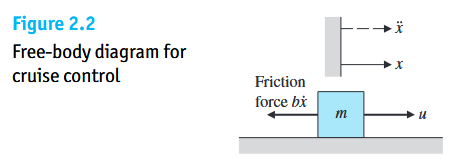
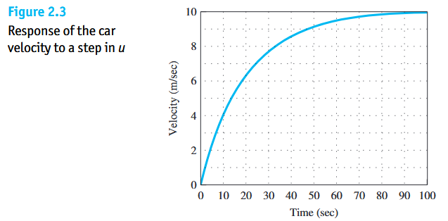
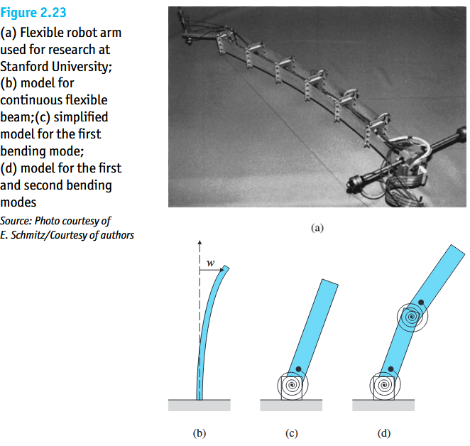

在第一章的汽车定速巡航案例中，我们曾假设节气门开度 $u$ 一旦给定，车速 $y = 10u$ 便瞬间达成。然而在物理现实中，任何具有质量、电感、电容或热容的物理实体都具有**能量存储与惯性**——当你踩下油门时，汽车不可能在零秒内从 $0\text{ mph}$ 瞬移到 $65\text{ mph}$，它必须经历一个随时间演化的加速过渡过程。

Dynamic Model：在控制工程语境下，**模型特指描述系统输入变量、输出变量及内部物理状态随时间动态演化规律的一组微分方程**。

工程中建立被控对象数学模型共有两条核心途径：

| 建模范式                 | 专业术语                            | 核心原理与操作路径                                           | 工程适用场景与优劣势                                         |
| :----------------------- | :---------------------------------- | :----------------------------------------------------------- | :----------------------------------------------------------- |
| **机理分析法（解析法）** | **Analytical Modeling via Physics** | 依据牛顿定律、基尔霍夫定律、热力学守恒等底层物理定律，直接列写运动微分方程 | **本章核心**。物理机理透彻，参数物理意义明确；但面对极复杂系统时推导困难。 |
| **系统辨识法（实验法）** | **System Identification**           | 将系统视为黑盒/灰盒，人为施加测试激励信号（阶跃、正弦扫频、伪随机噪声），采集输出数据反推拟合数学模型 | 适用于物理机理极其复杂或难以解析拆解的工程原型机；但依赖实体样机与高精度实验测试。 |

# 2.1 机械平移系统建模与“传递函数”

### 汽车定速巡航的动态微分方程

现在我们把第一章那个忽略了惯性的汽车巡航模型，还原为真实的物理动态系统。

**物理假设与受力分析**：

* 设汽车质量为 $m = 1000\text{ kg}$，位置坐标为 $x$，车速为 $v = \dot{x}$；
* 发动机产生的水平向前推进力为控制输入 $u$（单位：$\text{N}$）；
* 阻碍汽车前进的粘性摩擦与空气阻力与车速成正比，方向向左，大小为 $b\dot{x} = bv$，其中粘性阻尼系数 $b = 50\text{ N}\cdot\text{s/m}$。

**列写运动微分方程**：
根据牛顿第二定律（合力 $=$ 质量 $\times$ 加速度）：
$$
u - b\dot{x} = m\ddot{x} \tag{2.2}
$$
整理为标准二阶位置微分方程（将与输出相关的项全部移至等号左侧，输入项置于右侧）：
$$
\ddot{x} + \frac{b}{m}\dot{x} = \frac{1}{m}u \tag{2.3}
$$
由于在定速巡航系统中，我们真正关心并测量的被控输出量是**车速 $v \triangleq \dot{x}$**（此时加速度 $\ddot{x} = \dot{v}$），代入上式即得**车速的一阶线性常微分方程**：
$$
\dot{v} + \frac{b}{m}v = \frac{1}{m}u \tag{2.4}
$$

---

#### 从微分方程到传递函数

为什么要引入传递函数？因为直接求解高阶微分方程非常繁琐。**本征函数推导法**：

1. **指数信号试探**：对于线性定常系统，如果输入一个复指数信号：
   $$
   u(t) = U_0 e^{st}
   $$
   由于指数函数求导后仍然是同频率的指数函数，系统的稳态响应输出必然也具有完全相同的指数形式，只是幅值和相位发生了改变：
   $$
   v(t) = V_0 e^{st}
   $$
2. **微分的代数化消解**：对输出 $v(t)$ 求时间导数：
   $$
   \dot{v}(t) = \frac{d}{dt}(V_0 e^{st}) = s V_0 e^{st}
   $$
   **核心数学洞察**：对于指数信号 $e^{st}$ 而言，**时域中复杂的“求导运算 $\frac{d}{dt}$”，在代数上完全等价于“乘以一个复变量算子 $s$”**
3. **消去时间因子得出传递函数**：将 $u(t), v(t), \dot{v}(t)$ 代入汽车微分方程 (2.4)：
   $$
   \left(s + \frac{b}{m}\right) V_0 e^{st} = \frac{1}{m} U_0 e^{st} \tag{2.5}
   $$
   等式两边同时约去永不为零的指数因子 $e^{st}$，并将输出与输入的幅值之比提取出来（用大写字母代表变换域变量）：
   $$
   G(s) \triangleq \frac{V(s)}{U(s)} = \frac{\frac{1}{m}}{s + \frac{b}{m}} \tag{2.6/7}
   $$
   

这就是控制理论中最核心的概念——**传递函数（Transfer Function）**。对照微分方程 $\dot{v} + \frac{b}{m}v = \frac{1}{m}u$ 与传递函数 $\frac{V(s)}{U(s)} = \frac{1/m}{s + b/m}$，**求传递函数本质上就是在零初始条件下，直接把微分方程中的微分算子 $\frac{d}{dt}$ 替换为复变量 $s$，然后做移项除法！**

---

#### 动态阶跃响应与稳态模型

将汽车参数 $m = 1000\text{ kg}$、$b = 50\text{ N}\cdot\text{s/m}$ 代入传递函数 (2.7)：
$$
G(s) = \frac{V(s)}{U(s)} = \frac{\frac{1}{1000}}{s + \frac{50}{1000}} = \frac{0.001}{s + 0.05}
$$
当在 $t = 0$ 时刻突然施加一个恒定推力 $u = 500\text{ N}$ 时，观察 Figure 2.3 的响应曲线：
1. **初始惯性阶段（$t = 0^+$）**：由于车身质量 $m=1000\text{ kg}$ 无法瞬间获得动能，车速从 $0$ 开始平滑爬升，初始斜率（加速度）最大：$\dot{v}(0) = \frac{u}{m} = 0.5\text{ m/s}^2$；
2. **阻尼平衡与稳态达成（$t \to \infty$）**：随着车速越来越快，阻力 $bv$ 越来越大，净加速力 $u - bv$ 逐渐减小，曲线斜率变平。
3. 当系统进入稳态（$t \to \infty$）时，车速不再变化，即**导数项 $\dot{v} = 0$（对应复频域中算子 $s \to 0$）**。此时微分方程 $\dot{v} + \frac{b}{m}v = \frac{1}{m}u$ 中的 $\dot{v}$ 消失，直接退化为：
   $$
   \frac{b}{m}v_{ss} = \frac{1}{m}u \implies v_{ss} = \frac{1}{b}u = \frac{1}{50} \times 500 = 10\text{ m/s}
   $$
   第一章所学的稳态代数模型，正是第二章动态微分方程在时间趋于无穷（$\dot{v}=0$ 或 $s=0$）时的极限特例！

#### 传递函数的性质与局限

##### 一般线性定常（LTI）系统模型通式
对于任意 $n$ 阶线性定常系统，其时域微分方程通式为：
$$
a_n \frac{d^n y(t)}{dt^n} + a_{n-1} \frac{d^{n-1} y(t)}{dt^{n-1}} + \cdots + a_1 \frac{dy(t)}{dt} + a_0 y(t) = b_m \frac{d^m u(t)}{dt^m} + \cdots + b_1 \frac{du(t)}{dt} + b_0 u(t) \quad (n \ge m)
$$
在**零初始条件**（即 $t=0$ 时系统处于静止平衡态，所有初始导数均为 $0$）下取拉氏变换，即将 $\frac{d^k}{dt^k}$ 替换为 $s^k$，即得通用传递函数：
$$
G(s) = \frac{Y(s)}{U(s)} = \frac{b_m s^m + b_{m-1} s^{m-1} + \cdots + b_1 s + b_0}{a_n s^n + a_{n-1} s^{n-1} + \cdots + a_1 s + a_0} = \frac{N(s)}{D(s)}
$$

* 系统处于静止状态，输出及各阶导数初值均为 $0$）下，系统输出的拉普拉斯变换 $Y(s)$ 与输入的拉普拉斯变换 $U(s)$ 之比，称为系统的传递函数：

##### 特征方程、极点（Poles）与固有运动模态（Modes）

拿到一个系统的传递函数 $G(s) = \frac{N(s)}{D(s)}$ 后，系统最关心的是它的**分母多项式 $D(s)$**：

1. **特征方程**：令传递函数的分母等于零：
   $$
   D(s) = a_n s^n + a_{n-1} s^{n-1} + \cdots + a_1 s + a_0 = 0
   $$

2. **极点 （Poles）**：
   特征方程 $D(s) = 0$ 解出来的 $n$ 个根 $s = p_1, p_2, \dots, p_n$，称为系统的**极点（Poles）**。*(注：令分子 $N(s)=0$ 解出的根则称为零点 Zeros)*。

3. **固有运动模态（Natural Modes）**：
   为什么极点如此重要？因为每一个极点 $p_i$，还原到时间域里都直接对应着一项自然指数响应 **$e^{p_i t}$**（称为系统的一个**运动模态**）。系统受到扰动后的自由运动，就是所有这些模态的叠加：

   * 若极点是**负数**：对应模态 $e^{-2t}$，随时间自动衰减归零 $\longrightarrow$ **系统天然稳定**；
   * 若极点是**正数**：对应模态 $e^{+2t}$，随时间指数级爆炸增长 $\longrightarrow$ **系统天然失稳**；
   * 若极点是**一对复数**（如 $p_{1,2} = -\sigma \pm j\omega$）：对应正弦摇摆模态 $e^{-\sigma t}\sin(\omega t + \phi)$ $\longrightarrow$ **系统呈现振荡特性**。

> 传递函数 $G(s)$ 的分母完全由系统自身的内部结构决定，与外界输入什么信号无关；**极点在复平面上的正负号，直接宣判了系统是稳定还是发散崩溃！**

| 理论维度       |                                                              |
| :------------- | :----------------------------------------------------------- |
| **核心性质**   | 1. **客观结构属性**：$G(s)$ 仅取决于系统自身的物理结构与元器件参数，与外界输入信号的大小和形式完全无关。 2. **微积分代数化**：将时域微分方程一一映射为复域代数有理分式。 3. **脉冲响应同构**：$G(s)$ 在数学上严格等于系统**单位脉冲响应 $h(t)$ 的拉氏变换**（单位脉冲 $\delta(t)$ 的拉氏变换为 $1$，故 $Y(s) = G(s) \cdot 1 = G(s)$）。4. **物理可实现性约束**：实际物理系统必然具有惯性，分母阶次 $n$ 必大于等于分子阶次 $m$（$n \ge m$，正常有理分式）。 |
| **固有局限性** | 1. **丢失初值信息**：传递函数强制要求“零初始条件”，无法反映非零初始状态（如弹簧初始被压缩、电容初始带电）引起的自由响应。 2. **局限于线性定常**：一旦系统存在显著非线性或时变系统，拉氏变换与传递函数即告失效。 3. **“黑盒”外部视角**：传递函数只描述从外部输入 $u$ 到外部输出 $y$ 的总映射，完全掩盖了系统内部中间变量的行为（外部看来稳定，内部某个状态已经发散爆炸），且不擅长处理多输入多输出耦合系统。 |

## 真实世界与数学模型的鸿沟

柔性机械臂模型简化传达了一个贯穿整个控制科学与强化学习的顶层哲学——**“一切数学模型都是近似的，永远存在未建模动态”**：

1. **真实物理世界是无穷维的**：任何真实的机械臂、机翼或物理构件都不是绝对坚硬的，它们在运动时除了整体移动外，还伴随着无穷多个不同节奏（频率）的弹性弯曲与微小颤抖（称为振动模态）。
2. **数学模型是人为截断的有限维近似**：为了能写出简洁的微分方程或传递函数，总是抓大放小——只保留最主要的整体运动或最明显的低速大幅度摆动（低频模态），而把那些速度极快、幅度极小的局部微颤（高频模态）直接忽略掉。
3. **未建模动态对反馈控制的制约**：那些被我们的数学公式忽略掉的高阶微小颤抖，并没有在真实物理世界里消失，它们潜伏在系统中，统称为**“未建模动态”**。
   * 当反馈控制器动作平缓（低带宽）时，这些隐藏的颤抖不会被触发，简化模型非常准确；
   * 但如果为了让误差更小、响应更快，把反馈增益调得过大、让控制器动作过于迅猛激烈（高带宽），就会像猛甩钓鱼竿一样，把这些隐藏的未建模颤抖彻底激发出来，导致真实系统剧烈振荡甚至崩溃！
