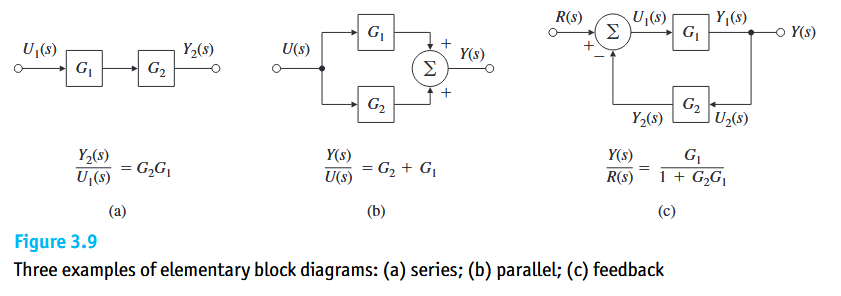
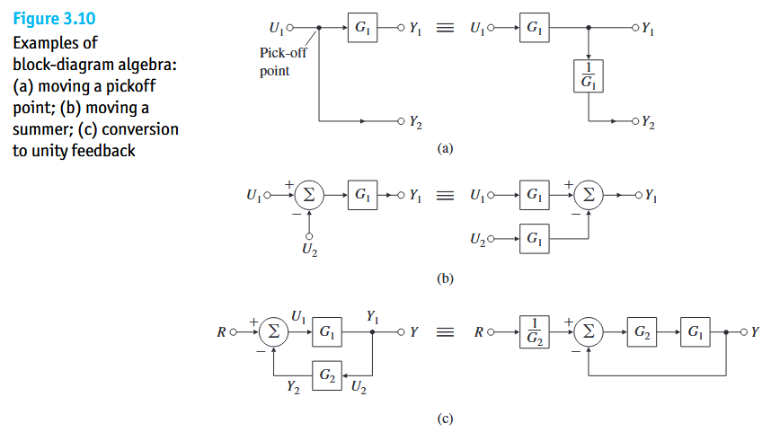
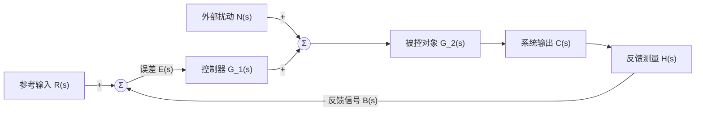
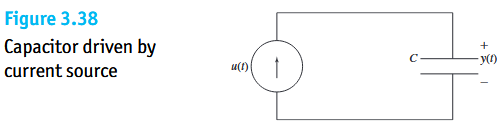
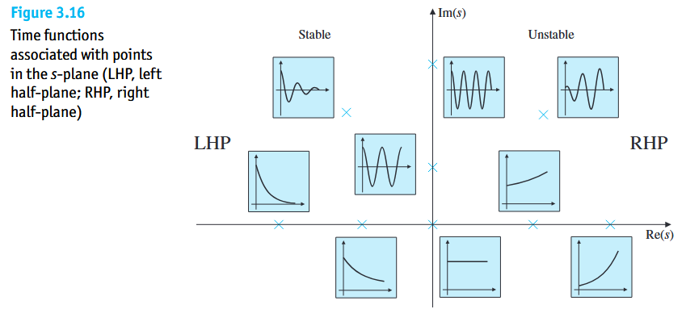

任何一个具有物理惯性的单个元件或对象，都可以用一个传递函数 $G(s)$（或 $H(s)$）来表征其输入与输出的动态关系。真正的控制系统绝不是单个孤立元件，而是由**控制器、执行器、被控对象、传感器**通过信号线相互交织而成的**互联网络**，且同时受到**目标指令**与**外界扰动**的双重作用。

---

# 3.1 线性定常系统

整个经典控制理论之所以能够建立起传递函数与框图，完全依赖于系统满足两条核心数学公理：**线性（Linearity）**与**时不变性（Time Invariance）**，合称 **LTI 系统（Linear Time-Invariant System）**。

* **线性**：假设系统初始处于静止状态。
  
  * 若单独施加第一路输入 $u_1(t)$，系统产生的输出为 $y_1(t)$；
  * 若单独施加第二路输入 $u_2(t)$，系统产生的输出为 $y_2(t)$；
  * 那么，当同时施加两路信号的线性组合输入：
    $$
    u(t) = \alpha_1 u_1(t) + \alpha_2 u_2(t) \tag{3.1}
    $$
    系统的总输出必然严格等于两次单独输出的相同线性组合：
    $$
    y(t) = \alpha_1 y_1(t) + \alpha_2 y_2(t) \tag{3.2}
    $$
  
* 在真实控制系统中，系统往往同时遭受**参考指令 $r(t)$** 和**外部扰动 $w(t)$** 的夹击。正是因为叠加原理成立，我们在分析闭环系统时，才可以：
  1. 先令扰动 $w(t) = 0$，单独算出参考指令 $r(t)$ 引起的输出 $y_r(t)$；
  2. 再令参考指令 $r(t) = 0$，单独算出外部扰动 $w(t)$ 引起的输出 $y_w(t)$；
  3. 最后将两者直接相加：$y_{\text{total}}(t) = y_r(t) + y_w(t)$。如果系统是非线性的，这种拆解分析将彻底失效。

* **时不变性**：系统的内部结构参数（如质量、阻尼、增益）不随时间 $t$ 发生改变。如果输入信号 $u(t)$ 产生输出 $y(t)$，那么将输入信号推迟任意时间 $\tau$ 秒再输入，即施加 $u(t - \tau)$，系统产生的输出除了同样原封不动地推迟 $\tau$ 秒外，波形完全一致：
  $$
  u(t - \tau) \longrightarrow y(t - \tau) \tag{3.3}
  $$

在满足线性与时不变性这两大公理后，任何一个复杂输入信号 $u(t)$ 都可以被看作是由无数个极窄的脉冲拼接而成的：
* **时域卷积表达**：在时间域中，因果系统的输出 $y(t)$ 是输入 $u(t)$ 与系统**单位脉冲响应$h(t)$** 的卷积积分：
  $$
  y(t) = \int_{0}^{\infty} h(\tau) u(t - \tau)\,d\tau \tag{3.4}
  $$
* **复域乘法跃迁**：对上式两边在**零初始条件**下取拉普拉斯变换，极其繁琐的时域卷积积分在复频域中直接退化为**初等代数乘法**：
  $$
  Y(s) = H(s) U(s) \iff H(s) = \frac{Y(s)}{U(s)} \tag{3.5}
  $$
  其中，传递函数 $H(s)$ 在数学上严格等于系统单位脉冲响应 $h(t)$ 的拉普拉斯变换：
  $$
  H(s) = \mathcal{L}\{h(t)\} = \int_{0}^{\infty} h(\tau) e^{-s\tau}\,d\tau \tag{3.6}
  $$

---

## 3.2.1结构框图

### 三种基本系统互联拓扑等效传递函数

任何复杂的控制系统，拆解到最底层都由 Figure 3.9 所示的三种基本连接方式组合而成。

**反馈连接（Feedback Connection）**

* **拓扑结构**：输入指令 $R(s)$ 进入比较点，减去反馈回来的信号 $Y_2(s)$ 得到误差信号 $U_1(s)$；$U_1(s)$ 经前向通道 $G_1(s)$ 产生系统输出 $Y_1(s)$；输出 $Y_1(s)$ 再经引出点送入反馈通道 $G_2(s)$，产生反馈信号 $Y_2(s)$ 回到比较点。
  $$
  U_1(s) = R(s) - Y_2(s) \tag{3.11}
  $$

  $$
  Y_1(s) = G_1(s) U_1(s) \tag{3.12}
  $$

$$
  Y_2(s) = G_2(s) Y_1(s) \tag{3.13}
$$

  最终得到(负反馈)：
$$
  T(s) = \frac{Y_1(s)}{R(s)} = \frac{G_1(s)}{1 + G_1(s) G_2(s)} \tag{3.17 / 3.58}
$$

  1. **前向通道传递函数（Forward Gain）**：从比较点后直通输出端的传递函数 $G_1(s)$；
  2. **反馈通道传递函数（Feedback Gain）**：从输出端回传至比较点的传递函数 $G_2(s)$；
  3. **回路增益 / 开环传递函数（Loop Gain / Open-loop Transfer Function）**：信号从比较点出发，顺着前向通道 $G_1(s)$ 和反馈通道 $G_2(s)$ **绕环路完整走一圈**的总乘积：
     $$
     L(s) \triangleq G_1(s) G_2(s) \tag{3.18}
     $$
     **单回路闭环增益**：
     
     * 当比较点为**负反馈（Negative Feedback，$-$ 号）**时：
       $$
       \text{闭环传递函数} = \frac{\text{前向通道增益}}{1 + \text{回路增益}} = \frac{G_1(s)}{1 + G_1(s)G_2(s)} \tag{3.19}
       $$
     * 当比较点为**正反馈（Positive Feedback，$+$ 号）**时，移项后符号相反，分母变为 $1$ **减去**回路增益：
       $$
       T_{\text{pos}}(s) = \frac{\text{前向通道增益}}{1 - \text{回路增益}} = \frac{G_1(s)}{1 - G_1(s)G_2(s)} \tag{3.20}
       $$

---

### 框图等价代数与单位反馈系统

* **单位反馈系统（Unity Feedback System）**：
  * **什么是单位反馈系统？** 指反馈通道上没有任何元部件（即反馈传递函数恒等于 $1$，$G_2(s) = 1$），系统的输出信号 $Y(s)$ 被 $1:1$ 原封不动地直接拉回比较点与参考输入 $R(s)$ 相减。
  * 如图 3.10(c) 所示，任何一个带有反馈环节 $G_2(s)$ 的一般系统，都可以通过把 $G_2(s)$ 往前挪出回路，在数学上等效转化为一个**单位反馈系统**。

---

# 多输入闭环系统的传递函数全貌

闭环控制系统不仅要**跟踪参考指令 $R(s)$**，还要**抑制外部扰动 $N(s)$**。

利用线性叠加原理，分别考察两个输入源对系统输出 $C(s)$ 和误差 $E(s)$ 的作用：

**1. 参考输入 $R(s)$ 单独作用（令扰动 $N(s) = 0$）**

* **系统对指令的闭环传递函数 $\Phi(s)$**：此时前向通道总增益为 $G_1(s)G_2(s)$，回路增益为 $G_1(s)G_2(s)H(s)$，套用公式 $(3.17)$：
  $$
  \Phi(s) \triangleq \frac{C(s)}{R(s)}\Bigg|_{N(s)=0} = \frac{G_1(s) G_2(s)}{1 + G_1(s) G_2(s) H(s)} \tag{3.21}
  $$
  
* **指令作用下的误差传递函数 $\Phi_e(s)$**：以误差 $E(s)$ 作为考察输出，从 $R(s)$ 到 $E(s)$ 的前向直通增益为 $1$，故：
  $$
  \Phi_e(s) \triangleq \frac{E(s)}{R(s)}\Bigg|_{N(s)=0} = \frac{1}{1 + G_1(s) G_2(s) H(s)} \tag{3.22}
  $$
  

**2.外部扰动 $N(s)$ 单独作用（令参考输入 $R(s) = 0$**

* **系统对扰动的闭环传递函数 $\Phi_n(s)$**：从扰动 $N(s)$ 看向输出 $C(s)$，直达输出的前向通道只有被控对象 $G_2(s)$，环路走一圈的回路是 $G_1(s)G_2(s)H(s)$，故：
  $$
  \Phi_n(s) \triangleq \frac{C(s)}{N(s)}\Bigg|_{R(s)=0} = \frac{G_2(s)}{1 + G_1(s) G_2(s) H(s)} \tag{3.23}
  $$
  
* **扰动作用下的误差传递函数 $\Phi_{en}(s)$**：从扰动 $N(s)$ 顺着箭头走到误差 $E(s)$，需要经过 $G_2(s)$、$-H(s)$，故前向通道为 $-G_2(s)H(s)$：
  $$
  \Phi_{en}(s) \triangleq \frac{E(s)}{N(s)}\Bigg|_{R(s)=0} = \frac{-G_2(s) H(s)}{1 + G_1(s) G_2(s) H(s)} \tag{3.24}
  $$
  

由叠加原理，当指令 $R(s)$ 与扰动 $N(s)$ 同时作用时，总输出 $C(s)$ 与总误差 $E(s)$ 为：
$$
C(s) = \Phi(s) R(s) + \Phi_n(s) N(s) = \frac{G_1(s) G_2(s)}{1 + G_1(s) G_2(s) H(s)} R(s) + \frac{G_2(s)}{1 + G_1(s) G_2(s) H(s)} N(s) \tag{3.25} 
$$

$$
E(s) = \Phi_e(s) R(s) + \Phi_{en}(s) N(s) = \frac{1}{1 + G_1(s) G_2(s) H(s)} R(s) - \frac{G_2(s) H(s)}{1 + G_1(s) G_2(s) H(s)} N(s) \tag{3.26}
$$

> 1. **分母的唯一性**：上述四个闭环传递函数分子各不相同，但分母一模一样，全部是 $1 + G_1(s)G_2(s)H(s)$**，系统定理：**一个闭环系统的特征方程（决定系统稳定性的极点），只取决于反馈回路自身的固有环路结构，而与信号是从指令端输入还是从扰动端输入毫无关系
> 2. 观察式 $(3.23)$ 和 $(3.26)$，怎样才能让扰动 $N(s)$ 对输出和误差的影响趋近于零？只需要把扰动入口**之前**的控制器传递函数 $G_1(s)$ 的幅值设计得极大（$|G_1(s)| \gg 1$），此时分母 $1 + G_1 G_2 H$ 变得极大，直接将扰动项压碎，同时让式 $(3.21)$ 的指令跟踪比值趋近于理想的 $\frac{1}{H(s)}$

---

# 3.6.1 & 3.6.2 动态系统的稳定性

在将系统连接成闭环之后，任何控制设计的第一前提都是**稳定性**。从**“外部输入输出视角”**和**“内部状态模态视角”**两个维度对线性定常系统稳定性给出了严格定义。

## 外部黑盒视角有界输入

* **直观物理定义**：不管系统内部发生了什么，只要我们给系统施加**任何一个幅值有限的输入信号**（即存在常数 $M$，使得对所有时间都有 $|u(t)| \le M < \infty$），系统产生的**输出信号幅值也永远不会发散到无穷大**（即存在常数 $N$，使得 $|y(t)| \le N < \infty$），我们就称该系统具有 **BIBO 稳定性（Bounded Input–Bounded Output Stability）**。
* **数学充要条件**：利用卷积公式取绝对值放缩可知，一个系统是 BIBO 稳定的，当且仅当其单位脉冲响应 $h(t)$ 绝对值在全时间域上积分是有限的（绝对可积）：
  $$
  \int_{-\infty}^{\infty} |h(\tau)|\,d\tau < \infty \tag{3.27 / 84}
  $$
  
* **经典概念辨析案例：为什么纯积分器（理想电容）不是 BIBO 稳定的？**

考察图 3.38 所示由电流源驱动的理想电容器：
* 输入 $u(t)$ 是充电电流，输出 $y(t)$ 是电容两端的电压，其传递函数为纯积分器：
  $$
  G(s) = \frac{1}{C s} \quad (\text{令 } C=1 \text{ 即 } G(s) = \frac{1}{s}) \tag{3.28}
  $$
* 它的脉冲响应是单位阶跃函数 $h(t) = 1(t)$，积分 $\int_0^\infty |1|\,d\tau = \infty$ 发散。
* **物理直觉验证**：如果我们给它施加一个完全**有界**的恒定小电流输入 $u(t) = 1\text{ A}$，电容电压会随着时间持续累积：
  $$
  y(t) = \int_{0}^{t} 1\,d\tau = t \xrightarrow{t \to \infty} \infty \tag{3.29}
  $$
  **有界的输入（$u=1$），却导致了无界爆炸的输出（$y \to \infty$）！** 因此，含有虚轴极点（如原点极点 $s = 0$）的开环纯积分器，**不具备 BIBO 稳定性**。

---

## 内部稳定性与复平面极点版图

与只看外部输入输出的 BIBO 视角不同，**内部稳定性（Internal Stability，又称渐近稳定性 Asymptotic Stability）**直接考察系统在没有外部输入时，其**内部初始状态能否自行衰减归零**。设闭环系统在**进行任何分子分母零极点约分之前**的传递函数为：
$$
T(s) = \frac{Y(s)}{R(s)} = \frac{b_0 s^m + b_1 s^{m-1} + \cdots + b_m}{s^n + a_1 s^{n-1} + \cdots + a_n} = K \frac{\prod_{i=1}^{m} (s - z_i)}{\prod_{i=1}^{n} (s - p_i)}, \quad (m \le n) \tag{3.30 / 课本 3.87}
$$
其分母为零构成的方程即为系统的**特征方程**：
$$
s^n + a_1 s^{n-1} + a_2 s^{n-2} + \cdots + a_n = 0 \tag{3.31 / 课本 3.86}
$$
当系统受到初始扰动后，其时域自由响应由全体极点 $p_i$ 对应的自然运动模态叠加而成：
$$
y(t) = \sum_{i=1}^{n} K_i e^{p_i t} \tag{3.32 / 课本 3.88}
$$
**左半平面法则:**系统是内部稳定的，当且仅当在 $t \to \infty$ 时，式 $(3.32)$ 中的**每一个**自然模态都衰减为零（$\lim_{t \to \infty} e^{p_i t} = 0$）。由于复极点可写为 $p_i = \sigma_i + j\omega_i$，而 $|e^{(\sigma_i + j\omega_i)t}| = e^{\sigma_i t}$，这要求**系统特征方程的所有极点 $p_i$ 必须全部具有严格为负的实部（即严格位于复平面的左半平面 Left Half-Plane, LHP）**：
$$
\operatorname{Re}\{p_i\} < 0 \quad (\forall i = 1, 2, \dots, n) \tag{3.33 / 课本 3.89}
$$

---

### 复平面的稳定性

复平面被垂直的**虚轴（$j\omega$ Axis，即稳定边界 Stability Boundary）**一分为二，极点落在不同位置时的物理命运总结如下：

| 极点 $p_i = \sigma \pm j\omega$ 所在区域                     |   实部符号   | 时域运动模态形态                                             | 内部（初值）稳定性判定  |                 外部（BIBO）稳定性判定                 |
| :----------------------------------------------------------- | :----------: | :----------------------------------------------------------- | :---------------------: | :----------------------------------------------------: |
| **1. 严格左半平面（LHP）**                                   | $\sigma < 0$ | $e^{\sigma t}$（单调衰减归零）或 $e^{\sigma t}\cos(\omega t)$（振荡衰减归零） | **渐近稳定 / 内部稳定** |                     **BIBO 稳定**                      |
| **2. 严格右半平面（RHP）** *(哪怕只有 1 个极点落入)*      | $\sigma > 0$ | $e^{\sigma t}$（单调指数爆炸）或 $e^{\sigma t}\cos(\omega t)$（增幅振荡爆炸） |       **不稳定**        |                       **不稳定**                       |
| **3. 虚轴边界（$j\omega$ 轴）——单根** *(无重复极点，如 $\frac{1}{s}$ 或 $\frac{1}{s^2+\omega^2}$)* | $\sigma = 0$ | 常值 $1$（保持初值不退）或 $\cos(\omega t)$（等幅持续振荡） | **中性稳定 / 临界稳定** | **不满足 BIBO 稳定** *(同频有界输入会引发共振发散)* |
| **4. 虚轴边界（$j\omega$ 轴）——重根** *(有重复极点，如双积分器 $\frac{1}{s^2}$)* | $\sigma = 0$ | $t$（随时间线性发散）或 $t\cos(\omega t)$（随时间线性增幅振荡） |       **不稳定**        |                       **不稳定**                       |

> 在不解方程求根的情况下，拿到一个特征方程 $s^n + a_1 s^{n-1} + a_2 s^{n-2} + \cdots + a_n = 0$，它要稳定的一个**必要（但不充分）条件**是：**所有的多项式系数 $a_1, a_2, \dots, a_n$ 必须全部严格大于零（同号），且中间绝对不能有任何一项系数缺失（等于零）**。只要一眼看到有负数系数或跳项缺项，无需任何计算即可直接判定系统不稳定。

---

### 为什么“外部 BIBO 稳定”不等于“内部稳定”？

* **问题设定**：为什么式 $(3.30)$ 强调必须在**“任何零极点约分对消之前”**检查极点？
* **数学假象（零极点对消）**：
  假设一个系统内部包含两个串联部分，总传递函数在约分前为：
  $$
  T(s) = \frac{Y(s)}{R(s)} = \frac{s - 2}{(s - 2)(s + 3)} \tag{3.34}
  $$
  注意分母上有一个位于右半平面的**不稳定极点 $p_1 = +2 > 0$**（对应随时间指数爆炸的模态 $e^{+2t}$）。但如果直接把分子的 $(s - 2)$ 和分母的 $(s - 2)$ 约分消掉，传递函数看起来就变成了：
  $$
  T_{\text{cancelled}}(s) = \frac{1}{s + 3} \tag{3.35}
  $$
  **灾难性的物理后果**：
  
  * 从**外部输入输出（BIBO）**来看：因为分子零点 $z_1 = +2$ 恰好把式 $(3.32)$ 中 $e^{+2t}$ 这一项在输出端 $y(t)$ 的权重系数 $K_1$ 变成了 $0$，所以你在最终输出端 $y(t)$ 只能看到 $e^{-3t}$，输出端看起来风平浪静、完全有界（外部 BIBO 稳定）！
  * 但从**系统内部**来看：那个不稳定的物理模态 $e^{+2t}$ 根本没有在机器内部消失！只要系统内部有一丁点初始扰动或噪声，连接在两个子系统之间的**某个内部中间变量**就会按照 $e^{+2t}$ 指数级疯狂增长。
* **系统论升华**：
  
  * **内部稳定（所有未约分极点都在左半平面） $\implies$ 必然外部 BIBO 稳定**；
  * 但**外部 BIBO 稳定 $\centernot\implies$ 内部稳定**（因为可能存在不稳定的零极点对消，即现代控制理论中的**“不可控/不可观不稳定模态”**）
  * 这正是为什么不能只看约分后的外部传递函数，而必须在现代控制理论中引入能够监控每一个内部变量的**状态空间模型**！

