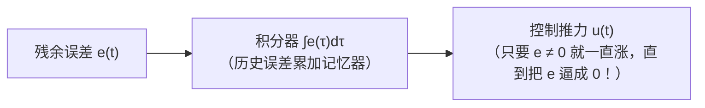
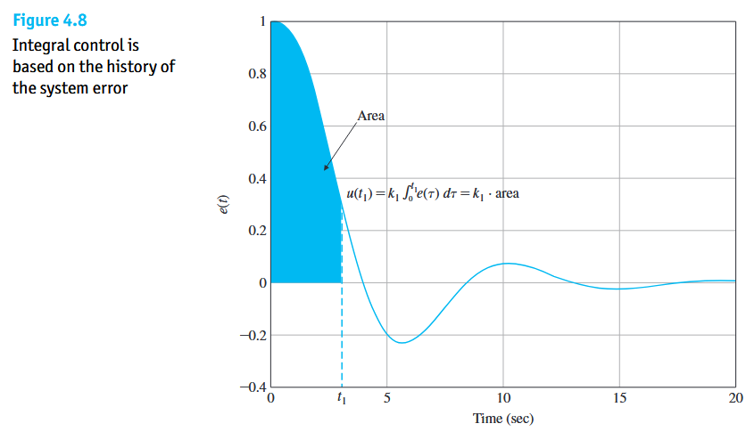
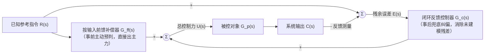

本章中，回答自动控制原理中最具灵魂的四个**控制思想问题**：
1. **为什么被控设备老化、参数漂移了，闭环反馈系统却依然稳如泰山？**
2. **为什么光靠“按误差比例用力”永远消除不掉残余静差，而加一个“积分器”就能把稳态误差彻底清零？**
3. **工业界无处不在的 PID 控制器，P、I、D 三项究竟在时间维度上扮演什么角色？**
4. **既然闭环负反馈这么强大，为什么高端控制系统还要引入“前馈”组成复合控制？**

---

# 深度负反馈与灵敏度

在现实物理世界中，前向通道里的执行器与被控对象 $G(s)$（例如电机、加热炉、机械臂、汽车发动机）属于大功率做功部件。随着使用时间推移、环境温度变化或负载增减，**$G(s)$ 的内部物理参数一定会发生老化、磨损与漂移**。如果是**开环控制**，输出直接等于 $Y(s) = G(s)U(s)$——对象增益 $G(s)$ 衰减了 $20\%$，系统输出就会跟着完完全全跌落 $20\%$，毫无招架之力。来看最经典的单回路负反馈闭环传递函数：
$$
\Phi(s) = \frac{C(s)}{R(s)} = \frac{G(s)}{1 + G(s)H(s)} \tag{4.1}
$$

当我们在前向控制器中把放大倍数调得很大，使得在整个工作频段内**环路增益远大于 $1$（即 $|G(s)H(s)| \gg 1$，“深度负反馈”）**时，分母中的“$1$”相对于巨大的 $G(s)H(s)$ 完全可以忽略不计，此时分子分母中的 $G(s)$ 直接约掉：

$$
\Phi(s) = \frac{G(s)}{1 + G(s)H(s)} \approx \frac{G(s)}{G(s)H(s)} = \frac{1}{H(s)} \tag{4.2}
$$

| 反馈核心物理作用                                          | 物理机制                                                     |                                                              |
| :-------------------------------------------------------- | :----------------------------------------------------------- | :----------------------------------------------------------- |
| **1. 钝化内部参数变化** *(降低系统灵敏度 Sensitivity)* | 当满足深度负反馈 $G(s)H(s) \gg 1$ 时，闭环表现 $\Phi(s) \approx \frac{1}{H(s)}$ **几乎与前向被控对象 $G(s)$ 无关，而只取决于反馈测量通道 $H(s)$** | 前向的电机、功放 $G(s)$ 哪怕老化打了折，只要反馈回路去盯着输出纠偏，闭环总特性依然稳如泰山。在控制理论中，把“闭环特性对对象参数变化的敏感程度”称为**灵敏度（Sensitivity）**，负反馈的核心功劳就是把对 $G(s)$ 的灵敏度压到了极低。 |
| **2. 加快系统动态响应** *(减小被包围环节的时间常数)*   | 将一个反应迟钝的一阶惯性环节 $\frac{K}{Ts+1}$ 用负反馈包起来后，其等效时间常数会直接缩小为 $T' = \frac{T}{1 + K K_h} < T$。 | 负反馈在输出未达目标前会利用高增益强行“猛推一把”，从而克服物理对象原本笨重的惯性，显著加快响应速度。 |
| **3. 反馈的铁律代价：对传感器噪声极度敏感**               | 再看一眼 $\Phi(s) \approx \frac{1}{H(s)}$：系统虽然不再受前向对象 $G(s)$ 波动的影响，但却**受制于反馈传感器 $H(s)$ 的准确性** | 如果反馈传感器 $H(s)$ 自身发生了零点漂移，混入了高频测量噪声，闭环控制器不仅无法分辨，还会忠实地把系统拉向错误的传感器读数！因此，**做功的元件 $G(s)$ 可以粗糙，但测量的传感器 $H(s)$ 必须极其精密**。 |

---

# 稳态误差、系统型别与积分清零

## 稳态误差（Steady-State Error，静差）
* **物理定义**：当系统的瞬态振荡过程全部衰减完毕、进入平稳运行状态（$t \to \infty$）后，期望目标输入 $r(t)$ 与实际输出 $c(t)$ 之间依然残留的差距 $e_{ss} = \lim_{t \to \infty} e(t)$，称为**稳态误差**。它是衡量控制系统**稳态精度**的核心指标。
* **讨论稳态误差的绝对前提**：**系统必须首先是稳定的！** 如果闭环极点在右半平面，输出早已发散飞车，此时讨论稳态误差毫无物理意义。
* **有差系统 vs. 无差系统**：在常值阶跃输入下，稳态时还残留固定偏差的系统称为**“有差系统”**；能把稳态偏差彻底消除为 $0$ 的系统称为**“无差系统”**。

用第一章的**汽车上坡定速巡航**或**手托重物**来做思想实验：
* 假设你的控制器是一个纯比例放大器：$u(t) = K \cdot e(t)$。
* 现在汽车要维持 $65\text{ mph}$ 匀速前进，由于地面摩擦力和空气阻力客观存在，发动机在稳态时**必须持续输出一个非零的恒定推力 $u_{ss} > 0$** 才能抵消风阻。如果车速真的分毫不差达到了 $65\text{ mph}$，此时误差 $e_{ss} = 65 - 65 = 0$；一旦误差 $e_{ss} = 0$，纯比例控制器算出的油门推力就立刻变成 $u_{ss} = K \times 0 = 0$！
* 为了逼迫纯比例控制器在稳态时依然吐出维持匀速所需的推力 $u_{ss}$，系统**不得不故意保留一个永远消除不掉的“死差” $e_{ss} = \frac{u_{ss}}{K} \neq 0$**（比如永远卡在 $64.2\text{ mph}$）！你把放大倍数 $K$ 调得再大，也只能让这个死差变小，永远不可能把它变成 $0$。

## 积分清零
在前向通道中串入一个**积分环节（复频域为 $\frac{1}{s}$，时域为 $\int_0^t e(\tau)\,d\tau$）**，即可让**误差 $e_{ss} = 0$ 的同时，控制器还能持续输出一个非零的推力 $u_{ss} > 0$**：

* **积分器的物理本质是“历史误差的累加记忆器”**：它的输出等于从 $0$ 时刻到现在**误差曲线下方围成的总面积**。

* **清零机制**：
  1. 哪怕当前车速卡在 $64.99\text{ mph}$，只剩下 $e = +0.01\text{ mph}$ 的微小正误差，只要误差还不等于 $0$，积分器累加出来的面积就会随时间 $t$ **一刻不停地往上增长**，推着油门 $u(t)$ 越踩越深！
  2. 油门越踩越深，车速就不得不继续往上爬，直到车速严丝合缝达到 $65.00\text{ mph}$、**$e_{ss} = 0$**为止！
  3. 当误差 $e_{ss} = 0$ 后，积分器不再增加新的面积，但它**依靠过去积累下来的历史总面积，稳稳地锁住并维持住了那个非零的稳态油门推力 $u_{ss}$**！

## 系统型别（System Type $v$）
在控制理论中，直接根据**开环传递函数 $G(s)H(s)$ 的分母中包含几个纯积分环节 $\frac{1}{s^v}$**，把系统划分为不同的**“型别（Type $v$）”**：

| 系统型别（开环含积分器个数 $v$）                    | 跟踪常值阶跃目标 $r(t)=A$ *(定点维持，如恒温/悬停)* | 跟踪匀速斜坡目标 $r(t)=At$ *(匀速移动，如雷达跟踪匀速飞机)* | 跟踪匀加速抛物线目标 $r(t)=\frac{1}{2}At^2$ *(机动加速目标)* |
| :-------------------------------------------------- | :----------------------------------------------------: | :----------------------------------------------------------: | :----------------------------------------------------------: |
| **0 型系统（$v = 0$，无积分）**                     |           **有常值静差**（$\frac{A}{1+K}$）            |                 跟不上（误差 $\to \infty$）                  |                 跟不上（误差 $\to \infty$）                  |
| **I 型系统（$v = 1$，含 $1$ 个 $\frac{1}{s}$）**    |                   **零误差（$0$）**                    |               **有常值静差**（$\frac{A}{K}$）                |                 跟不上（误差 $\to \infty$）                  |
| **II 型系统（$v = 2$，含 $2$ 个 $\frac{1}{s^2}$）** |                   **零误差（$0$）**                    |                      **零误差（$0$）**                       |               **有常值静差**（$\frac{A}{K}$）                |

- **“差一阶出常差，同阶以上彻底清零”**

- 想要跟踪常值阶跃（$0$ 阶时间多项式）零误差，至少需要 $1$ 个积分器（I 型）；

- 想要跟踪匀速斜坡（$1$ 阶时间多项式）零误差，至少需要 $2$ 个积分器（II 型）。

---

# PID 

$$
u(t) = \underbrace{k_P e(t)}_{\text{比例 P（盯现在）}} + \underbrace{k_I \int_{0}^{t} e(\tau)\,d\tau}_{\text{积分 I（算过去）}} + \underbrace{k_D \frac{de(t)}{dt}}_{\text{微分 D（看未来）}} \tag{4.3}
$$

| 控制分项          | 时间视角 | 控制思想                                                     | 正面贡献                                                     | 工程                                                         |
| :---------------- | :------: | :----------------------------------------------------------- | :----------------------------------------------------------- | :----------------------------------------------------------- |
| **比例控制（P）** | **现在** | **“当下的弹簧拉绳”**：当前离目标有多远，就立刻按比例使多大的劲。它是整个控制器的主力输出。 | 加快响应速度，增大稳态开环增益以减小有差系统的静差。         | 1. 单靠 P 无法彻底消除常值静差； 2. $k_P$ 过大会导致用力过猛、超调剧增、来回震荡甚至失稳。 |
| **积分控制（I）** | **过去** | **“翻旧账的记账员”**：只要过去还有残余误差没消掉，就不停累加施压，不达零误差誓不罢休。 | **把系统型别提高一阶，彻底消灭常值稳态误差**，强力抵抗常值外部扰动。 | 1. 积分攒面积需要时间，会拖慢动态响应、增加超调、削弱稳定性； 2. 若执行器已达物理上限，积分器还在盲目累加会导致**积分饱和**，引发严重卸荷延迟。 |
| **微分控制（D）** | **未来** | **“阻尼器”**：它不看当前误差有多大，专门看**误差变化的斜率 $\dot{e}(t)$**。误差快速减小，$\dot{e} < 0$时，D 项提前预判“要冲过头了”，立刻给出反向拉力 | **在物理上完全等效于给系统注入“人工粘性阻尼”**，能显著抑制超调、平息震荡、改善动态稳定性，允许搭配更大的 $k_P$。 | 1. 微分对常值静差毫无作用（常数的导数为 $0$）； 2. **对高频测量噪声极度敏感**：哪怕传感器里只有极其微小的毛刺噪声，毛刺的瞬间斜率 $\frac{d}{dt}$ 也会趋近无穷大，导致执行器疯狂高频抖动。 |

---

# 前馈控制

无论 PID 调得多么完美，纯闭环反馈控制都有一个无法回避的天然缺陷：**它是“靠误差驱动”的被动纠偏机制**。
* 也就是说，**必须等外部干扰已经把系统撞歪了、或者目标已经跑远了，系统实打实产生了误差 $e(t) \neq 0$ 之后**，反馈控制器才看得到误差并开始发力追赶。

## 前馈控制
* **前馈控制思想**：直接从参考输入端拉出一条**不经过闭环比较点的开环直通支路 $G_{ff}(s)$**，根据被控对象的物理模型，**提前算好需要多少控制力，在误差产生之前就直接注入执行器进行主动抵消**！

