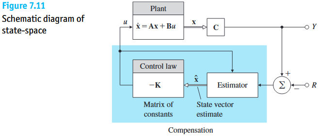
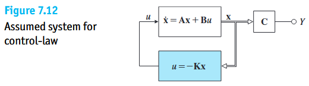
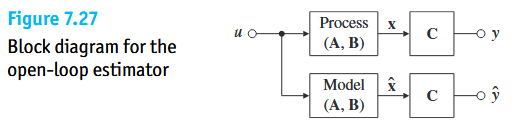
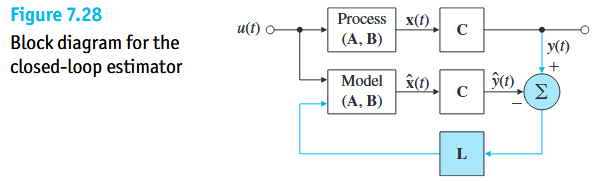

经典控制理论，我们一直用**传递函数 $G(s) = \frac{Y(s)}{U(s)}$** 来描述系统。但传递函数有一个天生的局限：**它把系统当成一个“只看外部输入 $U$ 和最终输出 $Y$ 的黑盒”，系统肚子里的各个物理量到底在干什么，传递函数完全看不见。**现代控制理论直接走进系统内部，提出了自动控制原理另外三大核心支柱概念：**状态变量（State Variables）**、**可控性（Controllability）**与**可观性（Observability）**。

---

# State Variables & State-Space

## State Variables
* **物理定义**：一个动态系统的**状态**，是指**能够完整概括系统过去的全部历史记忆，从而一旦给定当前状态和未来的控制输入，就能唯一决定系统未来一切运动走向的一组最小内部物理量**。
* **物理系统的状态变量：**系统的状态变量，直接对应系统内部存储能量的物理量：
  - 在机械系统（如汽车、单摆）中：**位置 $x$**（代表弹性势能或重力势能）与 **速度 $v = \dot{x}$**（代表动能 $\frac{1}{2}mv^2$）。只要你在 $t=0$ 时刻同时告诉我这辆车**“现在停在哪儿（位置 $x$）”**以及**“现在的车速是多少（速度 $v$）”**，这辆车之前是怎么开过来的历史细节就再也不重要了，它运动轨迹就已经被百分之百锁定了。

## State-Space
* 当系统有 $2$ 个状态变量——**位置 $x_1 = x$** 和 **速度 $x_2 = \dot{x}$** 时，我们把横轴画成位置 $x$，纵轴画成速度 $\dot{x}$，张成的这个二维平面在物理学上叫做**相平面（Phase Plane，即二维状态空间）**。
* 系统在任意时刻的状态 $\mathbf{x}(t) = \begin{bmatrix} x(t) \\ \dot{x}(t) \end{bmatrix}$，就是这个平面上的**一个几何点**；随着时间流逝，这个点在平面上滑行画出的一条曲线，就叫**状态轨迹（相轨迹）**。
* 如果系统是渐近稳定的（极点都在左半平面），那么无论初始状态点被扔在平面的哪个角落，它的状态轨迹最终都会像水流进下水道一样，稳稳地卷进中心的平衡点。当状态变量有 $n$ 个时，推广出来的 $n$ 维几何空间就叫**状态空间**。

在第二章 `Example 2.1` 中，质量 $m = 1000\text{ kg}$、阻力系数 $b = 50\text{ N}\cdot\text{s/m}$ 的汽车运动二阶微分方程：

$$
\ddot{x} + \frac{b}{m}\dot{x} = \frac{1}{m}u \iff \ddot{x} + 0.05\dot{x} = 0.001u \tag{7.1}
$$

定义汽车的**位置 $x$** 和**车速 $v = \dot{x}$** 为两个状态变量，打包成状态向量 $\mathbf{x} = \begin{bmatrix} x \\ v \end{bmatrix}$。就像我们在第 9 章做过的那样，把一个二阶微分方程改写为两个一阶微分方程：

$$
\begin{aligned}
\dot{x} &= 0 \cdot x + 1 \cdot v + 0 \cdot u \\
\dot{v} &= 0 \cdot x - \frac{b}{m}v + \frac{1}{m}u
\end{aligned} \tag{7.2}
$$

将式 $(7.2)$ 抽出系数写成矩阵乘法，就得到了现代控制理论最标准的**状态空间方程**：

$$
\begin{aligned}
\dot{\mathbf{x}} &= \mathbf{A}\mathbf{x} + \mathbf{B}u && \text{（状态方程：决定内部状态如何演化）} \\
y &= \mathbf{C}\mathbf{x} + Du && \text{（输出方程：决定外部传感器能测到什么）}
\end{aligned} \tag{7.3}
$$

代入汽车的具体参数（$\frac{b}{m} = 0.05,\ \frac{1}{m} = 0.001$），汽车的状态方程为：

$$
\begin{bmatrix} \dot{x} \\ \dot{v} \end{bmatrix} = \underbrace{\begin{bmatrix} 0 & 1 \\ 0 & -0.05 \end{bmatrix}}_{\text{系统矩阵 }\mathbf{A}} \begin{bmatrix} x \\ v \end{bmatrix} + \underbrace{\begin{bmatrix} 0 \\ 0.001 \end{bmatrix}}_{\text{输入矩阵 }\mathbf{B}} u \tag{7.4}
$$

而**输出矩阵 $\mathbf{C}$ 长什么样，完全取决于你在车上装了什么传感器**：
* **情况 (a) 装了定位 GPS（只测位置 $y = x$）**：此时 $y = 1 \cdot x + 0 \cdot v = \begin{bmatrix} 1 & 0 \end{bmatrix}\begin{bmatrix} x \\ v \end{bmatrix}$，所以输出矩阵 **$\mathbf{C} = \begin{bmatrix} 1 & 0 \end{bmatrix}$**，$D = 0$。
* **情况 (b) 装了车速表（只测速度 $y = v$）**：此时 $y = 0 \cdot x + 1 \cdot v = \begin{bmatrix} 0 & 1 \end{bmatrix}\begin{bmatrix} x \\ v \end{bmatrix}$，所以输出矩阵 **$\mathbf{C} = \begin{bmatrix} 0 & 1 \end{bmatrix}$**，$D = 0$。

|     矩阵符号     | 教材名称                                | 物理角色与直觉解读                                           | 关键性质                                                     |
| :--------------: | :-------------------------------------- | :----------------------------------------------------------- | :----------------------------------------------------------- |
| **$\mathbf{A}$** | **系统矩阵** *(System Matrix)*       | **“系统内部的固有物理基因”**：描述在没有外力输入（$u=0$）时，内部各个状态变量之间如何互相影响、自然演化。 | **$\mathbf{A}$ 矩阵的特征值（Eigenvalues），严格等于系统的极点（Poles）** 决定了系统天生的稳定性与固有模态。 |
| **$\mathbf{B}$** | **输入矩阵** *(Input Matrix)*        | **“执行器控制力的传入通道”**：描述外部控制推力 $u$ 能够直接推到哪几个内部状态变量上。 | $\mathbf{B}$ 和 $\mathbf{A}$ 配合起来，共同决定了系统的**可控性（Controllability）**。 |
| **$\mathbf{C}$** | **输出矩阵** *(Output Matrix)*       | **“传感器的观测窗口”**：描述外部安装的传感器，能够从内部状态向量 $\mathbf{x}$ 中提取出哪些信息作为测量输出 $y$。 | $\mathbf{C}$ 和 $\mathbf{A}$ 配合起来，共同决定了系统的**可观性（Observability）**。 |
|     **$D$**      | **直通矩阵** *(Direct Transmission)* | 描述控制输入 $u$ 是否不经过任何积分惯性、直接瞬间跳变传到输出 $y$。 | 真实物理系统都有惯性，所以绝大多数情况下 **$D = 0$**。       |

---

# Controllability

* **物理定义**：如果通过合理调节外部控制输入 $u(t)$，能够在有限时间内把系统的**每一个内部状态变量**都驱动到我们期望的任意目标位置（或者说，通过状态反馈能把系统的所有闭环极点挪到复平面的任意位置），就称该系统是**完全可控的**。
* **不可控**：**如果系统内部的某一个状态（或某一个子系统、运动模态），在物理结构上与控制输入 $u$ 彻底断开了连接**，那么无论外面的控制器怎么拼命踩油门，控制力根本传不到这个状态上，这个状态完全不受控制器的摆布。

## 零极点对消
* 假设一个二阶系统，它的传递函数是：

$$
G(s) = \frac{s - z_0}{(s + 3)(s + 4)} \tag{7.5}
$$

* 这个系统内部本来有两个一阶状态模态（对应极点 $-3$ 和 $-4$）。但如果分子上的零点恰好等于 $z_0 = -3$，分子和分母里的 $(s+3)$ 就会发生**代数约分对消**，外部看到的传递函数瞬间变成了 $G(s) = \frac{1}{s+4}$！
* **物理后果**：那个极点为 $-3$ 的内部状态并没有在物理世界上蒸发，它依然存在于系统肚子里，只是**控制输入 $u$ 通往这个状态的物理作用被内部结构完全抵消（解耦断开）了**，控制器从此彻底失去了对 $-3$ 这个模态的控制权（不可控）。
  
  > **“可控性是系统内部状态的属性，绝对不能光看约分后的外部传递函数来判断”**

## 弱可控
* 在数学上，“可控”还是“不可控”似乎是非黑即白的（看能控性矩阵满不满秩）；但在真实工程里：
  - 飞机的**升降舵 $\delta_e$** 专门用来控制抬头/低头的**俯仰运动 $x_p$**；**副翼 $\delta_a$** 专门用来控制机身左右倾斜的**滚转运动 $x_r$**。
  - 虽然左右晃动副翼引发滚转 $x_r$ 时，也会由于空气动力学耦合，对飞机俯仰高度 $x_p$ 产生一丝丝极其微弱的影响（系数 $\epsilon \approx 0.001 \neq 0$）。
  - 如果你死板地去算数学上的能控性矩阵，因为 $\epsilon \neq 0$，数学判据会告诉你：“哪怕升降舵坏了，只靠副翼也能控制飞机高度（数学上可控）！”但在物理现实中，**试图靠疯狂左右翻滚飞机去拉升高度是完全不可行的**

## 执行器饱和
* 同样是把二阶系统的闭环极点移动到期望位置 $s^2 + 2s + 4 = 0$：
  - 当零点在 $z_0 = 2$（远离极点 $-3$，系统**可控性很强**）时，所需的反馈控制增益非常温和：$\mathbf{K} = \begin{bmatrix} -3.80 & 0.60 \end{bmatrix}$；
  - 当零点挪到 $z_0 = -2.99$（距离极点 $-3$ 只有 $0.01$，**快要发生零极点对消、即将丧失可控性**）时，为了达到同样的控制效果，反馈增益瞬间暴增了 $500$ 多倍：**$\mathbf{K} = \begin{bmatrix} 2052.5 & -688.1 \end{bmatrix}$**
  
  > **当系统的可控性越来越弱时，控制器必须使出大得惊人的控制力才能勉强拉动那个状态，这在现实中会瞬间把执行器逼到物理饱和上限**

---

# Observability

* **工程痛点**：一个系统内部可能有 $5$ 个状态变量，但因为传感器太贵或内部根本没法塞传感器，**只能装 $1 \sim 2$ 个传感器测到输出信号 $y(t) = \mathbf{C}\mathbf{x}(t)$**。
* **物理定义**：如果我们仅凭监控外部传感器测到的输出记录 $y(t)$，就能顺着系统内部的物理耦合关系，**把所有内部状态变量 $\mathbf{x}(t)$ 的数值全部唯一地推算（还原）出来**，就称该系统是**完全可观的**。
* **什么叫“不可观（Unobservable）”？**
  如果系统内部有某一个状态，它既没有直接连到输出传感器上，它的变化也不会对其他能被测到的状态产生任何影响——**它在传感器读数 $y(t)$ 里彻底“隐身”了，无论它怎么变，传感器读数都纹丝不动**，这就叫**不可观**

假设小车有两个内部状态——**位置 $x$** 和**速度 $v = \dot{x}$**。现在为了省钱，你拆掉了位置传感器，**车上只装了一个速度表（即传感器只测速度 $y = v$，不测位置 $x$，输出矩阵 $\mathbf{C} = \begin{bmatrix} 0 & 1 \end{bmatrix}$）**。请问：光看速度表 $v(t)$ 的读数，你能不能推理出小车此刻停在哪个位置 $x(t)$？

| 对比物理系统（均只测速度 $y = v$）                           | 位置状态 $x$ 能否影响速度 $v$？                              | 可观性                                                       |
| :----------------------------------------------------------- | :----------------------------------------------------------- | :----------------------------------------------------------- |
| **1. 平地上的自由滑行小车** （如教材 $\frac{1}{s^2}$ 小车，或平路汽车：$\dot{v} = -0.05v + 0.001u$） | ❌ **完全不影响！** （平路上 $x=0\text{ m}$ 和 $x=100\text{ m}$ 处的受力一模一样，方程里根本没有 $x$ 这一项） | ❌ **位置状态 $x$ 不可观（Unobservable）** 因为位置 $x$ 的大小对速度 $v$ 毫无影响，无论小车最初是从 $0\text{ m}$ 还是从 $100\text{ m}$ 出发的，速度表 $v(t)$ 显示的曲线都 **100% 完全相同**！光看速度表，你永远猜不出它的初始位置 $x(0)$ 是多少！ |
| **2. 拴着弹簧的小车（弹簧振子）** （一端固定在原点墙上，受弹簧拉力：$m\dot{v} = -kx$） | ✅ **影响！** （位置 $x$ 离原点越远，弹簧拉力 $-kx$ 越大，速度变化的快慢——即加速度 $\dot{v}$ 就越大！） | ✅ **位置状态 $x$ 完全可观（Observable）！** 虽然你手里依然只有速度表 $y = v$，但因为位置 $x$ 时刻在拉扯改变着速度的变化率 $\dot{v} = -\frac{k}{m}x$，你只需要看一眼速度表指针掉得有多快（算出斜率 $\dot{v}$），除以 $-\frac{k}{m}$ 就能**当场反推出小车此刻的真实位置 $x = -\frac{m}{k}\dot{v}$**！ |

---

# State Feedback & Estimator

搞懂了“状态变量、可控性、可观性”三大概念后，现代控制理论是怎么做控制器设计的？由两块积木拼成：**全状态反馈控制器（Control Law）** ＋ **状态观测器（Estimator / Observer）**。

## 全状态反馈控制律

* **控制思想**：假设系统内部的每一个状态变量 $x_1, x_2, \dots, x_n$（如位置 $x_1$ 和速度 $x_2$）我们全都拿得到，那我们就不再像经典控制那样只盯着单一输出，而是**给每一个内部状态变量都分配一个反馈权重旋钮 $K_1, K_2, \dots, K_n$**，把它们加权求和作为控制输入：

$$
u = -\mathbf{K}\mathbf{x} = -\begin{bmatrix} K_1 & K_2 & \cdots & K_n \end{bmatrix} \begin{bmatrix} x_1 \\ x_2 \\ \vdots \\ x_n \end{bmatrix} = -K_1 x_1 - K_2 x_2 - \cdots - K_n x_n \tag{7.6}
$$

* **极点任意配置（Pole Placement）的物理威力**：把控制律 $u = -\mathbf{K}\mathbf{x}$ 代回原状态方程 $\dot{\mathbf{x}} = \mathbf{A}\mathbf{x} + \mathbf{B}u$：

$$
\dot{\mathbf{x}} = \mathbf{A}\mathbf{x} - \mathbf{B}\mathbf{K}\mathbf{x} = (\mathbf{A} - \mathbf{B}\mathbf{K})\mathbf{x} \tag{7.7}
$$

  原本系统的固有动力学矩阵是 $\mathbf{A}$（哪怕它原本是不稳定的，特征值在右半平面），引入全状态反馈后，闭环系统的新矩阵变成了 **$\mathbf{A}_{cl} = \mathbf{A} - \mathbf{B}\mathbf{K}$**！
  **只要系统是完全可控的**，我们就可以通过调节 $\mathbf{K}$ 里的 $n$ 个旋钮，把闭环矩阵 $(\mathbf{A} - \mathbf{B}\mathbf{K})$ 的特征值（即闭环极点）**随心所欲地指定到左半平面的任何位置**！

## 闭环状态观测器

* **核心痛点**：刚才全状态反馈 $u = -\mathbf{K}\mathbf{x}$ 需要知道全部状态 $\mathbf{x}$，但现实中传感器往往只能测到单个输出 $y = \mathbf{C}\mathbf{x}$（比如只测位置，没测速度）。没装传感器的那些状态去哪儿拿？**在计算机里跑一个“数字镜像模型（软件虚拟传感器）”**既然我们已经知道真实物理对象的矩阵 $(\mathbf{A}, \mathbf{B}, \mathbf{C})$，也知道每一时刻发给电机的控制信号 $u(t)$，我们干脆在控制器芯片里用代码建一个一模一样的数学模型，实时算出内部状态的**估计值 $\hat{\mathbf{x}}(t)$**！
* **为什么不能用开环仿真**
  如果像 **Figure 7.27** 那样只把 $u(t)$ 喂给计算机里的虚拟模型 $\dot{\hat{\mathbf{x}}} = \mathbf{A}\hat{\mathbf{x}} + \mathbf{B}u$，因为我们猜不准真实系统最初的起跑位置 $\mathbf{x}(0)$，再加上模型参数总有微小误差，计算机算出来的估计状态 $\hat{\mathbf{x}}(t)$ 很快就会和真实状态 $\mathbf{x}(t)$ 失之千里
*  **Figure 7.28（闭环状态观测器框图）**：既然外面有一个真实的传感器输出 $y(t)$，我们就拿**真实传感器的读数 $y(t)$**，减去**计算机模型自己预测出来的读数 $\hat{y}(t) = \mathbf{C}\hat{\mathbf{x}}(t)$**，利用这个**输出预测误差 $(y - \hat{y})$** 乘上一个修正增益向量 $\mathbf{L}$，时刻不停地反馈回去修正计算机里的估计状态 $\hat{\mathbf{x}}$：

$$
\dot{\hat{\mathbf{x}}} = \underbrace{\mathbf{A}\hat{\mathbf{x}} + \mathbf{B}u}_{\text{1. 依靠物理模型往前预测}} + \underbrace{\mathbf{L}\left(y - \mathbf{C}\hat{\mathbf{x}}\right)}_{\text{2. 拿真实传感器误差实时纠偏}} \tag{7.8}
$$

* **观测器收敛结论**：
  将真实状态方程 $\dot{\mathbf{x}} = \mathbf{A}\mathbf{x} + \mathbf{B}u$ 减去估计方程 $(7.8)$，控制输入 $u$ 直接抵消，得到估计误差 $\tilde{\mathbf{x}} \triangleq \mathbf{x} - \hat{\mathbf{x}}$ 的演化方程（教材式 7.132）：

$$
\dot{\tilde{\mathbf{x}}} = (\mathbf{A} - \mathbf{L}\mathbf{C})\tilde{\mathbf{x}} \tag{7.9}
$$

  **只要系统是完全可观的**，我们就可以自由选择修正增益 $\mathbf{L}$，让矩阵 $(\mathbf{A} - \mathbf{L}\mathbf{C})$ 的特征值全部落在左半平面很深的地方。这样一来，哪怕计算机最开始完全瞎猜了一个初始状态 $\hat{\mathbf{x}}(0)$，估计误差 $\tilde{\mathbf{x}}(t)$ 也会在眨眼之间衰减归零，此后计算机里的估计状态 $\hat{\mathbf{x}}(t)$ 就会像影子一样精准贴合真实物理状态 $\mathbf{x}(t)$！

## 对偶性与分离原理
把上面两块积木拼在一起（ **Figure 7.11**）：先用闭环状态观测器从传感器输出 $y$ 中实时还原出估计状态 $\hat{\mathbf{x}}$，然后直接把估计状态 $\hat{\mathbf{x}}$ 当作真实状态喂给全状态反馈控制律 $u = -\mathbf{K}\hat{\mathbf{x}}$！

| 现代控制核心性质  | 物理内涵与工程意义                                           |
| :---------------- | :----------------------------------------------------------- |
| **1. 对偶性原理** | **“控制问题”与“观测估计问题”在数学上是照镜子一样的孪生兄弟**： • **可控性**看 $(\mathbf{A}, \mathbf{B})$ 能不能通过 $\mathbf{K}$ 配置闭环矩阵 $(\mathbf{A} - \mathbf{B}\mathbf{K})$ 的极点； • **可观性**看 $(\mathbf{A}, \mathbf{C})$ 能不能通过 $\mathbf{L}$ 配置观测误差矩阵 $(\mathbf{A} - \mathbf{L}\mathbf{C})$ 的极点。 |
| **2. 分离原理**   | **“控制器 $\mathbf{K}$ 与观测器 $\mathbf{L}$ 可以各干各的、完全分开独立设计”** 把观测器（$\mathbf{L}$）和状态反馈控制器（$\mathbf{K}$）拼在一起后，整个大系统的闭环极点刚好等于**“你单独设计的控制器极点 $(\mathbf{A}-\mathbf{B}\mathbf{K})$”加上“你单独设计的观测器极点 $(\mathbf{A}-\mathbf{L}\mathbf{C})$”**，两边互不干扰、互不破坏 |

