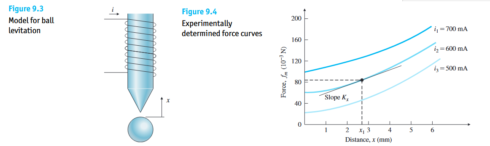

我们学习的所有工具——无论是叠加原理、传递函数 $G(s)$、框图闭环公式 $\frac{G}{1+GH}$，还是复平面极点分析——全部建立在一个严苛的前提之上：**假设被控系统是线性定常（LTI）系统**。然而，

> ***“All systems are nonlinear, especially if large signals are considered.”***  
> **（现实世界中的所有物理系统本质上都是非线性的，尤其是当信号幅度较大时。）**

例如：单摆的重力恢复力矩包含三角函数 $\sin\theta$；高速汽车的风阻正比于速度的平方 $v^2$；任何电机和放大器在输入过大时都会发生饱和。既然现实世界处处是非线性的，**为什么我们前面花大力气学习的“线性控制理论”非但不是废纸，反而构成了现代工业与机器人控制的绝对基石？**

---

# 9.1 线性控制理论得以成立的两大基石

## 反馈控制的核心任务是“在平衡工作点附近做微小调节”
* 绝大多数自动控制系统的核心使命，是**将系统维持在某一个期望的平衡工作点附近**（例如：定速巡航将车速维持在 $65\text{ mph}$ 附近；温控系统将室温维持在 $25^\circ\text{C}$ 附近；四旋翼无人机维持在水平悬停姿态 $\theta \approx 0^\circ$ 附近）。
* 由于闭环负反馈的强力纠偏作用，只要系统刚一偏离平衡点，控制器就会立刻将其拉回。因此，在正常受控运行状态下，系统偏离平衡点的**误差信号始终非常微小**。
* **小信号下的光滑近似**：在微小的偏离范围内，几乎所有光滑的非线性物理曲线，都可以用该点处的**切线**极高精度地代替。最典型的例子就是当角度 $\theta$ 很小时：

$$
\sin\theta \approx \theta, \quad \cos\theta \approx 1 \tag{9.1}
$$

---

## 李雅普诺夫两大稳定性方法

“用切线近似曲线”听起来很合理，但在数学上会不会因为忽略了高阶非线性项而导致严重误判？俄国数学家李雅普诺夫（A. M. Lyapunov）提出了著名的两大稳定性判别方法，彻底为线性控制理论吃下了定心丸：

| 李雅普诺夫方法                              | 专业名称与分析视角                                           | 核心定理内容与物理意义                                       |
| :------------------------------------------ | :----------------------------------------------------------- | :----------------------------------------------------------- |
| **第一方法** *(间接法 / 局部线性化法)*   | **Lyapunov's First Method** （通过局部线性近似模型判断原非线性系统在平衡点附近的稳定性） | **1. 局部稳定保真定理**：如果一个非线性系统在平衡点处的**线性化近似模型是严格稳定的**（即线性模型的所有极点全部严格位于左半平面 $\operatorname{Re}\{p_i\} < 0$），那么**原本真实的非线性系统，在该平衡点周围的一定邻域内也必然是稳定的！** **2. 局部失稳判定定理**：如果线性化近似模型哪怕只有 $1$ 个极点落在右半平面（$\operatorname{Re}\{p_i\} > 0$），那么真实非线性系统在该平衡点附近也必然是不稳定的！ |
| **第二方法** *(直接法 / 广义能量耗散法)* | **Lyapunov's Second Method** （直接利用能量标量函数判断非线性系统的大范围稳定性） | 线性近似无法告诉我们“稳定区域到底有多大”。第二方法寻找一个描述系统**内部存储总能量**的正标量函数 $V(\mathbf{x}) > 0$（称为**李雅普诺夫函数 Lyapunov Function**）。 **核心物理直觉**：如果随着系统运动，这个能量函数对时间的导数恒为负数（$\dot{V}(\mathbf{x}) < 0$，即系统能量一直在持续耗散、不断往外漏），那么无论系统非线性有多强，内部能量最终必将耗尽，系统状态必然会稳稳停在平衡点上！ |

---

## 控制工程对付非线性系统

在进入具体的线性化数学推导前，非线性问题转化为线性问题设计的三种核心工程思路：
1. **小信号局部线性化**：不改变物理对象，仅在平衡工作点附近取一阶泰勒展开近似，提取出局部线性模型 $\delta\dot{\mathbf{x}} = \mathbf{A}\delta\mathbf{x} + \mathbf{B}\delta\mathbf{u}$，在此基础上设计线性控制器。
2. **反馈线性化 / 计算力矩法**：常用于现代机器人与航空航天控制。既然已知系统的非线性方程，直接利用计算机算出一部分控制力去**精确相减抵消掉方程里的非线性项**，使剩下的受控系统在全局范围内变成一个纯线性系统。
3. **串联逆非线性补偿**：如果传感器或执行器存在已知的静态非线性畸变 $f(\cdot)$，直接在软件里串联一个它的反函数 $f^{-1}(\cdot)$，正反抵消拉直为线性通道。

---

# 9.2.1 小信号局部线性化的完整数学推导

## 单变量以切线代曲线

假设某装置的静态输入 $x$ 与输出 $y$ 之间存在光滑的非线性关系：

$$
y = f(x) \tag{9.2}
$$

* **第 1 步**：系统正常工作的基准点为 $(x_0, y_0)$，满足 $y_0 = f(x_0)$。
* **第 2 步**：当系统在工作点附近发生微小波动时，我们将真实的绝对变量拆分为**“工作点常数 $+$ 微小偏离量”**：

$$
x = x_0 + \delta x, \quad y = y_0 + \delta y \tag{9.3}
$$

  **第 3 步（在工作点 $x_0$ 处做泰勒级数展开）**：
将 $y = f(x_0 + \delta x)$ 在 $x_0$ 处展开为无穷幂级数：
$$
y_0 + \delta y = f(x_0) + \left.\frac{df}{dx}\right|_{x_0} \delta x + \frac{1}{2!}\left.\frac{d^2 f}{dx^2}\right|_{x_0} (\delta x)^2 + \frac{1}{3!}\left.\frac{d^3 f}{dx^3}\right|_{x_0} (\delta x)^3 + \cdots \tag{9.4}
$$

* **第 4 步（小信号截断与平衡项相消）**：
  * 在小信号假设下，偏离量 $|\delta x| \ll 1$ 非常小，高次幂非常小，可以丢掉。。
  * 略去二次及以上高阶项，并利用工作点恒等式 $y_0 = f(x_0)$ 将等式两边的基准常数直接抵消，即得**小信号线性化方程**：

$$
\delta y \approx \left(\left.\frac{df}{dx}\right|_{x_0}\right) \delta x = K \cdot \delta x \tag{9.5}
$$

  * **几何本质**：系数 $K \triangleq \left.\frac{df}{dx}\right|_{x_0}$ 就是非线性曲线 $f(x)$ **在工作点 $x_0$ 处的切线斜率**！原本弯曲的非线性关系 $y = f(x)$，对于微小偏离量 $\delta x$ 和 $\delta y$ 而言，变成了一个纯粹的正比例线性关系 $\delta y = K \delta x$！

---

## 动态系统通式推导

在控制系统中，系统是由微分方程描述的，且往往同时包含状态变量 $\mathbf{x}$（向量）和控制输入变量 $\mathbf{u}$（向量）。

非线性动态系统的通用表达：对于一般的非线性时不变动态系统，状态导数 $\dot{\mathbf{x}}$ 与状态 $\mathbf{x}$、控制输入 $\mathbf{u}$ 之间呈非线性耦合关系，无法直接写成矩阵乘法 $\dot{\mathbf{x}} = \mathbf{A}\mathbf{x} + \mathbf{B}\mathbf{u}$，只能写成一般非线性向量函数形式：
$$
\dot{\mathbf{x}} = \mathbf{f}(\mathbf{x}, \mathbf{u}) \tag{9.6}
$$

### 动态系统的平衡点
在推导线性化之前，必须先找到系统在哪里线性化——即**平衡工作点 $(\mathbf{x}_0, \mathbf{u}_0)$**。
* **平衡点的严格定义**：当控制输入固定在某个常值 $\mathbf{u}_0$ 时，如果系统状态能够保持在 $\mathbf{x}_0$ **静止不动、不再随时间发生任何变化**（即所有状态对时间的导数全部等于零 $\dot{\mathbf{x}}_0 = \mathbf{0}$），那么 $(\mathbf{x}_0, \mathbf{u}_0)$ 就称为系统的一个**平衡点**。
* 因此，求解平衡点的方法就是**令微分方程左边的导数项全部等于 $\mathbf{0}$**，解如下代数方程：

$$
\dot{\mathbf{x}}_0 = \mathbf{0} = \mathbf{f}(\mathbf{x}_0, \mathbf{u}_0) \tag{9.7}
$$

设系统在平衡点 $(\mathbf{x}_0, \mathbf{u}_0)$ 附近工作，我们将真实的状态 $\mathbf{x}(t)$ 和控制输入 $\mathbf{u}(t)$ 写成“平衡点基准值 $+$ 小信号偏离量”的形式：

$$
\mathbf{x}(t) = \mathbf{x}_0 + \delta\mathbf{x}(t), \quad \mathbf{u}(t) = \mathbf{u}_0 + \delta\mathbf{u}(t) \tag{9.8}
$$
将式 $(9.8)$ 代入原非线性微分方程 $(9.6)$，并在平衡点 $(\mathbf{x}_0, \mathbf{u}_0)$ 处同时对变量 $\mathbf{x}$ 和 $\mathbf{u}$ 进行多元一阶泰勒展开（忽略高阶无穷小项）：

$$
\dot{\mathbf{x}}_0 + \delta\dot{\mathbf{x}} \approx \mathbf{f}(\mathbf{x}_0, \mathbf{u}_0) + \mathbf{A}\,\delta\mathbf{x} + \mathbf{B}\,\delta\mathbf{u} \tag{9.9}
$$
其中，常数矩阵 $\mathbf{A}$ 和 $\mathbf{B}$ 分别是非线性向量函数 $\mathbf{f}(\mathbf{x}, \mathbf{u})$ 在平衡点 $(\mathbf{x}_0, \mathbf{u}_0)$ 处对状态向量 $\mathbf{x}$ 和输入向量 $\mathbf{u}$ 求偏导数所构成的**雅可比矩阵**：

$$
\mathbf{A} \triangleq \left[\frac{\partial \mathbf{f}}{\partial \mathbf{x}}\right]_{\mathbf{x}_0, \mathbf{u}_0}, \quad \mathbf{B} \triangleq \left[\frac{\partial \mathbf{f}}{\partial \mathbf{u}}\right]_{\mathbf{x}_0, \mathbf{u}_0} \tag{9.10}
$$
根据平衡点条件式 $(9.7)$，等号左边的 $\dot{\mathbf{x}}_0 = \mathbf{0}$ 与等号右边的 $\mathbf{f}(\mathbf{x}_0, \mathbf{u}_0) = \mathbf{0}$ 完全相等、直接相减抵消！式 $(9.9)$ 立刻化简为纯粹关于小信号偏离量 $\delta\mathbf{x}$ 与 $\delta\mathbf{u}$ 的**线性定常（LTI）微分方程**：

$$
\delta\dot{\mathbf{x}} = \mathbf{A}\,\delta\mathbf{x} + \mathbf{B}\,\delta\mathbf{u} \tag{9.11}
$$

> 在现代控制理论和绝大多数工程文献中，为了写起来省事，大家在写出式 $(9.11)$ 后，习惯直接把前面的偏离符号 $\delta$ 抹掉，简写成 $\dot{\mathbf{x}} = \mathbf{A}\mathbf{x} + \mathbf{B}\mathbf{u}$。
> **但你心里必须时刻铭记**：所有线性化模型里的变量 $\mathbf{x}$ 和 $\mathbf{u}$，代表的**绝不是绝对物理量**，而是**相对于平衡点 $(\mathbf{x}_0, \mathbf{u}_0)$ 的微小偏离量（$\delta\mathbf{x} = \mathbf{x} - \mathbf{x}_0$，$\delta\mathbf{u} = \mathbf{u} - \mathbf{u}_0$）**！控制器算出来的控制量 $\delta\mathbf{u}$，在真正送给电机执行时，必须再加上维持平衡所需的基准输入 $\mathbf{u}_0$（即真实输出 $\mathbf{u} = \mathbf{u}_0 + \delta\mathbf{u}$）！

---

# 单摆与倒立摆的局部线性化

## 单摆与倒立摆的双平衡点线性化

设摆杆长度为 $\ell$，质量为 $m$，摆角为 $\theta$（规定自然竖直下垂时 $\theta = 0$，竖直倒立向上时 $\theta = \pi$），电机施加的归一化控制力矩为 $u = \frac{T_c}{m\ell^2}$，固有频率记为 $\omega_0 = \sqrt{\frac{g}{\ell}}$。其精确的非线性运动微分方程为：

$$
\ddot{\theta} + \omega_0^2 \sin\theta = u \tag{9.12}
$$
定义二维状态向量 $\mathbf{x} = \begin{bmatrix} x_1 \\ x_2 \end{bmatrix} = \begin{bmatrix} \theta \\ \dot{\theta} \end{bmatrix}$（即 $x_1$ 为角度，$x_2$ 为角速度），则非线性方程 $(9.12)$ 写为标准形式 $\dot{\mathbf{x}} = \mathbf{f}(\mathbf{x}, u)$：

$$
\begin{bmatrix} \dot{x}_1 \\ \dot{x}_2 \end{bmatrix} = \begin{bmatrix} x_2 \\ -\omega_0^2 \sin x_1 + u \end{bmatrix} = \begin{bmatrix} f_1(\mathbf{x}, u) \\ f_2(\mathbf{x}, u) \end{bmatrix} \tag{9.13}
$$
假设平时不施加外部控制力矩（即基准输入 $u_0 = 0$）。令状态导数为零（$\dot{x}_1 = 0,\ \dot{x}_2 = 0$）：

$$
\begin{aligned}
\dot{x}_1 &= x_2 = 0 \implies \dot{\theta}_0 = 0 \\
\dot{x}_2 &= -\omega_0^2 \sin\theta_0 + 0 = 0 \implies \sin\theta_0 = 0
\end{aligned} \tag{9.14}
$$
解三角方程 $\sin\theta_0 = 0$，我们在物理空间中得到了**两个截然不同的平衡位置**：
1. **平衡点一（$\theta_0 = 0$）**：摆锤自然竖直朝下静止悬挂；
2. **平衡点二（$\theta_0 = \pi$）**：摆锤竖直朝上倒立静止。

根据公式 $(9.10)$，对式 $(9.13)$ 中的 $f_1, f_2$ 分别关于 $x_1, x_2$ 和 $u$ 求偏导数（注意 $\frac{\partial (\sin x_1)}{\partial x_1} = \cos x_1$）：

$$
\mathbf{A} = \begin{bmatrix} \dfrac{\partial f_1}{\partial x_1} & \dfrac{\partial f_1}{\partial x_2} \\[1em] \dfrac{\partial f_2}{\partial x_1} & \dfrac{\partial f_2}{\partial x_2} \end{bmatrix}_{\theta_0, u_0} = \begin{bmatrix} 0 & 1 \\ -\omega_0^2 \cos\theta_0 & 0 \end{bmatrix}, \quad \mathbf{B} = \begin{bmatrix} \dfrac{\partial f_1}{\partial u} \\[1em] \dfrac{\partial f_2}{\partial u} \end{bmatrix}_{\theta_0, u_0} = \begin{bmatrix} 0 \\ 1 \end{bmatrix} \tag{9.15}
$$
我们将 $\theta_0 = 0$ 和 $\theta_0 = \pi$ 分别代入式 $(9.15)$，看看发生了什么惊人的变化：

| 对比维度                                               |             平衡点一：自然下垂（$\theta_0 = 0$）             |           平衡点二：竖直倒立摆（$\theta_0 = \pi$）           |
| :----------------------------------------------------- | :----------------------------------------------------------: | :----------------------------------------------------------: |
| **余弦斜率值 $\cos\theta_0$**                          |                   $\cos(0) = \mathbf{+1}$                    |         $\cos(\pi) = \mathbf{-1}$（符号彻底反转！）          |
| **局部线性化微分方程**                                 |  $\delta\ddot{\theta} + \omega_0^2 \delta\theta = \delta u$  |  $\delta\ddot{\theta} - \omega_0^2 \delta\theta = \delta u$  |
| **局部传递函数 $\frac{\delta\Theta(s)}{\delta U(s)}$** |                $\dfrac{1}{s^2 + \omega_0^2}$                 |                $\dfrac{1}{s^2 - \omega_0^2}$                 |
| **特征方程（令分母 $= 0$）**                           |      $s^2 + \omega_0^2 = 0 \implies s^2 = -\omega_0^2$       |      $s^2 - \omega_0^2 = 0 \implies s^2 = +\omega_0^2$       |
| **系统极点（特征值）**                                 |      $p_{1,2} = \mathbf{\pm j\omega_0}$（虚轴共轭单根）      | $p_1 = -\omega_0,\ \mathbf{p_2 = +\omega_0 > 0}$（右半平面正实根！） |
| **物理与稳定性结论**                                   | **中性稳定**：轻推一下，围绕最低点等幅来回摆动（若有空气阻尼则渐近稳定回到最低点）。 | **严重不稳定**：因为存在右半平面正极点 $p_2 = +\omega_0$，对应爆炸模态 $e^{+\omega_0 t}$，稍有风吹草动立刻倒下！ |

> 1. **为什么线性模型依赖于工作点？** 同一个单摆，在 $\theta_0 = 0$ 和 $\theta_0 = \pi$ 处线性化出来的传递函数分母一个是 $+ \omega_0^2$，一个是 $- \omega_0^2$！因此，脱离了具体的平衡工作点，谈论非线性系统的传递函数或极点是毫无意义的。
> 2. **怎么用线性控制器稳住非线性的倒立摆？** 在倒立点 $\theta_0 = \pi$ 附近，对象传递函数是 $\frac{1}{s^2 - \omega_0^2}$（分母缺一次项且常数项为负，天生失稳）。但只要我们在 $\theta_0 = \pi$ 附近引入闭环负反馈（比如 PD 控制器 $G_c(s) = K_p + K_d s$），根据第三章的闭环公式 $\frac{G_c G}{1 + G_c G}$，闭环分母就会变成：
>
> $$
> s^2 + K_d s + (K_p - \omega_0^2) = 0 \tag{9.16}
> $$
>
> 只要我们选择比例增益 $K_p > \omega_0^2$ 且微分增益 $K_d > 0$，就能生生把原本位于右半平面的不稳定极点 $+\omega_0$ **强行拽回左半平面（LHP）**！再结合李雅普诺夫第一方法：既然线性化闭环模型严格稳定了，那么真实的非线性倒立摆在顶部附近就真的能稳稳立住！

---

# 实验曲线上的图形化小信号线性化

很多时候我们写不出非线性函数 $f(x, u)$ 的精确数学解析式（如图所示电磁铁悬浮钢球系统，电磁吸力 $f_m(x, i)$ 随距离 $x$ 和电流 $i$ 呈极其复杂的非线性变化）：

* **物理平衡方程**（向下为 $x$ 正方向，向上电磁吸力为 $f_m(x, i)$，向下重力为 $mg$）：

$$
m\ddot{x} = mg - f_m(x, i) \tag{9.17}
$$

**平衡工作点 $(x_1, i_2)$**：在图 9.4 的实验测量曲线上，当稳态电流取 $i_2 = 600\text{ mA}$、小球距离磁铁高度为 $x_1$ 时，向上的电磁力恰好等于小球的重力：$f_m(x_1, i_2) = mg = 82\times 10^{-3}\text{ N}$，此时加速度 $\ddot{x} = 0$，小球悬浮静止在空中。

* **用实验曲线切线代替偏导数**：虽然没有解析公式，但偏导数在几何上就是**曲线的斜率**！工程师直接在图 9.4 的实验曲线上量出两个斜率：
  1. 在工作点 $(x_1, i_2)$ 处沿着 $i_2 = 600\text{ mA}$ 曲线画一条切线，量出力随距离变化的斜率 $K_x = \left.\frac{\partial f_m}{\partial x}\right|_{x_1, i_2} \approx 14\text{ N/m}$；
  2. 在固定位置 $x_1$ 处，看电流从 $500\text{ mA}$ 变到 $700\text{ mA}$ 时力的变化量，算出电流增益斜率 $K_i = \left.\frac{\partial f_m}{\partial i}\right|_{x_1, i_2} \approx 0.4\text{ N/A}$。
* **直接写出增量线性模型**：将 $f_m(x_1 + \delta x, i_2 + \delta i) \approx f_m(x_1, i_2) + K_x \delta x + K_i \delta i$ 代入牛顿定律，平衡力 $f_m(x_1, i_2)$ 与重力 $mg$ 直接抵消，立刻得到小信号线性微分方程：

$$
m\,\delta\ddot{x} = K_x \delta x + K_i \delta i \implies \delta\ddot{x} = 1667\,\delta x + 47.6\,\delta i \tag{9.18}
$$