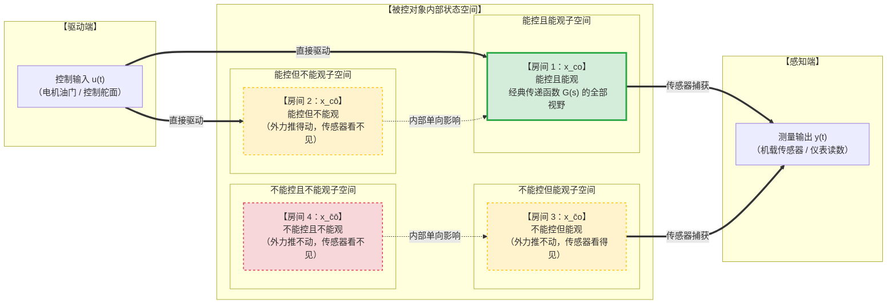

在经典控制理论中，我们习惯于用传递函数 $G(s) = \frac{Y(s)}{U(s)}$ 来分析系统。只要计算出系统的闭环极点都在复平面的左半边，我们就会放心地认为系统是稳定的，输出一定会乖乖听话，但：

1. **你手里的方向盘和油门，真的能管到车里所有的零部件吗？**（有些零部件可能脱扣断开，外力根本渗透不过去——**能控性问题**）
2. **你仪表盘上的指针和屏幕，真的能看清车里发生的一切吗？**（有些内部状态可能被遮挡在暗处，传感器怎么测也测不到——**能观性问题**）

如果一个系统内部某个零件正在悄悄剧烈振动甚至即将断裂，而**油门推力传不过去（不能控），仪表盘上也完全看不出来（不能观）**，那么外部表现出的所谓“稳定”全都是假象。

---

# 系统的能控性（Controllability）

* **课本严格定义**：如果存在一个分段连续的控制输入 $\mathbf{u}(t)$，能在有限时间区间 $[t_0, t_f]$ 内，把系统从任意给定的初始状态 $\mathbf{x}(t_0)$ 驱动转移到指定的终态 $\mathbf{x}(t_f)$（通常取终态为坐标原点 $\mathbf{0}$），则称该系统是**状态完全能控的**。**你想让系统的每一个状态去哪，它就能去哪，没有任何不受控的死角！**

---

## 代数判据矩阵

对于 $n$ 维系统 $\dot{\mathbf{x}} = \mathbf{A}\mathbf{x} + \mathbf{B}u$，著名的卡尔曼能控性判别矩阵：
$$
\mathbf{M}_c = \begin{bmatrix} \mathbf{B} & \mathbf{AB} & \mathbf{A}^2\mathbf{B} & \cdots & \mathbf{A}^{n-1}\mathbf{B} \end{bmatrix}
$$
**充要条件**：矩阵 $\mathbf{M}_c$ 的秩等于状态维数 $n$（即 $\text{rank}(\mathbf{M}_c) = n$，行满秩）。外力 $u$ 是通过输入矩阵 $\mathbf{B}$ 注入系统的。为什么后面还要乘 $\mathbf{AB}, \mathbf{A}^2\mathbf{B}$？

* **第 0 步（$\mathbf{B}$）**：控制力 $u$ 刚打进系统，首先直接作用在与 $\mathbf{B}$ 直连的那几个状态上；
* **第 1 步（$\mathbf{AB}$）**：受控的状态开始运动，通过系统内部矩阵 $\mathbf{A}$ 的物理耦合，带动与它相邻的第二批状态运动；
* **第 2 步（$\mathbf{A}^2\mathbf{B}$）**：第二批状态继续通过 $\mathbf{A}$ 往深处带动第三批状态……
* **第 $n-1$ 步**：凯莱-哈密顿定理保证，系统内部的物理链条最多传递 $n-1$ 次，就已经把系统能走通的所有通路全部探寻完毕了！

> 把外力在每一步能够推动的“方向向量”拼成一个大矩阵 $\mathbf{M}_c$。如果这些方向向量能**完完整整地撑满整个 $n$ 维空间**（满秩），就说明控制力成功渗透到了每一个角落，系统完全能控！

---

# 系统的能观性（Observability）

* **定义**：如果在已知控制输入 $\mathbf{u}(t)$ 的前提下，根据有限时间区间 $[t_0, t_f]$ 内的输出测量序列 $\mathbf{y}(t)$，能够**唯一确定系统在初始时刻的状态 $\mathbf{x}(t_0)$**，则称该系统是**状态完全能观的**。**单凭仪表盘和传感器看到的读数，把系统内部藏在暗处没被测量的变量全部推算出来！**

---

## 代数判据矩阵

对于系统 $\dot{\mathbf{x}} = \mathbf{A}\mathbf{x}, y = \mathbf{C}\mathbf{x}$，卡尔曼能观性判别矩阵定义为：
$$
\mathbf{N}_o = \begin{bmatrix} \mathbf{C} \\ \mathbf{CA} \\ \mathbf{CA}^2 \\ \vdots \\ \mathbf{CA}^{n-1} \end{bmatrix}
$$
**充要条件**：矩阵 $\mathbf{N}_o$ 的秩等于状态维数 $n$（即 $\text{rank}(\mathbf{N}_o) = n$，列满秩）。

* **第 0 步（$\mathbf{C}$）**：传感器第一眼直接读出来的当前输出值 $y(t) = \mathbf{C}\mathbf{x}$；
* **第 1 步（$\mathbf{CA}$）**：如果观察这个传感器读数随着时间**变化的快慢（一阶导数）**：$\dot{y} = \mathbf{C}\dot{\mathbf{x}} = \mathbf{CA}\mathbf{x}$；
* **第 2 步（$\mathbf{CA}^2$）**：再观察读数变化的**加速度（二阶导数）**：$\ddot{y} = \mathbf{CA}^2\mathbf{x}$……

> 虽然系统里只有少数几个传感器，但通过在时间轴上持续盯住它们变化的曲率与斜率，内部那些虽然没有安装传感器、但与它们发生物理联动的所有隐状态，都会在这些导数项中一一暴露。

---

# 卡尔曼子空间分解

**对于任何一个线性系统，无论它多么复杂庞大，其内部的所有状态空间，都可以严丝合缝、互不重叠地拆解到以下 4 个子空间之一中**

| 符号                              | 性质               | 巡航无人机                                                   | 控制器与传感器对它的掌控程度                               |
| :-------------------------------- | :----------------- | :----------------------------------------------------------- | :--------------------------------------------------------- |
| **$\mathbf{x}_{co}$**             | **能控且能观**     | **飞机的主飞行航向与高度**：四旋翼油门打得动它，机载 GPS 和气压计也看得清清楚楚。 | 完全在主控掌控之中，想怎么调就怎么调。                     |
| **$\mathbf{x}_{c\bar{o}}$**       | **能控但不能观**   | **机身内部机械结构的内部应力**：电机剧烈加速能使内部机架受挤压（推力打得着），但机架上没贴应变片传感器（仪表盘完全看不见）。 | 动作能对它造成影响，但它现在到底受力多大，你处于失明状态。 |
| **$\mathbf{x}_{\bar{c}o}$**       | **不能控但能观**   | **高空遭遇的强侧向阵风气流**：风速传感器看得明明白白，但无人机机载电机功率太小，吹过来的大风推力根本管不住、消除不了。 | 能眼睁睁看着它发生，手里的控制舵面却拿它毫无办法。         |
| **$\mathbf{x}_{\bar{c}\bar{o}}$** | **不能控且不能观** | **机身夹层里一颗螺丝的微小锈蚀**：电机转速影响不到它，机载传感器也绝不可能检测出它。 | 彻底断联的死角，在控制与观测体系外自生自灭。               |

---

##  信息流动单向法则

这 4 个子空间之间的状态传递，遵循严格的**单向流动法则**：

* **输入端 $u$**：只能直接连入“能控”的房间；
* **输出端 $y$**：只能直接从“能观”的房间抽取数据；
* 状态之间的内部传递是**单向梯形结构**：房间 2 可以单向影响房间 1，房间 4 可以单向影响房间 3，**绝不可能逆向倒流**。

---

# 零极点对消

## 传递函数
从状态空间导出传递函数时：
$$
G(s) = \mathbf{C}(s\mathbf{I} - \mathbf{A})^{-1}\mathbf{B}
$$
**这个公式算出来的传递函数，在数学上仅仅且只能表达能控且能观部分**至于房间 2、房间 3、房间 4 里发生了什么惊涛骇浪，传递函数 $G(s)$ **连一个标点符号都看不到**！在经典自控中，假设你推导出一个系统的传递函数是：
$$
G(s) = \frac{Y(s)}{U(s)} = \frac{s + 2}{(s + 2)(s - 3)}
$$
分子分母都有 $(s+2)$，我们把它**对消简化**掉：
$$
G(s) = \frac{1}{s - 3}
$$

**现代控制理论告诉你，在这个所谓“约分”的动作背后，到底发生了什么**：
* 状态方程里原本有 2 个物理运动模态：一个对应极点 $s = -2$（稳定模态），一个对应极点 $s = +3$（发散模态）；
* 传递函数里之所以分子分母都出现 $(s+2)$，**代表这个模态被系统踢出了第 1 房间，掉进了不可控或不可观房间里**
* 你以为它被“对消消失”了，其实它并没有消失，**它只是在传递函数这个黑盒子里隐身了**

如果反过来，对消掉的是一个不稳定的模态呢？ 例如：
$$
G(s) = \frac{s - 5}{(s - 5)(s + 1)}
$$
如果一个工程师盲目将分子的 $(s-5)$ 和分母的 $(s-5)$ 直接对消，他会得到：
$$
G(s) = \frac{1}{s + 1}
$$
* **工程师看着传递函数大喜过望**：“太棒了！极点是 $s = -1$（在左半平面），这是一个绝对稳定的一阶系统！”
* **实际无人机飞上天后的悲惨结局**：
  * 这个被对消掉的 $s = 5$ 极点，本质上是无人机某个**发散的内部振荡模态（以 $e^{5t}$ 爆炸级剧烈发散）**；
  * 如果它是**不可控的**：机载飞控虽然在仪表盘上看见了它，但发出的控制舵量根本送不到它身上，飞机在空中眼睁睁解体；
  * 如果它是**不可观的**：机载传感器完全测不到这个发散振荡，地面站监控屏幕上显示航向平稳极度正常，下一秒飞机突然凌空炸机！

> [!CAUTION]
> **传递函数中的零极点对消，绝非纯粹的代数化简！它代表系统内部出现了能控性或能观性的丧失！永远禁止人为通过前置滤波器去“对消”受控对象位于右半平面的不稳定极点！**
