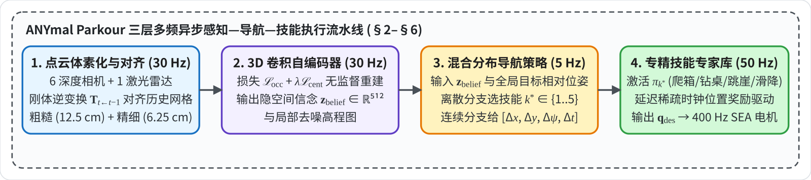
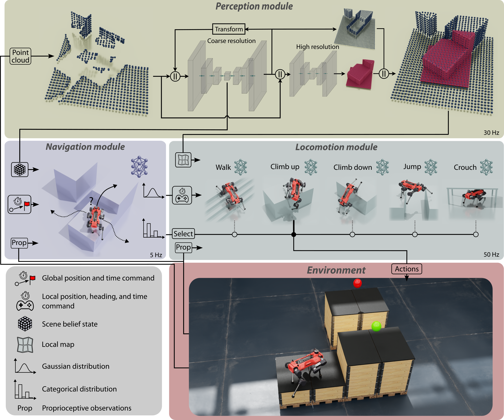
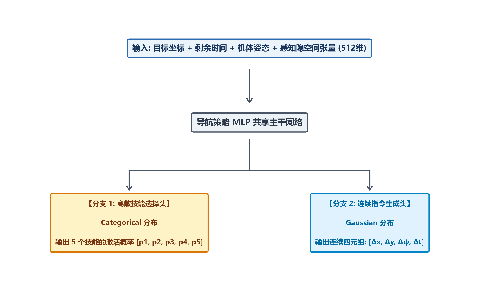

# ANYmal parkour: Learning agile navigation for quadrupedal robots

**核心思路**：高箱/悬空桌下无法靠 2.5D 高程图或单刚体预设接触解决。论文采用 **30 Hz 双尺度 [[三维体素自编码器与空间记忆变换|3D 体素隐式信念编码器]] + 5 个离散专精技能专家 + 5 Hz 高层自主切换导航**，并靠空间地图扰动稳稳实现真机跑酷 Sim2Real。

> * **研究机构**：ETH Zurich (Robotic Systems Lab), NVIDIA
> * **发表出处**：*Science Robotics*, Vol. 9, eadi7566（2024 年 3 月）

---

## 全文工作流程

以下展示三维体素感知、高层导航及低层技能专家之间的多频闭环数据流：

| 阶段 | 频率 | 输入 | 核心方法 / 方程 | 输出 | 章节 |
| :--- | :--- | :--- | :--- | :--- | :--- |
| **阶段 1：3D 体素化 / 自回归对齐** | 30 Hz | 当前帧点云、上一帧重构网格 $\hat{\mathbf{M}}_{t-1}$、帧间变换 $\mathbf{T}_{t \leftarrow t-1}$ | [[三维体素自编码器与空间记忆变换]]（刚体逆变换对齐 + 占用率/质心特征） | 粗尺度（$12.5\text{ cm}$）、细尺度（$6.25\text{ cm}$）双体素网格 | §3.1–§3.3 |
| **阶段 2：三维隐空间信念编码** | 30 Hz | 双尺度 3D 体素网格 | 3D 卷积编码器-解码器（损失 $\mathcal{L}_{\text{occupancy}} + \lambda \mathcal{L}_{\text{centroid}}$） | 隐空间信念张量 $\mathbf{z}_{\text{belief}} \in \mathbb{R}^{512}$、局部去噪高程图 | §3.4 |
| **阶段 3：高层混合分布导航** | 5 Hz | $\mathbf{z}_{\text{belief}}$、终点相对坐标、机体姿态/速度 | 混合分布 PPO 导航网络（Categorical 离散分支 + Gaussian 连续分支） | 技能索引 $k^* \in \{1,\dots,5\}$、局部指令 $[\Delta x_{\text{goal}}, \Delta y_{\text{goal}}, \Delta \psi_{\text{goal}}, \Delta t_{\text{timer}}]$ | §5.1–§5.2 |
| **阶段 4：专精技能执行** | 50 Hz | 局部时空指令、局部高程扫描（$\pm 7.5\text{ cm}$ 扰动）、IMU / 编码器 | 5 个独立技能专家网络（延迟稀疏位置奖励驱动全身多接触） | 12 维目标关节角 $\mathbf{q}_{\text{des}} \in \mathbb{R}^{12}$ | §4.1–§4.2, §6 |

---

## 1. 研究背景

### (1) 传统运动控制（MPC/WBC）的模型局限
*   **[[单刚体模型SRBM|单刚体]]（SRB）假设失效**。传统的模型预测控制（MPC）假设腿部质量极轻，忽略摆腿惯量。但在攀爬 1 米高台或腾空飞跃时，四条腿在大幅度猛烈摆动，机体发生超大角度翻滚，腿部非线性动力学反向主导了机体运动，单刚体模型直接失真。
*   **显式接触调度组合爆炸**。传统规划器必须预先指定哪只脚在什么时候落地。但在面对高达 1 米的障碍箱时，机器人不能仅用四个足底橡胶球踩地，它必须**用膝盖挂住箱子边缘、用小腿迎面骨贴在垂直墙面上借力、用腹部支撑滑降**。这种“全身多接触（Multi-Contact）”在[[混杂动力学与模态约束|混杂系统]]优化中会引发巨大的离散组合爆炸，数值求解器根本无法在线收敛。

### (2) 2.5D 高程感知的维度局限
*   学术界广泛使用的 2.5D 高程图（Elevation Map）本质是在二维平面 $(x, y)$ 上记录一个地表高度 $z$。
*   **无法表达垂直面与下悬空结构**。面对一张高度仅 0.4 米的桌子，2.5D 高程图只能记录桌面的高度，在地图上表现为一堵无法逾越的高墙，机器人永远无法自主决策出“从桌子底下钻过去”；面对垂直墙面，激光雷达点云无法生成带法向量的立面，更无法预测视线被遮挡的箱体顶面几何。

### (3) 单一端到端强化学习策略的局限
*   如果试图用一个神经网络同时学会走平地、跨 1 米间隙、钻桌子、爬高台，往往会发生多任务梯度冲突。
*   在 Google 的四足跑酷基准中，实验证实**将多种极端技能蒸馏到一个单一网络中时，性能反而显著落后于各个独立的专门网络**，因为网络为了兼顾所有地形，学会了“保守、中庸”的妥协姿态，丧失了在极限工况下榨干电机力矩的爆发力。

- **核心框架**：放弃单一网络与经典力学简化假设，构建一套“三维体素神经网络感知 + 离散极限技能专家库 + 高层自主切换导航”的全[[马尔可夫决策过程MDP|深度强化学习]]闭环框架。

---

## 2. 系统全局架构设计

整个跑酷系统由三个在不同物理时间尺度上协同演化的核心模块构成：

| 模块 | 频率 | 硬件载体 | 网络结构 | 输入 | 输出 |
| :-------------------------------- | :----------------------- | :------------------------------------ | :---------------------------- | :------------------------------------------------- | :----------------------------------------------------------- |
| **感知模块 (Perception)**     | **30 Hz** (异步运行) | NVIDIA Jetson Orin (机载边缘 GPU) | 双尺度 3D 全卷积编码器-解码器 | 6 深度相机点云+ 1 激光雷达点云                     | 1. 场景隐空间信念张量（$2\times 2\times 2\times 64$） 2. 局部高分辨率高程图 |
| **导航规划模块 (Navigation)** | **5 Hz** (外环同步)  | Intel i7 机载工控机 (多核 CPU)    | 混合输出多层感知机 (MLP)      | 目标相对位置、剩余时钟、机体姿态角速度、感知隐张量 | 1. 离散技能选择索引（5选1） 2. 局部目标位置 $(x, y)$、航向 $\psi$、计时器 $\Delta t$ |
| **运动控制模块 (Locomotion)** | **50 Hz** (内环同步) | Intel i7 机载工控机 (多核 CPU)    | 5 个并列的技能专家网络        | 本体感知（IMU/编码器）、局部高度扫描、局部时空指令 | 12 个关节电机的目标位置指令 $\mathbf{q}_{\text{des}}$ (经电机底层 PD 转化为输出力矩) |

---

## 3. Perception Module（[[三维体素自编码器与空间记忆变换|3D 体素感知 / 记忆]]）

为了让机器狗既能看清脚下几厘米的落足点，又能感知全局数米外的障碍物结构，同时记住身后被遮挡的几何空间，设计了 **[[三维体素自编码器与空间记忆变换|多分辨率 3D 卷积自编码网络]]**。

### 3.1 3D 体素化网格预处理
传感器采集的激光/深度点云是由离散的散乱三维坐标点组成的，无法直接送入卷积神经网络处理。 算法首先在以机器人质心为中心的空间中，用三维立方体网格切片（**体素 Voxel**）。 若某个体素内落入了点云，则该体素标记为占用，并在该体素内部计算落入的所有激光点的几何平均中心位置（**质心 Centroid**）；若体素内无激光点，其特征值填充为 0。

### 3.2 双尺度多分辨率机制
网络在计算时分为两个不同尺度并行推理：

1.  **全局粗糙尺度网络**：
    *   **网格尺度**：$32 \times 32 \times 32$ 体素阵列；
    *   **单体素物理分辨率**：$12.5\text{ cm}$（总覆盖物理范围为边长 $4\text{ 米}$ 的立方体空间）；
    *   **职责**：大范围大局场景理解，识别远处的箱体、立柱、深坑与墙面。
2.  **局部精细尺度网络**：
    *   **网格尺度**：$32 \times 32 \times 32$ 体素阵列；
    *   **单体素物理分辨率**：$6.25\text{ cm}$（总覆盖物理范围为边长 $2\text{ 米}$ 的近身空间）；
    *   **职责**：专注于机体周围极近距离的高精度几何细化，精准重建台阶边缘、箱体边缘，为摆动腿寻找安全落足支撑点。

---

### 3.3 自回归时序反馈
在极限运动中，机器狗常常面临严重的**传感器视线死角**：
*   当狗向上爬箱子时，前腿抬得极高，大腿结构件直接遮挡了前向左右深度相机的视野；
*   当狗钻入桌子底时，桌面遮挡了激光雷达的仰角，机器人根本看不到桌子顶板的厚度和后半部分。

为了解决“看不见”的问题，粗糙尺度网络引入了**自回归时序循环机制**：
*   **数学机理**：把网络在上一时刻 $t-1$ 预测重构出的场景三维体素结果，通过机器人自身的自车运动学变换转换到当前时刻 $t$ 的机体坐标系下，与时刻 $t$ 当前帧的带噪点云直接拼接作为网络输入。
*   **物理直觉**： 当狗在走向一张桌子时，在远处它已经看清了桌面的高度与长度。当它真正低头钻进桌底时，即便当前的雷达只能扫到面前的地面和桌腿，网络通过自回归记忆，依然能够在内部完整“回想并重构出”头顶上方的桌面实心板。**这彻底解决了传统反应式建图在遮挡发生时地图瞬间断裂的致命难题**。

---

### 3.4 隐空间表征 / 重建损失
* **隐空间信念张量 $\mathbf{z}_{\text{belief}}$**： 粗糙尺度编码器的瓶颈层直接输出一个维度为 $2 \times 2 \times 2 \times 64 = 512$ 的低维特征张量。该张量不经过几何解码，**直接展平输入给高层导航策略**。它被严格证明包含了重建三维部分可观测世界所需的全部紧凑信息，代表机器狗对当前环境的“综合空间信念”。
*   **损失函数**：网络在仿真中利用 2000 条包含随机箱子、墙体扰动的轨迹进行全无监督重建训练：
    $$
    \mathcal{L}_{\text{total}} = \mathcal{L}_{\text{occupancy}} + \lambda \mathcal{L}_{\text{centroid}}
    $$
    
    *   **占用率损失（$\mathcal{L}_{\text{occupancy}}$）**：采用**二值交叉熵损失（Binary Cross-Entropy, BCE）**，监督每个体素究竟是实心障碍物还是空地；
    *   **质心坐标损失（$\mathcal{L}_{\text{centroid}}$）**：采用**欧氏距离均方误差（Euclidean Distance Loss）**，精确监督每个被占用体素内部反射点的真实空间坐标偏差。

---

## 4. Locomotion Module

与传统四足控制输出速度指令不同，本论文在运动层实现了**任务表述范式与物理接触形式的双重彻底革新**。

### 4.1 Position-based Task Formulation
> **传统速度跟踪范式的困境**：传统的四足强化学习让网络跟踪三自由度机体速度指令 $(v_x, v_y, \omega_z)$。在平地走动尚可，但面对 1 米高台，你下发“向前速度 $1\text{ m/s}$”，机器狗根本无法理解：到底是要加速撞墙、还是原地高抬腿引体向上？

ETH 团队采用了 Rudin 等人前期在 IROS 2022 提出的 **“基于位置与时钟的离散目标驱动法（Position-based Formulation ）”**：

*   **输入指令结构**：
    $$
    \text{Command} = [\Delta x_{\text{goal}}, \Delta y_{\text{goal}}, \Delta \psi_{\text{goal}}, \Delta t_{\text{timer}}]
    $$
    
    *   $\Delta x_{\text{goal}}, \Delta y_{\text{goal}}$：期望机体在局部坐标系下移动的目标相对位移；
    *   $\Delta \psi_{\text{goal}}$：期望机体旋转达到的目标偏航角；
    *   **$\Delta t_{\text{timer}}$（倒计时时钟，核心控制变量！）**：告知网络必须在剩余多少时间内完成上述位姿到达。
* **Sparse Delayed Reward**： 在倒计时 $\Delta t_{\text{timer}} > 0$ 的整个过程中，算法**完全不惩罚机器人的瞬时位置误差，也不强制其速度必须平稳**！只有当计时器归零的瞬间，才去结算位置与偏航的跟踪奖励。
* 这一设计解除了对低层运动过程的所有人为微观束缚。机器狗可以自由发挥物理想象力：它可以在前 0.5 秒猛烈后撤蹲伏蓄力，在 0.8 秒全力飞踢跃起，只要在计时器结束时机体精准落在目标箱顶即可。

---

### 4.2 极限运动技能涌现

五大策略网络共享完全相同的观测维度与电机输出动作空间（12 关节期望位置），但在仿真中被投喂了截然不同的极端地形与奖励塑造项：

| 技能 (Skill) | 训练工况 | 涌现物理行为 | 核心机制 |
| :---------------------------------- | :----------------------------------------------------------- | :----------------------------------------------------------- | :----------------------------------------------------------- |
| **1. 攀爬上箱 (Climbing Up)**   | 垂直高度高达 **$1.0\text{ m}$** 的木箱 （超越机器人自身背高） | 1. 单侧前脚探上箱顶，整机拉升进入直立引体向上姿态； 2. 依靠后腿弹跳爆发力向上腾跃； 3. **主动用膝盖和小腿迎面骨撞击并支撑在垂直木板上承重**。 | 彻底打破“仅足底触地”的教条，全身结构件参与受力分配。         |
| **2. 极限深蹲 (Crouching)**     | 垂直净空高度仅 **$0.4\text{ m}$** 的镂空台面 （低于狗正常站立高度） | 1. 机身完全贴地匍匐前进； 2. 膝关节极度折叠向外展开； 3. **改用髋关节侧展电机作为主动推进源，以类似爬虫姿态平移**。 | 成功穿越 2.5D 高程图判定为完全不可通行的“伪墙壁”。           |
| **3. 腾空飞跃 (Jumping)**       | 跨越宽度高达 **$1.0\text{ m}$** 的深渊断崖间隙               | 1. 侧向逼近边缘，脚掌精确踩在箱体最边缘毫米级安全线内； 2. **三腿爆发式蹬地推举机体，第四条腿在空中前伸刺向彼岸**； 3. 落地瞬间依靠对角线腿吸能，防止反弹跌落。 | 榨干执行器峰值力矩（$85\text{ N}\cdot\text{m}$），利用不对称步态跨越鸿沟。 |
| **4. 缓冲滑降 (Climbing Down)** | 从 **$1.0\text{ m}$** 高台坠落至地面 （强冲击破坏工况）  | 1. 算法严厉惩罚足端垂直冲击力以防打齿断轴； 2. **策略自主涌现出：先跪倒在箱体边缘，将 L 型小腿作为挂钩扣住边缘**； 3. 身体下垂将质心降到最低，随后前腿轻柔着地，后腿沿箱面滑降。 | 将 1 米的高空直接坠落转化为可控的“两段式受控滑跌”。          |
| **5. 全地形巡航 (Walking)**     | $40^\circ$ 陡坡、高 $25\text{ cm}$ 乱石台阶、平地奔跑        | 面对普通非连续地形，输出高能效、高机动性跑步态，平地跑速突破 **$2.0\text{ m/s}$**。 | 作为全局导航切换时的基底缓冲策略，保持通用泛化性。           |

---

## 5. Navigation Module

高层导航策略相当于机器狗的“大脑指挥官”。它以 5 Hz 的频率运行，统揽全局并调遣底层的 5 位技能专家。

### 5.1 Hybrid Output Distribution
导航策略必须在同一个决策网络中同时输出**离散决策**与**连续控制量**：

1.  **离散分类分布分支**：
    *   输出一个 5 维的概率分布向量 $[p_1, p_2, p_3, p_4, p_5]$，代表当前瞬间激活哪一个底层技能。
    *   在训练时按概率采样以支持强化学习探索；在真机部署时，**直接取概率最大值 $\arg\max(p_k)$ 确定性切换**。
2.  **连续高斯分布分支**：
    *   输出多元正态分布的均值 $\boldsymbol{\mu}$ 与方差 $\boldsymbol{\sigma}$，包含局部目标位移 $(\Delta x, \Delta y)$、航向角偏差 $\Delta \psi$ 以及计时器长短 $\Delta t_{\text{timer}}$。
    *   在部署时，直接取正态分布的均值 $\boldsymbol{\mu}$ 作为确定性控制指令下发给被激活的底层专家。
3.  **算法更新**：策略网络基于近端策略优化（PPO）算法更新，损失函数中包含了双重熵正则化项，同时鼓励离散技能探索与连续时空指令探索。

---

### 5.2 自适应高级决策行为的涌现
一个极其震撼的现象是：**高层导航策略在没有人类专家示范的前提下，自主推演出了对“自身物理能力极限的深度自知”**。在原论文 Fig. 6 的控制实验中，设定机器狗从地面出发，翻越不同高度 $h$ 的箱子到达终点，然后返回起点：

1.  **箱高 $h \le 0.75\text{ 米}$ 时**：
    *   导航策略判定此高度完全在攀爬与跳下的安全裕度内，策略以 **100% 的概率选择走直线直穿路径**（直接正面上箱、正面跳下）。
2.  **箱高逐渐提升至 $h = 1.0\text{ 米} \sim 1.15\text{ 米}$ 时**：
    *   直接正面翻越的失败率因物理冲击急剧上升。导航策略敏锐地感知到了这种风险，在没有人工写死规则的情况下，**直穿路径的选择概率暴跌至接近 0%**！
    *   **涌现出长距离迂回绕道行为**：策略主动选择调头，绕行旁边平缓但路线更长的侧向台阶。
3.  **非设计性技能“偷跑”**：
    *   在穿越狭窄直角回廊时，走动策略转向半径过大。导航模块自主发现：**跳跃技能在起跳前具有极其强悍的“原地踏步零半径快速旋转对齐”能力**。于是，导航模块竟然在平地狭窄走廊中主动调用跳跃技能来完成原地快速掉头，随后再切回走动！**这种算法自发挖掘出的跨技能优势组合，彻底证明了分层解耦架构的巨大威力。**

---

## 6. Sim-to-Real 

论文最终在极其苛刻的真实物理世界环境中完成了闭环验证：

### 6.1 硬件参数
*   **平台自重**：$55\text{ kg}$（工业防爆级机体）；
*   **关节执行器**：12 个高性能**串联弹性执行器**，单关节峰值扭矩高达 **$85\text{ N}\cdot\text{m}$**；
*   **传感器套件**：
    *   机身四周环绕安装了 **6 颗 Intel RealSense 深度相机**（前两颗、后两颗、左右各一颗，消灭环形盲区）；
    *   机身顶部背负 1 台 **Velodyne Puck 16 线激光雷达**（提供长距离大范围绝对点云）；
    *   机载算力集成 1 台多核 CPU 工控机与 1 块 NVIDIA Jetson Orin 计算模组。

为什么全仿真训练出的网络，直接刷进真机能丝毫不翻车？
*   **地图高程空间扰动（Spatial Perturbation）**： 在仿真训练运动策略时，作者不仅在激光测距点上叠加高斯白噪声，更强制将整张输入高程图**在三维空间中进行随机三向漂移抖动（平移抖动幅度高达 $\pm 7.5\text{ cm}$）**。
*   **物理效果**： 这个严酷的训练约束迫使底层技能学会了“极其保守但容错率奇高的物理接触姿势”。例如在滑降时，网络放弃了对“脚掌精准踩在箱边缘”的脆弱幻想，主动进化出 **“让小腿大面积贴在箱壁上向下滑脱”** 的自愈策略。即使真机定位漂移了数厘米，机器狗依然稳若磐石。
*   **动态抗推自愈能力**： 真机实验中，研究人员在机器狗即将落地时**突然人工抽走地面的木箱**，或在地表涂抹低摩擦力润滑剂导致剧烈滑移，感知模块的自回归时序更新在 33 毫秒内修正了空间信念，机器人能够从严重侧滑中自主翻身爬起并继续奔跑。

---

## 7. Limitation

1.  **Training Pipeline Complexity**： 
    整个系统由 **8 个深度神经网络**拼接而成（2 个三维体素感知自编码网络 + 5 个底层低层技能专家网络 + 1 个高层导航策略网络）。每一个网络都必须单独调优、设计专属奖励并按严格顺序串行训练，训练工程开销巨大，调参极其痛苦。
2.  **模块间端到端联合微调极其困难（Interdependence Bottleneck）**： 
    由于低层运动技能采用了“基于时钟的延迟稀疏位置奖励”，其局部的位姿目标随时会被高层的导航策略覆盖重写。这导致目前**无法在仿真中把 8 个网络打通进行端到端（End-to-End）联合微调梯度回传**。底层技能只能在独立的简单方块世界上训练，无法反向感知高层跑酷赛道上的更复杂动态流。
3.  **未知完全非结构化场景的泛化边界**： 论文所有的特技展示，地表几何构型基本限定在“直角木箱、平整桌板、规则台阶、笔直墙面”等结构化/半结构化人造组合地形。面对真实野外废墟中的松散流沙碎石堆、乱木穿插、可形变柔性灌木丛时，基于刚性体素的几何重建与刚性接触假定仍将面临巨大的泛化考验。
