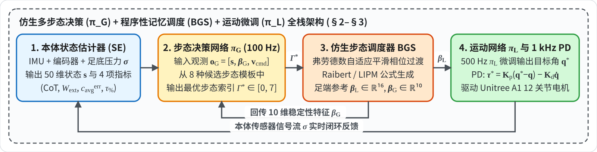
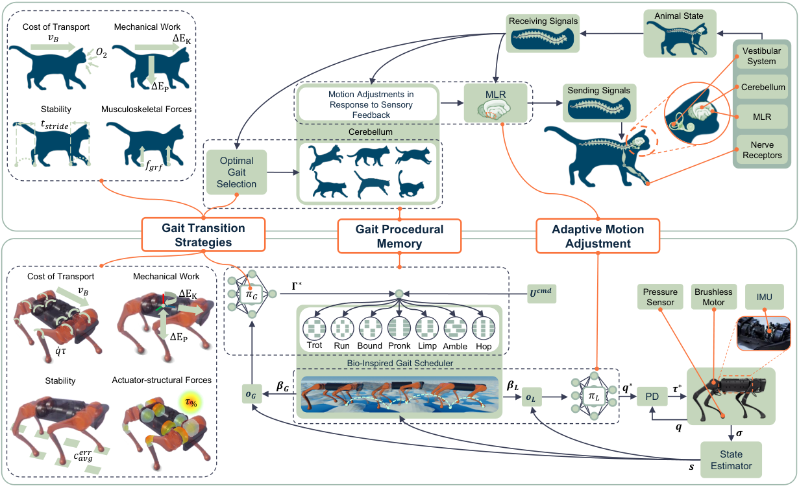

# Learning to adapt through bio-inspired gait strategies for versatile quadruped locomotion

**核心思路**：不硬学动物骨骼外貌，而是把神经控制三支柱抽象为 **仿生步态调度器 (BGS，程序性记忆) + 低层执行策略 $\pi_L$（神经反射微调） + 高层步态决策 $\pi_G$（CoT/力矩饱和度驱动切换）**。

> * **研究机构**：University of Leeds (School of Mechanical Engineering), University College London (Department of Computer Science)
> * **发表出处**：*Nature Machine Intelligence*, Vol. 7, pp. 1141–1153（2025 年 7 月）

## 全文工作流程

以下给出四级控制环路（状态估计 $\to$ 高层步态决策 $\pi_G$ $\to$ 仿生步态调度器 BGS $\to$ 低层执行 $\pi_L$ $\to$ 关节 PD 驱动）的全系统闭环数据流图及各阶段对照表：

| 阶段 | 模块（运行频率） | 输入 | 核心方程 / 算法 | 输出 | 章节 |
| :--- | :--- | :--- | :--- | :--- | :--- |
| **阶段 1** | **状态估计 / 生物力学评估** | 原始传感流 $\boldsymbol{\sigma}$（IMU、编码器、足底压力） | [[状态估计器与扩展卡尔曼滤波EKF\|本体状态估计器（SE）]]；在线计算 $\text{CoT}$、力矩饱和度 $\tau_{\%}$、外部机械功 $W_{\text{ext}}$、触地误差 $c_{\text{avg}}^{\text{err}}$ | 50 维机体状态 $\mathbf{s} \in \mathbb{R}^{50}$、4 项生物力学指标 | §2.1–2.2、§5.1 |
| **阶段 2** | **高层步态决策 $\pi_G$（100 Hz）** | 观测 $\mathbf{o}_G \in \mathbb{R}^{66}$（含 $\mathbf{s}, \boldsymbol{\beta}_G, \mathbf{v}_B^{\text{cmd}}$） | 最大化综合生物力学效用奖励 $r_G = w_u r_u + \psi(\text{CoT}) + \psi(\tau_{\%}) + \psi(c_{\text{avg}}^{\text{err}}) + \psi(W_{\text{ext}})$ | 最优离散步态 $\Gamma^* \in \{0, 1, \dots, 7\}$（Stand/Trot/Run/Bound/Pronk/Limp/Amble/Hop） | §2.2、§5.1–5.3 |
| **阶段 3** | **仿生步态调度 BGS（实时）** | 选中步态 $\Gamma^*$、状态 $\mathbf{s}$、速度指令 $\mathbf{v}_B^{\text{cmd}}$ | [[中枢模式发生器CPG与相位振荡器\|步态相位矩阵调度]]：弗劳德过渡周期 $C = e^{-2\Omega}$、固有稳定性 $\Omega_{\text{stab}} = \frac{g}{hf^2}$；[[线性倒立摆与捕获点LIPM\|Raibert 落足点]] | 执行参考 $\boldsymbol{\beta}_L \in \mathbb{R}^{16}$、决策参考 $\boldsymbol{\beta}_G \in \mathbb{R}^{10}$ | §3.1–3.2 |
| **阶段 4** | **低层运动执行 $\pi_L$（500 Hz）** | 观测 $\mathbf{o}_L = [\boldsymbol{\beta}_L, \mathbf{s}, \mathbf{v}_B^{\text{cmd}}] \in \mathbb{R}^{69}$ | 仅在平地预训练，最大化能效平滑 $r_\eta$、速度跟踪 $r_{v^{\text{cmd}}}$、记忆跟踪 $r_f$、姿态稳定 $r_{\text{stab}}$ | 12 维电机目标角度 $\mathbf{q}^* \in \mathbb{R}^{12}$ | §4.1–4.2 |
| **阶段 5** | **关节 PD 控制（1000 Hz）** | 目标角度 $\mathbf{q}^*$、实测 $(\mathbf{q}, \dot{\mathbf{q}})$ | 比例微分伺服控制律 $\boldsymbol{\tau}^* = K_p(\mathbf{q}^* - \mathbf{q}) - K_d \dot{\mathbf{q}}$ | 12 维电机扭矩 $\boldsymbol{\tau}^* \in \mathbb{R}^{12}$ | §2.2 |

---

## 1. 动机

### 1.1 单一固定步态局限
*   在动物日常生命活动中，**70%~90% 的运动属于弗劳德表征运动（即没有垂直脱离地面的奔走）**。
*   自然界哺乳动物面对复杂地形时，依靠丰富多样的步态自如切换：平地慢速行走（Amble/Walk）、中速对角小跑（Trot）、高速奔袭（Run），遇到捕食、泥潭、突发打滑时迅速唤醒特化步态（Bound 前后跳、Pronk 四足同弹、Limp 跛行、Hop 弹跳）。
*   **当前主流 DRL 的缺陷**：几乎所有控制器在训练时都被硬编码绑定在单一的步态上（通常是 Trot 小跑）。面对湿滑冰面或深坑泥泞，机器狗只能硬着头皮继续用小跑蹬地，导致车轮打滑式的失稳翻车。

### 1.2 现有步态规划的自适应局限
*   **传统 [[中枢模式发生器CPG与相位振荡器|CPG 方法]]**：虽然能通过耦合振荡器自然产生步态切换，但在户外复杂真实地形上往往只能以极低速度蠕动，动态抗扰极差；
*   **动作捕捉重定向**：直接把狗、马的动捕骨骼动画强行灌给机器人模仿学习。但机器人电机减速机的转动惯量、扭矩特性与生物肌肉完全不同，强行模仿导致电机低效过热；
*   **多策略蒸馏融合**：难以在单一策略中保留极端辅助步态的救车特化能力。

**核心主张**：不直接模仿动物的外在骨骼轨迹，而是将动物神经系统中控制步态的**三大底层神经机制（Gait Transitions, Procedural Memory, Real-time Adjustments）** 抽象化，嵌入 DRL 学习闭环。

---

## 2. 三大仿生内核

作者认为，机器狗之所以不如动物灵活，就是因为传统算法割裂了动物运动的这三大能力。整张图的设计全部围绕着这三根支柱展开：

1. **Gait Transition Strategies（步态切换策略）**： 动物能根据当前体能、地形与外部冲击，自主决定“何时换步态”。工程上对应**步态决策网络 $\pi_G$**。
2. **Gait Procedural Memory（步态程序性记忆）**： 动物不需要每次重新去想“小跑时左脚该先动还是右脚先动”，小脑里沉淀了固化的运动模板。工程上对应**仿生步态调度器（BGS）**。
3. **Adaptive Motion Adjustment（自适应运动微调）**： 当遇到突发打滑或踩空时，动物能通过脊髓和神经反射，在毫秒内微微抬高或收紧某条腿。工程上对应**低层运动执行网络 $\pi_L$**。

### 2.1 真实生物的神经控制闭环

**1. 左上角：驱动动物切换步态的 4 大生物力学指标**

画了 4 只小猫的剪影，分别代表生物学中解释动物步态切换的 4 个物理维度：

* **Cost of Transport（运输代谢能耗）**： 小猫嘴前画着 $O_2$（氧气消耗）。动物以速度 $v_B$ 奔跑时，单位距离消耗的氧气量（代谢能耗）。动物换步态，首要动机之一就是为了省氧气。
* **Mechanical Work（机械功做功效率）**： 标有水平方向的动能变化 $\Delta E_K$ 和垂直方向的势能变化 $\Delta E_P$。动物在跑跳时，身体像弹簧一样储存并释放势能与动能，换步态是为了减少无谓的能量耗散。
* **Stability（周期稳定性）**： 猫的脚下画着步幅周期 $t_{\text{stride}}$ 和虚线脚印。衡量每一步步频的变异系数（方差）。方差越小，动作越稳定；方差激增说明即将绊倒，促使动物换步态保平衡。
* **Musculoskeletal Forces（骨骼肌肉受力）**： 脚下画着向上的巨大地面反力 $f_{\text{grf}}$。如果奔跑速度太快，冲击力过大，为了防止骨折或肌腱拉伤，动物必须换步态卸力。

**2. 中上与右上：动物神经系统的具体解剖分工**

* **右侧猫头部的局部放大图（橙色圆圈）**：标明了动物感知与运动的中枢神经组织：
  * **Vestibular System（内耳前庭系统）**：感知重力矢量与头部角加速度（IMU）；
  * **Cerebellum（小脑）**：负责运动协调与空间程序性记忆；
  * **MLR（中脑运动区，Mesencephalic Locomotor Region）**：脑干的关键核团，负责启动、维持并向下传递运动奔跑指令；
  * **Nerve Receptors（神经机械感受器）**：足底皮肤压力感应与肌肉肌腱拉伸感受器。
* **信号流动机制**：
  * 猫在奔跑时，神经感受器和前庭收集 **`Animal State`（动物生理状态）**；
  * 信号通过脊髓传回（`Receiving Signals`）到脑干中脑运动区（MLR）和小脑；
  * 小脑根据当前感觉做出 **`Motion Adjustments in Response to Sensory Feedback`（基于感知反馈的运动微调）**；
  * 中脑运动区（MLR）根据 4 大生物力学评估，做出 **`Optimal Gait Selection`（最优步态选择）**，选出当前是用小跑（Trot）、奔跑（Run）、同弹（Pronk）还是前后跳（Bound）；
  * 脊髓发出下行运动指令（`Sending Signals`），指挥四肢肌肉协调收缩。

### 2.2 DRL全栈控制系统

* **Cost of Transport（运输能耗 CoT）**： 不再测氧气，而是测量 12 个关节电机的做功总功率 $\dot{q}\tau$（力矩乘以转速）加上电机发热电阻损耗，除以机身重力和车速 $v_B$。
* **Mechanical Work（外部机械功 $W_{\text{ext}}$）**： 计算机器狗机身在三维空间中动能变化率 $\Delta E_K$（不仅包含前进，还计入横移与横滚角动能）与势能变化率 $\Delta E_P$ 之差。
* **Stability（接触稳定性）**： 机器狗脚下画着 4 个绿色脚印，标着 $c_{\text{avg}}^{\text{err}}$。它实时计算 **“实际脚掌踩地状态与调度器期望状态的误差”**，步态出现紊乱打滑时，该值瞬间飙升。
* **Actuator-structural Forces（执行器力矩饱和度）**： 机器狗髋关节被高亮标为黄色，带着 **$\tau_{\%}$**。由于机械狗髋关节力臂最大、最容易受损，通过监控各关节力矩向极限饱和度的百分比，替代猫的骨骼防断裂指标。

**1. 核心流程**

**(1) 步态决策网络 $\pi_G$（Gait Selection Policy，100 Hz）**

* 相当于**机器狗的大脑**；
* 接收包含自身状态和 4 大生物力学指标的观测向量 $\mathbf{o}_G$；
* 输出一个离散决策值 **$\Gamma^* \in [0, 7]$**（从 8 种候选步态中选出最优步态编号）。

**(2) 仿生步态调度器 BGS（Bio-Inspired Gait Scheduler）**

* 相当于**机器狗的小脑程序性记忆**；
* 里面画了 **8 个轮子图标**，代表预存的 8 种基础步态模板：`Trot`（小跑）、`Run`（奔跑）、`Bound`（前后跳）、`Pronk`（四足同弹）、`Limp`（跛行）、`Amble`（缓行）、`Hop`（单侧跳）等；
* 下方画了一条**四足交替腾空落地的三维波浪带**：BGS 利用 Raibert 倒立摆公式，将离散的步态 $\Gamma^*$ 与外界下发的速度指令 $U^{\text{cmd}} = [v_x, v_y, \omega_z, \Gamma^*]$，翻译成连续的足底接触状态与空间落足坐标；
* 兵分两路输出参考信号：
  * 向左输出 $\boldsymbol{\beta}_G$（回传给 $\pi_G$ 大脑）；
  * 向右输出 $\boldsymbol{\beta}_L$（发给 $\pi_L$ 运动策略）。

**(3) 运动执行网络 $\pi_L$（Locomotion Policy，500 Hz）**

* 相当于**小脑深部运动核团与脊髓**；
* 输入特征 $\mathbf{o}_L$（包含 BGS 的程序性参考 $\boldsymbol{\beta}_L$、机体状态 $\mathbf{s}$ 以及期望速度）；
* 它的职责不是去猜步态，而是做**微观自适应**：把 BGS 给出的理论脚印轨迹，根据当前脚下有没有滑移、有没有踩到碎石，实时微调修正；
* 输出目标关节角 **$\mathbf{q}^*$**（12 个电机的目标旋转角度）。

**(4) 关节级高频 PD 控制器（1000 Hz）**

* 接收目标关节角 $\mathbf{q}^*$，比对当前电机实际角度 $\mathbf{q}$ 与角速度 $\dot{\mathbf{q}}$；
* 根据公式 $\boldsymbol{\tau}^* = K_p(\mathbf{q}^* - \mathbf{q}) - K_d \dot{\mathbf{q}}$，算出最终要下发给电机线圈的真实扭矩 **$\boldsymbol{\tau}^*$**。

**2.硬件与感知**

* **Unitree A1 机器狗实机**：12 个电机执行力矩 $\boldsymbol{\tau}^*$；
* **传感器组件（全部为纯本体感知，无视觉/雷达）**：
  * **Pressure Sensor**：足底压力传感器，测脚有没有沾地；
  * **Brushless Motor**：无刷电机内部自带的高精度旋转编码器（测关节转角 $\mathbf{q}$ 和转速 $\dot{\mathbf{q}}$）；
  * **IMU**：安装在机身内部的惯性测量单元，测机身倾角和三轴陀螺仪角速度。
* **状态估计器（State Estimator, SE）**：
  * 采集由各传感器拼成的原始信号流 **$\boldsymbol{\sigma}$**；
  * 滤波解算出高精度的机体真实物理状态 **$\mathbf{s}$**（包含空间线速度、高度、力矩、重力分量等 50 维状态）；
  * 将状态 $\mathbf{s}$ 闭环反馈给 BGS、高层决策网络 $\pi_G$ 以及低层执行网络 $\pi_L$。

整个控制架构不含任何激光雷达和深度相机，仅依靠**纯本体感知**实现完全自治：

| 核心模块 | 频率 | 对应生物结构 | 核心职责 / 输入输出 |
| :----------------------------------------------- | :----------- | :-------------------- | :----------------------------------------------------------- |
| **步态决策策略 $\pi_G$ (Gait Selection)**    | **100 Hz**   | 大脑皮层 / 脑干 MLR   | • **输入**：机体状态 $\mathbf{s}$、调度器参考 $\boldsymbol{\beta}_G$、速度指令 $\mathbf{v}_B^{\text{cmd}}$ • **输出**：最优离散步态编号 $\Gamma^* \in [0, 7]$（8 选 1） |
| **仿生步态调度器 BGS (Gait Scheduler)**      | **在线实时** | 小脑程序性记忆库      | • **输入**：决策步态 $\Gamma^*$、机体自车状态 $\mathbf{s}$ • **输出**：空间足端与触地参考 $\boldsymbol{\beta}_L \in \mathbb{R}^{16}, \boldsymbol{\beta}_G \in \mathbb{R}^{10}$ |
| **运动执行策略 $\pi_L$ (Locomotion Policy)** | **500 Hz**   | 小脑运动皮层/脊髓环路 | • **输入**：程序性记忆参考 $\boldsymbol{\beta}_L$、机体状态 $\mathbf{s}$、速度指令 • **输出**：12 个关节目标角度 $\mathbf{q}^* \in \mathbb{R}^{12}$ |
| **关节 PD 控制器**                               | **1000 Hz**  | 肌肉肌腱机械阻抗      | • 将 $\mathbf{q}^*$ 转化为电机扭矩 $\boldsymbol{\tau}^* = K_p(\mathbf{q}^* - \mathbf{q}) - K_d \dot{\mathbf{q}}$ |

| 符号                             |                                              | 物理意义                                                     |
| :------------------------------- | :------------------------------------------- | :----------------------------------------------------------- |
| **MLR**                          | 中脑运动区 (Mesencephalic Locomotor Region)  | 动物脑干中控制行走、奔跑启停与步态速度调节的神经中枢。       |
| **$\pi_G$**                      | 步态决策策略网络 (Gait Selection Policy)     | 运行在 100 Hz 的神经网络，模拟大脑，负责从 8 种步态中选出最适合当前地貌的 $\Gamma^*$。 |
| **$\pi_L$**                      | 运动执行策略网络 (Locomotion Policy)         | 运行在 500 Hz 的神经网络，负责具体输出 12 个电机的期望角度 $\mathbf{q}^*$ 并自适应抗扰。 |
| **BGS**                          | 仿生步态调度器 (Bio-Inspired Gait Scheduler) | 程序性记忆发生器，负责平滑生成任意步态的空间足尖轨迹与时钟序列。 |
| **$\Gamma^*$**                   | 最优离散步态编号                             | 整数 $0 \sim 7$，对应 Stand, Trot, Run, Bound, Pronk, Limp, Amble, Hop。 |
| **$U^{\text{cmd}}$**             | 综合任务指令向量                             | 包含三维机身线速度/角速度指令以及决策步态：$[v_x^{\text{cmd}}, v_y^{\text{cmd}}, \omega_z^{\text{cmd}}, \Gamma^*]$。 |
| **$\boldsymbol{\beta}_L$**       | 运动执行步态参考张量 (16 维)                 | BGS 输出给 $\pi_L$ 的参考足端三维空间位置及触地相态期望。    |
| **$\boldsymbol{\beta}_G$**       | 决策步态参考张量 (10 维)                     | BGS 输出给 $\pi_G$ 的参考特征，包含步态固有稳定性指标 $\Omega_{\text{stab}}$ 和切换标志位 $\kappa$。 |
| **$\mathbf{o}_G, \mathbf{o}_L$** | 策略观测向量 (Observation)                   | 分别为 $\pi_G$（66 维）和 $\pi_L$（69 维）的输入张量。       |
| **$\mathbf{s}$**                 | 机体综合状态估计向量 (50 维)                 | 包含重力投影、关节角、速度、力矩、触地状态的滤波估计真值。   |
| **$\boldsymbol{\sigma}$**        | 原始传感器信号流                             | 电机编码器、足底开关与 IMU 输出的未经滤波的底层裸数据。      |
| **$\mathbf{q}^*$**               | 目标关节角指令向量 (12 维)                   | 4 条腿各 3 个电机期望转到的角度。                            |
| **$\boldsymbol{\tau}^*$**        | 目标关节力矩指令向量 (12 维)                 | 经由 1000 Hz PD 控制器算出的最终电机相电流扭矩。             |
| **PD**                           | 比例-微分控制器 (Proportional Derivative)    | 将角度误差和角速度误差，转化为电机输出力矩的高频伺服环节。   |

## 3. 仿生步态调度器（BGS）

BGS 是连接高层步态决策 $\pi_G$ 与低层运动执行 $\pi_L$ 的核心桥梁。它充当了 **“伪程序性记忆（Pseudo Gait Procedural Memory）”** 的角色。

### 3.1 BGS 输出张量定义
BGS 输出两组特征向量：
1.  **发往底层运动策略的 $\boldsymbol{\beta}_L \in \mathbb{R}^{16}$**：
    $$
    \boldsymbol{\beta}_L = [\mathbf{c}_{\text{ref}}, \mathbf{p}_{\text{ref}}^x, \mathbf{p}_{\text{ref}}^y, \mathbf{p}_{\text{ref}}^z]
    $$
    
    *   $\mathbf{c}_{\text{ref}} \in \mathbb{B}^4$：四条腿当前时刻的布尔期望接触状态（1 代表支撑相 Stance，0 代表空中摆动相 Swing）；
    *   $\mathbf{p}_{\text{ref}}^x, \mathbf{p}_{\text{ref}}^y, \mathbf{p}_{\text{ref}}^z \in \mathbb{R}^4$：四只脚基于 Raibert 启发式在线计算出的世界系三维空间期望落足点坐标。
2.  **发往高层步态决策策略的 $\boldsymbol{\beta}_G \in \mathbb{R}^{10}$**：
    $$
    \boldsymbol{\beta}_G = [\mathbf{c}_{\text{ref}}, \mathbf{p}_{\text{ref}}^z, \Omega_{\text{stab}}, \kappa]
    $$
    
    *   $\Omega_{\text{stab}}$：当前步态的固有稳定性指标；
    *   $\kappa \in \mathbb{B}$：布尔标志位，标记当前系统是否正处于步态过渡切换期。

---

### 3.2 步态平滑过渡机制
以往的四足控制器通常只能在固定的顺序间切换（例如只能 Walk $\to$ Trot $\to$ Gallop）。BGS 实现了**任意两种步态（8 种步态中的任意两两配对）之间的任意平滑切换**。

**(1) 过渡周期数计算**
$$
C = e^{-2\Omega}
$$

*   **$\Omega$（弗劳德数）**：$\Omega = \frac{v^2}{g h}$（$v$ 是速度，$g$ 重力，$h$ 背高）。
*   **物理本质**：当机器狗在低速（$\Omega$ 较小）时，$C$ 较大，步态切换会在多个步态周期内极其缓慢、平滑地交织渐变；而当高速奔跑（$\Omega \ge 2$）时，$e^{-2\Omega}$ 迅速衰减趋向于 0，**步态在瞬间完成毫秒级爆发突变**，与野生动物高速捕食瞬间的突发切换完全一致。

**(2) 步态固有稳定性指标 $\Omega_{\text{stab}}$ 与切换分辨率 $\delta$**

为了决定从步态 A 切到步态 B 究竟该“猛切”还是“柔切”，论文定义了**步态固有稳定性系数 $\Omega_{\text{stab}}$**：

$$
\Omega_{\text{stab}} = \frac{g}{h f^2}
$$

*   **符号含义**：$g$ 为重力常数，$h$ 为臀部离地高度，$f$ 为该步态的固有摆腿频率。
*   **物理意义**：摆腿频率 $f$ 越低，单腿支撑时间越长，$\Omega_{\text{stab}}$ 越大，步态固有静态稳定性越高。
*   **过渡步进分辨率 $\delta$ 计算公式**：
    $$
    \delta = 1 + \frac{\Omega_{\text{stab}}}{\Omega_{\text{stab}}^{\text{next}}}
    $$
    其中 $\Omega_{\text{stab}}^{\text{next}}$ 是目标新步态的稳定性系数。
    
    *   场景 A：从高频奔跑（Run，稳定性低）切换回低频行走（Trot，稳定性高）：此时分母很大，$\delta$ 较小，算法放慢步调，以极高平滑度缓缓过渡，**防止急刹车导致向前栽跟头**；
    *   场景 B：从稳态行走（Trot）切换到高速逃逸（Pronk/Bound）：分母很小，$\delta$ 极大，算法以极高分辨率瞬间完成步进突变，**立即爆发逃离危险区**。

---

## 4. 运动执行策略 $\pi_L$

**底层的运动执行策略 $\pi_L$ 在整个训练生命周期中，只在 100% 绝对光滑的平坦地面上进行训练！它从未在仿真中见过任何台阶、碎石或斜坡！** 但它一旦部署到真实世界，却能自适应踩过烂泥、树根、瓦砾与深坑。这背后的核心机理全在于**程序性记忆与奖励塑形机制**。

### 4.1 状态观测空间解剖
$$
\mathbf{o}_L = [\boldsymbol{\beta}_L, \mathbf{s}, \mathbf{v}_B^{\text{cmd}}] \in \mathbb{R}^{69}
$$

* 其中机体状态估计向量 $\mathbf{s} \in \mathbb{R}^{50}$ 包含：机身重力投影向、关节角 $q$、关节角速度 $\dot{q}$、机身三轴线速度/角速度、机身离地高度 $z_B$、电机力矩 $\boldsymbol{\tau}$ 以及 4 足触地布尔状态。 

* $\mathbf{v}_B^{\text{cmd}} \in \mathbb{R}^3$（高层期望速度指令，共 3 维），这 3 维数据来自操作员（或高层规划器发下的全局任务）。它规定了机器狗 **“你想去哪”**：
  $$
  \mathbf{v}_B^{\text{cmd}} = [v_x^{\text{cmd}}, \; v_y^{\text{cmd}}, \; \omega_z^{\text{cmd}}] \in \mathbb{R}^3
  $$

  | 符号                        |   维度   | 物理含义                                                     |
  | :-------------------------- | :------: | :----------------------------------------------------------- |
  | **$v_x^{\text{cmd}}$**      | **1 维** | **期望前进/后退线速度**（单位：$\text{m/s}$）。比如要求狗以 $1.0\text{ m/s}$ 往前冲。 |
  | **$v_y^{\text{cmd}}$**      | **1 维** | **期望左右横移线速度**（单位：$\text{m/s}$）。平地直行通常为 0，躲避横向障碍时为非零。 |
  | **$\omega_z^{\text{cmd}}$** | **1 维** | **期望转向偏航角速度**（单位：$\text{rad/s}$）。控制狗向左转还是向右拐。 |

---

### 4.2 运动执行奖励函数

$$
r_L = w_\eta r_\eta + w_{v^{\text{cmd}}} r_{v^{\text{cmd}}} + w_f r_f + w_{\text{stab}} r_{\text{stab}}
$$

1.  **机械能效与平滑项（$r_\eta$）**：
    $$
     r_\eta = \|\dddot{\mathbf{q}}\|^2 + \|\boldsymbol{\tau}\|^2 + \|\mathbf{q}^* - \mathbf{q}_{t-1}^*\|^2
    $$
    
    *   惩罚关节加加速度（$\dddot{\mathbf{q}}$），惩罚大电机力矩 $\boldsymbol{\tau}$，惩罚相邻时间步动作突变。消除高频抖动，保护物理齿轮箱。
    
2.  **速度跟踪项（$r_{v^{\text{cmd}}}$）**：
    $$
    r_{v^{\text{cmd}}} = \psi \left( \|\mathbf{v}_B - \mathbf{v}_B^{\text{cmd}}\|^2 \right) \quad \text{其中 } \psi(x) = 1 - \tanh(x^2)
    $$
    
    *   $\psi(\cdot)$ 归一化激活函数将奖励平滑限制在 $[0, 1]$ 之间，防止单项误差过大破坏整个策略梯度。
    
3.  **步态程序性记忆跟踪项（$r_f$）**：
    $$
    r_f = |\mathbf{c}_{\text{err}}| + \sum_{i=1}^4 \|\mathbf{p}_i - \mathbf{p}_i^{\text{ref}}\|^2
    $$
    
    *   $|\mathbf{c}_{\text{err}}|$：足端实际触地状态与 BGS 计划状态不一致的腿数；
    *   $\|\mathbf{p}_i - \mathbf{p}_i^{\text{ref}}\|^2$：脚掌在三维空间中的实际绝对位置与 BGS 参考位置的欧氏距离误差。
    *   **物理效果**：迫使神经网络将 BGS 提供的步态参考内化为自己的潜意识本能。
    
4.  **全维稳定性硬惩罚项（$r_{\text{stab}}$）**：
    $$
    \begin{aligned}
    r_{\text{stab}} &= \underbrace{\sum_{i=1}^F \|\dot{\mathbf{p}}_i\|^2}_{\text{1. 足端打滑}} + \underbrace{\|\boldsymbol{\omega}_{B,xy}\|^2}_{\text{2. 晃动角速度}} \\
    &\quad + \underbrace{\|\mathbf{q}_{\text{hip}}\|^2}_{\text{3. 髋关节角}} + \underbrace{\psi(\|\boldsymbol{\alpha} R_B - \boldsymbol{\alpha} R_B^{\text{des}}\|^2)}_{\text{4. 姿态倾斜惩罚}} \\
    &\quad - \underbrace{\psi((z_B - z_B^{\text{nom}})^2)}_{\text{5. 离地高度保持}}
    \end{aligned}
    $$
    
    * $\sum \|\dot{\mathbf{p}}_i\|^2$：**支撑腿足端滑移速度惩罚**（严禁支撑脚在地上蹭地打滑）；
    
    * $\|\boldsymbol{\omega}_{B,xy}\|^2$：机体横滚与俯仰角速度惩罚；
    
    * $\|\mathbf{q}_{\text{hip}}\|^2$：髋关节侧展角惩罚（防止双腿无意义外八字大劈叉）。
    
    * $$\psi \left( \|\boldsymbol{\alpha} R_B - \boldsymbol{\alpha} R_B^{\text{des}}\|^2 \right)$$：
    
      * **$R_B \in \text{SO}(3)$（当前机体旋转矩阵）**：  $3 \times 3$ 的正交旋转矩阵，描述机器狗机身在三维空间中的**实际朝向与倾斜姿态**。
      * **$R_B^{\text{des}} \in \text{SO}(3)$（期望机体旋转矩阵）**： 算法要求机器狗保持的**理想水平姿态**（即机身不向左倾斜、不向前栽倒，水平朝向前方）。
      * **$\boldsymbol{\alpha} = [0, 0, 1]^T$（单位投影抽取向量）**： 这是线性代数里的一个经典操作——把矩阵第三行（对应 Z 轴方向）给“抓取”出来！
        * $\boldsymbol{\alpha} R_B$ 在几何上代表：**机器狗背部垂直向上的法向量，在世界坐标系里的真实朝向**；
        * $\boldsymbol{\alpha} R_B^{\text{des}}$ 代表：**绝对垂直于水平面的天顶向量 $[0, 0, 1]$**。
    
      * 两个单位向量相减求模长平方：
        * 如果机器狗身体**完全水平**，两根向量完全平行对齐，差值为 0；
        * 如果机器狗在跑动中发生严重的**横滚（Roll）** 或者**俯仰（Pitch）**，背部的法向量就会偏离天顶，这个差值就会暴增！
      * **物理目的**：**严厉惩罚机身侧倾和前倾！强制机器狗在任何颠簸路面上，机身必须像平衡仪一样保持水平背朝天。**
    
    * $$- \psi \left( (z_B - z_B^{\text{nom}})^2 \right)$$：
    
      * **$z_B \in \mathbb{R}$（当前机身真实离地高度）**： 机器狗中心躯干此时此刻距离地面的**实际物理垂直高度**（单位：米）。
      * **$z_B^{\text{nom}} \in \mathbb{R}$（名义标准站立高度）**： 机器狗出厂设定的**最舒适黄金站立高度**。
    

---

## 5. 步态决策网络 $\pi_G$

高层步态决策网络 $\pi_G$ 模拟大脑，从 8 种候选步态库中动态挑选当前最佳的唯一步态 $\Gamma^* \in [0, 7]$：

| 步态编号 | 0 | 1 | 2 | 3 | 4 | 5 | 6 | 7 |
| :---: | :---: | :---: | :---: | :---: | :---: | :---: | :---: | :---: |
| **步态类型** | Stand 静止 | Trot 小跑 | Run 奔跑 | Bound 前后跳 | Pronk 同弹 | Limp 跛行 | Amble 缓行 | Hop 单侧跳 |

### 5.1 生物力学评估指标
自然界动物在切换步态时，受多个物理量同时驱动。论文将这些复杂的生物学指标重构为机器人可直接在线计算的工程指标：

| 生物学假说 | 工程重构指标 | 数学公式 | 物理意义 |
| :----------------- | :----------------------------------------------- | :----------------------------------------------------------- | :----------------------------------------------------------- |
| **能量经济性**     | **运输成本 (CoT)**                               | $\text{CoT} = \frac{\sum_{i=1}^n \max(\tau_i \dot{q}_i + 0.3 \tau_i^2, 0)}{m g \|\mathbf{v}_B\|}$ | 计入电机机械做功（$\tau \dot{q}$）与线圈焦耳热损耗（$0.3 \tau^2$），反映整机电能效率。 |
| **骨骼防损伤**     | **关节力矩饱和度 ($\tau_{\%}$)**                 | $\tau_{\%} = \frac{1}{n} \left\| \frac{\boldsymbol{\tau}}{\boldsymbol{\tau}_{\text{lim}}} \right\|_1$ | **大幅优于地面反力 GRF！** 因为髋电机距离足底最远（力臂最大），力矩饱和比足端力更早预警机械损坏。 |
| **外力做功守恒**   | **外部机械功 ($W_{\text{ext}}$)**                | $W_{\text{ext}} = \sum_{i=0}^{t_{\text{gait}}} (\Delta E_{k,i} - \Delta E_{p,i})$ | 统计单周期内动能与势能的非守恒耗散。计入了三维角速度与横向速度突变。 |
| **步态周期稳定性** | **触地跟踪误差 ($c_{\text{avg}}^{\text{err}}$)** | $c_{\text{avg}}^{\text{err}} = \frac{|\mathbf{c}_{\text{err}}|}{4}$ | 代替需要长时间统计的步态周期方差 CV，实现**每一步的高频即时稳定性在线打分**。 |

---

### 5.2 步态选择策略奖励函数
$$
r_G = w_u r_u + \psi(\text{CoT}) + \psi(\tau_{\%}) + \psi(c_{\text{avg}}^{\text{err}}) + \psi(W_{\text{ext}})
$$

其中效用奖励 $r_u = r_{v^{\text{cmd}}} + r_{\text{stand}} + r_{\text{smooth}}$。  

- $$
  \begin{aligned}
  r_{v^{\text{cmd}}} &= \psi \left( \|\mathbf{v}_B - \mathbf{v}_B^{\text{cmd}}\|^2 \right) = 1 - \tanh \left( \|\mathbf{v}_B - \mathbf{v}_B^{\text{cmd}}\|^4 \right) \\
  \mathbf{v}_B^{\text{cmd}} &= [v_x^{\text{cmd}}, v_y^{\text{cmd}}, \omega_z^{\text{cmd}}]^T
  \end{aligned}
  $$

* $$
  r_{\text{stand}} = \begin{cases} 
  +10, & \|\mathbf{v}_B^{\text{cmd}}\| = 0 \land \Gamma^* = \text{Stand} \\
  +10, & \|\mathbf{v}_B^{\text{cmd}}\| > 0 \land \Gamma^* \ne \text{Stand} \\
  0, & \text{其他违规情况}
  \end{cases}
  $$
  *(物理规则：命令停车时必须且仅能选 `Stand`；命令开跑时严禁选 `Stand`，否则零分惩罚。)*

* $$
  r_{\text{smooth}} = \begin{cases} 
  -\psi\left( \text{CoT} + \tau_{\%} + c_{\text{avg}}^{\text{err}} + W_{\text{ext}} \right), & \Gamma_t^* \ne \Gamma_{t-1}^* \text{（切换步态）} \\
  0, & \Gamma_t^* = \Gamma_{t-1}^* \text{（保持原步态）}
  \end{cases}
  $$

  * 在强化学习中，经常会出现“两种步态表现几乎一样好”的情况（比如在平地上，Trot 和 Amble 的能耗和受力几乎没区别）。 如果没有这一项，策略网络就会在每 10 毫秒内疯狂在 1 和 6 之间来回反复横跳，导致底层电机高频抽搐。 
    * 只要这一瞬间你**没换步态**（$\Gamma_t^* = \Gamma_{t-1}^*$），不扣分（$r_{\text{smooth}} = 0$）；
    * 只要你敢**换步态**（$\Gamma_t^* \ne \Gamma_{t-1}^*$），立刻触发惩罚，**扣除一笔与当前综合物理代价成正比的负分！**
    * **结论**：只有当新步态带来的性能收益**远远大于**这笔过路费时，大脑策略才会真正下定决心切换步态，消除了微小扰动下的高频步态乱跳。

### 5.3 步态涌现

训练完成后，$\pi_G$ 自发推演出一套与野生动物高度重合的双层步态体系：
*   **名义步态（Nominal Gaits，占日常 90%）**：
    *   低速巡航：只选 **Trot（小跑）**；
    *   高速狂奔：只选 **Run（奔跑）**；
    *   加速阶段：在 Trot 和 Run 之间高频交替震荡，自发平滑过渡，这与赛马加速时的步频拉伸完全一致。
*   **特化辅助步态（Auxiliary Gaits，恶劣地形自发唤醒）**：
    *   一旦遭遇粗糙地形或突发侧向撞击，显示 Trot 的表现急剧下滑；
    *   此时$\pi_G$ 会以极高敏感度瞬间切入 **Bound（前后跳）、Pronk（同相弹跳）或 Limp（跛行）**，通过重塑足端支撑相位，迅速平抑力矩饱和与机体晃动。
