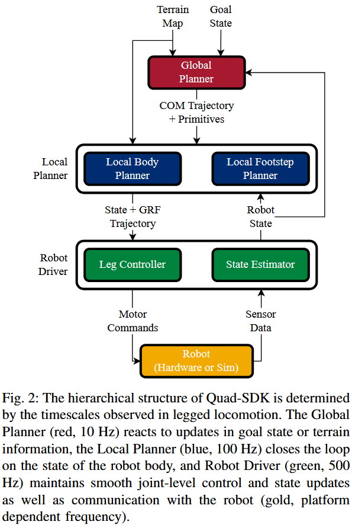

# Quad-SDK 

## 1. 立项背景

在机器人学界，不同形态的机器人有其标准化的软件基础设施：
*   **机械臂**：有 **MoveIt**。开发者只需给出一个末端坐标，MoveIt 自动计算正逆运动学、碰撞检测与轨迹插补。
*   **普通轮式/履带车**：有 **ROS Navigation (Nav2)**。利用 2D 激光雷达扫出激光栅格地图，A* 算法搜索全局路径，DWA/TEB 算法输出线速度与角速度 $(v, \omega)$。
*   **四足机器狗的困境**：
    1.  **轮式 Nav2 无法处理三维地形**：轮式车遇到 15 cm 台阶直接判定为不可通行的死墙，但机器狗能跨越、跳跃过去；
    2.  **既有开源工具极度碎片化**：学界有做轨迹优化的，有做多体仿真的，但只是“单一求解器算法”，既没有接入上层导航建图，也没有接入底层电机驱动；
    3.  **厂商 SDK 闭源黑盒**：波士顿动力（Spot）、ANYbotics、宇树（Unitree）只给外部开发者暴露极其粗糙的速度接口，底层核心算法全部封死。

**Quad-SDK 的定位**：建立四足机器人第一个**从高层自主导航、到中层模型预测控制（NMPC）、再到底层电机驱动与状态估计的全栈（Full Stack）开源架构**。

---

## 2. Timescale Separation

机器人如果想在复杂的真实世界里奔跑，它面对的物理变化速度是截然不同的：
*   周围障碍物的位置变化很慢；
*   机体跑步时的晃动和踩地推力变化较快；
*   电机线圈电流与足端触地碰撞的变化极快 。

Quad-SDK 没有试图用一个超级大算法计算所有事情，而是将系统严格划分为**三个时间尺度层级**，每个层级封装为一个独立的 C++ 类并以 ROS 节点异步运行：

| 系统层级 (Layer)                          | 运行频率   | 对应的物理现象与职责                                         | 为什么是这个频率？                                           |
| :---------------------------------------- | :--------- | :----------------------------------------------------------- | :----------------------------------------------------------- |
| **顶层：全局规划器 (Global Planner)** | **10 Hz**  | 观察外部大局环境，在三维地形上规划机体的长远巡航路线与动作模式。 | 人眨眼需要 200 ms，环境中的大障碍物不会在几毫秒内凭空瞬移，10 Hz 足够应对大局变化。 |
| **中层：局部规划器 (Local Planner)**  | **100 Hz** | 预测机体未来几十毫秒的姿态，计算脚踩地的反作用推力；决定脚掌落在地面哪个坐标。 | 机器狗走一步通常耗时 200~400 ms，100 Hz 能保证在一条腿触地期间重新计算并修正推力 20~40 次。 |
| **底层：机器人驱动器 (Robot Driver)** | **500 Hz** | 读取电机编码器与 IMU，计算每个电机需要输出的瞬时扭矩，与真实电机驱动板通信。 | 电机响应和冲击振动极快，频率低于 500 Hz 时，电机输出力矩会出现阶梯状卡顿，导致机体发抖甚至共振散架。 |

---

## 3. 顶层：全局规划器（Global Planner）

### 3.1 输入与环境表征
*   **输入目标**：期望到达的终点位姿。
*   **输入地图**：**2.5D 高程地图**。

### 3.2 规划机理与动作基元
1.  **显式处理系统动力学与腾空相（Aerial Phases）**：
2.  **动作基元（Motion Primitives）**：指预先设计好的基础运动模板库。比如机器人不会像流水一样无限变形，它通常在离散的基础动作之间切换：**小跑步态基元**用于平地高效巡航；**跳跃跨障基元**用于飞越沟壑。
3.  **输出结果**：耗时仅约 **0.05 秒**，即可计算出一条长时域、包含跨越 15 cm 台阶动作的机体质心轨迹（CoM Trajectory）及对应的步态基元标签，下发给中层。

---

## 4. 中层 A：局部机体规划器（Local Body Planner）

局部机体规划器的核心使命是：**跟踪高层下发的质心轨迹，并算出为了不摔倒，处于支撑相的脚必须向地面输出多大的推力**。

### 4.1 单刚体模型（Single Rigid Body, SRB）
真实的四足机器狗有 1 个身体和 12 个腿部关节，总共有 18 个自由度，多体运动学极其复杂。 现代足式机器人普遍采用简化假设：**机器狗四条腿的质量很轻（通常仅占全机重的 10% 左右），整机的质量和转动惯量绝大部分集中在躯干上**。因此，将整个机器狗简化为一块在空间飞行的“质点长方体”，四条腿退化为四根只负责在特定接触点输出推力的无质量推杆。

---

### 4.2 核心数学优化模型

论文中的离散时间非线性模型预测控制（NMPC）构建为如下最优化问题：

$$
\min_{\mathbf{x}, \mathbf{u}} \sum_{i=0}^{N-1} \left( \|\mathbf{x}_{i+1} - \mathbf{x}_{i+1, \text{ref}}\|_{Q_i}^2 + \|\mathbf{u}_i - \mathbf{u}_{i, \text{ref}}\|_{R_i}^2 \right) \\
\begin{aligned}
\text{s.t.} \quad & \mathbf{x}_0 = \mathbf{x}_{\text{init}} & & \text{--- (初始状态约束)} \\
& f(\mathbf{x}_i, \mathbf{x}_{i+1}, \mathbf{u}_i, \mathbf{p}_i, dt_i) = 0 & & \text{--- (系统动力学模型等式约束)} \\
& \mathbf{x}_i \in \mathcal{X} & & \text{--- (状态变量物理上下限)} \\
& \mathbf{u}_i \in \mathcal{U} & & \text{--- (控制推力物理上下限)} \\
& C_i \mathbf{u}_i \le 0 & & \text{--- (摩擦金字塔约束)} \\
& D_i \mathbf{u}_i = 0 & & \text{--- (接触选择约束)}  
\end{aligned}  \tag{1}
$$

$$
Q = \begin{bmatrix} q_{11} & 0 & 0 \\ 0 & q_{22} & 0 \\ 0 & 0 & q_{33} \end{bmatrix}
$$

* 设状态误差向量 $\mathbf{e} = \mathbf{x} - \mathbf{x}_{\text{ref}} = [e_x, e_y, e_z]^T$。矩阵乘法加权范数展开为：
  $$
  \|\mathbf{e}\|_Q^2 = \mathbf{e}^T Q \mathbf{e} = q_{11} e_x^2 + q_{22} e_y^2 + q_{33} e_z^2
  $$
  如果非对角线上有数值（例如 $Q_{12} \ne 0$），展开式中就会出现交叉乘积项 $2 Q_{12} \cdot e_x \cdot e_y$。 在物理上，这意味着“机体在 X 轴的位置偏差”和“Y 轴的位置偏差”被强行耦合惩罚。但在工程实践中：

  1.  **物理意义不明确**：各个状态量物理单位不同，交叉相乘丧失物理量纲意义；
  2.  对角线上的 $q_{jj}$ 物理意义非常纯粹——**就是对应那个状态分量的“惩罚权重”**。如果你希望机器狗死死咬住目标高度，就把对应机体 $z$ 轴的对角元素 $q_{zz}$ 调大；如果允许横滾角 $roll$ 有微小摇晃，就把对应对角项调小。如果引入非对角线元素，调节一个参数会导致多个轴相互牵扯，系统极难稳定。

**(2) 动力学等式约束 $f(\mathbf{x}_i, \mathbf{x}_{i+1}, \mathbf{u}_i, \mathbf{p}_i, dt_i) = 0$**

*   这代表单刚体动力学方程的**离散数值积分**。它约束了系统：在第 $i$ 个时刻的状态是 $\mathbf{x}_i$、足端受力是 $\mathbf{u}_i$、且该状态持续了时间 $dt_i$ 之后，物理定律决定了下一个时刻的状态必须严格等于 $\mathbf{x}_{i+1}$，中间不能发生反物理瞬移。

**(3) 摩擦金字塔约束 $C_i \mathbf{u}_i \le 0$**

* 防止脚底打滑。真实的物理摩擦边界是一个圆锥体（库仑摩擦锥）：$\sqrt{f_x^2 + f_y^2} \le \mu f_z$。由于带根号和二次方，该约束是非线性的，计算速度较慢。工程上用一个**四棱锥（金字塔）**来内接逼近圆锥：
  $$
  |f_x| \le \frac{\mu}{\sqrt{2}} f_z, \quad |f_y| \le \frac{\mu}{\sqrt{2}} f_z, \quad f_z \ge 0
  $$
  矩阵 $C_i$ 将这些不等式写成统一线性形式 $C_i \mathbf{u}_i \le 0$。

**(4) 接触选择约束 $D_i \mathbf{u}_i = 0$**

*   离散步态开关。$D_i$ 是一个由 0 和 1 组成的布尔筛选矩阵。如果当前步态时钟表明第 1 条腿处于空中（摆动相），则 $D_i$ 对应的行激活，强制约束该脚的推力 $\mathbf{u}_1 = [0, 0, 0]^T$。脚踩在空气中绝不可能产生地面反力。

---

### 4.3 为什么能做到 100 Hz 极速求解？

*   **NLP（Nonlinear Programming，非线性规划）**：包含非线性目标函数或非线性约束的最优化数学问题统称为 NLP。式 (1) 中的动力学约束包含三维姿态旋转矩阵相乘，是典型的 NLP。
*   **CasADi**：**数值优化与自动微分符号计算工具**。在优化求解时，算法需要反复计算目标函数和约束函数的导数（雅可比矩阵和海森矩阵）。如果让人工去手算推导数，极易出错且非常慢；CasADi 能自动为你生成极其高效、无任何截断误差的 C/C++ 语言导数求解代码。
*   **IPOPT（Interior Point Optimizer，内点法求解器）**：
    求解带约束优化时，传统的算法常常沿着约束的边缘走； 而“内点法”是在不等式约束边界树立一道“无形的势能高墙”（对数屏障函数），迫使搜索迭代点**始终严格在可行域的“内部”平滑滑动逼近最优解**。IPOPT 是目前开源界求解大型非线性规划最强大、工业落地最广泛的数值库之一。

#### 变时步热启动
*   *冷启动*：优化求解器从零随机瞎猜一个解开始迭代，通常需要迭代 30~50 步才能收敛，耗时数十毫秒，无法达到 100 Hz。
*   *热启动*：把上一次（10 ms 前）算出来的最优解作为下一次求解的初始猜测值。因为 10 ms 内物理世界变化极小，求解器只需要微调 2~3 步即可收敛。

*   **传统 MPC 热启动时间节点错位问题**
    *   传统 MPC 的预测时间窗是一格一格固定步长（$\Delta t$）向前滚动的：时刻 $t=0$ 算的是未来 $[0, 0.1, 0.2, 0.3]\,\text{s}$ 的状态；
    *   到了下一个控制周期 $t=0.01\,\text{s}$，新窗口覆盖的是未来 $[0.01, 0.11, 0.21, 0.31]\,\text{s}$；
    *   你会发现**所有离散时间点全都发生了平移，上一轮解出来的数值在新时间点上对不齐**！初始猜测值质量变差，IPOPT 重新陷入多次迭代。
*   **变时步**：
    *   算法在向前滚动时，**仅仅缩短第一个网格间距 $dt_0$ 的长度**，让它动态缩水；由于第一个间距缩水了，**后续第 2 个、第 3 个……第 $N$ 个所有离散插值点，在绝对物理世界的时间轴上完全定住不动**！这样，上一轮求解出来的后续轨迹，能够**百分之百完美贴合**到新一轮优化问题的对应节点上。极高品质的热启动使 IPOPT 每次仅需极少迭代，在长时域下稳稳突破 100 Hz 刷新率。

---

## 5. 中层 B：局部落足点规划器（Local Footstep Planner）

机体如何受力已经确定，那么脚该踩在哪？论文给出了经典落足点计算公式：

$$
\mathbf{p}_{\text{nominal}} = \mathbf{p}_{\text{center}} + \mathbf{p}_{\text{vel}} + \mathbf{p}_{\text{centrifugal}}
$$

*   $\mathbf{p} = [p_x, p_y, p_z]^T$ 代表足端脚掌在世界笛卡尔坐标系中的三维空间坐标。

#### 1. 几何几何项 $\mathbf{p}_{\text{center}}$ 与 Welzl 算法
$$
\mathbf{p}_{\text{center}} = \arg\min_{\mathbf{p}} \left( \max_{i \in \text{st}} \|\mathbf{p} - \mathbf{p}_i\|_2^2 \right)
$$

*   **为什么用 Welzl 最小外接圆算法？**计算几何经典算法。给定平面上的一堆散点（即当前所有踩在地面上的支撑脚坐标 $\mathbf{p}_i$），Welzl 算法能在 $O(N)$ 线性时间内找到能够把这些点**全部包在内部的最小圆**。该圆的圆心，就是当前整个支撑多边形最均衡的**几何中心**。机器狗四条腿的伸展极限是有限的。如果落足点严重偏向某一边，关节会伸展到死点。把落脚点锚定在最小外接圆中心附近，**从几何上最大程度保证了腿部永远处于活动余量最大的舒适工作空间内**。

#### 2. 速度前馈项 $\mathbf{p}_{\text{vel}}$ 与倒立摆
$$
\mathbf{p}_{\text{vel}} = \sqrt{\frac{z_0}{\|\mathbf{g}\|}} (\mathbf{v}_{\text{touchdown, ref}} - \mathbf{v}_{\text{touchdown}})
$$

*   **倒立摆与自然共振周期**
    
    *   普通单摆 ：重物在支点下方晃荡，重力是“拉向中心”的稳定恢复力；
    *   **线性倒立摆**：把一根棍子竖在地上，重心在支点上方。重力不再拉回物体，而是**加速推着它倾倒**！
    *   倒立摆的微分方程为：$\ddot{x} = \frac{g}{z_0} x$（$z_0$ 为机体高度）。
    *   定义其固有特征频率为 $\omega_0 = \sqrt{\frac{g}{z_0}}$，其倒数即为特征时间常数：
        $$
        T_{\text{pendulum}} = \frac{1}{\omega_0} = \sqrt{\frac{z_0}{g}}
        $$
        高度单位是 $\text{m}$，重力加速度是 $\text{m/s}^2$，两者的比值开方后，**物理单位严格是“秒（s）”**！
* **物理意义**：$\sqrt{z_0 / g}$ 就是这个倒立摆“倒向地面”的时间尺度。 当实际速度 $\mathbf{v}$ 低于期望速度 $\mathbf{v}_{\text{ref}}$，说明机器狗冲得不够快，脚需要往后踩一点借力推一把；如果狗冲得太快，速度差为负，**时间常数 $\sqrt{z_0/g}$ 乘以速度差（单位 $\text{m/s} \times \text{s} = \text{m}$）正好得出一个需要向前跨出的位移量**，利用前跨腿接住前冲的身体，产生制动力矩。

#### 3. 离心力补偿项 $\mathbf{p}_{\text{centrifugal}}$ 与角速度叉乘
$$
\mathbf{p}_{\text{centrifugal}} = \frac{z_0}{g} \mathbf{v}_{\text{touchdown}} \times \boldsymbol{\omega}_{\text{ref}}
$$

*   **物理本质**：机器狗在高速转弯时（具有线速度 $\mathbf{v}$ 和转向角速度 $\boldsymbol{\omega}_{\text{ref}}$），会受到向外的离心力加速甩出。
*   根据矢量叉乘右手定则，$\mathbf{v} \times \boldsymbol{\omega}$ 的矢量方向精准指向弯道内侧。该项的作用是在转弯时**主动将落足点向弯道内侧横向平移**。这正如短跑运动员在弯道奔跑时身体和脚掌都会内倾一样，利用地面支撑力产生抵抗侧翻的向心加速度。

---

### 5.1 局部可通行性搜索与三次 Hermite 样条曲线

1.  **局部可通行性搜索**：按公式算出的 $\mathbf{p}_{\text{nominal}}$ 只是空旷平面的数学解。算法以该坐标为中心，在 2.5D 高程地图的一定半径内快速搜索，评估备选微元栅格的坡度与方差，自动避开悬崖裂缝与尖锐突起，选定最终稳固的落脚格。
2.  **三次 Hermite 样条曲线（Cubic Hermite Spline）**：一种经典的空间平滑插值几何曲线。只需指定起点的空间位置和切线速度、终点的空间位置和切线速度，就能在中间生成一段曲率连续、绝对平滑的过渡曲线。 确定了离地高度（Liftoff）、抬腿最高顶点（Swing Apex）和触地落脚点（Touchdown），算法用 Hermite 样条连成优美的摆动腿避障空间弧线，彻底杜绝空中迈步时的机械顿挫。

---

## 6. 底层：机器人驱动器（Robot Driver）

当上层将机体推力 $\mathbf{u}_{\text{ref}}$ 与摆动腿样条轨迹下发到 500 Hz 驱动器后，系统进入**物理与电机执行器的交界面**。

### 6.1 运动学逆解与逆动力学
*   **逆运动学（Inverse Kinematics, IK）**：已知脚掌在三维空间的期望位置 $(x, y, z)$，反求出髋、大腿、小腿 3 个关节需要旋转到的角度 $\mathbf{q}_{\text{ref}}$。
*   **逆动力学（Inverse Dynamics, ID）**：已知期望的关节加速度和接触外力，利用牛顿力学公式反求出电机需要爆发多少牛·米（$\text{N}\cdot\text{m}$）的力矩 $\boldsymbol{\tau}$。

---

### 6.2 驱动控制核心公式解剖

#### (1) 支撑腿的前馈力矩映射
$$
\boldsymbol{\tau}_{\text{ff, st}} = -J_{\text{st}}^T \mathbf{u}_{\text{ref}}
$$

该公式是足式机器人底层驱动的**核心动力学基石**。它实现了将中层 NMPC 规划出的三维空间推力，在数微秒内无损映射为 3 个关节电机的目标输出扭矩。

#### (2) 摆动腿的机械全动力学方程
空中的腿没有地面支撑力，必须由电机克服自身的重力、惯性和科氏力带动甩动：

$$
M(\mathbf{q})\ddot{\mathbf{q}} + \mathbf{h}(\mathbf{q}, \dot{\mathbf{q}}) = \boldsymbol{\tau}
$$

*   **$M(\mathbf{q})$（广义惯性矩阵）**：三条机械连杆的质量分布。机械臂或腿伸得越开，惯量越大。
*   **$\mathbf{h}(\mathbf{q}, \dot{\mathbf{q}})$（科氏力、离心力与重力项之和）**
    
    科氏力：在旋转坐标系内运动时产生的附加惯性偏转力。当大腿在向前快速摆动的同时小腿在折叠，小腿会受到一种被甩向外侧的虚拟力，电机必须输出额外的力矩来抵消它。
*   解算该方程即可得到摆动腿精确的动力学前馈力矩 $\boldsymbol{\tau}_{\text{ff, sw}}$。

#### (3) 闭环执行总控制律
$$
\boldsymbol{\tau} = \boldsymbol{\tau}_{\text{ff}} + \boldsymbol{\tau}_{\text{fb}}
$$

$$
\boldsymbol{\tau}_{\text{fb}} = K_p (\mathbf{q}_{\text{ref}} - \mathbf{q}) + K_d (\dot{\mathbf{q}}_{\text{ref}} - \dot{\mathbf{q}})
$$

*   **前馈（Feedforward, $\boldsymbol{\tau}_{\text{ff}}$）**：基于模型提前算出的理想力矩，提供大头动力；
*   **反馈（Feedback, $\boldsymbol{\tau}_{\text{fb}}$）**：典型的比例-微分（PD）控制器。实际转角有滞后误差就用 $K_p$ 补偿拉回，实际转速发飘就用 $K_d$ 阻尼刹车。

---

### 6.3 状态估计器
状态估计是控制闭环的眼睛，底层采用**互补滤波**融合：
*   **低频无漂移信息**：来自外部动捕或视觉定位的绝对位置；
*   **高频快速变化信息**：来自机载 IMU 加速度计二次积分与陀螺仪积分；
*   互补滤波将 IMU 的高频响应与动捕的低频无偏特性结合，滤波输出低延迟、无累积漂移的 500 Hz 机体位姿，论文指出后续会平滑替换为板载**扩展卡尔曼滤波**实现彻底离线作业。
