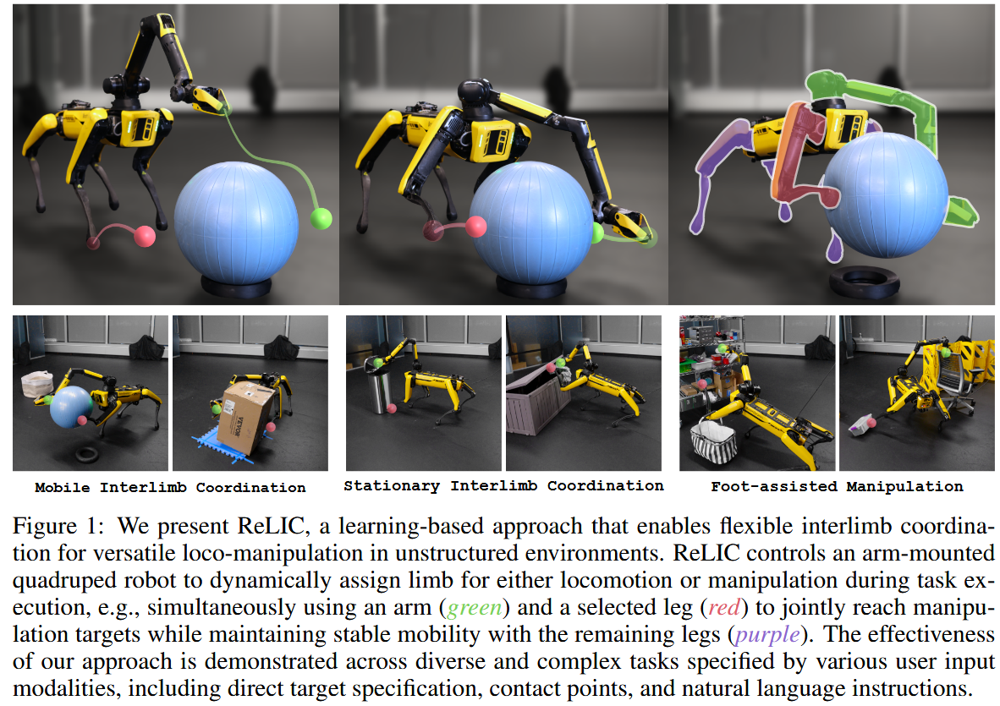
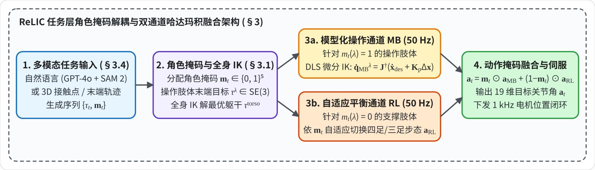
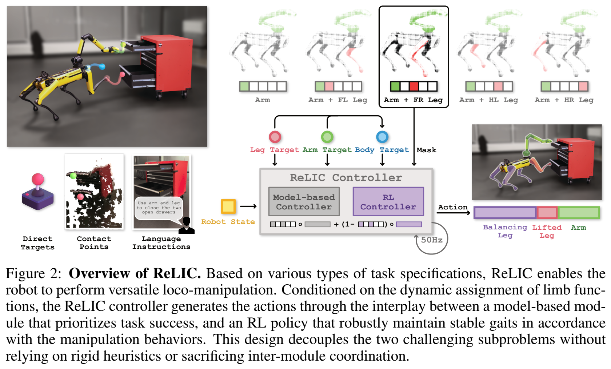
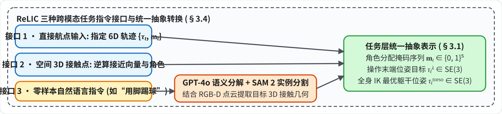
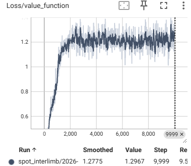
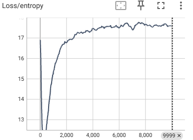
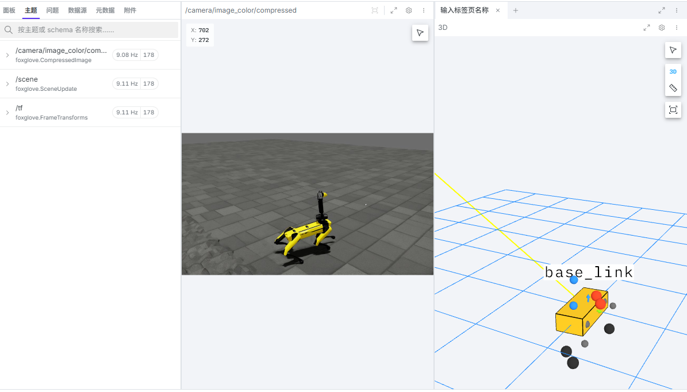

# Versatile Loco-Manipulation through Flexible Interlimb Coordination (ReLIC)

**核心思路**：打破“腿只走路、臂只拿物”的死板分工，提出**可切换角色掩码 $\mathbf{m}_e$ + 腿部/基座自适应 RL 平衡底座 + [[雅可比矩阵与微分逆运动学|可微 IK 精密操作分支]] + 四阶段课程学习**，实现三足奔跑单腿踢球、推门、躯干辅助抓重物。

> * **研究机构**：Boston Dynamics AI Institute (RAI), UC Berkeley, Cornell University
> * **发表出处**：arXiv:2506.07876v2 [cs.RO], Jun 2025 (CoRL 2025)
> * **项目主页 & 开源仓库**：[bdaiinstitute.github.io/relic](https://bdaiinstitute.github.io/relic) / `bdaiinstitute/relic`

---

---

## 全文工作流程

以下给出任务解析、全身逆运动学、模型化操作（MB）与强化学习自平衡（RL）双通道融合的闭环数据流图及各阶段对照表：

| 阶段 | 频率 | 输入 | 核心方法 / 方程 | 输出 | 章节 |
| :--- | :--- | :--- | :--- | :--- | :--- |
| **阶段 1：多模态任务解析 / 全身 IK** | 异步 / 规划周期 | 语言指令 / RGB-D 点云 / 轨迹、当前关节角 $\mathbf{q}_t$ | GPT-4o + SAM 2 接触点提取、全身逆运动学优化躯干可达空间 | 角色掩码 $\mathbf{m}_t \in \{0,1\}^5$、躯干目标 $\tau_t^{\text{torso}} \in \text{SE}(3)$、操作目标 $\tau_t^\lambda \in \text{SE}(3)$ | §3.1, §3.4 |
| **阶段 2：模型化操作解算（MB 通道）** | 50 Hz | 操作目标 $\mathbf{x}_{\text{des}}^\lambda, \dot{\mathbf{x}}_{\text{des}}^\lambda$、关节状态 $\mathbf{q}_t^\lambda$ | [[雅可比矩阵与微分逆运动学]]：$\dot{\mathbf{q}}_{\text{MB}}^\lambda = \mathbf{J}^\dagger(\dot{\mathbf{x}}_{\text{des}}^\lambda + \mathbf{K}_p \Delta \mathbf{x}^\lambda) + (\mathbf{I} - \mathbf{J}^\dagger\mathbf{J})\dot{\mathbf{q}}_0$ | 操作肢体关节角度指令 $\mathbf{a}_{\text{MB}, t} \in \mathbb{R}^{19}$ | §3.2.1 |
| **阶段 3：自适应移动平衡（RL 通道）** | 50 Hz | 观测 $o_t$（速度指令、躯干误差 $\Delta \mathbf{p}^{\text{torso}}, \Delta \mathbf{R}^{\text{torso}}$、投影重力 $\mathbf{g}^{\text{proj}}$、掩码 $\mathbf{m}_t$） | 四阶段课程学习 PPO 自平衡策略网络 $\pi_{\text{RL}}(o_t)$ | 支撑肢体平衡步态指令 $\mathbf{a}_{\text{RL}, t} \in \mathbb{R}^{19}$ | §3.2.2, §3.3 |
| **阶段 4：双通道掩码融合 / 执行** | 50 Hz / 1 kHz | $\mathbf{a}_{\text{MB}, t}, \mathbf{a}_{\text{RL}, t}, \mathbf{m}_t$ | 哈达玛逐元素乘积融合：$\mathbf{a}_t = \mathbf{m}_t \odot \mathbf{a}_{\text{MB}, t} + (\mathbf{1} - \mathbf{m}_t) \odot \mathbf{a}_{\text{RL}, t}$ | 19 维全身关节位置 $\mathbf{a}_t \in \mathbb{R}^{19}$ 下发 PD 伺服 | §3.1 |

---

## 1 Introduction

### 1.1 研究背景
在非结构化动态环境中，自主机器人必须同时具备敏捷的移动能力与精细的环境交互操作能力，即**移动操作（Loco-Manipulation）**。对于配备机械臂的四足机器人，其本体拥有多条高自由度活动肢体（4 条腿 + 1 条机械臂共 19 个自由度），理论上具备极为广阔的工作空间和动作冗余度。

然而，现存的移动操作范式普遍存在一个**预设的刚性角色分工假设**：
* **“机械臂永远是手，四条腿永远是脚”**：绝大多数已有系统将机械臂严格约束为抓取工具，将四足底盘严格约束为移动平台。
* **物理作业上限被严重锁死**：当面对大尺寸物体（如单臂无法环抱的箱子、大瑜伽球）、或者需要施加多点协调接触力（例如：单手开门同时单脚顶门防反弹、单脚踩住垃圾桶脚踏板同时手臂投放垃圾）时，这种固定分工直接使机器人丧失执行能力。

### 1.2 现有技术路线的核心瓶颈
此前学术界探索过多接触移动操作，但面临难以调和的工程与理论矛盾：
1. **分层启发式分离控制**：
   * 将控制硬拆分为机械臂轨迹跟踪与底盘基座导航，二者通过启发式状态机简单切换。这种方案缺乏底盘与操作肢体之间的全身动力学闭环补偿，一旦机械臂接触重物产生外力矩，底盘极易倾覆。
2. **基于模型的全身模型预测控制**：
   * 依赖精确的机器人与环境几何接触模型。但在多肢体接触切换时，离散接触顺序会导致巨大的**混合整数规划组合爆炸**，难以在板载计算平台上实现数十赫兹的实时闭环；且对未建模外力、地面打滑非常脆弱。
3. **单体端到端[[马尔可夫决策过程MDP|强化学习]]**：
   * 试图用单一策略网络直接输出全部 19 个关节指令。
   * **致命缺陷**：操作任务要求的“毫米级末端几何跟踪精度”与移动自平衡要求的“米级大范围高动态鲁棒性”存在本质上的**多目标梯度冲突**。网络极易退化为保守步态，操作精度低下，且 Sim-to-Real 迁移难度巨大。

### 1.3 核心贡献
针对上述瓶颈，论文提出了 **ReLIC（Reinforcement Learning for Interlimb Coordination）**，其核心思想是：**打破“手”与“脚”的固有界限，将机器人的所有肢体抽象为可在操作与移动支撑之间动态任意重构的通用执行机构。**

本文的主要贡献包括：
1. **统一的任务与控制分层抽象**：提出基于**角色掩码 $m \in \{0, 1\}^{|\Lambda|}$** 与**末端目标位姿 $\tau^\lambda$** 的通用任务表示，并在控制层采用 **“模型化高精度操作控制器 + [[马尔可夫决策过程MDP|强化学习]]自适应移动平衡策略”** 的混合互补控制架构。
2. **自适应多肢体协调步态学习**：在 Isaac Lab 仿真中通过强化学习训练通用移动策略，使其能够在四足行走、三足支撑、甚至操作肢体施加剧烈外力扰动时，自适应生成稳定步态并平滑过渡。
3. **高泛化多模态任务接口**：支持直接末端轨迹、空间交互接触点、以及基于 VLM（GPT-4o + SAM 2）的零样本自然语言指令输入。
4. **真实物理系统充分验证**：在波士顿动力 Spot + Spot Arm 实体机器人上完成了涵盖**足部辅助操作**、**静态多肢体协调**与**动态移动协调**三大类共 12 种极具挑战性的物理任务。

---

## 2 Related Work

### 2.1 四足机器人移动操作
四足移动操作长期以来主要沿两条主线发展：
* **解耦/分层架构**：通常将上身机械臂规划为操作器，将四足底盘视为浮动基座。此类方法难以在极端姿态下利用腿部力量协助操作，且难以应对接触时的反作用力冲击。
* **全身端到端学习**：近年来许多学者尝试使用全 RL 解决全身协调。然而单一策略网络难以同时学习高精度操作与动态稳定性，在面对接触式任务时往往发生末端抖动或步态失稳。

### 2.2 多肢体协调 / 足部操作
* 生物学观察表明，哺乳动物与灵长类动物在面对复杂交互场景时，能极其自然地利用后肢支撑、前肢甚至单后肢参与环境操控（如踢门、踩踏、推移重物）。
* 早期机器人研究曾尝试通过离线轨迹优化或预设接触时序来让腿式机器人用单腿踹门或推箱子，但这些方法均**硬编码了特定的肢体角色与固定的接触时序**，无法泛化到新任务，更不能在任务执行中按需任意切换肢体功能。
* **ReLIC 与以往工作的本质区别**：ReLIC 不对任何肢体的角色进行硬编码，允许机械臂与任意一条腿在任意时刻被动态指派为操作器或支撑腿，实现了真正通用的多肢体灵活协调。

---

## 3 Method

### 3.1 Overview

ReLIC 采用了优雅清晰的“任务层（Task Level）— 控制层（Command Level）”两层分层架构：

**1. 肢体集合与角色分配掩码（Task-Level）**

设机器人全部可用肢体的集合为 $\Lambda$：
$$
\Lambda = \{\lambda_{\text{Arm}}, \lambda_{\text{FL}}, \lambda_{\text{FR}}, \lambda_{\text{HL}}, \lambda_{\text{HR}}\}, \quad |\Lambda| = 5
$$
其中下标分别代表机械臂（Arm）、前左腿（FL）、前右腿（FR）、后左腿（HL）与后右腿（HR）。

在离散时间步 $t$，引入二进制角色分配掩码向量 $\mathbf{m}_t \in \{0, 1\}^{|\Lambda|}$：
$$
m_t(\lambda) = \begin{cases} 
1, & \text{肢体 }\lambda\text{ 执行操作 (Manipulation)} \\
0, & \text{肢体 }\lambda\text{ 执行移动 (Locomotion)}
\end{cases}
$$

**2. 目标位姿与躯干逆运动学解算**

* 对于分配为操作角色的肢体（$m_t(\lambda) = 1$），上层指定其末端执行器的期望 6-DoF 空间位姿目标 $\tau^\lambda \in \text{SE}(3)$。
* 对于负责移动平衡的肢体（$m_t(\lambda) = 0$），其末端落足目标**完全不预先指定**，完全交由底层的自适应策略自主决策。
* 基于操作肢体的末端目标 $\tau^\lambda$，系统通过全身[[分层全身控制WBC与HQP|逆运动学]]求解机身躯干的最优目标位姿 $\tau^{\text{torso}} \in \text{SE}(3)$，使操作肢体处于最佳可达工作空间内：
$$
\tau_t = \{\tau^{\text{torso}}_t\} \cup \{\tau^\lambda_t \mid \lambda \in \Lambda, m_t(\lambda) = 1\}
$$
在时域长度为 $T$ 的任务中，任务层的全局抽象即为时序序列 $\{\tau_t, \mathbf{m}_t\}_{t=0}^{T-1}$。

**3. 控制层双通道执行与动作掩码融合（Command Level）**

在控制层，ReLIC 设立两条高度分工、优势互补的并行执行通道（以 50 Hz 周期同步运行）：
1. **模型化操作控制器（Model-Based Controller, MB）**：负责跟踪操作肢体的末端位姿，输出高精度的操作关节动作 $\mathbf{a}_{\text{MB}}$。
2. **自适应移动强化学习策略（Adaptive Locomotion Policy, RL）**：观测机器人实时状态与机身目标，自适应生成支撑肢体的移动平衡动作 $\mathbf{a}_{\text{RL}}$。
3. **哈达玛积动作融合**：
   $$
   \mathbf{a}_t = \mathbf{m}_t \odot \mathbf{a}_{\text{MB}, t} + (\mathbf{1} - \mathbf{m}_t) \odot \mathbf{a}_{\text{RL}, t}
   $$
   融合后的 19 维目标关节位置向量 $\mathbf{a}_t$ 直接下发至 Spot 机器人的底层电机执行器。

---

**4. 全系统分层控制执行流水线全景图**

**架构核心层级、运行频率与软硬件分配**

| 层级 | 频率 | 核心模块 | 输入 | 输出 | 硬件 |
| :--- | :---: | :--- | :--- | :--- | :--- |
| **层级 1：任务输入层** | 异步触发 / 低频更新 | GPT-4o 语义解析 + SAM 2 实例分割 / 交互标定 | 自然语言、RGB-D 空间彩色点云、用户接触点 | 初始角色分配、交互目标三维点云与表面法向量 | 机载 Jetson Orin / 上位机 |
| **层级 2：任务抽象层** | 异步触发 / 规划周期 | 任务解释器 + 全身[[分层全身控制WBC与HQP\|逆运动学]] | 目标三维接触几何、时序航点 | 角色掩码序列 $\mathbf{m}_t$、躯干最优位姿 $\tau^{\text{torso}}$、操作末端目标 $\tau^\lambda$ | Intel Core i7 工控机 |
| **层级 3：控制执行层 (MB 通道)** | **50 Hz** 同步闭环 | 微分逆运动学  + 笛卡尔空间阻抗控制 | 操作末端目标 $\tau^\lambda$、躯干位姿 $\tau^{\text{torso}}$、关节状态 $\mathbf{q}_t$ | 操作肢体 19 维前馈关节角度指令 $\mathbf{a}_{\text{MB}}$ | Intel Core i7 工控机 |
| **层级 3：控制执行层 (RL 通道)** | **50 Hz** 同步闭环 | Isaac Lab PPO 训练的多模态自平衡神经网络 | 躯干位姿误差、掩码 $\mathbf{m}_t$、IMU 角速度、关节编码器 | 支撑肢体 19 维移动自平衡关节指令 $\mathbf{a}_{\text{RL}}$ | ONNX Runtime (CPU/GPU) |
| **底层硬件执行** | **50 Hz / 1 kHz** | 电机底层位置伺服闭环 | 哈达玛积融合动作 $\mathbf{a}_t = \mathbf{m}_t \odot \mathbf{a}_{\text{MB}} + (\mathbf{1}-\mathbf{m}_t) \odot \mathbf{a}_{\text{RL}}$ | 19 个执行器力矩输出驱动机械臂与四腿 | Spot 底层驱动板 |

---

### 3.2 Adaptive Control for Flexible Interlimb Coordination

**1. 模型化操作控制器（Model-Based Controller $\mathbf{a}_{\text{MB}}$，[[雅可比矩阵与微分逆运动学]]）**

针对被分配为操作的肢体（$m(\lambda) = 1$），精度与接触顺应性是首要目标。ReLIC 利用已知精确的机器人运动学与动力学刚体模型，采用 **[[雅可比矩阵与微分逆运动学|微分逆运动学（Differential IK）]]结合阻抗控制**求解：
$$
\dot{\mathbf{q}}^\lambda_{\text{MB}} = \mathbf{J}^{\dagger}(\mathbf{q}^\lambda) \Big( \dot{\mathbf{x}}^\lambda_{\text{des}} + \mathbf{K}_p (\mathbf{x}^\lambda_{\text{des}} - \mathbf{x}^\lambda) \Big) + (\mathbf{I} - \mathbf{J}^\dagger \mathbf{J}) \dot{\mathbf{q}}_0
$$

**核心数学与物理机理深度拆解：**

> **（1）雅可比矩阵 $\mathbf{J}$**
>
> * **物理直觉**：雅可比矩阵是连接“电机内部世界”与“外部三维物理世界”的**动态传动比矩阵（敏感度矩阵）**。
> * **数学推导**：设肢体拥有的关节角度向量为 $\mathbf{q}^\lambda = [q_1, q_2, \dots, q_n]^T$（例如 Spot 机械臂 $n=6$ 或一条腿 $n=3$），末端执行器（手爪或足尖）在三维笛卡尔空间中的位置和朝向为 $\mathbf{x}^\lambda = [x, y, z, \text{roll}, \text{pitch}, \text{yaw}]^T \in \text{SE}(3)$。
> * 机器人正运动学表达为 $\mathbf{x}^\lambda = f(\mathbf{q}^\lambda)$。对时间求导后得到一阶微分映射关系：
>   $$
>   \dot{\mathbf{x}}^\lambda = \frac{\partial f(\mathbf{q}^\lambda)}{\partial \mathbf{q}^\lambda} \dot{\mathbf{q}}^\lambda = \mathbf{J}(\mathbf{q}^\lambda) \dot{\mathbf{q}}^\lambda
>   $$
>   这里的偏导数矩阵 $\mathbf{J}(\mathbf{q}^\lambda) \in \mathbb{R}^{6 \times n}$ 就是雅可比矩阵。它精确刻画了：**当每个电机以一定速度转动（$\dot{\mathbf{q}}^\lambda$）时，末端执行器在三维空间中会产生多大的线速度和角速度（$\dot{\mathbf{x}}^\lambda$）**。

> **（2）为什么控制时必须求逆？运动学奇异点**
>
> * **逆向求解需求**：控制器的目标是反过来的——已知任务要求的末端期望速度 $\dot{\mathbf{x}}^\lambda_{\text{des}}$，我们要反向求解**各个电机该以多大角速度旋转 $\dot{\mathbf{q}}^\lambda$**。理想情况下只需计算 $\dot{\mathbf{q}} = \mathbf{J}^{-1} \dot{\mathbf{x}}$。
> * **非方阵与伪逆**：当自由度 $n \neq 6$（如机械臂冗余或单腿只有 3 个自由度）时，$\mathbf{J}$ 不是方阵，无法直接求普通矩阵逆，必须使用广义逆（伪逆）$\mathbf{J}^\dagger$。
> * **致命的奇异点危机**：当机械臂完全伸直、折叠，或者多个关节轴线共面共线时，机器人处于**运动学奇异位姿**。在奇异点附近，雅可比矩阵发生秩亏，其行列式 $\det(\mathbf{J}\mathbf{J}^T) \to 0$。
>   * 若使用普通伪逆 $\mathbf{J}^\dagger = \mathbf{J}^T(\mathbf{J}\mathbf{J}^T)^{-1}$，分母趋近于零会导致 $\mathbf{J}^\dagger \to \infty$！
>   * **严重后果**：即便末端只要求微小移动 1 毫米，算法解出的某些关节电机会瞬间暴增到上万 rad/s 的天文数字。

> **（3）阻尼最小二乘伪逆 $\mathbf{J}^\dagger$（Damped Least-Squares, DLS）？**
>
> * 为了在奇异点附近保命，机器人领域引入了**阻尼最小二乘法（Levenberg-Marquardt 型正则化）**：
>   $$
>   \mathbf{J}^\dagger = \mathbf{J}^T \Big( \mathbf{J} \mathbf{J}^T + \lambda^2 \mathbf{I} \Big)^{-1}
>   $$
>   其中 $\mathbf{I}$ 为单位矩阵，$\lambda > 0$ 为人为设定的**阻尼系数**。
> * **物理机理与直观类比**：
>   
>   * 在求逆的分母项中强行加上非零正定对角阵 $\lambda^2 \mathbf{I}$，使得待求逆矩阵的特征值永远严格大于零，**在数学上彻底根除了除以零的奇异发散可能**；
>   * **远离奇异点时**：$\mathbf{J}\mathbf{J}^T$ 占绝对主导，$\lambda^2 \mathbf{I}$ 的影响微乎其微，算法表现为高精度的纯运动学逆解，精准跟踪轨迹；
>   * **靠近奇异点时**：$\lambda^2 \mathbf{I}$ 起到“阻尼缓震刹车”作用，自动平滑抑制关节速度幅值，以牺牲极微小末端跟踪精度的代价，换取**全局平滑、安全、有界的电机旋转指令**。

> **（4）反馈校正与零空间投影项**
>
> * **闭环跟踪反馈项 $\Big( \dot{\mathbf{x}}^\lambda_{\text{des}} + \mathbf{K}_p (\mathbf{x}^\lambda_{\text{des}} - \mathbf{x}^\lambda) \Big)$**：纯前馈速度对时间积分会在物理世界产生漂移，加入比例增益 $\mathbf{K}_p$ 构成的闭环位置误差弹簧拉力，能实时将当前末端 $\mathbf{x}^\lambda$ 强行拉向目标 $\mathbf{x}^\lambda_{\text{des}}$，消除毫米级累积误差。
> * **零空间投影算子 $(\mathbf{I} - \mathbf{J}^\dagger \mathbf{J})$**：这是一个正交投影矩阵，**该矩阵作用在任何次要速度指令 $\dot{\mathbf{q}}_0$ 上，所产生的关节微动在笛卡尔末端产生的速度严格为零**（即完全不影响末端抓取/操作位姿）。
> * **次要优化目标 $\dot{\mathbf{q}}_0$**：通常设计为引导关节避开机械限位、避开身体自碰撞，或让机械臂自然弯曲到最省力舒适的姿势。

---

**2. 自适应移动平衡策略（Adaptive Locomotion Policy $\pi_{\text{RL}}$）**

负责其余肢体（$m(\lambda) = 0$）的强化学习策略 $\pi_{\text{RL}}$ 必须在无需显式重规划落足点的情况下，动态感知哪个肢体被“抽离”去操作，并自动调节剩下的肢体（如三腿站立、三腿行走或四腿奔跑）以维持机身稳定。

**（1）策略观测空间 $o_t$ 逐项核心参数详解**

论文中输入给 PPO 策略网络的观测向量 $o_t$ 定义如下：
$$
o_t = \begin{bmatrix}
\mathbf{v}_{\text{base}}^{\text{target}}, \; \boldsymbol{\omega}_{\text{base}}^{\text{target}}, \; \Delta \mathbf{p}^{\text{torso}}, \; \Delta \mathbf{R}^{\text{torso}}, \; \boldsymbol{\omega}_{\text{base}}^{\text{curr}}, \\
\mathbf{g}^{\text{proj}}, \; \mathbf{q}_t, \; \dot{\mathbf{q}}_t, \; \mathbf{a}_{t-1}, \; \mathbf{m}_t
\end{bmatrix}
$$

各参数的物理意义、数学维度及对强化学习策略的作用剖析如下：

| 参数符号 | 空间 / 维度 | 物理名称 | 作用 |
| :--- | :---: | :--- | :--- |
| $\mathbf{v}_{\text{base}}^{\text{target}}$ | $\mathbb{R}^3$ | **期望基座线速度指令** | 上层任务指定的机器狗前进、横移与升降期望速度 $(v_x^*, v_y^*, v_z^*)$，告诉策略机体要往哪走、走多快。 |
| $\boldsymbol{\omega}_{\text{base}}^{\text{target}}$ | $\mathbb{R}^3$ | **期望基座角速度指令** | 主要是机身旋转转向（Yaw Rate）指令，引导策略调整足端差速以完成转弯与航向对齐。 |
| $\Delta \mathbf{p}^{\text{torso}}$ | $\mathbb{R}^3$ | **躯干位置跟踪误差** | $\Delta \mathbf{p} = \mathbf{p}_{\text{target}}^{\text{torso}} - \mathbf{p}_{\text{curr}}^{\text{torso}}$。全身 IK 为配合操作肢体够到目标而算出的躯干最优离散高度/位置偏差，策略据此调整重心。 |
| $\Delta \mathbf{R}^{\text{torso}}$ | $\mathbb{R}^3$ (旋转向量) | **躯干姿态旋转误差** | 当前机身俯仰（Pitch）、滚转（Roll）与目标姿态的偏角。高处探取时机身需大幅后仰，策略依据该误差主动改变支撑腿构型保持稳定。 |
| $\boldsymbol{\omega}_{\text{base}}^{\text{curr}}$ | $\mathbb{R}^3$ | **当前实测基座角速度** | 来自机载 IMU 陀螺仪的实时高频读数，让策略在受到外力扰动、地面不平时第一时间感知晃动并输出反倾覆力矩。 |
| $\mathbf{g}^{\text{proj}}$ | $\mathbb{R}^3$ | **机体投影重力向量** | $\mathbf{g}^{\text{proj}} = \mathbf{R}_{\text{base}}^T [0, 0, -1]^T$。**灵魂输入**：四足机器人没有全局绝对坐标系，投影重力直接告诉策略“哪个方向是地心朝下”。机身倾斜时分量改变，策略依此修正法向支撑力。 |
| $\mathbf{q}_t$ | $\mathbb{R}^{19}$ | **当前全部关节角度** | 来自 19 个电机编码器的高精反馈（4条腿 $\times 3$ + 机械臂 6 + 夹爪 1），反映当前四肢的瞬时几何形态。 |
| $\dot{\mathbf{q}}_t$ | $\mathbb{R}^{19}$ | **当前全部关节角速度** | 电机转速反馈，反映肢体运动的动力学动量与惯性状态。 |
| $\mathbf{a}_{t-1}$ | $\mathbb{R}^{19}$ | **上一周期历史动作** | 上一时刻神经网络输出的目标关节角度。配合动作变化率惩罚，能强迫策略平滑输出，**彻底根除实机电机高频抖动**。 |
| $\mathbf{m}_t$ | $\{0, 1\}^5$ | **肢体角色分配掩码** | **ReLIC 的核心条件信号**！显式告知策略当前 5 条肢体中哪几条是支撑腿、哪一条被抽调为操作手。一旦 $m(\lambda_{\text{FL}})=1$，策略立刻切入三足平衡模式，不再期望左前腿触地！ |

---

**（2）多模态自适应奖励函数 $r_t$ 结构与参数详解**

强化学习总奖励函数由四大模块加权求和构成：
$$
r_t = r_{\text{tracking}} + w_{\text{gait}} r_{\text{gait}} + w_{\text{posture}} r_{\text{posture}} + w_{\text{reg}} r_{\text{reg}}
$$

下表汇总了论文 Appendix D (Table 3) 中所采用的全部奖励子项、数学定义与权重设置：

| 奖励大类 | 子项名称 | 数学表达式 | 权重系数 | 作用机制 |
| :--- | :--- | :--- | :---: | :--- |
| **跟踪奖励组 $r_{\text{tracking}}$** | 线速度跟踪 | $\exp\big(-\|\mathbf{v}_B - \mathbf{v}_B^*\|^2 / 0.25\big)$ | $+7.0$ | 高斯指数奖励核，误差越小越逼近 1，激励底盘精准跟踪前进与横移速度指令。 |
| | 角速度跟踪 | $\exp\big(-\|\boldsymbol{\omega}_B - \boldsymbol{\omega}_B^*\|^2 / 0.25\big)$ | $+3.5$ | 激励底盘精准跟踪偏航旋转角速度。 |
| | 躯干姿态跟踪 | $-\|\mathbf{x}_{\text{rot}} - \mathbf{x}_{\text{rot}}^*\|^2$ | $-120$ | 严厉惩罚机身滚转、俯仰以及高度偏离全身 IK 求解出的最佳躯干姿态。 |
| **步态奖励组 $w_{\text{gait}} r_{\text{gait}}$** | 动态协调步态 | $-\mathbb{I}_{\text{walking}} \cdot (r_{\text{four-leg}} + r_{\text{three-leg}})$ | $-5.0$ | **自适应步态核心**： • **四足模式**：激励对角小跑（Trot），惩罚对角触地时间与空中摆动时间的相位偏差； • **三足模式**：单腿抬起操作时，自动约束剩余三腿进入顺时针循环弹跳步态（周期 $T_{\text{gait}}=0.4\text{ s}$）。 |
| | 腾空摔倒惩罚 | $-\mathbb{I}_{\text{flight}}$ | $-10.0$ | **安全红线**：若与地面保持接触的支撑腿数量 $< 3$，判定为危险腾空或倾覆摔倒，施加强力大额扣分。 |
| **姿态奖励组 $w_{\text{posture}} r_{\text{posture}}$** | 关节默认构型 | $-\|\mathbf{q} - \mathbf{q}_{\text{nominal}}\|^2$ | 自适应 | 引导未被激活的关节保持在符合人体工学/最经济的标称姿态，防止关节过度死锁。 |
| **正则化惩罚组 $w_{\text{reg}} r_{\text{reg}}$** | 关节角速度 | $-\|\dot{\mathbf{q}}\|^2$ | $-1.0 \times 10^{-5}$ | 惩罚高转速与空转甩腿，降低机械磨损。 |
| | 关节角加速度 | $-\|\ddot{\mathbf{q}}\|^2$ | $-1.0 \times 10^{-6}$ | 惩罚加速度突变，抑制冲击峰值力矩。 |
| | 关节驱动力矩 | $-\|\boldsymbol{\tau}\|^2$ | $-2.0 \times 10^{-4}$ | 惩罚高负载堵转与大电流，降低能耗并防止电机过热停机。 |
| | 动作突变率 | $-\|\mathbf{a}_t - \mathbf{a}_{t-1}\|^2$ | $-0.1$ | **Sim-to-Real 的关键**：强制相邻控制步动作平滑过渡，消除实机电机的“高频吱吱震颤”。 |

---

### 3.3 Learning Transferrable Policy in Simulation

**1. 高吞吐仿真与大规模域随机化**

策略在基于 GPU 加速的 **Isaac Lab** 物理仿真环境中进行端到端 PPO 训练，并行运行 4096 个实例。为了使训练出的策略免去微调直接零样本迁移到真实 Spot 机器人上，实施了全方位的物理参数域随机化：

| 随机化参数 | 随机化范围 | 物理意义 |
| :--- | :---: | :--- |
| **机身质量扰动（Base Mass）** | $[-3.0, +3.0]\text{ kg}$ | 适应搭载不同末端夹爪、传感器及载荷 |
| **质心偏移（CoM Offset）** | $[-5.0, +5.0]\text{ cm}$ (各轴独立) | 机械臂展开与抓持外物时的巨大重心偏移 |
| **地面摩擦系数（Friction）** | $[0.2, 1.25]$ | 从光滑瓷砖地面到粗糙地毯、橡胶地面的泛化 |
| **关节阻尼与刚度（Joint Damping/Stiffness）** | 原标称值的 $[80\%, 120\%]$ | 消除传动机构发热与老化磨损造成的动力学误差 |
| **控制延迟（Latency）** | $[0, 20]\text{ ms}$ 离散随机延迟 | 弥补板载工控机计算与总线通信延迟 |
| **传感器噪声（Sensor Noise）** | IMU、编码器注入高斯白噪声 | 增强在真实硬件测量噪声下的抗扰能力 |

**2. 离线拒绝采样**

随机生成的目标位姿可能导致机械臂奇异点或动力学不可行（例如要求机器人在单侧两足悬空状态下大范围移动）。系统在训练前离线采样了超过 $10^7$ 个候选基座状态指令，利用运动学与动力学边界过滤掉不可行解，确保策略在高质量可达状态分布上高效收敛。

**3. 执行器非线性校准**

真实 Spot 机器人的膝关节采用了高度非线性的高功率密度执行器，其在高扭矩、高转速工况下的动力学行为与仿真中简化的理想力矩电机存在显著差距。
* 研究团队在真实 Spot 机器人上记录了极端工况下的关节运行轨迹；
* 采用**协方差矩阵自适应进化策略**在线下优化电机的有效转矩-转速限制曲线与非线性摩擦阻尼参数，使 Isaac Lab 中的虚拟执行器响应与真实电机的均方根误差降低了 **64%**，彻底攻克了腿部高载荷支撑下的 Sim-to-Real 鸿沟。

---

### 3.4 Task Interface for Versatile Loco-Manipulation

为了让用户能够便捷地向系统下达高层意图，ReLIC 提供了三级递进式跨模态交互接口：

1. **直接目标输入（Direct Target Specification）**：
   * 适用于专家用户或高层路径规划算法，直接输入末端执行器 6D 位姿序列和二进制掩码。
2. **三维关键接触点（Contact Points）**：
   * 用户在场景点云中点击指定交互接触点（如箱子侧壁、门把手、垃圾桶踏板）。系统根据接触点与机器人当前基座的欧氏距离和相对朝向，自动决策最优分配肢体并生成平滑逼近轨迹。
3. **自然语言端到端交互（Natural Language Instructions via VLM）**：
   * **视觉语义解析**：板载 RealSense 深度相机捕获 RGB-D 场景，GPT-4o 接收图像与用户指令；
   * **常识推理与肢体指派**：GPT-4o 分析物理约束，决定分配机械臂抓取把手（$m(\lambda_{\text{Arm}})=1$），同时分配前左腿踹门（$m(\lambda_{\text{FL}})=1$）；
   * **几何接地（Visual Grounding）**：调用 **SAM 2** 分割出目标物体的高质量像素掩膜，结合深度点云提取目标几何质心与表面法向量，转换为空间连续航点序列下发给控制层。

---

## 4 Simulation Training

### 4.1 Experimental Setup

* **强化学习算法库**：**RSL-RL**
* **机器本体**：Boston Dynamics Spot + Spot Arm（全身 18 个可动主动自由度：4 条腿各 3 个关节共 12 自由度 + 机械臂 6 个关节）。
* **控制指令周期**：物理仿真步频 $200\text{ Hz}$（$\text{dt}=0.005\text{ s}$），策略网络推理与执行闭环频率 **$50\text{ Hz}$**（抽取步数 decimation $= 4$）。

---

### 4.2 指标

**4.2.1 Train**

| 指标 Tag | 数学定义 | 作用 | 实测终值 |
| :--- | :--- | :--- | :---: |
| `Train/mean_reward` | $\frac{1}{N}\sum_{i=1}^N R_i$ 4096 个环境中单回合累积总奖励的平均值。 | **强化学习的核心优化标的**。反映小狗在保持平衡、跟踪指令以及避免摔倒等综合任务下的整体表现。 | **+29.53** （从早期的 -50 剧烈负分反弹收敛） |
| `Train/mean_reward/time` | 随真实物理时间轴记录的 `mean_reward`。 | 评估训练效率，观察单位时间内的回报收益增长斜率。 | **+29.53** |
| `Train/mean_episode_length` | $\frac{1}{N}\sum_{i=1}^N T_i$ 单回合平均存活时间步长（仿真单步步长 $\Delta t = 0.02\text{ s}$，单回合时间上限为 300 步即 $6\text{ s}$）。 | 反映机身稳定性。初期秒摔时仅有 10~20 步；当小狗学会奔跑后，能够持续稳定奔跑直至触发超时截断。 | **272.76 步** |
| `Train/mean_episode_length/time` | 随真实物理时间轴记录的平均存活步长。 | 用于横向对比不同算力硬件下的策略存活收敛速度。 | **272.76 步** |

**4.2.2 Loss （PPO 神经网络训练损失）**

| 指标 Tag | 数学定义 | 作用 | 实测终值 |
| :--- | :--- | :--- | :---: |
| `Loss/value_function` | $\mathcal{L}_{\text{val}} = \frac{1}{B}\sum (V_\phi(s) - R)^2$ Critic 网络对状态价值估算的未归一化均方误差。 | 衡量 Critic 网络预测未来累积折扣回报的准确程度。由于回报尺度随存活时间暴增数十倍，其绝对 MSE 呈现健康的上升并稳定。 | **1.2967** |
| `Loss/surrogate` | $\mathcal{L}_{\text{surr}} = -\frac{1}{B}\sum \min(r_t A_t, \text{clip}(r_t) A_t)$ Actor 策略剪切代理损失。 | PPO 核心策略梯度更新量。始终维持在负值区间，策略持续朝正向优势方向单调提升。 | **-0.0061** |
| `Loss/entropy` | $\mathcal{H} = \sum_{j=1}^{12} (\ln \sigma_j + \frac{1}{2}\ln(2\pi e))$ 12/18 维连续动作高斯分布的总微分熵。 | 表征动作探索的随机性。早期为求生存紧急收紧动作方差导致熵骤降；随后在熵正则奖励驱动下反弹并稳定在高位，保障策略的阻尼顺应性。 | **17.5925** |
| `Loss/learning_rate` | PPO 优化器的实时自适应学习率 $\eta$。 | 由自适应 KL 散度调度器动态调控（目标 $\text{KL} = 0.01$）。步长过大时除以 1.5 刹车，步长保守时乘以 1.5 提速，彻底杜绝策略崩塌。 | **$1.50 \times 10^{-5}$** （从 $1\times 10^{-3}$ 自适应退火） |

**4.2.3 Episode_Reward**

**（1）Tracking Rewards**

| 指标 Tag | 权重 | 数学定义 | 实测终值 |
| :--- | :---: | :--- | :---: |
| `Episode_Reward/track_lin_vel_xy_exp` | **+7.0** | $\exp\big(-\frac{\|\mathbf{v}_{xy} - \mathbf{v}_{xy}^{\text{cmd}}\|^2}{0.25}\big)$ 底盘水平线速度跟踪高斯指数奖励。误差越接近 0 奖励越逼近权重上限。 | **+1.6309** |
| `Episode_Reward/track_ang_vel_z_exp` | **+3.5** | $\exp\big(-\frac{(\omega_z - \omega_z^{\text{cmd}})^2}{0.25}\big)$ 偏航旋转角速度跟踪高斯指数奖励。引导底盘敏捷转弯对齐期望航向。 | **+0.7181** |
| `Episode_Reward/track_base_orientation_l2` | **-7.0** | $-\|\mathbf{g}_{\text{proj}} - [0, 0, -1]^T\|^2$ 躯干重力投影偏差 L2 惩罚。强迫底盘在运动中保持躯干水平，严禁剧烈侧翻。 | **-0.1220** |
| `Episode_Reward/track_base_height_l2` | **-3.5** | $-(z_{\text{base}} - z_{\text{nominal}})^2$ 机身离地高度偏差 L2 惩罚。强迫底盘质心维持在离地标称高度，防止塌陷蹲地。 | **-0.0235** |

**（2）Gait & Contact Rewards**

| 指标 Tag | 权重 | 数学定义 | 实测终值 |
| :--- | :---: | :--- | :---: |
| `Episode_Reward/flight_penalty` | **-5.0** | $-\mathbb{I}(\text{contact\_feet} < 3)$ 危险腾空惩罚。当与地面保持稳定接触的足端数量 $<3$ 时触发，防止倾覆。 | **-0.1529** |
| `Episode_Reward/foot_slip` | **-0.5** | $-\sum_{i \in \text{contact}} \|\mathbf{v}_{xy}^{\text{foot}, i}\|^2$ 足端触地打滑速度惩罚。强迫落足瞬间在地面牢牢“抓地咬死”，消除脚底抹油。 | **-0.2106** |
| `Episode_Reward/foot_impact` | **-1.0** | $-\sum_{i} \max(0, F_z^{\text{foot}, i} - F_{\text{threshold}})^2$ 足端着地垂直冲击力惩罚。引导轻盈落足，抑制电机减速齿轮的刚性冲击峰值。 | **-0.0084** |
| `Episode_Reward/feet_air_time` | **+0.01** | $\sum_{i} (t_{\text{air}, i} - 0.1) \cdot \mathbb{I}(\text{first\_contact})$ 足端滞空时间奖励。鼓励肢体积极迈腿腾空，避免四腿僵死在原地。 | **-0.0003** |
| `Episode_Reward/air_time_variance` | **-10.0** | $-\text{Var}(t_{\text{air}, 1:4})$ 四足滞空时间方差惩罚。强制四腿对称迈步，诱导自然对角小跑（Trot）节律。 | **-0.0807** |
| `Episode_Reward/feet_air_time_target` | **0.0** *(Phase 4 启用)* | $-|t_{\text{air}} - t_{\text{target}}|$ 目标滞空时间精确跟踪。用于锁定特定周期的步态频率。 | **0.0000** |
| `Episode_Reward/foot_clearance` | **0.0** *(Phase 2 启用)* | $-\sum (h_{\text{swing}} - h_{\text{target}})^2$ 摆动腿离地抬腿间隙惩罚。引导跨越台阶时不绊腿。 | **0.0000** |
| `Episode_Reward/gait` | **0.0** *(Phase 4 启用)* | 四足对角小跑经典相位接触奖励。 | **0.0000** |
| `Episode_Reward/three_leg_gait` | **0.0** *(Phase 4 启用)* | 三足支撑工况下的周期循环弹跳步态奖励。 | **0.0000** |

**（3）Regularization & Smoothness**

| 指标 Tag | 权重 | 数学定义 | 实测终值 |
| :--- | :---: | :--- | :---: |
| `Episode_Reward/joint_energy` | **+2.0** | $\sum_{j} \max(0, -\tau_j \dot{q}_j)$ 再生制动与能量回收奖励。激励策略利用动力学惯性自然摆腿省电。 | **+0.0202** |
| `Episode_Reward/dof_torques_l2` | **-1.0e-5** | $-\sum_{j} \tau_j^2$ 关节驱动力矩 L2 惩罚。抑制大电流堵转，降低电机发热风险。 | **-0.0190** |
| `Episode_Reward/dof_acc_l2` | **-2.5e-7** | $-\sum_{j} \ddot{q}_j^2$ 关节角加速度 L2 惩罚。平抑角速度突变，抑制传动机构高频冲击。 | **-0.1701** |
| `Episode_Reward/action_rate_l2` | **-0.01** | $-\|\mathbf{a}_t - \mathbf{a}_{t-1}\|^2$ 相邻控制步目标关节角变化率惩罚。**Sim-to-Real 核心**：杜绝实机电机高频振颤。 | **-0.1171** |
| `Episode_Reward/dof_torque_limits_l2` | **0.0** *(Phase 4 启用)* | $-\sum \max(0, |\tau_j| - \tau_{\text{limit}})^2$ 关节峰值力矩软越限惩罚。 | **0.0000** |

**4.2.4 Episode_Termination**

| 指标 Tag | 物理定义 | 含义 | 实测终值 |
| :--- | :--- | :--- | :---: |
| `Episode_Termination/base_contact` | 机身主躯干（Base）与地面发生刚性接触。 | **致命倾覆摔倒判据**。触发环境立刻重置并施加大额负回报。收敛后摔倒大幅下降。 | **0.5525** |
| `Episode_Termination/undesired_ground_contact` | 非足端刚体（如大腿关节 `uleg`、小腿上段）触地。 | **姿态失稳变形判据**。防止小狗学会畸形跪地滑行等局部劣质步态。 | **0.4135** |
| `Episode_Termination/time_out` | 仿真时间步长达到单回合最大步数（300 步）。 | **健康存活截断判据**。该数值上升标志着小狗已经能够平稳长途行走。 | **0.0367** |

**4.2.5 Metrics**

| 指标 Tag | 单位 | 含义 | 实测终值 |
| :--- | :---: | :--- | :---: |
| `Metrics/base_velocity/error_vel_xy` | $\text{m/s}$ | 底盘水平线速度与期望指令的平均欧氏绝对误差 $\|\mathbf{v}_{xy} - \mathbf{v}_{xy}^{\text{cmd}}\|$。 | **0.1060 m/s** |
| `Metrics/base_velocity/error_vel_yaw` | $\text{rad/s}$ | 底盘偏航旋转角速度与期望转向指令的绝对误差 $|\omega_z - \omega_z^{\text{cmd}}|$。 | **0.1470 rad/s** |
| `Metrics/arm_leg_joint/arm_joint_error` | $\text{rad}$ | 机械臂 6 个关节与目标指令位置的平均跟踪误差。 | **0.1695 rad** （约 $9.7^\circ$） |
| `Metrics/arm_leg_joint/leg_joint_error` | $\text{rad}$ | 腿部 12 个关节位置跟踪误差。 | **0.4119 rad** |
| `Metrics/arm_leg_joint/base_roll_pitch_error` | $\text{rad}$ | 躯干水平面倾角误差（滚转与俯仰）。 | **0.2911 rad** （约 $16.6^\circ$ 倾角） |
| `Metrics/arm_leg_joint/base_height_error` | $\text{m}$ | 躯干绝对离地高度与标称值偏差。 | **0.1260 m** |

**4.2.6 Curriculum**

| 指标 Tag | 取值区间 | 机制趋势 | 实测终值 |
| :--- | :---: | :--- | :---: |
| `Curriculum/terrain_levels` | $[0.0, 1.0]$ | Isaac Lab 自动地形难度系数。小狗走得稳则动态升级地形复杂度（台阶、倾角、凸起障碍）。 | **0.9391** |

**4.2.7 Perf**

| 指标 Tag | 单位 | 开销解析 | 实测终值 |
| :--- | :---: | :--- | :---: |
| `Perf/total_fps` | $\text{steps/s}$ | 全系统物理仿真、传感器渲染与 PPO 策略网络训练的每秒综合样本吞吐量。 | **27,215 steps/s** |
| `Perf/collection time` | $\text{s}$ | 4096 个环境并行推进 24 步（单次采集 98,304 条时序转移）所耗费的时间。 | **3.439 s** |
| `Perf/learning_time` | $\text{s}$ | GPU 执行 5 个 Epoch（20 个 Mini-batch）反向传播更新 Actor 与 Critic 的总耗时。 | **0.173 s** |

**4.2.8 Policy**

| 指标 Tag | 物理含义 | 实机价值 | 实测终值 |
| :--- | :--- | :--- | :---: |
| `Policy/mean_noise_std` | 动作对角高斯标准差向量的数学均值 $\frac{1}{12}\sum_{j=1}^{12} \sigma_j$。 | 策略动作探索方差。确保真实机器人在遭遇突发推搡时保持阻尼顺应性。 | **1.0528** |

---

### 4.3 关键训练曲线

传统监督学习或简单离散动作强化学习中，在面对高维连续动作机器人控制时“损失必须单调下降”、“熵必须最终衰减至 0”的直觉在这里完全不成立：

**1.  `Loss/value_function`**

* 曲线前 2000 步迅速从 0.5 爬升至 1.2 并保持平稳。
* **预测目标尺度与方差发生数量级膨胀**：
  * Critic 网络的损失为未归一化的均方误差：$\mathcal{L}_{\text{val}} = \frac{1}{N}\sum (V(s) - R)^2$，其中 $R = \sum_{t} \gamma^t r_t$。
  * **初期（0 步）**：小狗秒摔，存活步数 $T \approx 15$，累积回报 $R$ 在 0 附近振荡且方差极小。**拟合一个接近零且毫无变化的常数，绝对 MSE 自然极小（只有 0.5）**。
  * **后期（2000 步之后）**：小狗学会了奔跑，单回合总步数暴涨至 270 步，`mean_reward` 飙升至 **+30**。此时未来真实折扣累积回报 $R$ 的数值尺度和跨环境分布方差扩大了数十倍。
* **绝对 MSE vs. 相对相对误差（Relative Error）**：
  * 初始阶段：$R \approx 1$，$\text{MSE} = 0.5 \implies$ **相对误差高达 70%**；
  * 收敛阶段：$R \approx 30$，$\text{MSE} = 1.25$，其均方根误差 $\text{RMSE} = \sqrt{1.25} \approx 1.11 \implies$ **相对误差仅为 $\frac{1.11}{30} \approx 3.7\%$**！
  * Critic 价值网络的预测能力不仅没有劣化，反而比初期精准了整整 20 倍。
* **地形难度的自适应提升**：随着小狗越走越稳，`terrain_levels` 从平地解锁至 0.94+ 崎岖复杂地形。粗糙地面带来的随机打滑和微小碰撞，使物理环境本身的不可预测内在方差天然上升。

**2.  `Loss/entropy`**

* **直观表象**：曲线在第 0 步为 17.03，随后在前 300 步断崖跌落至 13 附近，随后在 2000 步内反弹上升至 17.59 并在高位保持平稳。
* **12 维连续动作高斯策略的数学严格解析**：
  * **动作维数的严格界定**：Spot 机器狗全身虽然有 18 个关节，但在 ReLIC 分层架构中，6 个手臂关节由模型化微分逆运动学通道独立控制；**底层强化学习策略网络（Actor）输出的动作维度严格是 12 维**（控制 4 条腿 $\times$ 3 个关节 = 12 个腿部自由度，网络权重结构 `actor.6.weight` 严格为 `[12, 128]`，动作噪声参数 `std` 为 `torch.Size([12])`）。
  * **12 维高斯策略微分熵的解析推导**：
    $$
    \mathcal{H} = \sum_{j=1}^{12} \left( \ln(\sigma_j) + \frac{1}{2}\ln(2\pi e) \right)
    $$
    其中单维高斯常数项 $\frac{1}{2}\ln(2\pi e) = \frac{1}{2}\ln(2 \times 3.14159265 \times 2.71828183) \approx 1.4189385$。
  * **初始熵（Step 0）**：
    配置设定 `init_noise_std = 1.0`，此时对所有 $j \in \{1,\dots,12\}$ 均有 $\ln(\sigma_j) = \ln(1.0) = 0$。代入公式：
    $$
    \mathcal{H}_{\text{init}} = 12 \times 1.4189385 = \mathbf{17.02726} \approx \mathbf{17.03}
    $$
    **收敛熵（Step 9999）**：
    最终模型检查点 `model_9999.pt` 中保存的 `std` 向量为：
    `[1.0119, 1.0144, 0.9998, 1.0479, 1.2536, 1.2683, 1.0500, 1.0516, 1.0459, 1.0239, 0.9431, 0.9229]`，其算术均值为 $1.0528$。
    将该参数向量直接代入解析公式：
    $$
    \mathcal{H}_{\text{final}} = \sum_{j=1}^{12} \ln(\sigma_j) + 12 \times 1.4189385 = 0.56519 + 17.02726 = \mathbf{17.5925}
    $$
* **阶段 1：前 300 步断崖下跌（保命收缩）**：
  * 在完全未受训时，巨大噪声 $\sigma=1.0$ 导致小狗腿部剧烈乱蹬，立刻触发巨大的关节角加速度惩罚（`dof_acc_l2`）和秒摔惩罚。
  * 策略梯度反向传播为了降低惩罚，第一时间紧急压低动作标准差 $\sigma$（迅速收紧至 0.5 左右），身体强行“绷紧”，使得动作熵跌落至 13 附近。
* **阶段 2：500 ~ 2000 步反弹上升（熵正则化驱动探索）**：
  * PPO 优化总目标为：$\mathcal{L} = \mathcal{L}_{\text{surrogate}} + c_{\text{val}}\mathcal{L}_{\text{val}} - c_{\text{ent}}\mathcal{H}$。
  * 负号：**在最小化损失函数时，算法在强制最大化熵 $\mathcal{H}$**！
  * 当小狗在 500 轮掌握了基础自平衡步态（均值 $\mu(s)$ 足以维系行走）后，$-c_{\text{ent}}\mathcal{H}$ 开始反向主导梯度，将噪声标准差 $\sigma$ 重新撑开回 1.05 附近，确保策略不会过早陷入局部次优步态。
* **阶段 3：为什么机器人的动作熵绝不能归零？**：
  * 在离散决策中，最终确定走法可能让熵趋于零；
  * 但在四足机器人连续动力学控制中，**动作分布标准差 $\sigma$ 绝不能降为零**。若 $\sigma \to 0$，策略退化为纯刚性刚体开环控制，在真实物理世界面对地面摩擦突变或意外推搡时，将彻底丧失抗扰鲁棒性与柔顺度。稳定在 17.59 正代表网络具有最佳的弹性顺应度。

---

### 4.4 MPC 规划器

在 ReLIC 的后续自主全身操作扩展《Sumo》中，上层采用的是 **MPPI（Model Predictive Path Integral，基于采样的模型预测控制）**。其在预测时域步长 $T$ 内优化的目标函数是物理最优控制的**代价函数（Cost Function $J$）**：

$$
\begin{aligned}
J(\mathbf{U}) = \sum_{t=0}^{T} \Big( & w_{\text{goal}} J_{\text{goal}}(t) + w_{\text{coll}} J_{\text{coll}}(t) \\
& + w_{\text{smooth}} J_{\text{smooth}}(t) + w_{\text{posture}} J_{\text{posture}}(t) \Big)
\end{aligned}
$$

各代价子项的严格物理定义如下：
1. **末端任务跟踪代价（$J_{\text{goal}}$）**：
   $$
   J_{\text{goal}}(t) = \|\mathbf{p}_{\text{ee}}(t) - \mathbf{p}_{\text{target}}\|^2 + \lambda_{\text{rot}} \mathcal{D}_{\text{geodesic}}(\mathbf{R}_{\text{ee}}(t), \mathbf{R}_{\text{target}})
   $$
   惩罚机械臂末端夹爪或悬空操作足与操作目标物体表面接触点之间的空间几何距离与姿态旋转测地线距离。
2. **环境避障与自碰撞排斥代价（$J_{\text{coll}}$）**：
   $$
   J_{\text{coll}}(t) = \sum_{i} \max\Big(0, d_{\text{safe}} - \text{dist}(\text{link}_i, \text{obstacle})\Big)^2
   $$
   当机器人任意连杆、支撑腿接近障碍物或发生身体自干涉距离小于安全裕度 $d_{\text{safe}}$ 时，触发二次方排斥高额代价。
3. **指令平滑性代价（$J_{\text{smooth}}$）**：
   $$
   J_{\text{smooth}}(t) = \|\mathbf{c}_t - \mathbf{c}_{t-1}\|^2
   $$
   约束连续规划步之间指令变化的导数，杜绝突变震荡指令下发给底层电机，避免电机过温停机。
4. **机身稳定性先验代价（$J_{\text{posture}}$）**：
   $$
   J_{\text{posture}}(t) = \|\boldsymbol{\theta}_{\text{roll, pitch}}\|^2 + w_{\text{zmp}} \text{dist}(\mathbf{p}_{\text{CoM}}, \mathcal{S}_{\text{support}})
   $$
   促使机器人躯干保持近似水平，并引导机身质心投影始终处于当前三足或四足形成的支撑多边形 $\mathcal{S}_{\text{support}}$ 几何重心附近。

> **MPPI 采样优化器执行机制**：每个规划周期在 GPU 上并行生成 $K=2048$ 条候选轨迹，利用物理预测模型计算每条轨迹的总代价 $J^{(k)}$，通过 Softmax 玻尔兹曼权重计算最优指令均值下发给底层：
> $$
> \mathbf{u}_t^* = \sum_{k=1}^K w_k \mathbf{u}_t^{(k)}, \quad w_k = \frac{\exp(-\frac{1}{\lambda} J^{(k)})}{\sum_{j} \exp(-\frac{1}{\lambda} J^{(j)})}
> $$

ReLIC 的核心工程优势在于**目标条件控制接口的彻底解耦**。底层 RL 策略封装成了通用的动作执行引擎，只要任何外部模块能够提供以下标准维度的控制指令：
$$
\mathbf{c}_t = \Big[ v_x^{\text{cmd}}, v_y^{\text{cmd}}, \omega_z^{\text{cmd}}, \mathbf{p}_{\text{arm}}^{\text{cmd}}, \mathbf{p}_{\text{leg}}^{\text{cmd}} \Big]
$$
即可**完全无需重新训练底层神经网络，实现上层模块的即插即用替换**。

1. **人类专家摇杆遥操作**：
   * 左手摇杆直接控制底盘移动速度 $(v_x, v_y)$，右手摇杆控制偏航旋转 $\omega_z$，实体按键触发预设的手臂与操作腿目标位姿；
   * 优势：零延迟、人在回路，用于抢险搜救与极高灵活性的人类示范数据采集。
2. **视觉-语言-动作基础模型**：
   * 人类自然语言指令（“把红色轮胎滚到垃圾桶旁”）+ 车载 RealSense RGB-D 点云画面；
   * 大模型分解子目标，实时输出连续的空间坐标航路点并直接映射为 $\mathbf{c}_t$，实现零样本语言控制。
3. **基于物理采样的 GPU MPPI 优化器**：
   * 专门用于需要剧烈多体动力学交互的重物作业（如 15kg 汽车轮胎翻滚、直立与堆叠）；
   * 通过在显存中实时推演轮胎动力学，自主决策何时用手推、何时用单腿辅助踩踏维持平衡。
4. **经典机器人运动规划与导航栈**：
   * 激光雷达 SLAM 构建点云地图，A* 算法生成全局导航航路点，结合解析微分逆运动学求解机械臂避障轨迹，适用于变电站日常自主巡检与开关柜分合闸操作。

---

### 4.5 四阶段权重（Phase 1 至 Phase 4）

在实际训练中，如果直接从零尝试学习“三足悬空踢球”或“单腿动态抗扰”，强化学习将面临巨大的探索空间稀疏奖励困境：

| 训练阶段 | 任务定位 | 触地重置约束 | 核心奖励 | 能力涌现 |
| :---: | :--- | :--- | :--- | :--- |
| **Phase 1** | **全肢体基础运动与平衡基石** | 严格约束：任何肢体（大腿、小腿上段、躯干）非预期触地即重置。 | 重点激励线速度与角速度跟踪（+7.0 / +3.5），施加严格动作突变率与能耗惩罚。 | 掌握稳健的四足全向平地与越野小跑，建立全身基本协调。 |
| **Phase 2** | **操作肢体解绑与接触放宽** | 放宽接触限制：允许大腿（`.*uleg`）在交互中产生物理接触。 | 躯干高度跟踪惩罚提高至 -30.0，引入足端离地间隙。 | 允许单腿被抽调并抬起，策略在肢体受限工况下探索初步重心偏移。 |
| **Phase 3** | **大倾角自平衡与三足支撑强化** | 维持放宽的非期望接触边界。 | 躯干姿态跟踪惩罚飙升至 **-45.0**，高度跟踪惩罚飙升至 **-120.0**，防滑惩罚加倍。 | 面对机械臂大范围探取、机身剧烈后仰或侧倾时，剩余支撑腿能够自主建立坚固的防倾覆角锥。 |
| **Phase 4** | **动态多肢体协调最终极态** | 完全支持动态多角色切换。 | 正式激活自适应步态奖励组： • `gait` (+5.0) • `three_leg_gait` (+5.0) • `feet_air_time_target` (+0.5) | 形成三足模式下的顺时针循环弹跳步态，达成论文演示的边三足平稳奔跑、边单腿推球开门的高阶全身操作。 |

## 5 Conclusion and Discussion

ReLIC 成功打破了足式机器人领域长期固化的“上身专司操作、下身专司移动”的人为割裂假设。通过提出基于角色掩码的统一任务描述，并有机融合**高精度模型化操作控制**与**高鲁棒性自适应移动平衡强化学习策略**，机器人得以在真实世界中像灵长类动物一样，根据任务需求自如调度任意肢体参与操作或移动。

这篇工作为通用具身智能系统的全身协调提供了全新的范式参考：**复杂的具身控制并不意味着必须盲目追求纯黑盒的单体端到端网络，通过物理知识引导的混合解耦架构，能够以极高的数据效率和可控性解决兼具精密性与动态性的物理交互难题。**

---

## 6 Limitations

论文客观总结了当前系统的局限性，指出了未来演进方向：
1. **盲移动策略**：当前底层的自适应策略仅依赖机器人本体感知，未融合局部地形高程图。面对高台阶、深坑等不规则复杂越野地形时，三腿行走的通行能力受限。
2. **缺乏显式接触力反馈**：控制层主要基于位置与阻抗跟踪，未在足端加装六维力传感器，对柔性物体或易碎物体的精细交互力度感知有限。
3. **高层任务规划的准静态假设**：VLM 任务生成器在当前版本中仍假设环境交互是分阶段准静态的，尚不支持像足球运动员抽射那样的超高动态踢球技能。
4. **单腿操作约束**：在物理实验中，系统最多同时将一条腿分配为操作肢体，尚未尝试两条后腿站立的双腿悬空双臂操作，这需要融入专门的双足动量平衡策略。

---

## Appendix

### Appendix A Notations
论文核心数学符号对照表：

| 符号 | 数学空间 / 类型 | 物理含义 |
| :--- | :--- | :--- |
| $\Lambda$ | 集合 $|\Lambda| = 5$ | 机器人全部可用肢体集合 $\{\lambda_{\text{Arm}}, \lambda_{\text{FL}}, \lambda_{\text{FR}}, \lambda_{\text{HL}}, \lambda_{\text{HR}}\}$ |
| $\mathbf{m}_t$ | $\{0, 1\}^{|\Lambda|}$ | 离散时间步 $t$ 下的肢体角色分配掩码（1: 操作, 0: 移动平衡） |
| $\tau^\lambda$ | $\text{SE}(3)$ | 分配为操作角色的肢体 $\lambda$ 的末端执行器 6D 目标位姿 |
| $\tau^{\text{torso}}$ | $\text{SE}(3)$ | 由全身逆运动学根据操作目标逆解出的机身躯干最优期望位姿 |
| $\tau_t$ | 集合 | 时刻 $t$ 下包含躯干与所有操作肢体目标的复合目标 |
| $\mathbf{a}_{\text{MB}}$ | $\mathbb{R}^{19}$ | 模型化操作控制器计算出的 19 维前馈关节角度指令 |
| $\mathbf{a}_{\text{RL}}$ | $\mathbb{R}^{19}$ | 自适应强化学习策略输出的 19 维自平衡关节角度指令 |
| $\mathbf{a}_t$ | $\mathbb{R}^{19}$ | 经掩码哈达玛积融合后最终发送给底层电机的目标关节位置指令 |
| $\mathbf{q}, \dot{\mathbf{q}}$ | $\mathbb{R}^{19}$ | 机器人实时的 19 个关节位置与关节角速度向量 |
| $\mathbf{J}(\mathbf{q})$ | 矩阵 | 操作肢体末端执行器对应的几何雅可比矩阵 |

### Appendix D Implementation Details of Reinforcement Learning

**1. 网络架构与超参数**

* **Policy & Value Network**：双层多层感知机（MLP），每层隐藏单元维度为 $[512, 256, 128]$，采用 ELU 激活函数。
* **强化学习算法**：PPO（Proximal Policy Optimization），重要参数设置：
  * 折扣因子 $\gamma = 0.99$，GAE 参数 $\lambda = 0.95$；
  * PPO Clip 阈值 $\epsilon = 0.2$；学习率 $\eta = 3 \times 10^{-4}$ 并配以自适应退火；
  * 每次迭代收集步数：$24$ 步 $\times 4096$ 环境，Batch size 为 16384。

**2. 四足与三足支撑奖励项权重细节**

* **机身速度跟踪**：$r_{\text{lin\_vel}} = \exp(-\|\mathbf{v}_{xy} - \mathbf{v}_{xy}^{\text{cmd}}\|^2 / 0.25)$；
* **躯干姿态稳定**：$r_{\text{ang\_vel}} = \exp(-\|\boldsymbol{\omega}_{xy}\|^2 / 0.25)$，惩罚机身摇摆；
* **三足平衡支撑惩罚**：当某一腿 $m(\lambda)=1$ 悬空操作时，若地面检测到支撑腿数量 $<3$，施加强烈惩罚项 $r_{\text{fall\_penalty}} = -2.0$，强迫其余三腿牢固压地。

---

### Appendix E Implementation Details of Sim-to-Real Transfer
* **CMA-ES 优化参数集**：优化了腿部电机的等效库仑摩擦系数 $\tau_{\text{coulomb}}$、粘性阻尼系数 $D_{\text{viscous}}$、以及最大峰值转矩随角速度下降的软边界双曲正切参数；
* **通信抖动对抗**：在仿真环境中对动作指令施加 $0 \sim 2$ 个控制步的随机离散延迟，显著抑制了实机上的关节抖动与自激振荡。

---

### Appendix F Implementation Details of Task Interface
* **GPT-4o Prompt 模板**：设计了包含机器人运动学约束（如最大伸展半径 $0.98\text{ m}$、防倾覆支撑角锥条件）的 System Prompt，要求模型以 JSON 结构化格式输出指定肢体、接触目标物描述以及交互类型标签；
* **点云过滤与坐标系变换**：采用统计滤波剔除深度相机噪点，并通过手眼标定将像素级语义特征实时投影至机器人基座坐标系。
