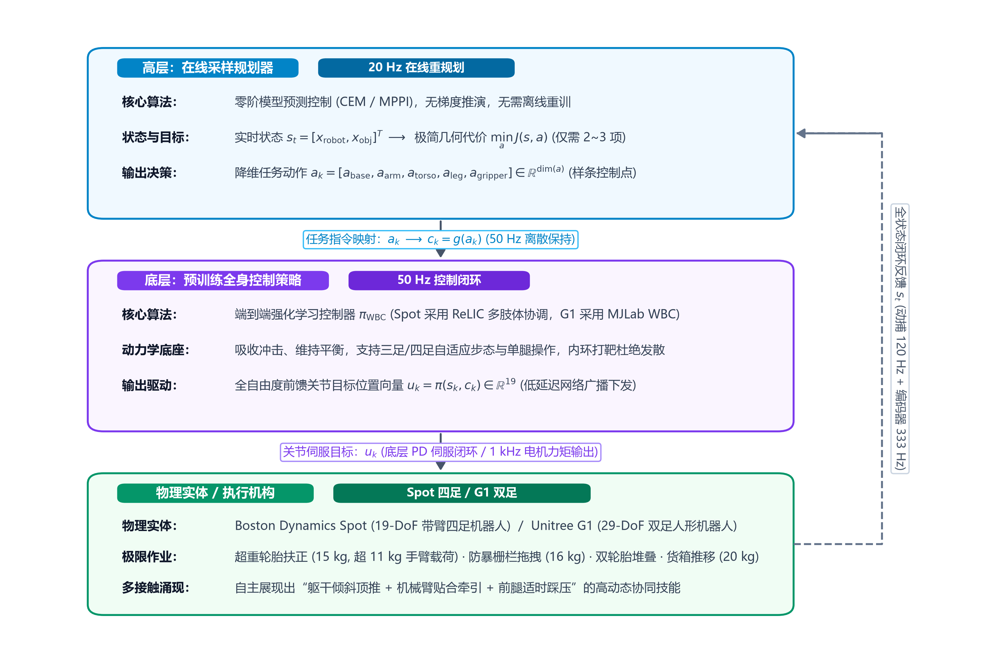
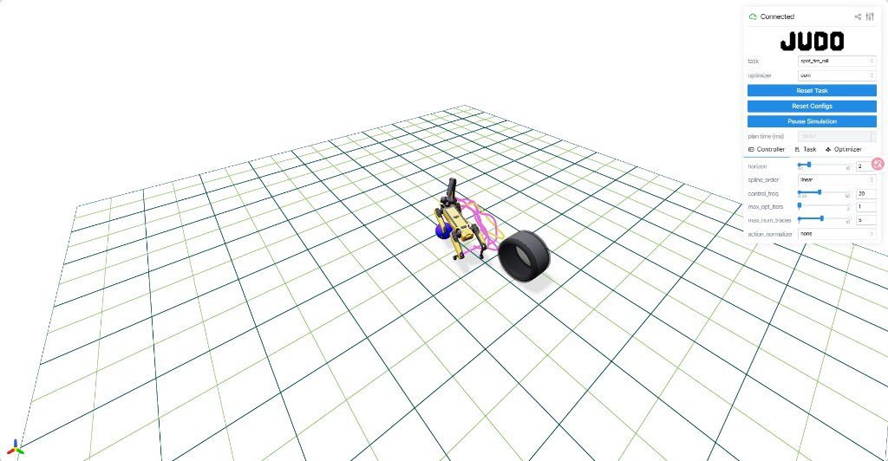
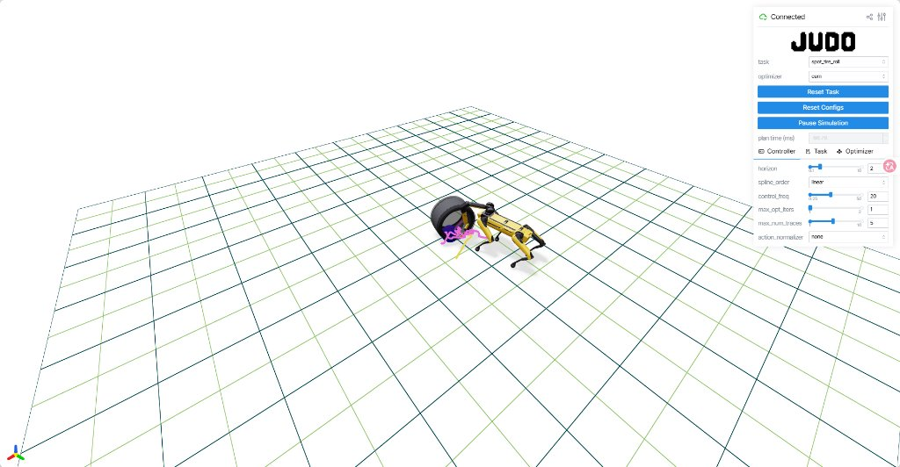
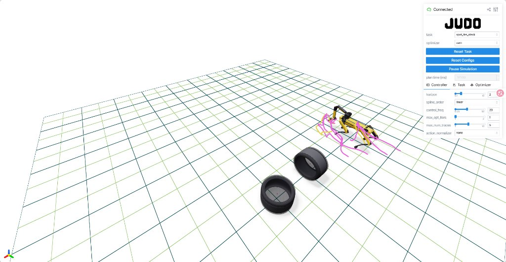
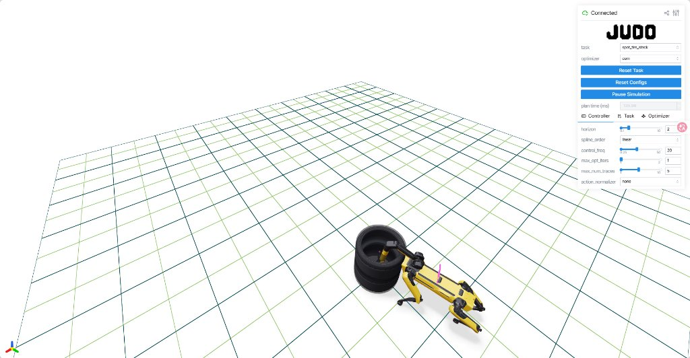

# Sumo: Dynamic and Generalizable Whole-Body Loco-Manipulation

> * **研究机构**：Massachusetts Institute of Technology (MIT), Boston Dynamics AI Institute (RAI), Cornell University
> * **发表出处**：arXiv:2604.08508v3 [cs.RO], Sep 2026 (Submitted to IEEE Transactions on Robot Learning)
> * **项目主页 & 开源仓库**：[sumo.rai-inst.com](https://sumo.rai-inst.com/) / [github.com/rai-opensource/sumo](https://github.com/rai-opensource/sumo)

---

## 1 Introduction

### 1.1 研究背景与问题定义
人类与动物在真实物理世界中能够以极富创造力的方式与环境交互：通过自如地制造与断开环境接触，生物体不仅能轻松翻越崎岖险阻的地形，还能协调全身肢体搬运数倍于自身体重的庞大物体。让机器人具备类似水准的**“高动态身体智能”**。

得益于数值轨迹优化与深度强化学习的飞速突破，腿式机器人在敏捷移动与灵巧抓取领域取得了里程碑式进展。然而，当前的机器人技术前沿正迈向一个兼具两者的更复杂领域——**动态移动操作。迄今为止，移动操作的研究大多局限于通过**人类遥操作示教或**视频模仿学习**进行学习。这些范式普遍存在显著瓶颈：

* **局限于桌面级准静态场景**：主要针对抓取水杯、按压开关等微小轻载荷物体，假定基座移动与手臂操作处于弱耦合状态；
* **无法利用全身被动动力学**：传统方法往往避免剧烈碰撞与接触，无法主动利用物体与机器人自身的惯性、动量、地面反作用力及被动动力学；
* **受限于机器人物理载荷上限**：当物体尺寸庞大（甚至超出机器人自身外形尺寸）或质量沉重（超过机械臂额定负重能力）时，孤立依赖机械臂抓取搬运的常规方法完全失效，必须依靠**全身协调的多接触接触丰富交互**。

### 1.2 现有技术路线的核心瓶颈
实现自主协调全身、动态操控大型重载物体的移动操作面临严峻的理论与算法瓶颈：

1. **端到端深度强化学习的工程与泛化困境**：
   * **高昂的稠密奖励工程**：为了让单一神经网络同时学会自平衡行走、趋近目标、施加合理接触力并完成操作，通常需要极其繁琐的人工奖励塑造，往往包含十几个相互冲突的奖励项；
   * **训练脆弱且难以收敛**：策略对超参数和奖励权重极度敏感，微小的权重改动就会导致步态崩溃或陷入局部极小；
   * **闭门造车，泛化性极差**：一旦面对训练分布之外的新几何形状、不同质量或未建模摩擦力的物体，离线策略往往彻底失效，必须重新设计奖励并在 GPU 集群上耗费数小时重新训练。
2. **端到端基于采样的模型预测控制的动力学发散**：
   * **维度灾难**：对于四足机器人（带臂共 19+ 自由度）或双足人形机器人（20~30+ 自由度），在全关节驱动空间中直接进行多步采样搜索，决策空间维度呈指数级爆炸，在线计算难以实时收敛；
   * **开环不稳定系统的单步打靶发散**：基于采样的 MPC严重依赖前向打靶仿真。然而腿足机器人本质上属于开环不稳定的倒立摆系统，在缺乏底层高频反馈控制的情况下，开环扰动指令会迅速导致打靶轨迹发散、倒地摔翻，采样效率极低。
3. **分层架构与模仿学习的局限**：
   * 遥操作与人类动作重定向难以映射到非人形态的机器本体；
   * 以往的分层多接触规划方法（如混合整数规划或接触隐式 MPC）往往需要人为预设离散的接触时序或假设准静态交互，无法在毫秒级内动态适应开放环境下的突发接触。

### 1.3 Sumo 的核心贡献与创新思想·
**Sumo**——一种将**离线预训练全身控制策略**与**在线测试时基于采样的模型预测控制**有机融合的分层控制新架构。

> [!IMPORTANT]
> 不要试图用端到端 RL 解决一切开放式交互，也不要在高维不稳定的关节力矩空间中盲目采样 MPC。相反，**利用离线 RL 训练一个鲁棒的高频全身基础移动或平衡策略作为“底层动力学稳定底座”，将高层基于采样的 MPC 作为“在线方向舵”，在测试部署时实时引导底层策略的行为。**



本文的主要贡献包括：
1. **分级互补控制框架**：首次系统化地验证了“高层 MPC 引导底层预训练 RL WBC 策略”在动态全身移动操作中的有效性，解决了高维多接触操作中的打靶发散与维度灾难。
2. **分层解耦极大简化移动操作**：相较于端到端 MPC，Sumo 在预训练策略的指令空间采样，不仅大幅压缩了有效搜索空间，且打靶系统具有闭环渐近稳定性；相较于端到端 RL，Sumo 仅需 2~3 项极简任务代价函数，省去了 15 项以上的繁复奖励塑造与数小时的 GPU 重训。
3. **测试时在线搜索赋能强大的零样本泛化能力**：面对未见过的全新物体或全新任务目标，**无需任何网络权重微调或重训**，仅需在测试时在线替换规划器内部的物体仿真模型或切换任务代价函数，即可实现零样本泛化。
4. **极致的工程实用效率**：超参数贝叶斯优化测试表明，Sumo 在单台常规 CPU 电脑上寻找最优控制参数的物理耗时比强化学习集群训练**快整整一个数量级**。
5. **极具挑战性的物理实体与仿真大范围验证**：
   * **Spot 四足机器人实体**：完成了 8 项极具物理挑战的真机任务，包括扶正重达 15 kg 的汽车轮胎（超过机械臂 11 kg 的最大额定提升载荷）、双轮胎立体堆叠、拖拽尺寸超越机身的 16 kg 铁质防暴栅栏、推移 20 kg 重箱等；
   * **Unitree G1 双足人形机器人仿真**：完成了推重箱、推靠背椅、开门穿越、推双人餐桌 4 项高动态全身操作；

---

## 2 Background and Related Works

### 2.1 Reinforcement Learning for Whole-Body Control
将纯 RL 直接应用于开放世界的移动操作面临致命缺陷：
* **对稠密奖励设计极其敏感**：接触丰富型任务往往具有高度非凸的价值曲面，微小的超参数偏差会导致策略陷入无效的非接触鞍点；
* **测试时多样性爆炸**：现实中的物体涵盖无限的几何形状、质心分布、摩擦因数和质量。试图在离线训练阶段将这些物理属性全部随机化覆盖，往往会导致网络容量耗尽，策略退化为过于保守的动作甚至训练崩溃。

### 2.2 Sample-Based MPC
基于采样的模型预测控制是一类**零阶轨迹优化**方法，在有限预测时域内寻找最优控制序列。该族谱涵盖模型预测路径积分（MPPI）、交叉熵法（CEM）、协方差矩阵自适应进化策略（CMA-ES）以及预测采样。从理论本质上看，基于采样的 MPC 可被视为一种**无需离线训练的在线策略梯度更新方法**。

由于无需计算物理动力学的解析导数，基于采样的 MPC 在面对**非光滑刚体碰撞、间歇性地面摩擦接触、深层黑盒神经网络**时表现出显著的数学与工程鲁棒性。传统的基于梯度的方法在接触切换瞬间往往面临雅可比矩阵不连续、梯度消失或梯度爆炸问题。

然而，在线基于采样的 MPC 长期存在两大硬伤：
1. **维度灾难**：高自由度机器人的全关节驱动空间导致采样空间极大，有限的粒子数难以覆盖高质量轨迹；
2. **开环动力学发散**：标准打靶法直接对开环动力学进行积分，腿足系统微小的初始平衡误差在多步递推后迅速指数级发散，产生大量“摔倒”的无效废样。

### 2.3 Loco-Manipulation
移动操作要求机器人在移动底盘位移的同时与外部物体进行物理交互。早期工作通常将底盘与手臂强行解耦（例如将底盘当成移动导轨、手臂执行准静态操作），或利用特定的腿进行专用踢踏。但在面对大型重型物体时，机械臂电机的扭矩上限决定了单臂无法强行提起物体，必须要求机器人利用身体躯干倾斜、多肢体协同夹持以及地面静摩擦力来共同做功。

以往的多接触模型预测控制往往需要硬编码指定接触点模式，丧失了根据物理动态随机应变的能力。Sumo 则完全打破了固定接触模式的假定，允许机器人在物理连续交互中自主涌现出顶推、靠抱、拖拽、下踩等多重操作模式。

### 2.4 Hierarchical Control Methods
在近期的机器人学习文献中，混合“RL 与 MPC”的方法逐渐受到广泛关注，但其常见结构普遍为：
* **“高层 RL + 底层 MPC”架构**：通常由高层神经网络规划出足端接触力或质心期望轨迹，底层通过高频凸优化 MPC（如 QP-MPC）求解逆动力学并输出关节力矩。这种方案要求底层具备精确的刚体运动学和接触模型，在面对未知重物的不规则接触力时容易发生底层求解不可行。
* **Sumo 提出的“高层 MPC + 底层 RL”倒置架构**：
  * 底层充分发挥强化学习的优势：吸收未建模冲击、保持抗扰自平衡，输出鲁棒的全身动作；
  * 高层充分发挥在线 MPC 的优势：直接利用在线测试时的物体几何与质量模型进行无梯度轨迹前向推演，灵活应对未见过的任务目标。

相较于基于模仿学习的视觉-语言-动作（VLA）大模型（如 $\pi_0$、OpenVLA），VLA 虽然具有极强的语义理解能力，但当前输出频率较低（通常 5~10 Hz），且主要针对桌面级准静态双臂夹取，缺乏对高动态重载多接触全身动力学的物理闭环感知。Sumo 与 VLA 形成天然互补：VLA 可在上层负责语义识别并生成目标位姿与代价函数，而 Sumo 则在底层执行高频多接触全身闭环控制。

---

## 3 Sumo

### 3.1 Overview
Sumo 系统采用了两层分级的控制架构：


#### 系统运行频率与核心层级配置

| 架构层级 | 运行频率 | 核心算法 / 模块 | 输入物理量 | 输出物理量 | 硬件与计算载体 |
| :--- | :---: | :--- | :--- | :--- | :--- |
| **状态感知层** | **120 Hz / 333 Hz** | 低通滤波状态融合 | 外部 MoCap 位姿估计 + 电机编码器角度 | 全系统状态 $s = [x_{\text{robot}}, x_{\text{obj}}]$ | 机载感知 / 外部动捕 |
| **高层规划层** | **20 Hz** | 交叉熵法 (CEM) / MPPI | 状态估计 $s_0$、任务代价函数 $J$、物体模型 | 降维任务动作 $a \in \mathbb{R}^{\dim(a)}$ | AMD 64核工作站 |
| **底层执行层** | **50 Hz** | 预训练 RL 策略 | 机器人自身运动状态 + 任务指令 $c = g(a)$ | 19 维全关节驱动目标 $u \in \mathbb{R}^{19}$ | 板载/网络低延迟下发 |
| **电机驱动层** | **1 kHz** | 关节底层数字伺服闭环 | 期望关节位置 $u_t$、当前编码器测量值 | 各电机驱动相电流与驱动力矩 $\tau$ | 机器人底层电机驱动板 |

---

### 3.2 Pre-Trained Whole-Body Control Policy
Sumo 并不试图重新训练通用的底层控制器：

1. **Spot 四足机器人平台**：
   * 采用前序工作 **ReLIC的预训练策略。
   * **核心优势**：ReLIC 打破了传统“四腿走路、单臂抓取”的刚性限制，策略学会了在**四足正常奔跑行走**与**三足稳定支撑平衡（同时将第四条腿抬起作为额外操作机构）**之间无缝切换。这使得高层 MPC 能够自主在测试时调度“躯干顶推 + 机械臂抓持 + 单前腿协同踩压”，极大拓展了作业物理范围。
2. **Unitree G1 双足人形机器人平台**：
   * 采用基于 **MJLab** 训练的标准双足速度跟踪策略。
   * 该基础策略本身仅训练了跟踪躯干在平面上的前进、横移及偏航线角速度指令。Sumo 的高层规划器在控制机身走动的同时，**直接以纯前馈方式覆写双臂各关节的目标角度指令**。由于双足行走策略具备优异的抗扰动平衡裕度，这种覆写操作在实际仿真中展现出极高的稳定性。

> [!TIP]
> 论文通过消融分析指出，一个适合用于被高层 MPC 在线采样的底层 WBC 策略，最关键的特性并非极致的最优性，而是满足以下三点：
> 
> 1. **低维指令空间**：大幅削减高层采样搜索空间，避免维度灾难；
> 2. **一致且平滑的闭环响应**：策略对微小的指令扰动产生确定性、平滑的物理位移变化，使打靶轨迹分布呈现单峰向心性；
> 3. **抗高频指令突变的内在稳定性**：高层 MPC 在 20 Hz 快速重规划下发急转弯或急促变向指令时，底层策略必须能依靠本能维持自平衡而不发生摔倒倒地。

---

### 3.3 Policy-in-the-Loop Parallel Rollouts

#### 1. 物理机理与动力学数学推导
设全系统的物理状态向量为 $\mathbf{s}$，其由机器人浮动基座 6D 位姿、所有关节位置与速度，以及被操作物体的 6D 空间位姿与线/角速度拼接而成：
$$
\mathbf{s} = \big[ \mathbf{x}_{\text{base}}, \mathbf{v}_{\text{base}}, \mathbf{q}_{\text{joints}}, \dot{\mathbf{q}}_{\text{joints}}, \mathbf{x}_{\text{obj}}, \mathbf{v}_{\text{obj}} \big]^T
$$
设 $\mathbf{u}$ 为机器人底层关节伺服电机的控制指令（例如电机的期望角度或力矩）。在传统的单体仿真器中，系统状态由标准多刚体动力学前向递推：
$$
\mathbf{s}_{k+1} = f(\mathbf{s}_k, \mathbf{u}_k) \tag{1}
$$
在以往的端到端 MPC 中，规划器必须在整个时域内对序列 $\{\mathbf{u}_0, \mathbf{u}_1, \dots, \mathbf{u}_{H-1}\}$ 进行蒙特卡洛随机采样打靶。由于 $\mathbf{u}$ 维度极高且系统属于开环不稳定动力学，微小的打靶扰动就会导致足端腾空滑倒或机体失衡侧翻，搜索极难收敛。

Sumo 提出了**策略内环动力学打靶（Policy-in-the-Loop Rollout）**：
引入高层动作到策略指令的映射函数 $\mathbf{c} = g(\mathbf{a})$，底层策略网络输出前馈关节动作 $\mathbf{u} = \pi(\mathbf{s}, \mathbf{c})$。由此，复合后的闭环打靶动力学被精确定义为：
$$
\mathbf{s}_{k+1} = f'(\mathbf{s}_k, \mathbf{a}_k) \triangleq f\Big(\mathbf{s}_k, \; \pi\big(\mathbf{s}_k, \, g(\mathbf{a}_k)\big)\Big) \tag{2}
$$

```
(a) 传统端到端 MPC 打靶 (Standard Dynamics Rollout):
       u_0            u_1            u_2
        │              │              │
        ▼              ▼              ▼
s_0 ───►[ f(s, u) ]───►[ f(s, u) ]───►[ f(s, u) ] ───► s_H (极易失稳发散)

(b) Sumo 策略内环打靶 (Policy-in-the-Loop Rollout):
               a_0                 a_1                 a_2
                │ g(a)              │ g(a)              │ g(a)
                ▼                   ▼                   ▼
               c_0                 c_1                 c_2
                │                   │                   │
                ▼                   ▼                   ▼
 s_0 ───┬───►[ π(s_0, c_0) ] ┌─►[ π(s_1, c_1) ] ┌──►[ π(s_2, c_2) ]
        │         │          │        │          │         │
        │         ▼ u_0      │        ▼ u_1      │         ▼ u_2
        └───►[ f(s_0, u_0) ]─┴───►[ f(s_1, u_1) ]┴────►[ f(s_2, u_2) ] ───► s_H
                       │                   │                    │
                   输出状态 s_1         输出状态 s_2         输出状态 s_3
                   (向上闭环反馈！)     (向上闭环反馈！)      (向上闭环反馈！)
```

#### 2. 策略内环打靶
1. **降维空间采样**：高层规划器只需在低维任务动作空间 $\mathbf{a}$ 中采样，而非在 19~30 维的全关节空间中采样，从根源上缓解了采样搜索的“维度灾难”；
2. **单步打靶的动力学鲁棒镇定**：无论高层下发的指令 $\mathbf{a}$ 如何剧烈变动，底层策略网络 $\pi$ 始终在每一个物理步内以 50 Hz 强行计算各关节自平衡力矩，消除了开环不稳定系统的指数级发散，使前向预测时域内的物理模拟高度稳定；
3. **极简任务代价函数**：规划器完全无需关心“如何交替迈腿、如何调整质心防跌倒”等复杂的移动动力学惩罚，任务代价函数**仅需编码纯粹的操作几何目标**（如物体离目标的欧氏距离、物体轴向是否竖直）。

#### 3. CPU 多线程并发架构
Sumo 在 C++ 层面深度封装了 MuJoCo 物理引擎，利用线程池实现高效的多线程并行打靶。论文在 Intel Core i7-12700K 消费级 CPU 上测试了 32 条并行打靶轨迹（时域长度 1.5 秒）的计算耗时对比：

##### Table I: 32 条并行打靶轨迹（1.5 秒时域）耗时基准对比 (Intel i7-12700K CPU)

| 打靶实现方案 | 包含模块 | 单次打靶总耗时 (ms) | 是否满足 20 Hz (50 ms) 实时闭环 |
| :--- | :--- | :---: | :---: |
| **纯 MuJoCo 物理引擎** | 仅纯物理正向积分 | $21.73 \pm 1.86\text{ ms}$ | 是 |
| **Sumo 策略内环打靶** | MuJoCo 物理 + 策略网络推断 | $\mathbf{43.45 \pm 1.88\text{ ms}}$ | **是 ** |

> [!NOTE]
> **为什么选择 CPU 多线程而非 GPU 并行？**
> 在实时闭环控制中，**低端到端延迟（Low Latency）的优先级严格高于大吞吐量（High Throughput）**。GPU 批处理虽然能同时并发上千个实例，但其主机与显卡间的内存拷贝和批处理同步机制会带来显著的固定时间延迟（常达 80~100 ms 以上）。而在 20 Hz 在线重规划场景下，CPU 线程池能够以极低的中断延迟在 43 ms 内完成全部 32 条轨迹的推演与最优动作输出，保证了真实物理机的高动态响应。

---

### 3.4 High-Level Sample-Based MPC

#### 1. 策略指令空间与降维动作空间映射
以配备 6-DoF 机械臂与夹爪的波士顿动力 Spot 机器狗为例，底层 ReLIC 策略接收的完整控制指令向量 $\mathbf{c}_{\text{policy}} \in \mathbb{R}^{25}$ 包含：
* $\mathbf{c}_{\text{base}} \in \mathbb{R}^3$：基座在水平面内的 $\text{SE}(2)$ 速度指令 $(v_x, v_y, \omega_{\text{yaw}})$；
* $\mathbf{c}_{\text{arm}} \in \mathbb{R}^6$：机械臂 6 个关节的目标角度；
* $c_{\text{gripper}} \in \mathbb{R}^1$：机械臂末端夹爪开合位置；
* $\mathbf{c}_{\text{leg}} \in \mathbb{R}^{12}$：四条腿各 3 个关节的标称偏移指令；
* $\mathbf{c}_{\text{torso}} \in \mathbb{R}^3$：躯干的俯仰角（Pitch）、滚转角（Roll）以及对地离地高度（Height）。

#### 2. 模块化动作空间解耦与掩码机制
在绝大多数基础移动操作任务中，规划器默认仅在 9 维紧凑空间中采样：
$$
\mathbf{a}_{\text{default}} = [\mathbf{a}_{\text{base}}, \mathbf{a}_{\text{arm}}] \in \mathbb{R}^9
$$
其余指令直接填充系统标称默认值（腿部目标置交由策略自主步态生成，夹爪保持闭合，躯干保持默认姿态）。

而当面临需要利用身体躯干倾斜施加下压力、单腿踩踏或夹爪抓取的高难度任务时，Sumo 支持通过拼接子动作空间动态扩充：
$$
\mathbf{a} = [\mathbf{a}_{\text{base}}, \; \mathbf{a}_{\text{arm}}, \; \mathbf{a}_{\text{torso}}, \; \mathbf{a}_{\text{leg}}, \; a_{\text{gripper}}]
$$

##### （1）躯干倾角与高度主动控制（$\mathbf{a}_{\text{torso}} \in \mathbb{R}^3$）
直接将躯干俯仰、滚转与离地高度加入采样空间，使得机器狗在面对高台推物或重物下压时，能够像举重运动员一样后仰挺身或下蹲蓄力。

##### （2）前腿操作选择变量与阈值化掩码（$\mathbf{a}_{\text{leg}} \in \mathbb{R}^7$）
Sumo 将前腿参与操作的形式参数化为一个连续选择标量 $s_{\text{leg}} \in [-1, 1]$ 与 6 维前腿关节目标 $\mathbf{c}_{\text{leg}} \in \mathbb{R}^6$：
$$
\mathbf{a}_{\text{leg}} = [s_{\text{leg}}, \; \mathbf{c}_{\text{leg}}]
$$
通过引入非线性分段阈值化函数，实现对左前腿（FL）或右前腿（FR）的离散激活选择：
$$
\mathbf{c}_{\text{leg}}^{\text{masked}} = \begin{cases} 
[\mathbf{c}_{\text{leg}}[0:3], \; 0, \; 0, \; 0]^T, & \text{若 } s_{\text{leg}} < -0.5 \quad (\text{激活左前腿 FL 操作}) \\ 
[0, \; 0, \; 0, \; \mathbf{c}_{\text{leg}}[3:6]]^T, & \text{若 } s_{\text{leg}} > 0.5 \quad (\text{激活右前腿 FR 操作}) \\ 
[0, \; 0, \; 0, \; 0, \; 0, \; 0]^T, & \text{其他 } (-0.5 \le s_{\text{leg}} \le 0.5) \quad (\text{双前腿均用于四足行走})
\end{cases} \tag{3}
$$

##### （3）夹爪开合离散控制（$a_{\text{gripper}} \in [-1, 1]$）
$$
c_{\text{gripper}} = \begin{cases} 
c_{\text{gripper}}^{\text{close}}, & \text{若 } a_{\text{gripper}} > 0 \\ 
c_{\text{gripper}}^{\text{open}}, & \text{若 } a_{\text{gripper}} \le 0 
\end{cases} \tag{4}
$$

> [!TIP]
> **连续与离散混合决策的优雅处理**：
> 在传统的基于梯度的最优控制算法中，处理式 (3) 和式 (4) 这类离散跳变开关会导致海森矩阵不可微，陷入极其困难的混合整数非线性规划（MINLP）。而基于采样的零阶优化（CEM/MPPI）天然允许目标空间存在不连续跃迁，优化器能在统一框架下顺畅处理离散多模态决策。

---

### 3.5 Planner Implementation Details

#### 1. Sumo 规划主循环流程

$$
\begin{array}{l}
\hline
\textbf{Algorithm 1: Sumo Planning Iteration (单次高层在线规划周期)} \\
\hline
\textbf{Input:} \; \mathbf{s}_0 \text{ (当前系统状态估计)}, \quad \mathcal{S} \text{ (上一周期动作样条)}, \quad \boldsymbol{\sigma} \text{ (噪声尺度向量)}, \quad J(\mathbf{s}, \mathbf{a}) \text{ (综合代价函数)} \\
\textbf{Output:} \; \mathcal{S}^* \text{ (本周期最优动作样条)}, \quad \mathbf{a}_0^* \leftarrow \mathcal{S}^*(0) \text{ (当前控制步下发执行指令)} \\
\hline
\textbf{1. 时移热启动 (Warm Start):} \quad \bar{\mathbf{A}} \leftarrow \mathcal{S}(t_{\text{shift}}) \quad \text{// 将上一周期收敛样条控制点向前平移一拍} \\[3pt]
\textbf{2. 并行物理打靶 (Parallel Rollouts):} \quad \textbf{parallel for } i = 1 \text{ to } N_{\text{samples}} \textbf{ do} \\
\quad \bullet \; \text{扰动采样与截断: } \boldsymbol{\epsilon}_i \sim \mathcal{N}(\mathbf{0}, \mathbf{I}), \quad \mathbf{A}^i \leftarrow \operatorname{clip}\left(\bar{\mathbf{A}} + \boldsymbol{\sigma} \odot \boldsymbol{\epsilon}_i, \; \mathbf{a}_{\min}, \; \mathbf{a}_{\max}\right) \\
\quad \bullet \; \text{连续样条插值: } \mathbf{a}^i(t) \leftarrow \operatorname{interpolate\_control\_points}(\mathbf{A}^i), \quad \mathbf{s}_{\text{curr}} \leftarrow \mathbf{s}_0, \quad J^i \leftarrow 0 \\
\quad \bullet \; \text{策略内环闭环多步推演: } \\
\qquad \textbf{for } k = 0 \text{ to } H-1 \textbf{ do} \\
\qquad\quad \mathbf{a}_k \leftarrow \mathbf{a}^i(k \cdot \Delta t), \quad \mathbf{s}_{\text{next}} \leftarrow f'\big(\mathbf{s}_{\text{curr}}, \mathbf{a}_k\big) \triangleq f\Big(\mathbf{s}_{\text{curr}}, \, \boldsymbol{\pi}\big(\mathbf{s}_{\text{curr}}, g(\mathbf{a}_k)\big)\Big) \\
\qquad\quad J^i \leftarrow J^i + J(\mathbf{s}_{\text{curr}}, \mathbf{a}_k), \quad \mathbf{s}_{\text{curr}} \leftarrow \mathbf{s}_{\text{next}} \\
\qquad \textbf{end for} \\
\quad \textbf{end parallel for} \\[3pt]
\textbf{3. 分布更新 (Distribution Update):} \\
\quad \{\mathbf{A}^{\text{elite}}, J^{\text{elite}}\} \leftarrow \operatorname{select\_top\_k\_elites}\Big( \{\bar{\mathbf{A}}, J(\bar{\mathbf{A}})\} \cup \{\mathbf{A}^i, J^i\}_{i=1}^{N_{\text{samples}}}, \; K_{\text{elites}} \Big) \\
\quad (\bar{\mathbf{A}}, \, \boldsymbol{\sigma}) \leftarrow \operatorname{update\_distribution}\Big(\{\mathbf{A}^{\text{elite}}, J^{\text{elite}}\}\Big) \\[3pt]
\textbf{4. 样条拟合与执行:} \quad \mathcal{S}^* \leftarrow \operatorname{fit\_spline}(\bar{\mathbf{A}}), \quad \operatorname{execute\_command}(\mathcal{S}^*(0)), \quad \textbf{return } \mathcal{S}^* \\
\hline
\end{array}
$$

#### 2. 规划器工程核心技术细节拆解
1. **样条控制点参数化**：在 1.5 秒的预测时域内，规划器并不在每个离散时间步独立采样，而是沿时间轴设立 4 个均匀分布的样条节点，控制点之间采用线性插值。这极大降低了时域上的搜索自由度，防止生成高频震颤的无效轨迹。
2. **对角协方差高斯先验**：在各个控制节点和动作维度之间独立采样高斯白噪声，舍弃维度间的交叉耦合项，既降低了采样的计算复杂度，又避免了协方差矩阵求逆可能带来的数值奇异。
3. **时域线性递增噪声调度**：
   $$
   \sigma(t) = \sigma_{\text{start}} + \frac{t}{T_{\text{horizon}}} (\sigma_{\text{end}} - \sigma_{\text{start}}), \quad \sigma_{\text{start}} = 0.02, \; \sigma_{\text{end}} = 0.6
   $$
   * **物理直觉**：时域前端（$t \to 0$）即将在下一个时刻被实机执行，且已在上一周期经历过多轮优化，因此施加微小噪声以保持**高精度的渐进收敛与动作平滑**；而时域尾端（$t \to T$）是新移入预测窗口的未知未来，需要施加大方差噪声以**充分探索广阔的解空间、跳出局部极小**。
4. **无缝热启动**：将上一时刻收敛的样条控制点沿时间向前推进 $\Delta t = 50\text{ ms}$ 作为当前采样的初始均值 $\bar{\mathbf{A}}$，并将完全未加扰动的 $\bar{\mathbf{A}}$ 本身作为打靶样本集中的第 0 号样本参与竞选。这一机制确保了规划器输出的轨迹具有物理世界中必不可少的**时序单调不减性**。

---

## 4 Experimental Analysis

### 4.1 Task Definition and Experiment Setup
```
评测物体库：
├── 1. 标准轻型货箱 (Box): 1.5 kg, 规则几何立方体
├── 2. 靠背办公椅 (Chair): 异形支架, 高重心, 易发生翻滚
├── 3. 汽车轮胎 (Car Tire): 圆环异形, 接触面为圆弧, 强非线性转动惯量
├── 4. 工业轮胎放置架 (Tire Rack): 细长框架, 多连杆几何, 拖拽极易卡滞
└── 5. 橡胶交通路锥 (Traffic Cone): 圆锥锥体, 上窄下宽, 接触点力矩臂剧烈变化
```

#### 代价函数

1. **移动推移任务（Move Object to Goal）**：
   
   * **成功判定**：在 30 秒内，物体被推移至目标位置且距离误差 $\le 0.1\text{ m}$，且最终线速度 $\le 0.05\text{ m/s}$。
   * **代价函数**：
     $$
     J_{\text{Move}} = \underbrace{w_{\text{goal}} \|\mathbf{p}_{\text{obj}} - \mathbf{p}_{\text{goal}}\|^2}_{\text{① 主任务目标项}} + \underbrace{w_{\text{gripper}} \|\mathbf{p}_{\text{gripper}} - \mathbf{p}_{\text{obj}}\|^2}_{\text{② 接触引导塑形项}} + \underbrace{w_{\text{vel}} \|\mathbf{v}_{\text{obj}}\|^2}_{\text{③ 终点制动阻尼项}} \tag{5}
     $$
     **各损失子项物理机制与权重**：
     
     * **① 目标距离惩罚（$w_{\text{goal}} = 60$）**：拉动任务进展的“全局引力势能”。权重高达 60，是系统的绝对第一优先级，迫使 MPC 在打靶中坚决剔除任何无法使物体逼近目标点的无效动作序列。
     * **② 末端接触引导（$w_{\text{gripper}} = 4$）**：破除“接触前零梯度陷阱”的关键塑形项。若无此项，机器人在未触碰物体前物体位移处处为 0，各打靶轨迹代价完全相同（稀疏代价），导致机器人在物体旁迷茫徘徊。此项如同一根橡皮筋将夹爪强行拉向物体表面。其权重设为 4（远小于 60），确保一旦发生接触，推移主任务立即主导优化，避免末端被过度“吸附”在物体表面而阻碍发力。
     * **③ 动能速度阻尼（$w_{\text{vel}} = 20$）**：充当“阻尼器”。20kg 重物具有极大惯性，若无速度惩罚，MPC 会驱使机器人全速猛撞将物体踢飞或冲过头。该项随物体速度呈二次方剧增，逼迫机器人在逼近目标点时主动收力减速，轻柔刹停以满足最终线速度 $\le 0.05\text{ m/s}$ 的严苛判定。

2. **倒地扶正任务（Upright Object）**：
   
   * **成功判定**：在 30 秒内，物体的坚直轴线与世界坐标系垂直朝上方向的夹角误差 $\le 0.1\text{ rad}$，且角速度 $\le 0.05\text{ rad/s}$。
   * **代价函数**：
     $$
     J_{\text{Upright}} = \underbrace{w_{\text{Upright}} (1 - \hat{\mathbf{z}}_{\text{obj}} \cdot \hat{\mathbf{z}}_{\text{world}})}_{\text{① 竖直姿态对齐项}} + \underbrace{w_{\text{gripper}} \|\mathbf{p}_{\text{gripper}} - \mathbf{p}_{\text{obj}}\|^2}_{\text{② 初始接触引导项}} \tag{6}
     $$
     其中 $\hat{\mathbf{z}}_{\text{world}} = [0, 0, 1]^T$ 为世界天顶朝向，$\hat{\mathbf{z}}_{\text{obj}}$ 为物体本体坐标系在目标坚直状态下的基向量。
   * **各损失子项物理机制与权重**：
     
     * **① 姿态竖直对齐（$w_{\text{Upright}} = 100$）**：核心主宰项。横躺倒地时 $\hat{\mathbf{z}}_{\text{obj}} \cdot \hat{\mathbf{z}}_{\text{world}} = 0 \implies \text{Cost} = 100$；完全直立时内积为 $1 \implies \text{Cost} = 0$；若被推翻底朝天则内积为 $-1 \implies \text{Cost} = 200$。该几何内积在 0 到 90 度的翻转过程中提供了全局光滑、单调且无局部奇异的重力势能梯度。
     * **② 初始接触引导（$w_{\text{gripper}} = 0.5$）**：此项权重压至极低的 0.5 。扶正 15kg 轮胎等重物需要复杂的“全身接力式多接触”（机械臂初始拉拽 $\to$ 躯干整体下沉前压 $\to$ 单前腿插入垫底借力），中后期手臂必须能随时自由松脱、换位。若夹爪权重过高，手臂会被焊死在初始接触点导致机身无法前扑；设为 0.5 仅在最初阶段引导手臂伸向物体，一旦物体产生动态，权重 100 的姿态项瞬间主导，释放全身协调自由度。

> [!NOTE]
> **深度数学剖析：为什么采用向量内积 $(1 - \hat{\mathbf{z}}_{\text{obj}} \cdot \hat{\mathbf{z}}_{\text{world}})$ 而坚决不用四元数距离？**
> 1. **偏航自由度完全解耦**：轮胎、路锥等几何体具备轴对称性，任务仅要求“中轴线竖直”，物体绕自身竖直轴旋转任意角度均属成功。若采用四元数误差 $\|\mathbf{q} - \mathbf{q}_{\text{target}}\|$，必须人为硬编码一个特定的航向角，导致机器人即使成功立起轮胎，也会因航向不符承受巨大的“虚假惩罚梯度”，逼迫机器人做无意义的自转调整。向量内积公式自然滤除了绕 $Z$ 轴的自由度。
> 2. **彻底根除双重覆盖与拓扑奇异**：三维旋转群中四元数 $\mathbf{q}$ 与 $-\mathbf{q}$ 指代同一物理位姿。打靶优化器直接计算四元数欧氏距离时，符号反转会导致代价曲面出现非连续阶跃尖刺，严重破坏采样收敛；而向量内积是纯几何投影，数学上全局一阶光滑。

---

### 4.2 Hierarchical Structure Simplifies Loco-Manipulation
论文首先对比了 Sumo 与另外两条技术路线在 Move 任务上的表现，严格隔离了分层控制带来的性能增益：
* **基线 1：端到端 MPC**：采用相同的 CEM 优化器，但在 19 维全关节驱动空间中以 50 Hz 直接优化打靶。代价函数必须强行加入复杂的四足步态跟踪项 $J_{\text{E2E MPC}} = J_{\text{Locomotion}} + J_{\text{Move}}$。
* **基线 2：端到端 RL**：在 MJLab 中使用 PPO 训练单个 19-DoF 神经网络策略（4096 个环境并行，训练 5000 次迭代，单任务耗费约 2 小时高端 GPU 算力）。为了使策略收敛，人工设计了多达 15 项稠密奖励函数（包含相位步态、足端抬起高度、逼近塑形、机身防后仰惩罚等）。

##### 仿真推移任务各方法成功率对比

| 测试物体类型 | 端到端 MPC (E2E MPC) | 端到端 RL (E2E RL) | **Sumo (本文方法)** |
| :--- | :---: | :---: | :---: |
| **标准轻型方箱 (Box)** | $45\%$ | $95\%$ | $\mathbf{100\%}$ |
| **靠背办公椅 (Chair)** | $35\%$ | $80\%$ | $\mathbf{100\%}$ |
| **橡胶交通路锥 (Cone)** | $50\%$ | $85\%$ | $\mathbf{95\%}$ |
| **汽车轮胎 (Tire)** | $20\%$ | $30\%$ | $\mathbf{85\%}$ |
| **工业轮胎架 (Tire Rack)** | $10\%$ | $15\%$ | $\mathbf{80\%}$ |

#### 深度归纳：分层结构带来的两大决定性优势
1. **相比于端到端 MPC**：Sumo 在预训练策略的指令空间采样，不仅把搜索自由度压缩了 60% 以上，而且由于底层策略时刻在物理内环闭环纠偏，彻底消除了无约束打靶导致的频繁倒地失稳，将复杂物体的任务成功率从惨不忍睹的 10%~20% 暴力提升至 **80%~100%**。
2. **相比于端到端 RL**：Sumo 仅仅依靠 **3 项纯几何代价函数**且**无需进行任何针对特定任务的网络训练**，便取得了优于耗费数小时精心微调 15 项奖励的端到端强化学习的成功率；尤其在面对轮胎、轮胎架等强非线性接触几何时，端到端 RL 发生严重过拟合崩溃，而 Sumo 凭借在线动态调整依然游刃有余。

---

### 4.3 Test-Time Search Enables Generalization
强化学习在学术界常受诟病之处在于：在推方箱任务上训练完备的策略，换成推椅子或轮胎时往往寸步难行。Sumo 探究了在固定底层控制器的情况下，**高层决策模块应当是“离线学出来的”还是“在线搜出来的”？**

论文将 Sumo 与**分层强化学习（Hierarchical RL, HRL）**进行了横向对比。HRL 的高层是一个神经网络，其训练环境仅为 1.5 kg 的标准方箱，输入输出空间与 Sumo 严格对齐，并在训练时注入了方箱质量、尺寸与摩擦力的域随机化。

1. **跨物体零样本泛化**：
   * **HRL 表现**：虽然在方箱训练任务上达到了 100% 成功率，但在面对未见过的汽车轮胎和路锥时，由于物理接触面的曲率截然不同，策略性能瞬间暴跌至近乎 0%；
   * **Sumo 表现**：**在测试部署时直接替换规划器内部的物体仿真模型（MJCF）**，无需任何训练，Sumo 在全部新物体上均维持了极高胜率。
2. **跨任务目标零样本泛化**：
   * **HRL 表现**：训练用于“推箱子到指定坐标点”的 HRL 策略完全无法理解何为“将倒地轮胎扶立”，若要完成新任务必须推倒重来重新设计奖励再训练一次；
   * **Sumo 表现**：仅仅在测试时将代价函数从式 (5) 切换为式 (6)，规划器在无需微调任何神经网络权重的前提下，直接在线搜索出“机械臂插地勾取、机身向后发力拉拽、前脚适时顶推”的全新直立扶正行为。

---

## 5 Simulation Experiments and Results

### 5.1 Experimental Setup

SUMO 作为**分层接触隐式模型预测控制**框架，直接加载离线预训练好的底层全自由度运动策略神经网络权重（与 **ReLIC** 论文中的全身全向运动控制策略无缝兼容对接），在线端完全通过 CPU 高并发物理仿真与前向轨迹采样进行多接触推演。

* **软件栈与动力学引擎**：
  * **仿真内核**：**MuJoCo 3.6.0**。
  * **底层策略推理**：**ONNX Runtime**。
  * **机器人本体**：Boston Dynamics Spot 四足机器人（配置 12 个腿部主动关节自由度与 6 自由度可控机械臂）。
* **控制分层与循环频率机制**：
  * **高层 MPC 采样规划循环**：规划与控制刷新频率设为 **$20\text{ Hz}$**（控制步长 $\Delta t_{\text{ctrl}} = 0.05\text{ s}$），规划时域窗口为 **$2.0\text{ s}$**（前瞻 40 个离散控制步）。
  * **底层物理仿真环境推进**：步频设为 **$50\text{ Hz}$**（$\text{dt} = 0.02\text{ s}$），通过精确的接触冲量积分保证刚体与轮胎、家具碰撞过程中的数值稳定性。

---

### 5.2 Hyperparameter Configuration

| Tag | 设定值 | 定义 | 物理机制 |
| :--- | :---: | :--- | :--- |
| `task` | `spot_tire_roll`<br/>`spot_tire_stack`<br/>`spot_chair_push` | 场景操作任务枚举 | 覆盖非定常滚动平衡、高维多接触立体堆叠以及大阻尼非平坦物体全身推移。 |
| `optimizer` | **`cem`** | Cross-Entropy Method（交叉熵连续优化器） | 在前向非凸、存在接触突变不连续的价值空间中，通过多轮均值方差高斯采样搜索全局最优动作参数。 |
| `horizon` | **$2.0\text{ s}$** | MPC 预测时间时域 | 设定为 2 秒（对应 40 个控制步）。过短会导致机器人无法预知物体滚动后的后续轨迹，过长则会因累积积分误差发散。 |
| `spline_order` | **`linear`** | 动作序列时域样条插值阶数 | 采用分段线性样条对控制动作进行时域参数化降维，在抑制控制量高频振颤的同时，保留突变接触瞬间的敏捷响应。 |
| `control_freq` | **$20\text{ Hz}$** | MPC 重新规划与控制指令发布频率 | 每 $50\text{ ms}$ 重新触发一轮前向 rollout 并下发首步控制量 |
| `max_opt_iters` | **$1$** | 单控制步 CEM 迭代优化最大轮数 | **One-step MPC 实时在线范式**。借助时域 Warm-start（将上一控制步的优化结果平移作为初值），单轮采样即可满足实时闭环。 |
| `max_num_traces` | **$5$** | 3D 视口中可视化最优候选轨迹条数 | 在 WebGL 视口中渲染累积代价最小的前 5 条粉色末端/基座候选探索流，便于直观监控采样分布的收敛离散度。 |
| `num_rollouts` | **$64$** | 单轮 CEM 前向模拟并行样本数 | 依托 CPU 多核心并行，同时前向探索 64 种不同的交互力矩与移动速度组合，避免陷入局部障碍物极小点。 |
| `action_normalizer` | **`none`** | 采样动作空间的归一化变换模式 | 直接在底层策略所定义的物理动作量纲（速度与关节目标角）内进行无约束采样与饱和限幅，杜绝非线性尺度失真。 |


---

### 5.4 Task Demonstration & Evaluation

#### 5.4.1 Spot 轮胎前滚推移任务 (`spot_tire_roll`)

* 汽车轮胎呈立姿自由放置在水平地面上。该任务要求四足机器人从一定距离外走近轮胎，并通过前肢或机械臂末端对轮胎侧面施加精确的推力，驱动轮胎平稳滚动至目标落点（以蓝色几何球体标示）。
  * **非凸与易倾覆性**：立姿轮胎仅有单点接触线与地面支撑，一旦推力偏角过大或接触力瞬间超标，轮胎极易发生横向倾翻倒地，导致任务彻底失败；
  * **代价函数导向**：根据附录式 $(13)$ $J_{\text{Tire Roll}}$，高权重项 $w_{\text{goal}} = 500$ 引导轮胎中心向蓝球移动，同时倾角惩罚项 $w_{\text{orient}} = 50$ 强制轮胎轴线垂直于世界重力轴，抵消滚动过程中的侧翻力矩。

| 任务阶段 | 实机仿真视口截图 |
| :---: | :---: |
| **执行前** |  |
| **执行后** |  |

---

#### 5.4.2 Spot 双轮胎立体精准堆叠任务 (`spot_tire_stack`)

* 地面上平放有两个重叠阻尼极大的汽车轮胎。机器人需要先移动至远端轮胎处，利用机械臂末端与机身配合将上层轮胎推起、翻转，并施加向上的法向支撑力，克服重力势能将其精确套叠在底座轮胎的正上方。
  * **下层滑移抑制难题**：在推移上层轮胎时，接触冲击极易传导至底座轮胎引发相对滑动；
  * **代价函数导向**：根据附录式 $(14)$ $J_{\text{Tire Stack}}$，$w_z = 200$ 与 $w_{xy} = 100$ 强力约束上层轮胎质心向底座中心汇聚，而底座静止惩罚项 $w_{\text{bottom}} = 50$ 严格惩罚底座轮胎的速度 $\mathbf{v}_{\text{bottom}}$，迫使优化器寻找不干扰底座稳定性的接触力夹角。

| 任务阶段 | 实机仿真视口截图 |
| :---: | :---: |
| **执行前** |  |
| **执行后** |  |

---

## 6 Autonomous Demonstrations with Sumo

### 6.1 Spot Quadruped Loco-Manipulation

#### 1. 真实物理部署软硬件架构
* **实验机器人**：波士顿动力 Spot 四足机器人，配备官方 Spot Arm 6-DoF 机械臂与单自由度夹爪；
* **机载/外部状态估计**：Spot 底层电机编码器以 **333 Hz** 回传关节状态，外部 Vicon 光学动捕系统以 **120 Hz** 追踪机身与被操纵物体的 6D 空间位姿，二者经低通滤波后融合为全系统状态；
* **非机载计算与通信**：规划更新与 32 条并行动力学打靶运行于外部台式工作站（搭载 AMD Threadripper Pro 5995WX 64 核处理器），通过低延迟 WiFi 双向透传 50 Hz 关节目标指令。

#### 2. 实机任务实测性能指标全景汇总

##### Table II: Spot 机器狗 8 大严苛实机操作任务表现统计

| Task Name | 操作物体物理参数 | 核心物理挑战 | 平均完成耗时 (s) | 实机成功率 (10 轮测试) | 任务时限 |
| :--- | :--- | :--- | :---: | :---: | :---: |
| **重型轮胎扶正<br/>(Tire Upright)** | 汽车橡胶轮胎<br/>**15.0 kg** | **超重极限**：超过 Spot 臂额定提升负荷 (11 kg)。高形变与摩擦，协同利用臂、前腿与躯干。 | $9.2 \pm 4.7\text{ s}$ | $\mathbf{10/10}$ (100%) | 30 s |
| **防暴铁栅栏扶正<br/>(Barrier Upright)** | 金属人群管制栅栏<br/>**16.0 kg** | **超长尺寸**：长宽远超机体。规划器自动寻找立杆抓取点并依靠后仰翻转。 | $10.5 \pm 7.1\text{ s}$ | $\mathbf{9/10}$ (90%) | 30 s |
| **交通路锥扶正<br/>(Cone Upright)** | 橡胶交通路锥<br/>**3.5 kg** | **接触点滑移**：锥面易打滑，需机械臂精准下压并依靠底座圆弧滚动。 | $10.2 \pm 7.9\text{ s}$ | $\mathbf{9/10}$ (90%) | 30 s |
| **靠背办公椅扶正<br/>(Chair Upright)** | 铁腿靠背椅<br/>**16.5 kg** | **高重心多接触点**：椅腿极易倒伏倾斜，机械臂与机体躯干协同靠推。 | $27.3 \pm 19.1\text{ s}$ | $\mathbf{8/10}$ (80%) | 60 s |
| **双轮胎立体叠放<br/>(Tire Stack)** | 两个橡胶轮胎<br/>**各 15.0 kg** | **Sim-to-Real 鸿沟之王**：极高橡胶接触静摩擦，需将一轮胎抬升至另一轮胎顶面平铺。 | $16.5 \pm 8.4\text{ s}$ | $\mathbf{8/10}$ (80%) | 30 s |
| **防暴铁栅栏拖拽<br/>(Barrier Drag)** | 直立防暴栅栏<br/>**15.0 kg** | **动态防倾倒**：夹爪牢固咬合横杆，边倒退走动边靠机体牵引，防止摆动倾覆。 | $20.2 \pm 6.7\text{ s}$ | $\mathbf{9/10}$ (90%) | 30 s |
| **大型轮胎架拖拽<br/>(Tire Rack Drag)** | 工业多层轮胎架<br/>**10.0 kg** | **大惯性轨迹跟踪**：夹持受限支撑杆，克服轮子摩擦阻力向目标点搬运。 | $19.1 \pm 6.2\text{ s}$ | $\mathbf{9/10}$ (90%) | 30 s |
| **超重粗糙方箱推移<br/>(Rugged Box Push)** | 粗糙重型货箱<br/>**20.0 kg** | **全身持续推力**：机体动态走位至货箱正后方，前倾胸部与机械臂贴合做功。 | $38.3 \pm 16.9\text{ s}$ | $\mathbf{10/10}$ (100%) | 90 s |

---

### 6.2 G1 Humanoid Loco-Manipulation (4 大仿真双足人形任务)
为了验证 Sumo 跨构型的通用性，论文将相同架构拓展到了 **Unitree G1 29-DoF 双足人形机器人**。
高层 CEM 规划器直接生成躯干线角速度及双臂关节目标，在 MuJoCo 仿真中完成了 4 项典型的人形全身操作：

##### Table III: Unitree G1 双足人形机器人移动操作表现

| 仿真任务名称 | 目标物体物理属性 | 操作模式与全身协调特性 | 平均完成耗时 (s) | 任务成功率 |
| :--- | :--- | :--- | :---: | :---: |
| **G1 双臂推箱 (Box Push)** | 10.0 kg 重型方箱 | 双手掌面推持，躯干向前倾斜提供下压牵引力 | $11.83 \pm 2.97\text{ s}$ | $\mathbf{9/10}$ (90%) |
| **G1 开门穿越 (Door Open)** | 带弹簧铰链门体 | 单手伸向门把手，转动并顺势推开，机体同步迈步通过门洞 | $4.73 \pm 0.98\text{ s}$ | $\mathbf{10/10}$ (100%) |
| **G1 推靠背椅 (Chair Push)** | 16.5 kg 靠背椅 | 双臂高位支撑椅背，双足小幅碎步协调推进，抑制椅腿翻转 | $6.86 \pm 0.288\text{ s}$ | $\mathbf{10/10}$ (100%) |
| **G1 推双人餐桌 (Table Push)** | 10.0 kg 宽大餐桌 | 超宽双臂展开，机体核心下沉推移桌面至指定空间坐标 | $4.86 \pm 1.65\text{ s}$ | $\mathbf{8/10}$ (80%) |

---

## 7 Conclusions and Future Work

### 7.1 总结与核心结论
Sumo 开创性地确立了**“以高层基于采样的模型预测控制在线引导底层强化学习全身控制器”**的新范式。这一架构完美化解了传统学术界“纯端到端 RL 缺乏泛化与奖励繁重”与“传统纯 MPC 维度爆炸且单步打靶失稳发散”的尖锐矛盾。通过将高难度移动操作在数学上分解为高频动力学稳定与低频任务导向在线优化的两层闭环，使得四足机器狗与双足人形机器人展现出超越本体设计规格的强大作业能力。

### 7.2 局限性与未来演进方向
1. **外部动捕与非机载计算依赖**：
   * *现状*：当前实体实验严重依赖架设在实验室四周的 Vicon 动捕系统获取毫米级物体真值位姿，且依靠 64 核外置工作站进行打靶计算；
   * *展望*：随着 Apple M 系列芯片（如 Mac mini）及 NVIDIA Jetson Thor 等高能效比边缘计算设备的爆发，未来可将 C++ 打靶完全移至机载平台，并结合板载 RGB-D 相机与基础位姿估计网络实现真正在野的完全自主运行。
2. **接触物理与材质摩擦的 Sim-to-Real 鸿沟**：
   * *现状*：对于高弹性橡胶与粗糙地面的干摩擦咬合，当前刚体物理仿真仍存在不可避免的近似建模误差；
   * *展望*：将在线系统辨识与残差动力学学习注入高层打靶引擎，根据交互过程中的实测力矩即时修正物体模型参数。
3. **缺乏端到端高层语义认知先验**：
   * *现状*：当前任务的代价函数仍需工程师根据几何关系编写数学表达式；
   * *展望*：将多模态视觉大模型作为最顶层任务理解大脑，由大模型自主观察环境并生成目标位置、物体 CAD 检索索引乃至自动编写 Python 代价代码，再交由 Sumo 底层进行毫秒级物理安全打靶。

---

## Appendix

### Appendix A Task Rewards
附录详尽给出了第 6 节全套实机与仿真演示所采用的完整代价函数设计。所有任务的综合代价均遵循统一的工程模块化模板：
$$
J_{\text{total}} = J_{\text{task}} + J_{\text{proximity}} + J_{\text{body}} + J_{\text{ctrl}} + J_{\text{safety}} + J_{\text{grasp}}
$$

#### 1. 全局共享通用代价项

##### （1）安全防跌倒惩罚项（Safety Fall Cost）
全任务共享安全硬约束，一旦预测轨迹中任何时间步的机身躯干（骨盆）高度跌落至阈值以下，立即施加强烈的大额指示惩罚：
$$
J_{\text{safety}} = w_{\text{fall}} \cdot \mathbb{I}\left[ \min_{t} h_t^{\text{torso}} < h_{\min} \right] \tag{8}
$$
* **参数设置**：Spot 平台取 $w_{\text{fall}} = 2500, \; h_{\min} = 0.35\text{ m}$；G1 双足平台取 $w_{\text{fall}} = 2500, \; h_{\min} = 0.60\text{ m}$。

##### （2）基于夹爪物理闭环阻力的真实抓取代价（Grasp Cost）
对于需要物理抓取的任务（防暴栅栏扶正、防暴栅栏拖拽、轮胎架拖拽），Sumo 巧妙地通过**夹爪电机的实测角度与目标角度偏差**来闭环感知物理咬合阻力：
定义闭环位置误差 $e = q_{\text{grip}} - c_{\text{grip}}$。当夹爪抓握住坚硬物体时，外物阻碍闭合，导致 $e > 0$。判定处于稳固咬合的条件为 $e > 0.15\text{ rad}$ 且夹爪未完全死锁合拢：
$$
J_{\text{grasp}} = -w_{\text{quality}} \cdot \mathbb{I}[\text{grasping}] \cdot \min\left( \frac{e}{0.5}, \; 1 \right) + w_{\text{false}} \cdot \mathbb{I}[\text{gripper fully closed in free space}] \tag{9}
$$
* **物理机理剖析**：
  * 第一项为**真实抓取奖励**（以负代价呈现），阻力误差 $e$ 越大代表抓得越紧越牢固，在 $e=0.5\text{ rad}$ 时达到最大奖励封顶；
  * 第二项为**空气虚假抓取惩罚**：严厉惩罚夹爪在空无一物的空气中彻底闭合，彻底斩断了采样优化器试图在打靶仿真中通过“合拢空爪作弊”换取动作正则化小代价的投机可能！权重设置：$w_{\text{quality}} = 100, \; w_{\text{false}} = 1000$。

---

#### 2. Spot 四足机器人实机任务代价函数与权重

##### （1）Tire Upright（汽车轮胎扶正）
$$
\begin{aligned}
J_{\text{Tire Upright}} = & \; w_{\text{orient}} \cdot \exp\left( \frac{|y_{\text{tire}}^z|}{\sigma} \right) + w_{\text{gripper}} \|\mathbf{p}_{\text{gripper}} - \mathbf{p}_{\text{gripper}}^{\text{des}}\|^2 \\
& + w_{\text{foot}} \cdot \min\left( \|\mathbf{p}_{\text{fr}} - \mathbf{p}_{\text{fr}}^{\text{des}}\|^2, \; \|\mathbf{p}_{\text{fl}} - \mathbf{p}_{\text{fl}}^{\text{des}}\|^2 \right) \\
& + w_{\text{torso}} \|\mathbf{p}_{\text{torso}} - \mathbf{p}_{\text{torso}}^{\text{des}}\|^2 + w_{\text{ctrl}} \|\mathbf{a}\|^2 + J_{\text{safety}}
\end{aligned} \tag{10}
$$
* **变量含义**：$y_{\text{tire}}^z$ 为轮胎本地 $y$ 轴在世界坚直方向的分量（直立时为 0）；$\mathbf{p}_{\text{fr}}, \mathbf{p}_{\text{fl}}$ 为左右前足尖坐标。期望位姿均为随轮胎姿态刚性绑定的局部坐标点。

##### （2）Crowd Barrier Upright（防暴栅栏扶正）
$$
\begin{aligned}
J_{\text{Barrier}} = & \; w_{\text{orient}} \cdot \Big(1 - \exp\big(\alpha \cdot (\mathbf{z}_{\text{barrier}} \cdot \mathbf{z}_{\text{world}} - 1)\big)\Big) \\
& + w_{\text{grasp}} \cdot \min\left( \|\mathbf{p}_{\text{grip}} - \mathbf{p}_{\text{grasp}}^L\|, \; \|\mathbf{p}_{\text{grip}} - \mathbf{p}_{\text{grasp}}^R\| \right) \\
& + w_{\text{grip}} \cdot \Big( (1 - |\mathbf{x}_{\text{grip}} \cdot \mathbf{x}_{\text{barrier}}|) + (1 - |\mathbf{y}_{\text{grip}} \cdot \mathbf{z}_{\text{barrier}}|) \Big) \\
& + w_{\text{approach}} \cdot \min\left( \|\mathbf{p}_{\text{torso}} - \mathbf{p}_{\text{appr}}^L\|, \; \|\mathbf{p}_{\text{torso}} - \mathbf{p}_{\text{appr}}^R\| \right) \\
& + w_{\text{vel}} \|\mathbf{v}_{\text{obj}}\|^2 + w_{\text{ctrl}} \|\mathbf{a}\|^2 + J_{\text{grasp}} + J_{\text{safety}}
\end{aligned} \tag{11}
$$
* **权重参数**：$w_{\text{orient}} = 100 \; (\alpha = 3), \; w_{\text{grasp}} = 500, \; w_{\text{grip}} = 100, \; w_{\text{approach}} = 10, \; w_{\text{vel}} = 10, \; w_{\text{ctrl}} = 2$。

##### （3）Traffic Cone Upright（交通路锥扶正）
$$
\begin{aligned}
J_{\text{Cone}} = & \; w_{\text{orient}} \cdot \Big(1 - \exp\big(\alpha \cdot (\mathbf{z}_{\text{cone}} \cdot \mathbf{z}_{\text{world}} - 1)\big)\Big) + w_{\text{gripper}} \|\mathbf{p}_{\text{gripper}} - \mathbf{p}_{\text{cone}}\|^2 \\
& - w_{\text{torso}} \cdot \min\left( d_{\text{thresh}}^2, \; \|\mathbf{p}_{\text{torso}} - \mathbf{p}_{\text{cone}}\|^2 \right) + w_{\text{vel}} \|\mathbf{v}_{\text{obj}}\|^2 + w_{\text{ctrl}} \|\mathbf{a}\|^2 + J_{\text{safety}}
\end{aligned} \tag{12}
$$

> [!IMPORTANT]
> 请特别注意式 (12) 中躯干距离项的负号：$-w_{\text{torso}} \cdot \min(d_{\text{thresh}}^2, \|\mathbf{p}_{\text{torso}} - \mathbf{p}_{\text{cone}}\|^2)$。因为这一项在总代价中是以**负值**计入的，意味着优化器**越远离路锥（在 $d_{\text{thresh}}$ 范围内），代价反而越低！**
> 
> * 该设计构建了高度精妙的**“各司其职”分工机制**——正向的夹爪吸引项引导机械臂末端靠近路锥进行操作，而负向的躯干排斥项强迫机身底盘与路锥保持安全距离。这彻底杜绝了机器狗在试图抓取路锥时，笨重的四足底盘意外撞飞、碾压或踩踏目标的尴尬局面！

##### （4）Chair Upright（靠背椅扶正）
$$
\begin{aligned}
J_{\text{Chair}} = & \; w_{\text{orient}} \cdot \Big(1 - \exp\big(\alpha \cdot (\mathbf{z}_{\text{chair}} \cdot \mathbf{z}_{\text{world}} - 1)\big)\Big) + w_{\text{gripper}} \|\mathbf{p}_{\text{gripper}} - \mathbf{p}_{\text{chair}}\|^2 \\
& - w_{\text{torso}} \cdot \min\left( d_{\text{thresh}}^2, \; \|\mathbf{p}_{\text{torso}} - \mathbf{p}_{\text{chair}}\|^2 \right) + w_{\text{vel}} \|\mathbf{v}_{\text{obj}}\|^2 + w_{\text{ctrl}} \|\mathbf{a}\|^2 + J_{\text{safety}}
\end{aligned} \tag{13}
$$

##### （5）Tire Stack（双轮胎立体堆叠）
$$
\begin{aligned}
J_{\text{Stack}} = & \; w_{xy} \|\mathbf{p}_{\text{top}}^{xy} - \mathbf{p}_{\text{bottom}}^{xy}\|^2 + w_z |p_{\text{top}}^z - p_{\text{desired}}^z| + w_{\text{orient}} (1 - \mathbf{y}_{\text{top}} \cdot \hat{\mathbf{u}}_{\text{stack}}) \\
& + w_{\text{bottom}} \big( \|\mathbf{v}_{\text{bottom}}\|^2 + \|\boldsymbol{\omega}_{\text{bottom}}\|^2 \big) + w_{\text{gripper}} \|\mathbf{p}_{\text{gripper}} - \mathbf{p}_{\text{gripper}}^{\text{des}}\|^2 \\
& + w_{\text{torso}} \|\mathbf{p}_{\text{torso}} - \mathbf{p}_{\text{torso}}^{\text{des}}\|^2 + w_{\text{ctrl}} \|\mathbf{a}\|^2 + J_{\text{safety}}
\end{aligned} \tag{14}
$$
* **权重参数**：$w_{xy} = 100, \; w_z = 200, \; w_{\text{orient}} = 20, \; w_{\text{bottom}} = 50, \; w_{\text{gripper}} = 10, \; w_{\text{torso}} = 10, \; w_{\text{ctrl}} = 1$。底座轮胎速度惩罚项 $w_{\text{bottom}}$ 确保下层轮胎在受到挤压时不发生滑动移位。

##### （6）Crowd Barrier Drag（防暴栅栏拖拽）
$$
\begin{aligned}
J_{\text{Barrier Drag}} = & \; w_{\text{goal}} \|\mathbf{p}_{\text{barrier}} - \mathbf{p}_{\text{goal}}\|^2 + w_{\text{orient}} \cdot \Big(1 - \exp\big(\alpha \cdot (\mathbf{z}_{\text{barrier}} \cdot \mathbf{z}_{\text{world}} - 1)\big)\Big) \\
& + w_{\text{grasp}} \cdot \min\left( \|\mathbf{p}_{\text{grip}} - \mathbf{p}_{\text{grasp}}^L\|, \; \|\mathbf{p}_{\text{grip}} - \mathbf{p}_{\text{grasp}}^R\| \right) \\
& + w_{\text{grip}} \cdot \Big( (1 - |\mathbf{x}_{\text{grip}} \cdot \mathbf{x}_{\text{barrier}}|) + (1 - |\mathbf{y}_{\text{grip}} \cdot \mathbf{z}_{\text{barrier}}|) \Big) \\
& + w_{\text{vel}} \|\mathbf{v}_{\text{obj}}\|^2 + w_{\text{ctrl}} \|\mathbf{a}\|^2 + J_{\text{grasp}} + J_{\text{safety}}
\end{aligned} \tag{15}
$$
* **权重参数**：$w_{\text{goal}} = 500, \; w_{\text{orient}} = 50, \; w_{\text{grasp}} = 250, \; w_{\text{grip}} = 100, \; w_{\text{vel}} = 10, \; w_{\text{ctrl}} = 2$。

##### （7）Tire Rack Drag（轮胎架拖拽）
$$
\begin{aligned}
J_{\text{Rack}} = & \; w_{\text{goal}} \|\mathbf{p}_{\text{rack}} - \mathbf{p}_{\text{goal}}\|^2 \\
& + w_{\text{orient}} \Big( (1 - \mathbf{x}_{\text{rack}} \cdot \mathbf{x}_{\text{world}}) + (1 - \mathbf{y}_{\text{rack}} \cdot \mathbf{y}_{\text{world}}) + (1 - \mathbf{z}_{\text{rack}} \cdot \mathbf{z}_{\text{world}}) \Big) \\
& + w_{\text{grasp}} \|\mathbf{p}_{\text{gripper}} - \mathbf{p}_{\text{grasp}}\|^2 + w_{\text{grip}} (1 - \mathbf{z}_{\text{gripper}} \cdot \mathbf{z}_{\text{rack}}) \\
& + w_{\text{approach}} \min_i \|\mathbf{p}_{\text{torso}} - \mathbf{p}_{\text{appr}}^i\|^2 + J_{\text{grasp}} + J_{\text{safety}}
\end{aligned} \tag{16}
$$
* **权重参数**：$w_{\text{goal}} = 500, \; w_{\text{orient}} = 50, \; w_{\text{grasp}} = 250, \; w_{\text{grip}} = 250, \; w_{\text{approach}} = 100$。

##### （8）Rugged Box Push（超重方箱全身推移）
$$
\begin{aligned}
J_{\text{Box Push}} = & \; w_{\text{goal}} \|\mathbf{p}_{\text{box}} - \mathbf{p}_{\text{goal}}\|^2 \\
& + w_{\text{orient}} \Big( |1 - \mathbf{x}_{\text{box}} \cdot \mathbf{x}_{\text{world}}| + |1 - \mathbf{y}_{\text{box}} \cdot \mathbf{y}_{\text{world}}| + |1 - \mathbf{z}_{\text{box}} \cdot \mathbf{z}_{\text{world}}| \Big) \\
& + w_{\text{torso}} \|\mathbf{p}_{\text{torso}} - \mathbf{p}_{\text{torso}}^{\text{des}}\|^2 + w_{\text{gripper}} \|\mathbf{p}_{\text{gripper}} - \mathbf{p}_{\text{box}}\|^2 + w_{\text{ctrl}} \|\mathbf{a}\|^2 + J_{\text{safety}}
\end{aligned} \tag{17}
$$
* **动态站位几何推导**：期望躯干位置 $\mathbf{p}_{\text{torso}}^{\text{des}}$ 并不是固定不变的，而是随着目标位置动态逆算在方箱的正后方（反向避开推进路线）：
  $$
  \mathbf{p}_{\text{torso}}^{\text{des}, xy} = \mathbf{p}_{\text{box}}^{xy} - d \cdot \frac{\mathbf{p}_{\text{goal}}^{xy} - \mathbf{p}_{\text{box}}^{xy}}{\|\mathbf{p}_{\text{goal}}^{xy} - \mathbf{p}_{\text{box}}^{xy}\|}, \quad d = 0.6\text{ m}, \; z_{\text{torso}}^{\text{des}} = 0.4\text{ m}
  $$
* **权重参数**：$w_{\text{goal}} = 500, \; w_{\text{orient}} = 50, \; w_{\text{torso}} = 30, \; w_{\text{gripper}} = 0.1, \; w_{\text{ctrl}} = 2$。

---

#### 3. G1 双足人形机器人 4 大仿真任务代价函数与权重

##### （1）G1 Box Push（双臂推箱）
$$
\begin{aligned}
J_{\text{G1 Box}} = & \; w_{\text{goal}} \|\mathbf{p}_{\text{box}} - \mathbf{p}_{\text{goal}}\|^2 + w_{\text{orient}} |1 - \mathbf{y}_{\text{box}} \cdot \mathbf{z}_{\text{world}}| \\
& + w_{\text{hand}} \cdot \min\left( \|\mathbf{p}_{\text{left}} - \mathbf{p}_{\text{box}}\|^2, \; \|\mathbf{p}_{\text{right}} - \mathbf{p}_{\text{box}}\|^2 \right) \\
& - w_{\text{pelvis}} \|\mathbf{p}_{\text{pelvis}} - \mathbf{p}_{\text{box}}\|^2 - w_{\text{facing}} (\mathbf{x}_{\text{robot}} \cdot \mathbf{x}_{\text{world}}) \\
& + w_{\text{ctrl}} \big( \|\mathbf{v}_{\text{base}}\|^2 + \|\mathbf{q}_{\text{arm}} - \mathbf{q}_{\text{arm}}^{\text{default}}\|^2 \big) + J_{\text{safety}}
\end{aligned} \tag{18}
$$
* **权重参数**：$w_{\text{goal}} = 50, \; w_{\text{orient}} = 15, \; w_{\text{hand}} = 10, \; w_{\text{pelvis}} = 0.1, \; w_{\text{facing}} = 50, \; w_{\text{ctrl}} = 3$。微小的负骨盆距离项引导双手主动向前触碰做功，防止肚子或膝盖发生意外挤压。

##### （2）G1 Chair Push（推靠背椅）
$$
\begin{aligned}
J_{\text{G1 Chair}} = & \; w_{\text{goal}} \|\mathbf{p}_{\text{chair}}^{xy} - \mathbf{p}_{\text{goal}}^{xy}\|^2 + w_{\text{orient}} |1 - \mathbf{z}_{\text{chair}} \cdot \mathbf{z}_{\text{world}}| \\
& + w_{\text{hand}} \cdot \min\left( \|\mathbf{p}_{\text{left}} - \mathbf{p}_{\text{chair}}\|^2, \; \|\mathbf{p}_{\text{right}} - \mathbf{p}_{\text{chair}}\|^2 \right) \\
& - w_{\text{pelvis}} \|\mathbf{p}_{\text{pelvis}} - \mathbf{p}_{\text{chair}}\|^2 + w_{\text{vel}} \|\mathbf{v}_{\text{obj}}\|^2 \\
& + w_{\text{ctrl}} \big( \|\mathbf{v}_{\text{base}}\|^2 + \|\mathbf{q}_{\text{arm}} - \mathbf{q}_{\text{arm}}^{\text{default}}\|^2 \big) + J_{\text{safety}}
\end{aligned} \tag{19}
$$
* **权重参数**：$w_{\text{goal}} = 30, \; w_{\text{orient}} = 15, \; w_{\text{hand}} = 10, \; w_{\text{pelvis}} = 0.1, \; w_{\text{vel}} = 10, \; w_{\text{ctrl}} = 3$。

##### （3）G1 Door Open（推拉开门与通过）
$$
\begin{aligned}
J_{\text{G1 Door}} = & \; w_{\text{goal}} \|\mathbf{p}_{\text{pelvis}} - \mathbf{p}_{\text{goal}}\|^2 + w_{\text{handle}} \|\mathbf{p}_{\text{hand}} - \mathbf{p}_{\text{handle}}\|^2 \\
& - w_{\text{pelvis}} \|\mathbf{p}_{\text{pelvis}} - \mathbf{p}_{\text{door}}\|^2 - w_{\text{facing}} (\mathbf{x}_{\text{robot}} \cdot \mathbf{x}_{\text{world}}) \\
& + w_{\text{ctrl}} \big( \|\mathbf{v}_{\text{base}}\|^2 + \|\mathbf{q}_{\text{arm}} - \mathbf{q}_{\text{arm}}^{\text{default}}\|^2 \big) + J_{\text{safety}}
\end{aligned} \tag{20}
$$
* **物理机制**：$\mathbf{p}_{\text{goal}}$ 设置在门体背后的房间内部深处，强迫机器人唯有先伸手下压门把手推开通道，骨盆方能顺利穿越。权重参数：$w_{\text{goal}} = 30, \; w_{\text{handle}} = 5, \; w_{\text{facing}} = 50, \; w_{\text{ctrl}} = 3$。

##### （4）G1 Table Push（宽大餐桌推移）
$$
\begin{aligned}
J_{\text{G1 Table}} = & \; w_{\text{goal}} \|\mathbf{p}_{\text{table}}^{xy} - \mathbf{p}_{\text{goal}}^{xy}\|^2 + w_{\text{orient}} |1 - \mathbf{y}_{\text{table}} \cdot \mathbf{z}_{\text{world}}| \\
& + w_{\text{hand}} \cdot \min\left( \|\mathbf{p}_{\text{left}} - \mathbf{p}_{\text{table}}\|^2, \; \|\mathbf{p}_{\text{right}} - \mathbf{p}_{\text{table}}\|^2 \right) \\
& - w_{\text{pelvis}} \|\mathbf{p}_{\text{pelvis}} - \mathbf{p}_{\text{table}}\|^2 + w_{\text{vel}} \|\mathbf{v}_{\text{obj}}\|^2 \\
& + w_{\text{ctrl}} \big( \|\mathbf{v}_{\text{base}}\|^2 + \|\mathbf{q}_{\text{arm}} - \mathbf{q}_{\text{arm}}^{\text{default}}\|^2 \big) + J_{\text{safety}}
\end{aligned} \tag{21}
$$
* **权重参数**：$w_{\text{goal}} = 30, \; w_{\text{orient}} = 15, \; w_{\text{hand}} = 10, \; w_{\text{pelvis}} = 0.1, \; w_{\text{ctrl}} = 3$。
