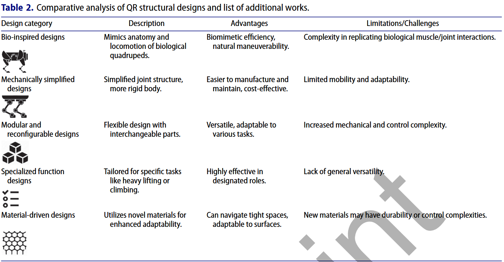
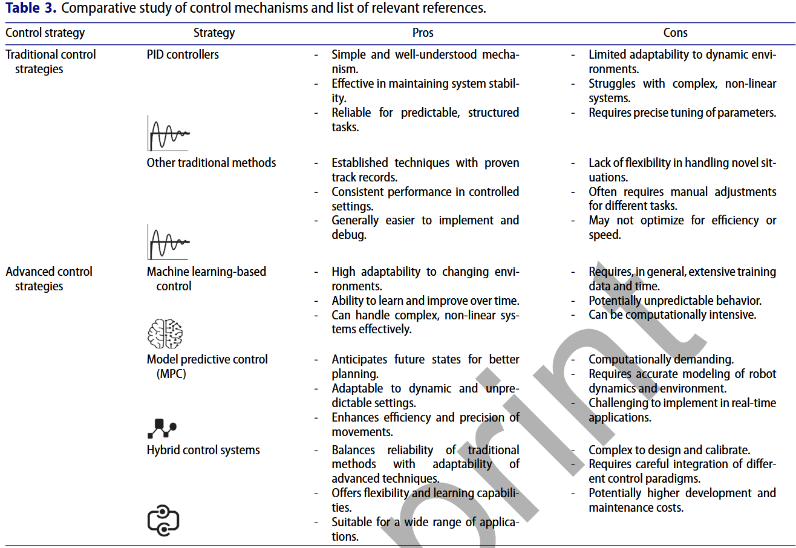
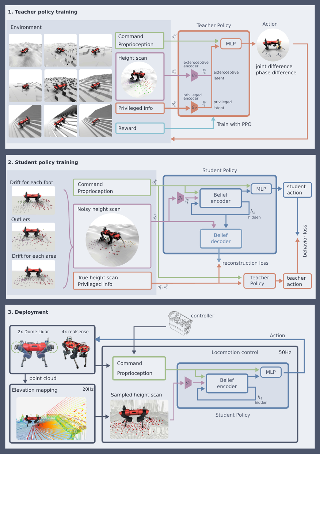
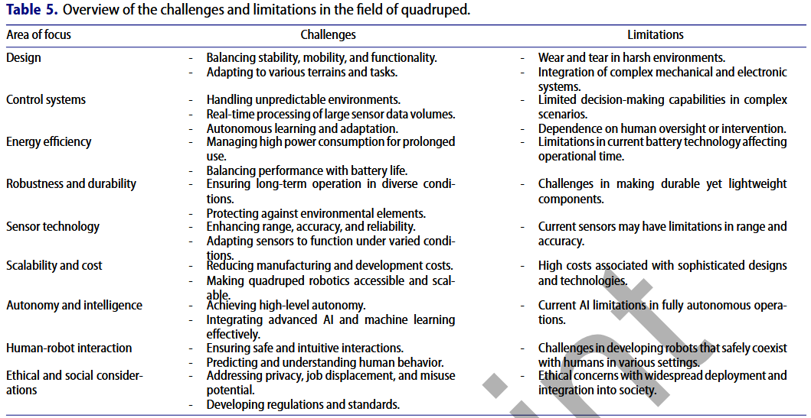

# Smart quadruped robotics: a systematic review of design, control, sensing and perception

## 机器狗与普通移动机器人

### 1. 状态空间与动作空间的维度跃迁
*   **普通轮式机器人**：规划空间通常严格限定在二维李群 $\text{SE}(2)$ 平面流形上，状态向量仅包含三自由度平面位姿 $(x, y, \theta)$ 及线速度、角速度 $(v, \omega)$。其控制输入在时间域上是平滑连续可导的，底盘满足非完整滚动约束。
*   **四足机器狗**：运动系统在数学本质上属于**非线性混杂动态系统**。
    *   **连续状态**：机体在三维空间具有完整的 6-DoF 刚体自由度（$\text{SE}(3)$），附加 12 个关节的广义坐标与角速度，总状态空间高达数十维。
    *   **离散事件跳变**：规划器不能只规划一条平滑的质心轨迹，必须**同步求解四条腿在时空域中的离散接触序列**，即实时决定：每只脚在什么时刻离地、以何种空间轨迹摆动、在什么三维坐标着地。
    *   **耦合求解难点**：机体连续轨迹的可行性完全取决于当前处于支撑相的脚所构成的即时支撑多边形；反之，摆动腿未来的落足可行域又受制于机体现有位姿的运动学可达空间。二者形成复杂的双向非凸约束，极易陷入组合爆炸和局部极小。

### 2. 环境地图表征的升维
*   **普通轮式机器人**：环境地图通常被抽象为二维占据栅格地图。障碍物的判定是二值化的。规划器本质是在无碰撞自由空间中搜索最短欧氏几何路径。
*   **四足机器狗**：四足的跨越与攀爬能力使得“障碍物”与“可行走面”的边界彻底模糊。
    *   **高程图与局部接触网格**：一段 20 cm 的马路牙子、碎石堆或工业楼梯，对轮式无人车是绝对阻挡障碍，但对机器狗却是极佳的通行表面。
    *   **表面物理特征提取**：综述中引述的基底分类研究，规划器输入的地形不能仅是简单的几何点云，必须在线解析地表的**局部倾角（Slope）、表面粗糙度（Roughness）、摩擦系数（Friction Coefficient）以及地质刚度（Stiffness）**。
    *   **几何与物理可通达性评估**：落足点规划器必须计算足端接触面局部的法向量 $\mathbf{n}$，评估落脚后接触力是否能有效锚定而不会发生滑移或陷入。

### 3. 接触物理学的根本逆转
*   **普通轮式机器人**：路径规划的根本公理是 **Collision-Free**。车体与任何环境实体的机械接触都被定义为规划事故或控制失效。
*   **四足机器狗**：**“接触”是其产生推进力的唯一物理来源**。
    
    *   **力学安全边界约束**：每一个规划生成的离散接触点，在动力学层面必须严格满足**库仑摩擦锥约束**：
      $$
      \| \mathbf{f}_t \| \le \mu f_n, \quad f_n > 0
      $$
      其中 $f_n$ 为法向反力，$\mathbf{f}_t$ 为切向切应力，$\mu$ 为摩擦系数。如果规划的机体加减速轨迹过激，将导致足端反力突破摩擦锥而发生打滑；如果足端落于松散基底，还会产生不可逆的沉陷。
    *   **主动利用环境接触**：在如跑酷越障等极限场景下，机器狗甚至需要主动规划机身、小腿与障碍物边缘的物理接触来辅助借力攀爬。对于交互式探测任务，规划器必须从“几何几何几何”转向“力学平衡与接触安全约束”。

### 4. 步态动态震颤带来的感知退化与高频重规划压力
*   **普通轮式机器人**：底盘平稳贴地，机载激光雷达与相机的位姿主要随路面平缓起伏，传感器点云的畸变较小，全局规划器通常以较低频率运行，局部避障以 10–20 Hz 运行即可满足需求。
*   **四足机器狗**：对地交替步态带来无法消除的机体周期性姿态震颤与地面冲击冲击波。
    *   **激光雷达运动畸变**：由于机体俯仰（Pitch）和横滚（Roll）的高频快速切换，单帧雷达点云发生严重的拉扯和拖尾，若缺乏高精度去畸变算法，规划器获取的局部高程图将出现严重的虚假悬崖或浮空障碍。
    *   **高频局部重规划**：由于足端触地时微小的滑移都会导致机体航向与位置漂移，静态规划的路径在数步之后即失去跟踪可行性，要求落足点规划与局部轨迹必须以极高频率与传感器完成闭环。

| 对比维度           | 轮式机器人                                         | 四足机器狗                                                   | 规划设计面对的本质挑战                                 |
| :----------------- | :------------------------------------------------- | :----------------------------------------------------------- | :----------------------------------------------------- |
| **规划状态空间**   | 平面流形 $\text{SE}(2)$：$(x, y, \theta)$ 连续轨迹 | 混杂系统 $\text{SE}(3) \times \mathbb{R}^{12} \times \{0,1\}^4$：6-DoF 刚体 + 12 关节 + 离散步态相 | 连续轨迹与离散步态相序混合整数优化，解空间极其庞大。   |
| **动作生成机制**   | 连续可微的轮速/角速度指令 $(v, \omega)$            | 离散落足位置 $(x_i, y_i, z_i)$、接触时间与机体 3D 动力学轨迹 | 必须协同处理脚印几何选择与机体动力学可行性。           |
| **环境地图模型**   | 2D 占据栅格地图                                    | 2.5D 高程图 / 3D 接触几何网格                                | 障碍物具有“相对性”，需要在线推理地形的“多接触通达性”。 |
| **地表物理感知**   | 基本忽略                                           | 必须感知表面法向量 $\mathbf{n}$、坡度、地表粗糙度、摩擦系数  | 规划必须规避滑移风险与松软塌陷基底。                   |
| **碰撞/接触范式**  | **零碰撞 (Collision-Free)**：接触即失败            | **多接触推进**：必须接触地表才能行进                         | 规划目标转变为“受力可控、不倾覆、不滑移的安全接触”。   |
| **感知与状态反馈** | 底盘运动平滑，传感器观测噪声稳定                   | 周期性剧烈俯仰/横滚震颤，雷达点云运动畸变严重                | 局部规划器需容忍传感器剧烈抖动与突发性触地滑移。       |

---

## 机械与物理构型设计

机构设计构成了规划算法的**物理边界条件**：

---

## Control Mechanisms

> [!NOTE]
> **关于控制模块的边界界定**：低层关节力矩控制与抗推平衡在近几年已取得决定性突破。论文系统梳理了从传统 PID 到现代 MPC 与强化学习的演进全貌。对于从事高层规划的研究者，控制层应当被视作**“提供强鲁棒性速度与姿态跟踪能力的底层执行基石”**，规划层重点在于调用其接口而非重复造轮子。

### 1. 控制策略对比

| 控制架构类别                            | 核心数学/算法方法                                       | 核心优势                                                     | 固有缺陷                                                     | 对规划层的接口定义与角色分工                                 |
| :-------------------------------------- | :------------------------------------------------------ | :----------------------------------------------------------- | :----------------------------------------------------------- | :----------------------------------------------------------- |
| **传统线性/非线性控制**                 | 关节 PID、线性二次型调节器 (LQR)、反馈线性化 (FL)       | 结构简单、原理透彻、确定性强、控制频率高（>1000 Hz）。       | 依赖准确模型参数；面对未知地形冲击适应力差，多关节非线性耦合严重。 | 仅用于最底层的电机电流环与单个关节的位置/速度闭环。          |
| **模型预测控制 (MPC) 与全身控制 (WBC)** | 单刚体 MPC (SRB-MPC)、隐式接触 NMPC、HiLQR-MPC 、QP-WBC | 显式预测未来时域状态；能够主动处理地面反力约束、摩擦锥与电机力矩饱和。 | 非线性多体模型在线计算开销大；高度依赖对接触碰撞时间的离散假设。 | 规划层下发宏观质心轨迹与目标足迹点，MPC 求解各支撑腿的最优接触力，WBC 解算关节力矩。 |
| **深度强化学习 (DRL)**                  | 策略梯度方法 (PPO , TRPO )、Actor-Critic (SAC)、分层 RL | 无需显式动力学建模；对高噪声、粗糙地表及外部推搡具有极其强悍的鲁棒性。 | 黑盒不可解释；难以给出确定性的安全边界证明；极度依赖海量仿真训练。 | 将整机运动控制封装为高鲁棒性策略网络，高层规划器直接下发 3-DoF 期望速度指令 $(v_x, v_y, \omega_z)$。 |
| **混杂与神经协同控制**                  | 中枢模式发生器融合、CPG-RBF 神经网络、虚拟约束控制      | 能够产生极其自然平滑的仿生节律运动；抗非结构化拓扑故障能力好。 | 运动形式多局限于周期性步态，在非周期越障或复杂多接触交互时缺乏灵活性。 | 适用于长距离平坦路面的巡航节能走动，为规划层提供基础周期相位时序。 |

---

## Sensing & Perception

在交互式探测任务中，“信息驱动”的前提是系统能够从多模态传感器中准确提取环境的**几何结构、物理力学属性及机体自车运动状态**。综述将感知系统划分为两大核心部分：状态估计与环境感知。

### 1. 经典感知融合
苏黎世联邦理工团队发表在《Science Robotics》上的代表作该架构彻底解决了**“外感知在非结构化恶劣环境中极易失效而导致致命误判”**的痛点：

#### (1) 现实环境中的外感知失效陷阱
四足机器人在野外与工业废墟中巡检时，仅靠激光雷达与深度相机构建的高程图存在大量“视觉欺骗”：
*   **可穿透性软介质**：茂密的深草丛或松软厚雪，雷达和相机会将其顶端扫描为坚硬支撑面，机器狗按此规划落足高度会产生严重的踏空下坠。
*   **反射与吸收介质**：积水和泥浆会导致红外光或激光发生镜面全反射，在点云中形成假深坑或多径假反射。
*   **光学视线盲区与污损**：工业现场的扬尘、飞溅泥浆遮挡镜头，产生漂移严重的伪障碍物。

#### (2) 基于注意力的循环置信度网络机理 
*   **两阶段训练**：
    *   *Teacher 策略*：在物理引擎中训练能够直接读取没有噪声的**特权信息**，包括完美的网格高程真值、脚底与地面的实际滑动速度、摩擦系数及真实接触力。
    *   *Student 策略*：只能接收现实机载传感器能够采集的**带噪输入**——漂移的本体状态（编码器、IMU）和充满噪声的局部高程扫描。
*   **循环置信度编码器（Belief Encoder）**：
    *   利用注意力机制和递归神经网络隐空间，实时比对**“外感知测得的高程轨迹”**与**“足端实际触地时的力学/运动学反馈”**。
    *   **动态权重裁决**：当脚踩地反馈与视觉点云高度完全一致（如坚固的硬地、台阶），网络输出高置信度，系统信任外感知，机器狗能够提前高抬腿，高速、优雅地大步迈过台阶；
    *   **自适应降级自愈**：一旦足端踩入草丛深处或雪地，感知力矩显示脚下沉降，网络瞬间识别出外感知失真，**自适应抑制外感知输入，权重立刻回退至纯本体感觉闭环**，机器狗立刻收紧步态，转为盲走试探步摸索前行，确保绝不发生失稳跌倒。

### 2. 状态估计与去畸变
*   **运动畸变校正算法（PMF & MDR）**：由于机器狗对地步态的剧烈震颤，激光雷达点云极易拉扯变形。Shao 等 [94] 提出了点图融合（Point-Map Fusion, PMF）算法与运动畸变消除（Motion Distortion Removal, MDR）方法，结合轮腿里程计高频姿态，在点云生成瞬间消除多轴摆动伪影。
*   **因子图多模态紧耦合融合（VILENS & LVIO）**：
    *   Wisth 等 [91] 提出的 **VILENS 系统**，采用因子图优化，将机载 LiDAR、双目相机、IMU 与**四足运动学腿式里程计**深度融合。
    *   *相比传统 UGV 轮式里程计的优势*：轮式小车一旦打滑，轮速计彻底失效；四足狗在任何时刻通常至少有 2–3 只脚与地面保持静态锚定，通过运动学正解即可解算出极高精度的无漂移相对位移约束。

---

## Challenges & Applications

### 1. 落地核心挑战
1.  **Energy Efficiency & Battery Limitations**：
    腿式机器人相比轮式具有极高的基础巡航能耗（摆腿惯量与支撑相电机做功）。在野外大范围勘探中，一旦加装高功率主动激光雷达、防爆外壳及边缘计算卡，电池工作时长通常被压缩至不足 90 分钟，亟需能效最优的步态规划与速度调控策略。
2.  **Wear, Tear and Environmental Hazards**：
    文献专门评估了四足机器人在能源工业（石油、天然气、核电站）中的长期服役性能。足端橡胶磨损、细小沙尘入侵减速机齿轮箱、酸性化学水汽腐蚀以及核辐射对 CMOS 图像传感器和电控板的不可逆损坏，构成了硬件层面的硬性制约。
3.  **Autonomy & Intelligence **：
    目前商业化巡检机器狗多停留在“被动巡航摄影车”的初级阶段（即沿着预设轨迹走动，机载云台拍照测温）。面对复杂场景缺乏自主推理能力，遇到意外阻挡或通道闭锁时，依然严重依赖远程人工操作员接管介入。
4.  **Cobots & Physical HRI **：
    未来的四足狗正逐渐被推向建筑施工监测 、医院环境服务及导盲协作。在与人类共享狭窄通道时，必须建立被动柔顺性与主动避让安全包络，确保在发生意外机械擦碰时绝对不伤人。
