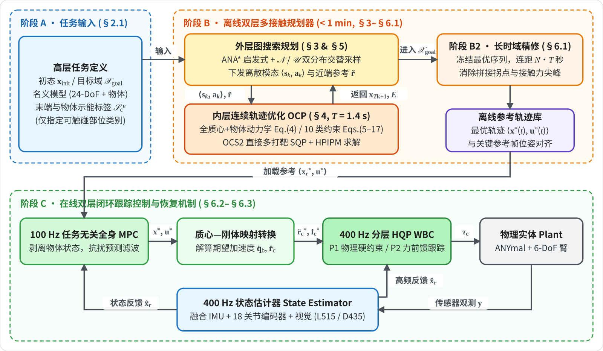
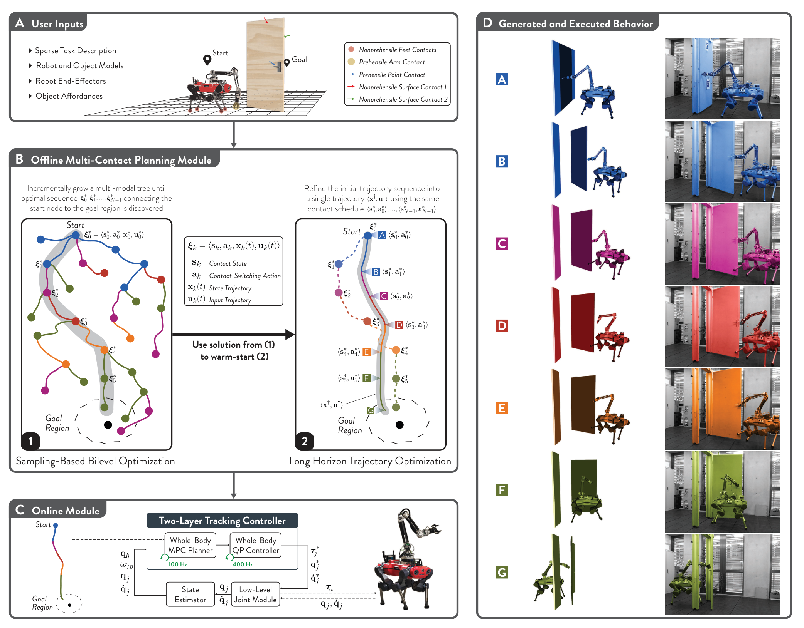
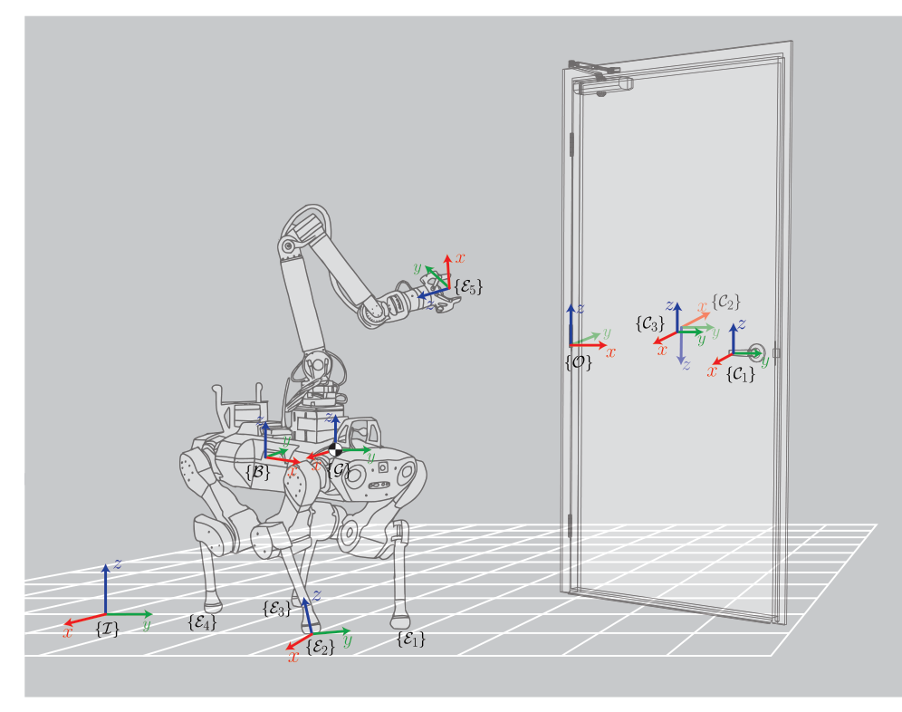
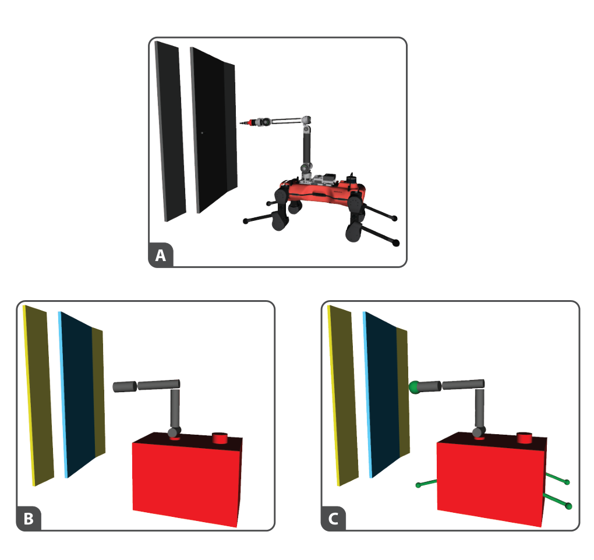
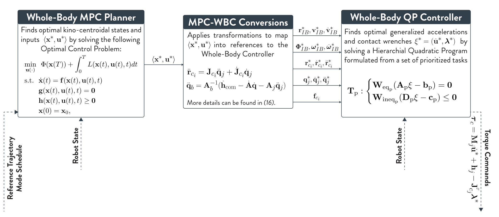
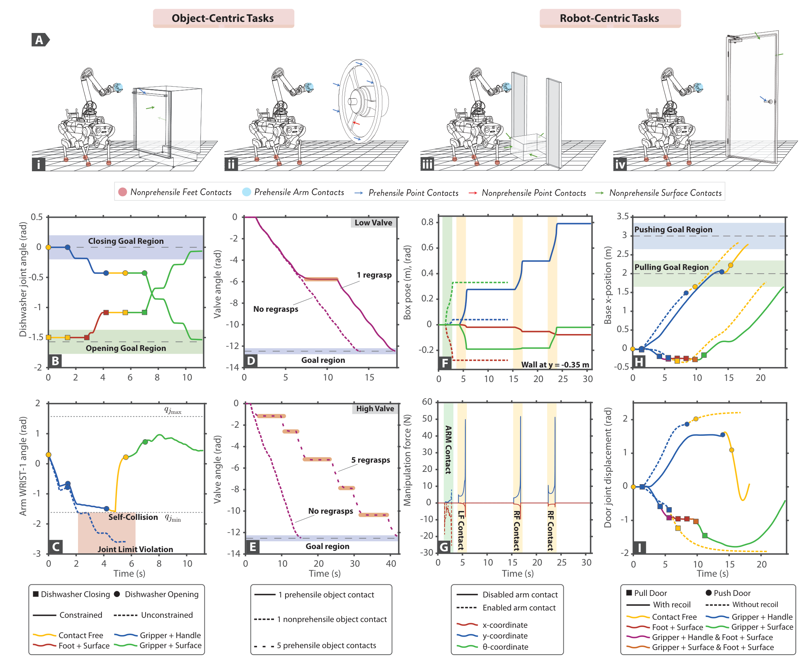
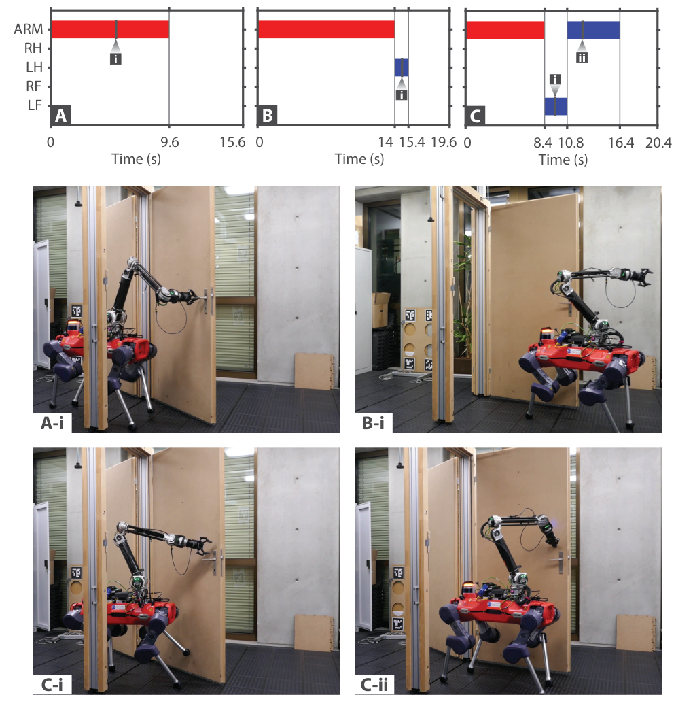
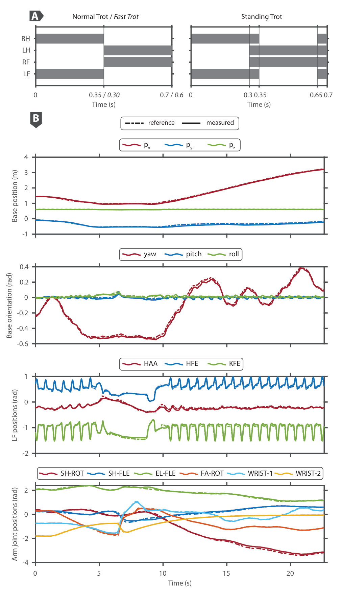
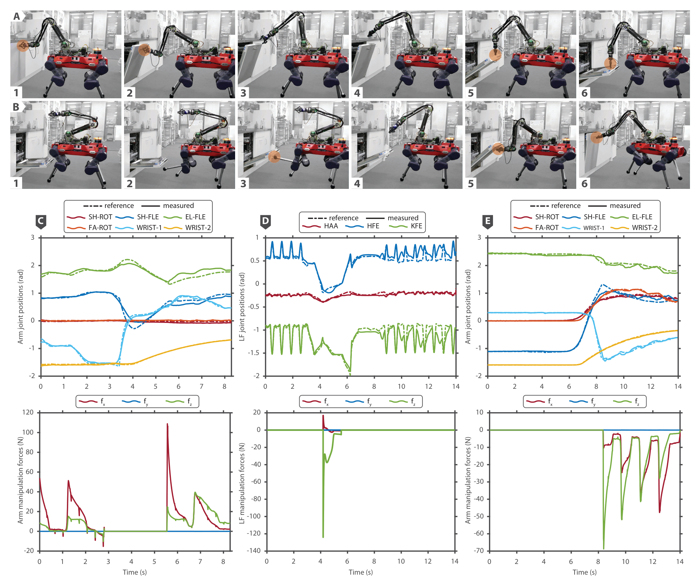
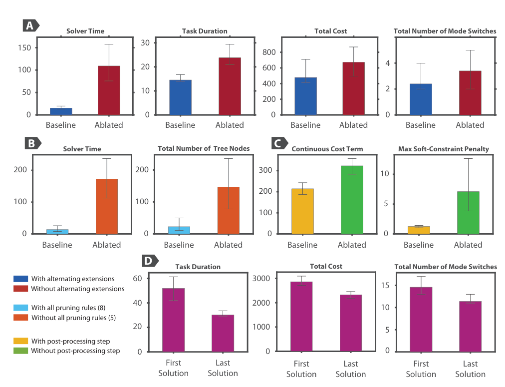

# Versatile Multi-Contact Planning and Control for Legged Loco-Manipulation
---
## 0. 全文导读

### 0.1 论文概况

* **论文标题**：*Versatile Multi-Contact Planning and Control for Legged Loco-Manipulation*
* **研究机构**：ETH Zurich, Robotic Systems Lab (RSL)
* **发表出处**：*Science Robotics*（2023 年 8 月 / `arXiv:2308.09179`）
* **硬件平台**：**ANYmal 四足机器人 + 定制 6-DoF 机械臂**
  * **总计 24 个自由度（24-DoF）**：浮动躯干（基座）空间 6-DoF（前后左右上下平动 + 滚转/俯仰/偏航） + 4 条腿共 12 个驱动关节（每条腿 `HAA` 髋外展、`HFE` 髋俯仰、`KFE` 膝俯仰） + 机械臂 6 个驱动关节（`SH-ROT, SH-FLE, EL-FLE, FA-ROT, WRIST-1, WRIST-2`）。
* **底层数值工具栈**：`OCS2`（[[混杂动力学与模态约束|开关系统]][[最优控制OCP与MPC|最优控制]] C++ 工具箱，开源核心依赖） + `Pinocchio`（多刚体运动学/动力学解析库） + `CppAD`（C++ 自动微分） + **[[二次规划QP与HPIPM|HPIPM]]**（高性能[[二次规划QP与HPIPM|二次规划]]求解器） + **[[符号距离场SDF与松弛障碍函数|FCL / GJK]]**（三维碰撞最小距离库） + **[[ANA星与RRT采样式图搜索|OMPL]]**（最近邻搜索与采样式规划基础设施）。

### 0.2 核心思想概述

传统的移动操作机器狗，要么靠工程师像导演一样逐帧写死“走两步 $\to$ 抬手抓把手 $\to$ 后退 $\to$ 抬脚挡门”，要么靠强化学习调几百个奖励权重。这篇论文反过来：**人类只管告诉机器狗“起点在哪、最终要去哪（目标区域）、你和物体长啥样、物体上哪几块能抓或能推（示能标注）”**，剩下的全部交给一套 **“外层大脑出剧本 + 内层物理引擎试驾打分”** 的双层搜路器——机器狗就会自己根据当前卡不卡关节、撞不撞墙，**自发涌现出“先手拉门 $\to$ 再抬脚卡住弹簧门防弹回 $\to$ 换手按住门内面推开钻过去”的高难度协同动作**。

### 0.3 全文工作流程

| 阶段                   | 运行方式 / 频率                                       | 输入                                                                                                                    | 核心算法 / 方程                                                                                            | 输出                                                                                                                                | 章节              |
| :------------------- | :---------------------------------------------- | :-------------------------------------------------------------------------------------------------------------------- | :--------------------------------------------------------------------------------------------------- | :-------------------------------------------------------------------------------------------------------------------------------- | :-------------- |
| **阶段 A：高层语义输入**      | 离线初始化                                           | 初始状态 $\mathbf{x}_{\text{init}}$、稀疏目标域 $\mathcal{X}_{\text{goal}}$（Eq. 19）、URDF 模型、示能标签 $\mathcal{S}^e, \mathcal{S}^c$ | 动作空间逻辑剪枝规则 $\bar{\mathcal{A}}(\mathbf{s}_k, \mathbf{s}_{k-1}, \mathbf{x}_{T_k})$                     | 合法单肢接触切换动作集 $\bar{\mathcal{A}}$、状态转移映射 $\boldsymbol{\Gamma}$（Eq. 3）                                                               | §2.1, §3.1–§3.3 |
| **阶段 B1：外层采样图搜索**    | 离线双层规划（主循环）                                     | 搜索树 $\mathcal{T}$、正态分布 $\mathcal{N}$、均匀分布 $\mathcal{U}$                                                               | [[ANA星与RRT采样式图搜索\|ANA* 启发式图搜索]]、UCT 分模态子树选择（Eq. 25）、生理限速冻结参考裁剪（Eqs. 20–23）                           | 单段模态调度 $\langle \mathbf{s}_k, \mathbf{a}_k \rangle$、近端参考向量 $\tilde{\mathbf{r}} \in SE(2) \times \mathbb{R}^{n_o}$                 | §2.2, §5.1–§5.3 |
| **阶段 B1（内环）：单段轨迹优化** | 离线双层规划（单次约 $279\text{ ms}$）                     | 父节点终点状态 $\mathbf{x}_{T_k}$、单段模态 $\langle \mathbf{s}_k, \mathbf{a}_k \rangle$、近端参考 $\tilde{\mathbf{r}}$                | [[全质心动力学]]-物体耦合流图（Eq. 4）、10 类接触/避障约束（Eqs. 5–17）、[[SQP与多打靶法\|OCS2 多打靶 SQP]] / [[二次规划QP与HPIPM\|HPIPM]] | 单段 $T=1.4\text{ s}$ 连续轨迹、终端状态 $\mathbf{x}_{T_{k+1}}$、树边代价 $E$（回传搜索树 $\mathcal{T}$）                                                | §4.1–§4.4       |
| **阶段 B2：全局后处理精修**    | 离线后处理（单次求解）                                     | 最优离散序列 $\{\langle \mathbf{s}_k^*, \mathbf{a}_k^* \rangle\}_{k=0}^{N-1}$、拼接轨迹初值                                        | 冻结离散接触序列，在完整时域 $N \cdot T$ 上热启动求解连续 OCP                                                              | 消除拐点及力尖峰的平滑参考轨迹 $\langle \mathbf{x}_r^*(t), \mathbf{u}^*(t) \rangle$                                                              | §6.1            |
| **阶段 C：在线双层跟踪控制**    | 在线实时（$100\text{ Hz}$ MPC / $400\text{ Hz}$ WBC） | 参考轨迹 $\langle \mathbf{x}_r^*, \mathbf{u}^* \rangle$、[[状态估计器与扩展卡尔曼滤波EKF\|400 Hz 状态估计器]]实时反馈 $\hat{\mathbf{x}}_r$       | $100\text{ Hz}$ 全身预测滤波 MPC $\to$ 质心-刚体加速度映射 $\to$ [[分层全身控制WBC与HQP\|400 Hz HQP-WBC]]                  | 18 个驱动关节实时电机力矩 $\boldsymbol{\tau}_c = \mathbf{M}_j \dot{\mathbf{u}}^* + \mathbf{h}_j - \mathbf{J}_{C_j}^T \boldsymbol{\lambda}^*$ | §6.2–§6.3       |

---

## 1. 研究背景（§1）

引言全篇围绕一个核心工程难题展开：**面对一个 24-DoF、[[欠驱动系统|欠驱动浮动基座]]、[[混杂动力学与模态约束|混杂跳跃动力学]]的四足移动操作机器人，如何在不依靠人工逐帧编写接触时刻表的前提下，让它自主决策“用哪只手或哪只脚、在什么时候碰哪里、出多大力”，顺利拉开带弹簧或重摩擦阻尼的大门并安全钻过去？**

作者将前人庞杂的移动操作方案梳理成三条主线，精准指出了各自迈不过去的门槛：

1. **分散模块化拼装 + 手写状态机（以及单模态全身 MPC）**：
   * **代表作**：Boston Dynamics SpotMini 自主开弹簧门展示，以及绝大多数将移动底盘导航与机械臂逆解强行解耦拼装的工程方案。
   * **核心局限**：移动和抓取是力学紧耦合的（你拽门时门会把机器狗往前拽倒），硬拆分后需要针对特定场景做海量手工调参；即便用单模态全身优化框架，也要求工程师**提前写死接触顺序与时间表**，一旦需要“半途换只手推、用脚挡住弹簧门”这类跨越离散拓扑的动作，单模态方法束手无策。
1. **无模型强化学习（RL）与模仿学习（IL）**：
   * **局限 (a) 奖励工程复杂**：长时域多接触稀疏目标任务下，无模型 RL 如果没有极为精细的“稠密奖励函数”（手接近把手给分、推开门给分、走过去给分……），几乎探索不出正确配合，换个类似门又要重调几个星期。
   * **局限 (b) 示教采集与构型鸿沟**：用人类动作捕捉或遥操作做模仿学习，对每个新任务录示教费时费力，且人类双足两手与四足狗背一臂的构型差异太大，动作很难直接重定向迁移。
3. **纯梯度轨迹优化 vs. 纯图搜索/采样式规划**：
   * **[[分支定界与MINLP|`MINLP / MICP`（混合整数非线性/凸规划）]]**：前者复杂度爆炸且陷入非凸极小，后者用凸松弛换可解性却丢失重物大旋转真实动力学；
   * **[[分支定界与MINLP|`CIO / MPCC`（接触隐式优化 / 带互补约束数学规划）]]**：前者易现“隔空施力”幻觉解，后者互补结构太脆极易收敛失败；
   * **传统 RRT/图搜索**（Dalibard 开门、Hauser 多模态树、Murooka 落足重抓）：严重依赖**准静态平衡或 [[支撑多边形与ZMP存活性|`ZMP` 共面支撑假设]]**，既忽略了手臂对物体施展的巨额三维操作反力，也无法产生一边小跑行走（Trot）一边顶推沉重物件的动态协同动作。

**本文解法的核心洞察**：既然物理引擎擅长“算连续动态与避障”、图搜索擅长“搜离散换手顺序”、随机采样擅长“从非凸死胡同里硬拽出新路线”，那就把三者以**规则剪枝后的双层搜路架构**耦合起来！

> **Fig. 1（本文全局四模块流水线）**：**(A) User Inputs** 人类只需给极简高层设定（起止区域、名义模型、肢体与物体示能分类）；**(B) Offline Multi-Contact Planning Module** 包含 `(1)` 基于采样的双层优化生长出五彩斑斓的多模态搜索树（每种颜色代表一种离散接触状态，颜色跳变即发生换手/用脚挡门）与 `(2)` 用所得离散剧本热启动的平滑长时域后处理；**(C) Online Module** 送入 `100 Hz` 全身 MPC + `400 Hz` HQP WBC 闭环跟踪；**(D) Generated and Executed Behavior** 仿真与真机拉弹簧门高度吻合。

---

## 2. 双层混杂优化（§4.1）

### 2.1 问题输入 / 语义标注

“论文里写着洗碗机标出了前表面、把手、后表面 3 个可用交互部位，还有门的质量和弹簧阻尼，这难道是机器狗自己看图猜出来的吗？”**不是。在离线规划阶段，所有这些都由用户（或任务场景配置模块）作为先验输入显式给进算法，属于预建模环境假设**：

1. **几何与运动学“环境地图”**：人类把目标物体（门框墙体、25 kg 洗碗机门、40 kg 大门）写成仿真物理模型文件，包括物体长宽厚、铰链轴在哪里、能转几度、质量与名义摩擦/弹簧阻尼估计值。**在机器狗大脑内部，并不是孤零零只建机器狗自己的物理模型，而是把“机器狗本体 + 当前受操纵物体的运动学和动力学”焊在一起，当成同一个耦合大系统的世界模型！**
2. **示能交互标注**：人类在物体表面框出“哪里允许碰/怎么碰”（如门正面标为“不可抓表面”、门把手标为“可抓握点”、门背面标为“不可抓表面”），并标注机器狗哪些末端能抓东西（只有机械臂夹爪）、哪些不能抓只能踩或顶（4 只球形脚掌）。
3. **稀疏终点目标**：用户只框定起跑态与终点区域（比如“只要底盘走到门后 $(3, 0.5)$ 附近，门最终停在哪都无所谓”）。
具体哪秒抬哪只脚挡门、什么时候松手改用门背面顶推、任务一共要花多少秒！这些高难协同全由系统自动计算“长出来”。
---

### 2.2 混杂优化双层分解（Eqs. 1–2）

想要同时找出最完美的连续身体-物体运动轨线（状态 $\mathbf{x}^*(t)$、控制输入 $\mathbf{u}^*(t)$）以及离散开关模式序列（$\mathbf{z}^*(t)$），最原教旨、不打任何折扣的数学写法是一个**自由终端时间 $t_f$ 的[[分支定界与MINLP|混合整数]][[最优控制OCP与MPC|最优控制]]问题（MIOCP）**：

$$
\begin{aligned}
\boldsymbol{\zeta}^* = \arg\min_{\boldsymbol{\zeta}} \quad & \int_0^{t_f} L(\mathbf{x}, \mathbf{u}, \mathbf{z}) \, dt \\
\text{s.t.} \quad & \dot{\mathbf{x}} = \mathbf{f}_{\mathbf{z}}(\mathbf{x}, \mathbf{u}), \quad \mathbf{x}(0) = \mathbf{x}_{\text{init}} \\
& \langle \mathbf{x}, \mathbf{u} \rangle \in \mathcal{S}_{\mathbf{z}}, \quad \mathbf{x}(t_f) \in \mathcal{X}_{\text{goal}}
\end{aligned} \tag{1}
$$

* **优化变量 $\boldsymbol{\zeta}(t) = \{\mathbf{x}(t), \mathbf{u}(t), \mathbf{z}(t)\}$**：连同不知多长的结尾时间 $t_f$ 一起找。
* **极简代价积分 $\int_0^{t_f} L(\mathbf{x}, \mathbf{u}, \mathbf{z}) \, dt$**：注意**目标本身不写进 $L$ 里！** $L$ 里只放与任务无关的“通用干净习惯”（少用力气 $\mathbf{u}$、躯干高度姿态尽量端正、别没事乱换接触 $\mathbf{z}$）。真正的任务目标全写在结尾最后一条：**$\mathbf{x}(t_f) \in \mathcal{X}_{\text{goal}}$（终点状态只要落进目标域即可）**。
* **模态依赖动力学 $\dot{\mathbf{x}} = \mathbf{f}_{\mathbf{z}}(\mathbf{x}, \mathbf{u})$**：离散模式 $\mathbf{z}$ 一变，物理方程跟着变（比如手抓门时手臂推力直接驱动门转；松手后无论手臂怎么挥舞都不影响门，门全靠弹簧自己弹回去）。
* **[[混杂动力学与模态约束|模态依赖约束可行域]] $\langle \mathbf{x}, \mathbf{u} \rangle \in \mathcal{S}_{\mathbf{z}} := \{\langle \mathbf{x}, \mathbf{u} \rangle \mid \mathbf{g}_{\mathbf{z}}(\mathbf{x}, \mathbf{u}) = \mathbf{0},\ \mathbf{h}_{\mathbf{z}}(\mathbf{x}, \mathbf{u}) \ge \mathbf{0}\}$**：**在某个离散接触模式 $\mathbf{z}$ 下，所有满足该模式特定等式和不等式物理红线的“状态-控制力组合”所围成的合法区域**（如选“脚踩地”模式，就激活“脚底法向压力不能为负、切向力必须在摩擦圆锥内”的区域 $\mathcal{S}_{\mathbf{z}}$）。

> **为什么不能直接用[[分支定界与MINLP|分支定界（Branch-and-Bound）]]暴力硬解 `Eq. (1)`？**
> 分支定界是整数规划的兜底通解：对每一个离散时间步、每一个可能切换动作都裂成一棵组合树，再上下剪枝。但连续轨迹如果每隔 20 ms 离散化一个节点，十几秒就是几百个时间步，每步有几百种可能状态开关，分支因子按 $M^{500}$ **指数爆炸**，外加三维避障非凸，传统 solvers **根本算不动**。

为了把不可算变可算，作者做了**两刀关键结构改造**，将其化成极具可控性的**混杂逻辑双层优化**：

1. **刀法一：粗粒度模态不变分段**：现实开扇门不可能每隔 10 ms 换次手，于是将长轨迹切成若干时长固定为 **$T$（1.2 或 1.4 秒，相当于两轮完整四足跨步周期 `Table S4`）** 的积木段。**同一条积木段内部“手脚操作物体的开关动作 $\langle \mathbf{s}_k, \mathbf{a}_k \rangle$”固定不变**（注意：四足地面行走的小跑换脚周期仍然在段内自动按节拍跑！），交互模式切换只发生在段与段之间的接缝处。
2. **刀法二：语义接触编码与领域剪枝动作集 $\bar{\mathcal{A}}$**：彻底扔掉抽象的 `0/1` 整数变量 $\mathbf{z}(t)$，换成携带明确物理常识的接触状态 $\mathbf{s}_k$ 与切换动作 $\mathbf{a}_k$（第 3 章详拆）。

于是得到了统领全篇的 **双层优化架构 `Eq. (2)`**：

$$
\begin{aligned}
\min_{\{\mathbf{s}_k, \mathbf{a}_k, \mathbf{x}_{T_k}\}} \quad & \sum_{k=0}^{N-1} E(\mathbf{s}_k, \mathbf{a}_k, \mathbf{x}_{T_k}) \\
\text{s.t.} \quad & \langle \mathbf{s}_0, \mathbf{x}_{T_0} \rangle = \langle \mathbf{s}_{\text{init}}, \mathbf{x}_{\text{init}} \rangle, \quad \mathbf{x}_{T_N} \in \mathcal{X}_{\text{goal}} \\
& \mathbf{s}_{k+1} = \boldsymbol{\Gamma}(\mathbf{s}_k, \mathbf{a}_k), \quad \mathbf{a}_k \in \bar{\mathcal{A}}(\mathbf{s}_k, \mathbf{s}_{k-1}, \mathbf{x}_{T_k}) \\
& \mathbf{x}_{T_{k+1}} \in \arg\min_{\mathbf{x}(\cdot), \mathbf{u}(\cdot)} \Big\{ \Phi(\mathbf{x}_T, \tilde{\mathbf{r}}) + \int_0^T \mathcal{L}(\mathbf{x}, \mathbf{u}, \tilde{\mathbf{r}}) \, dt \;\Big|\; \\
&\qquad \mathbf{x}(0) = \mathbf{x}_{T_k}, \quad \dot{\mathbf{x}} = \mathbf{f}(\mathbf{x}, \mathbf{u} \mid \mathbf{s}_k, \mathbf{a}_k), \\
&\qquad \mathbf{g}(\mathbf{x}, \mathbf{u}, t \mid \mathbf{s}_k, \mathbf{a}_k) = \mathbf{0}, \quad \mathbf{h}(\mathbf{x}, \mathbf{u}, t \mid \mathbf{s}_k, \mathbf{a}_k) \ge \mathbf{0} \Big\}
\end{aligned} \tag{2}
$$

**Eq. (2) 双层交互机制**

* **外层决定 4 件事**：总共要接多少段 $N$（事先未知，到了 $\mathcal{X}_{\text{goal}}$ 才停）、每段选什么状态 $\mathbf{s}_k$、执行什么切换动作 $\mathbf{a}_k$（必须从逻辑剪枝库 $\bar{\mathcal{A}}$ 中抽卡，注意它同时参考了前一步状态 $\mathbf{s}_{k-1}$ 以防“刚抓上立刻松手”），使得整条路线的边权之和 $\sum E$ 尽量小。
* **外层派单给内层**：喂给内层三个输入——起点实况 $\mathbf{x}_{T_k}$、这段剧本 $\langle \mathbf{s}_k, \mathbf{a}_k \rangle$、以及一个在工作空间随机挑来**专门用于指方向牵引**的参考目标 $\tilde{\mathbf{r}} \in \mathcal{R} \subseteq \mathbb{R}^{n_x}$。
* **内层（即单段连续 [[最优控制OCP与MPC|OCP（Optimal Control Problem，最优控制问题）]]）干什么**：在这固定 $T = 1.4\text{ s}$ 和固定 $\langle \mathbf{s}_k, \mathbf{a}_k \rangle$ 内，在必须严格遵守物理方程 $\mathbf{f}$ 和全部物理约束 $\mathbf{g}, \mathbf{h}$ 的前提下，寻找一条连续状态输入轨线，使“自身稳态正则 + 追随参考点 $\tilde{\mathbf{r}}$”总代价最小，然后把第 $T$ 秒真正安全抵达的物理状态 $\mathbf{x}_{T_{k+1}}$ 交回给外层，作为外层搜索树里的**下一个节点**！
* **边权 $E$（即外层判断这段路好坏的真正打分）到底由什么组成？**
  $$
  \begin{aligned}
  E &= \underbrace{\text{离散换手惩罚}(100)}_{\text{少换手}} \\
    &\quad + \underbrace{\text{连续物理能耗与姿态正则}}_{\text{不计追踪随机点 }\tilde{\mathbf{r}}\text{ 的误差}} \\
    &\quad + \underbrace{100 \times \text{Merit 约束违背项}}_{\text{物理违规重罚}}
  \end{aligned}
  $$
  * **什么是 Merit 项？** 内层在 1.4 秒求解时，一些不等式（如距离壁障、关节极限）为了防止 QP 卡死是“先通过松弛屏障软惩罚塞进优化器的”。如果某条路径虽然勉强给出结果，实际上出现了轻微擦碰或挤过限位，这个“违背约束有多严重”的数值指标就叫 **Merit（评价罚项）**，在 `Table S4` 里被赋予 `100` 的极高惩罚权重！
  * **关键巧思：为什么边权 $E$ 算的是连续代价+Merit，却故意不算追逐 $\tilde{\mathbf{r}}$ 的误差？** 因为 $\tilde{\mathbf{r}}$ 只是为了帮内层摆脱局部陷阱而**随机采样**画的一张“引导草稿点”，如果连没追上这张草稿点也要记入真实路线边权 $E$，等于让随机噪声污染全局路线优劣排序！所以内层“按 $\tilde{\mathbf{r}}$ 指引拼命往前试开”，外层评估路段得分 $E$ 时**只考核你费没费油（连续正则）、违没违章（Merit）以及换没换手（切换惩罚）**。

---

## 3. 外层离散状态机（§4.2）

现在先拆解 `Eq. (2)` 的前半截：外层的 $\mathbf{s}_k, \mathbf{a}_k, \boldsymbol{\Gamma}, \bar{\mathcal{A}}$ 到底长什么样？

### 3.1 离散接触状态空间定义（$\mathbf{s} \in \mathcal{S}$）

设机器人共有 $n_e$ 个可以与物体交互的末端执行器，物体上共标出了 $n_c$ 个交互部位（外加编号 `0` 代表**悬空自由、没碰物体任意一处**）：
* 在 ANYmal + 臂平台中：**$n_e = 5$**（左前脚 LF、右前脚 RF、左后脚 LH、右后脚 RH、手臂夹爪 ARM）；
* 若洗碗机标出了前表面（1）、把手（2）、后表面（3），则 **$n_c = 3$**，每个末端的可选号码集合为 $\{0, 1, 2, 3\}$（共 $n_c + 1 = 4$ 种状态）。

**注意不要搞反指数**！机器人身上的 5 个末端各自独立选一个去碰哪里，等价于有 **$n_e = 5$ 个槽位**，每个槽位只能从 $\{0, 1, \dots, n_c\}$ 中取 1 个数字，因此离散接触状态空间是集合的 **$n_e$ 次笛卡尔幂**：

$$\mathbf{s} \in \mathcal{S} := \{0, 1, \dots, n_c\}^{n_e}$$

向量 $\mathbf{s}$ 的长度永远等于机器人末端数 **$n_e$**（而不是物体接触点数 $n_c$）！例如论文中假设有 3 个末端、2 个物体点时给出的示例 $\mathbf{s} = (0\ \ 0\ \ 2)$（长度 3 = $n_e$）：第 1、2 个末端正处于 `0`（自由不碰物体），第 3 个末端正碰着物体第 2 号部位。在本机 $n_e = 5$ 上，刚准备拉门那瞬间就是 $\mathbf{s} = (0, 0, 0, 0, 1)$（4 条腿只顾走地不碰门，手臂正操作 1 号把手）。

*(注：地面在本文只视作机器人默认的行走支撑平面，脚踩地/抬脚走路由时基步态控制，不占用 $n_c$ 的物体编号。)*

### 3.2 单肢切换动作 $\mathbf{a}_k$ 转移映射（Eq. 3）

如果在同一条 1.4 秒积木内允许 5 只手脚**同时**断开或建立不同接触，组合空间瞬间炸裂（$4^5 = 1024$ 种单步转移）。因此作者效仿非周期足式规划与灵巧操作，制定铁律：**每一步离散切换 $\mathbf{a}_k$ 最多只允许改变 1 个末端的状态！**

动作编码压缩成一个仅仅包含两个数字的小二元组 $\mathbf{a} \in \{0, 1, \dots, n_e\} \times \{0, 1, \dots, n_c\}$，第一个数 $a_k[1]$ 指“点名几号末端”，第二个数 $a_k[2]$ 指“它要换去几号物体位置”：
* **保持动作（No-switch）**：$a_k[1] = 0$（只要第一个数字写 0，代表所有末端都不切换与物体的接触状态，纯粹继续当前推行或纯走动）；
* **断开接触动作（Break）**：$a_k[1] = e > 0$ 且 $a_k[2] = 0$（点名第 $e$ 号末端立刻松开/离开当前触碰物体，变回 `0`）；
* **建立接触动作（Establish）**：$a_k[1] = e > 0$ 且 $a_k[2] = c > 0$（点名第 $e$ 号末端伸过去新建与第 $c$ 号物体部位的接触）。

对应的确定性状态转移方程 $\mathbf{s}_{k+1} = \boldsymbol{\Gamma}(\mathbf{s}_k, \mathbf{a}_k)$ 极其干脆：
$$
s_{k+1}[i] = \begin{cases}
s_k[i], & \text{if } i \neq a_k[1] \\
a_k[2], & \text{if } i = a_k[1]
\end{cases} \qquad \forall i = 1, \dots, n_e \tag{3}
$$

**带入具体数值逐步演算**：
* 假设当前 $n_e = 5$，处于 $\mathbf{s}_k = (0, 0, 0, 0, 1)$（只有第 5 个手臂抓着 1 号把手）。
* 现在外层拍出一张单肢切换牌 $\mathbf{a}_k = (1, 3)$（点名第 1 号末端左前脚去建立 3 号门背面接触）：
  * $i=1$ 时刚好等于 $a_k[1]$，直接被覆写为 $a_k[2] = 3$；
  * $i=2,3,4,5$ 全都不等于 $1$，全部原封不动抄下来！
  * 于是下一段进入的离散状态立刻更新成 $\mathbf{s}_{k+1} = (3, 0, 0, 0, 1)$（**左手/手臂还死死拉着把手的同时，左前脚 LF 已经卡到门背表面上了，** 这就是真机拉门多肢协同动作的离散步序）。

### 3.3 语义交互动作剪枝

即便每次只换 1 个末端，如果不加约束，$5 \times 4 = 20$ 种动作还是有很多毫无道理的垃圾组合（比如“让没长手指的四足脚掌去抓圆柱门把手”、“手还抓着 1 号把手还没松呢，就想直接瞬移去碰 3 号背面”）。为此，依托用户在 `Fig. 1A` 给的语义标签，把全部动作空间 $\mathcal{A}$ 剪掉废牌，只留下合法动作集 $\bar{\mathcal{A}}$：

* **末端语义标签**：足端 $\mathcal{S}^e_{\text{foot}}$ vs. 臂端 $\mathcal{S}^e_{\text{arm}}$；抓持末端 $\mathcal{S}^e_{\text{preh}}$（能咬合锁定旋转） vs. 非抓持末端 $\mathcal{S}^e_{\text{nonpreh}}$（只能单向压/顶/推）；
* **物体部位语义标签**：抓持特征 $\mathcal{S}^c_{\text{preh}}$（把手等） vs. 非抓持特征 $\mathcal{S}^c_{\text{nonpreh}}$；其中非抓持又分点特征 $\mathcal{S}^c_{\text{point}}$ vs. 面特征 $\mathcal{S}^c_{\text{surface}}$。

论文 `§4.2` 与 `§S7` 重点明确了以下 4 条核心剪枝逻辑（原文 `§S7` 提及全套共有 8 条逻辑规则、消融实验中删去了其中的 Rules 1, 3, 4；正文与附录中明确印出了下面这 4 条）：
1. **防物理鬼畜（Rule 1，`§S7` 明注）**：如果上一步刚费劲建立一个新接触（从 `0` 变成非 `0`），这一步绝对**禁止立刻在同一肢体上选择断开回 `0`**——这正是 `Eq. (2)` 的合法集函数 $\bar{\mathcal{A}}(\mathbf{s}_k, \mathbf{s}_{k-1}, \mathbf{x}_{T_k})$ 里**必须额外把上一步历史状态 $\mathbf{s}_{k-1}$ 传进去**的根本原因！
2. **禁止空中隔空换位（`§4.2` 明注）**：一个末端只有在原本处于 open (`0`) 空闲状态时，才允许建立新接触；手正握着 1 号点时想要换到 3 号面，必须拆成两步（先 `(e, 0)` 撤离断开，再 `(e, 3)` 建新接触）。
3. **点接触独占法则（`§4.2` 明注）**：像小把手或阀门辐条这样的点状部位 $c_i \in \mathcal{S}^c_{\text{point}}$，同一时刻最多只能被单一肢体占据；而宽大的平面 $c_i \in \mathcal{S}^c_{\text{surface}}$ 允许两个肢体同时压在上面交接！
4. **末端—示能匹配约束（`§4.2` 明注）**：非抓持型机器人末端（如球形四足脚掌）绝不准配对给需要手指扣合的抓持物体特征（如把手）。

---

## 4. 内层连续轨迹优化（§4.3, §S1–S4）

> **本章在全框架中的接线口**：外层第 3 章每次抽出一张合法剧本卡 $\langle \mathbf{s}_k, \mathbf{a}_k \rangle$ 并由第 5 章指派一个近端参考坐标 $\tilde{\mathbf{r}}$，全部送入本章构建的**单段 $T = 1.4\text{ s}$ 连续最优控制问题（OCP）** 里实战验算。本章由浅入深拆透它的“变量定义 $\to$ 动力学流图 $\to$ 10 类开关约束 $\to$ 极简代价与数值求解器”。

---

### 4.1 坐标系、状态及控制输入（§S1）

> **Fig. S1（机器人-物体坐标系图解）**：惯性世界系 $\{\mathcal{I}\}$（固定在地上）；基座系 $\{\mathcal{B}\}$（固连在机器狗躯干中心）；质心系 $\{\mathcal{G}\}$（坐标轴永远平行世界系 $\{\mathcal{I}\}$、原点贴死整只机器狗瞬时质心）；5 个末端局部系 $\{\mathcal{E}_1\}\dots\{\mathcal{E}_5\}$；物体参考系 $\{\mathcal{O}\}$ 与 $n_c$ 个交互接触帧 $\{\mathcal{C}_1\},\{\mathcal{C}_2\},\{\mathcal{C}_3\}$。**重要符号习惯**：论文所有公式中，凡是左下标未注明所在坐标系的向量，**默认全部投影表达在惯性世界系 $\{\mathcal{I}\}$ 中**；写了左下标如 ${}_{\mathcal{C}_i}\mathbf{f}_{e_i}$ 或 ${}_{\mathcal{O}}\mathbf{w}_{e_i}$，则指转到了接触帧 $\{\mathcal{C}_i\}$ 或物体帧 $\{\mathcal{O}\}$ 下表达。

在 `§4.3` 中，作者直接将机器人和物体的连续联合状态与[[控制视角与输入输出反向定义|系统控制输入]]定义为：

$$\mathbf{x} := (\mathbf{x}_r \ \ \mathbf{x}_o) = (\mathbf{h}_{\text{com}} \ \ \mathbf{q}_b \ \ \mathbf{q}_j \ \ \mathbf{q}_o \ \ \mathbf{v}_o), \qquad \mathbf{u} = (\mathbf{w}_e \ \ \mathbf{v}_j)$$

| 向量符号                                                                                                   | 维度 / 物理含义                                                                                                                                                                                                                          |
| :----------------------------------------------------------------------------------------------------- | :--------------------------------------------------------------------------------------------------------------------------------------------------------------------------------------------------------------------------------- |
| **机器人连续状态 $\mathbf{x}_r = (\mathbf{h}_{\text{com}}, \mathbf{q}_b, \mathbf{q}_j) \in \mathbb{R}^{30}$** | 全身质心 6 维线/角动量 $\mathbf{h}_{\text{com}} = (\mathbf{p}_{\text{com}}, \mathbf{l}_{\text{com}}) \in \mathbb{R}^6$ + 浮动基座 6-DoF 广义位姿 $\mathbf{q}_b \in \mathbb{R}^6$ + 18 个驱动关节角 $\mathbf{q}_j \in \mathbb{R}^{18}$（4 腿 12 维 + 机械臂 6 维） |
| **受操作物体连续状态 $\mathbf{x}_o = (\mathbf{q}_o, \mathbf{v}_o) \in \mathbb{R}^{2n_o}$**                      | 受操纵物体的[[广义坐标与广义力\|广义坐标与广义速度]]（如洗碗机/门/阀门的开合角与角速度 $q_o, v_o$ 共 2 维；可移动箱子的平面位姿与速度 $x, y, \theta, \dot{x}, \dot{y}, \dot{\theta}$ 共 6 维）                                                                                               |
| **系统控制输入 $\mathbf{u} = (\mathbf{w}_e, \mathbf{v}_j) \in \mathbb{R}^{6n_e + 18}$**                      | $n_e=5$ 个交互末端的[[广义坐标与广义力\|广义接触扳手]] $\mathbf{w}_{e_i} = (\mathbf{f}_{e_i}, \boldsymbol{\tau}_{e_i}) \in \mathbb{R}^6$（接触力 + 纯力矩） + 18 个驱动关节的期望角速度 $\mathbf{v}_j \in \mathbb{R}^{18}$                                                |

**两个关键建模问题解析**：
1. **为什么机器人的关节速度 $\mathbf{v}_j$ 跑到了控制输入 $\mathbf{u}$ 里，而不在状态 $\mathbf{x}$ 里？**
   * 因为本文采用**一阶运动学+质心动力学建模**：在离线规划和 MPC 层，我们不直接控制电机电流/加速度，而是把“期望关节转速 $\mathbf{v}_j$”和“期望末端力旋量 $\mathbf{w}_e$”当成每毫秒可调的控制输入 $\mathbf{u}$；关节角只要满足 $\dot{\mathbf{q}}_j = \mathbf{v}_j$ 直接一阶积分就得到，因此状态里不重复存放 $\mathbf{v}_j$（这把机器人维度压低、计算速度翻倍，最终底层电机所需的力矩留到 `§6.2` 的 400 Hz WBC 里再逆动力学反算！）。
2. **那为什么物体的速度和位置 $(\mathbf{q}_o, \mathbf{v}_o)$ 必须双双放进状态 $\mathbf{x}$ 里？**
   * 因为门、箱子身上**没有长任何机器狗能直接控制的电机**！门什么时候减速停下、箱子撞墙弹不弹回，全取决于牛顿第二定律对 $\mathbf{v}_o$ 进行积分的结果（受惯性 $\mathbf{M}_o$、摩擦弹簧 $\mathbf{b}_o$ 和手/脚施加的推拉力 $\mathbf{w}_e$ 驱动），所以 $\mathbf{v}_o$ 必须是连续积分演化出来的物理状态！

完整的交互末端动态分类集合：

| 类别        | 集合符号                                                                                                 | 定义 / 物理含义                             |
| :-------- | :--------------------------------------------------------------------------------------------------- | :------------------------------------ |
| **接触态划分** | $\mathcal{S}^e_{\text{open}}, \ \mathcal{S}^e_{\text{ground}}, \ \mathcal{S}^e_{\text{object}}$      | 悬空无接触末端集、正稳踩地面支撑腿集、**全程稳定闭合碰着物体**的末端集 |
| **切换态划分** | $\mathcal{S}^e_{\text{break}}, \ \mathcal{S}^e_{\text{establish}}$                                   | 当前积木段内正在断开物体的末端集、正在伸出去碰物体的末端集         |
| **合并驱动集** | $\mathcal{S}^e_{\text{switch}} = \mathcal{S}^e_{\text{break}} \cup \mathcal{S}^e_{\text{establish}}$ | 本段正在做切换过渡动作的末端集合                      |
| **交互激活集** | $\mathcal{S}^e_{\text{active}} = \mathcal{S}^e_{\text{switch}} \cup \mathcal{S}^e_{\text{object}}$   | **全部正对物体产生力作用（或切换瞬态涉入碰撞交互）** 的末端总集    |

---

### 4.2 系统动力学建模（§S2, Eq. 4）

作者在动力学流图 $\dot{\mathbf{x}} = \mathbf{f}(\mathbf{x}, \mathbf{u} \mid \mathbf{s}, \mathbf{a})$ 中摒弃了轻质无臂假设和准静态质心投影，**将[[全质心动力学]]（FCD）、机器人一阶运动学与受操作物体全刚体动力学**统一进同一组六行常微分方程中：

$$
\begin{cases}
\dot{\mathbf{p}}_{\text{com}} = \displaystyle\sum_{i=1}^{n_e} \mathbf{f}_{e_i} + m\mathbf{g} \\
\dot{\mathbf{l}}_{\text{com}} = \displaystyle\sum_{i=1}^{n_e} \left( \mathbf{r}_{\text{com}, e_i}(\mathbf{q}_r) \times \mathbf{f}_{e_i} + \boldsymbol{\tau}_{e_i} \right) \\
\dot{\mathbf{q}}_b = \mathbf{A}_b^{-1}(\mathbf{q}_r)\left(\mathbf{h}_{\text{com}} - \mathbf{A}_j(\mathbf{q}_r)\dot{\mathbf{q}}_j\right) \\
\dot{\mathbf{q}}_j = \mathbf{v}_j \\
\dot{\mathbf{q}}_o = \mathbf{v}_o \\
\dot{\mathbf{v}}_o = \mathbf{M}_o^{-1}(\mathbf{q}_o)\left( \displaystyle\sum_{e_i \in \mathcal{S}^e_{\text{active}}} {}_{\mathcal{O}}\mathbf{J}_{o,e_i}^T(\mathbf{q}_o, \mathbf{q}_r) \, {}_{\mathcal{O}}\mathbf{w}_{e_i} - \mathbf{b}_o(\mathbf{q}_o, \mathbf{v}_o) \right)
\end{cases} \tag{4}
$$

1. **第 1 行（质心平动动量变化率 $\dot{\mathbf{p}}_{\text{com}}$）**：全身总线性动量的导数 = 5 个末端（4 条腿脚 + 1 个手臂）对环境施加的**全部接触力之和** + 整机重力 $m\mathbf{g}$。（注：这里 $\mathbf{f}_{e_i}$ 按牛顿第三定律记法：脚踩地推地面时地面反推机器人向上的支撑力使机器人跃起；手把门往前推时门的反作用力也同步作用在质心动量上，实现机器狗“借力倚门”的动态平衡！）
2. **第 2 行（质心角动量变化率 $\dot{\mathbf{l}}_{\text{com}}$）**：围绕全身瞬时质心的角动量变化 = 每处接触力臂 $\mathbf{r}_{\text{com}, e_i} \times \mathbf{f}_{e_i}$ 产生的力矩之和 + 抓手扭转关节时的纯力矩 $\boldsymbol{\tau}_{e_i}$（非抓持点此项严格为 `0`）。
3. **第 3 行（全质心耦合法则还原浮动基座速度 $\dot{\mathbf{q}}_b$）**：质心总动量 $\mathbf{h}_{\text{com}} = (\mathbf{p}_{\text{com}}, \mathbf{l}_{\text{com}}) \in \mathbb{R}^6$ 与全身所有广义坐标时间导数 $(\dot{\mathbf{q}}_b, \dot{\mathbf{q}}_j)$ 之间由质心动力学矩阵 $\mathbf{A}(\mathbf{q}_r) = [\mathbf{A}_b \;\; \mathbf{A}_j] \in \mathbb{R}^{6\times (6+n_j)}$ 精确连接，即 $\mathbf{h}_{\text{com}} = \mathbf{A}_b \dot{\mathbf{q}}_b + \mathbf{A}_j \dot{\mathbf{q}}_j$。**反解一下**：把手臂和腿自身挥舞带走的那部分动量 $\mathbf{A}_j\dot{\mathbf{q}}_j$ 从总动量里扣掉，再左乘 $\mathbf{A}_b^{-1}$，就能极其真实地算出躯干到底会怎么歪、怎么退！
4. **第 4、5 行（一阶积分）**：关节位置导数等于控制输入关节速度 $\mathbf{v}_j$；物体位置导数等于物体状态速度 $\mathbf{v}_o$。
5. **第 6 行（受操作物体的全刚体动力学 $\dot{\mathbf{v}}_o$）**：**只把当前真正活跃干活的末端集合 $e_i \in \mathcal{S}^e_{\text{active}}$ 施加在物体上的旋量 ${}_{\mathcal{O}}\mathbf{w}_{e_i}$ 累加起来**，通过物体接触雅可比转置 ${}_{\mathcal{O}}\mathbf{J}_{o, e_i}^T$ 变成推动物体的广义力矩，减去物体自身的摩擦力/弹簧阻尼等非线性阻抗 $\mathbf{b}_o(\mathbf{q}_o, \mathbf{v}_o)$，除以物体广义质量阵 $\mathbf{M}_o(\mathbf{q}_o)$ 就得到物体下一瞬间的加速度！

论文四个仿真和实机大场景对应的物体名义参数见 `Table S1`：

| 受操作物体 | 物体状态 $\mathbf{x}_o$ 维度 | 位置依赖阻抗项 $\mathbf{b}_o(\mathbf{q}_o)$ | 速度依赖阻抗项 $\mathbf{b}_o(\mathbf{v}_o)$ | 质量 (kg) |
| :--- | :---: | :--- | :--- | :---: |
| **Dishwasher（洗碗机门）** | 2 ($q_o, v_o$) | — | $20\tanh(20v_o)$（拟合高静摩擦门轴阻尼） | 25 |
| **Valve（工业大阀门）** | 2 ($q_o, v_o$) | — | $\tanh(v_o)$（轻度静态摩擦阻尼） | 2 |
| **Door（带弹簧大门）** | 2 ($q_o, v_o$) | $15\tanh(15q_o)$（强非线性关门弹簧回弹） | $10v_o$（线性黏性阻尼） | 40 |
| **Box（可移动阻塞箱）** | 6 ($x,y,\theta$ 及各自速度) | — | $\begin{bmatrix} \sum_{i=1}^4 [\mathbf{F}_{f_i}]_{x,y} \\ \sum_{i=1}^4 [\mathbf{r}_{o,f_i} \times \mathbf{F}_{f_i}]_z \end{bmatrix}$，其中 4 个箱底角点各按 $\mathbf{F}_{f_i} = 3.4\tanh(3.4\mathbf{v}_{f_i})$ 拟合 $\mu=0.7$ 干摩擦黏滑效应 | 2 |

> **为什么 `Table S1` 里的静摩擦全写成双曲正切 $\tanh(k v)$ 而不是阶跃符号函数 $\text{sign}(v)$？**
> 因为内层要用基于梯度的 SQP 算一阶导数！库仑干摩擦在速度过零瞬间从 $+F$ 跳变到 $-F$，导数在这里无穷大直接让优化器崩溃；乘大系数 $20\tanh(20 v)$ 既有“未动先死扛、一动平滑放行”的黏滑特性，又在零点附近光滑连续可微。

**全质心动力学 vs. SRBM**
在只负责纯跑跳的 [[Quad-SDK#4.1 单刚体模型（Single Rigid Body, SRB）|Quad-SDK §4.1]] 中，四条腿轻且只在支撑地面短暂蹬踏，因此整条机器狗被简化成 **[[单刚体模型SRBM|单刚体长方体（SRBM）]]**——直接假定“腿怎么甩也不影响躯干惯量和角动量”。
而在本文面向 **ANYmal + 重型 6-DoF 机械臂** 的多接触任务中，SRBM 在两件事上彻底失效：(1) 长机械臂伸开、回缩或抱门时，整机瞬时质心和惯量剧烈变化；(2) **机械臂快速甩臂、或高抬一条腿跨过去顶门时，关节角动量项 $\mathbf{A}_j(\mathbf{q}_r)\dot{\mathbf{q}}_j$ 对基座产生的反冲倾覆力矩绝不可忽略！**

---

### 4.3 模态约束 / 几何避障（§S3, Eqs. 5–17）

为什么本文只需要一份极简通用的代价矩阵，就能既会开洗碗机、又会拧五次阀门、还能一脚踢开挡路箱？**答案全在这一节的 13 个公式里：把所有物理交互行为直接建模成“在什么模式下必须满足哪些数学边界”。** 当机器臂拧门把快撞上关节极限（`Eq. 5`）或快打中自己底盘（`Eq. 6`）时，连续路被约束封死，外层只好换手换脚绕着走！

**A. 全程持续约束**

1. **关节角度、速度与物体工作空间物理极限**：
   $$
   \begin{cases}
   \mathbf{q}_r^{\min} \le \mathbf{q}_r \le \mathbf{q}_r^{\max}, & \mathbf{q}_o^{\min} \le \mathbf{q}_o \le \mathbf{q}_o^{\max} \\
   \mathbf{v}_r^{\min} \le \mathbf{v}_r \le \mathbf{v}_r^{\max}, & \mathbf{v}_o^{\min} \le \mathbf{v}_o \le \mathbf{v}_o^{\max}
   \end{cases} \tag{5}
   $$
   *(这就是洗碗机开门实验中 `WRIST-1` 腕关节撞到 $q_{j_{\min}}$ 红线被迫触发松手切换的直接原因！)*
2. **持续全身自碰与环境障碍最小符号距离避障（FCL / GJK）**：
   $$\mathbf{d}(\mathbf{x}_r, \mathbf{x}_o) - \epsilon \cdot \mathbf{1}_{n_p \times 1} \ge \mathbf{0}_{n_p \times 1} \tag{6}$$
   其中 $\epsilon \ge 0$ 是最小安全裕度，$\mathbf{d} \in \mathbb{R}^{n_p}$ 是借助 `FCL`（Flexible Collision Library）中的 `GJK` 凸包最近距离算法算出的一组几何包络体之间的有向距离（正值表示未撞且隔开距离，负值表示穿模碰撞）。

> **Fig. S2（避障与接触的“死锁悖论”及巧妙破解）**：**(A)** ANYmal 与大门真实参考网格；**(B)** 用圆柱、球、长方体凸包近似出**持续开启避障**的主干几何体（如躯干外壳、雷达、门框墙黄块、门板蓝块、机械臂上连杆等），无论何时绝不允许相撞；**(C)** **接触依赖型避障体（绿色末节）**：想让末端“摸到并推门（距离=0）”的同时又加一道硬避障规则“末节与门距离永远 $\ge \epsilon$”，优化器会瞬间左右互搏原地死锁！因此作者将四条小腿末节与机械臂末端夹爪这几颗**绿色碰撞体设置为条件开关**：**只在对应末端处于悬空 (`open`) 或刚断开/正靠近 (`switch`) 阶段时纳入避障检验；一旦稳定贴合建立接触，就把对应这一对之间的避障锁临时撤掉！**
---

**B. 模态依赖接触约束（Contact-driven）**

在读 `Eqs. (7)–(17)` 前，必须先看懂底层的**时间切换发条**——外层只给出了这一段时长 $T = 1.4\text{ s}$ 里哪个手臂要换手（$\mathbf{s}_k, \mathbf{a}_k$），但积木段里面的四条腿还要按固定小跑节奏踩地抬腿，刚撤离的手还要花前 0.2 秒退开、刚去抓的手要在最后时刻闭合夹紧……**这些片段内部的时变节拍是如何优雅放进统一 OCP 里的？**

**ModeSchedule 与圆锥正则**

整个杂乱的时变开关被浓缩成区区两个一维数组：
* `eventTimes`（长度为 $K-1$ 的切换时刻数组 $[t_0, t_1, \dots]$）
* `modeSequence`（长度为 $K$ 的区间模态码 $[m_0, m_1, \dots]$）

任何物理约束类中，均统一通过虚函数来决定“这毫秒这一条约束开不开机”。

对应到本文：**在每一条 $T=1.4\text{ s}$ 的树边里，外层选定 $\langle \mathbf{s}_k, \mathbf{a}_k \rangle$（若是纯持续推或纯走则配 `Trot` 步态；若在切换手脚操作接触则自动切换四足站稳 `Standing-Trot`，`Table S4`）后，直接生成这一段专用的 `ModeSchedule` 喂给 `OCS2`，让下方 10 类物理约束精准按时刻亮灯或熄灭！**

1. **已闭合的物体接触（$e_i \in \mathcal{S}^e_{\text{object}}$）**：手或脚已经实实在在压在/抓在物体上：
   * **通用防滑与消多余内力约束**：
     $$
     \begin{cases}
     \boldsymbol{\nu}_{e_i}(\mathbf{q}_r) - \boldsymbol{\nu}_{e_i}\left(\mathbf{q}_o, \mathbf{r}_{e_i}(\mathbf{q}_r)\right) = \mathbf{0}_{3\times 1} \\
     {}_{\mathcal{C}_i}\mathbf{M}_l^T \, {}_{\mathcal{C}_i}\mathbf{f}_{e_i} = \mathbf{0}_{m_l \times 1}
     \end{cases} \tag{7}
     $$
     * **无相对滑移**：末端与物体该接触点的相对线速度严格为零，不许打滑蹭掉。
     * **消多余内力**：如门合页锁死沿门轴与上下方向的位移，禁止末端朝“死轴”施力内耗。
   * **（1a）闭合 + 非抓持接触（$e_i \in \mathcal{S}^e_{\text{object}} \land c_i \in \mathcal{S}^c_{\text{nonpreh}}$）**：比如用脚趾顶门板、或张开夹爪用背面去推箱子/压门：
     $$
     \begin{cases}
     \boldsymbol{\tau}_{e_i} = \mathbf{0} \\
     {}_{\mathcal{C}_i}\hat{\mathbf{n}}^T \left( \mathbf{C}_{\mathcal{C}_i, \mathcal{E}_i} \, {}_{\mathcal{E}_i}\hat{\mathbf{n}} \right) \ge 0 \\
     {}_{\mathcal{C}_i}\hat{\mathbf{n}}^T \, {}_{\mathcal{C}_i}\mathbf{f}_{e_i} \ge 0 \\
     \mu_s \left({}_{\mathcal{C}_i}\hat{\mathbf{n}}^T \, {}_{\mathcal{C}_i}\mathbf{f}_{e_i}\right) - \left\| {}_{\mathcal{C}_i}\hat{\mathbf{T}}^T \, {}_{\mathcal{C}_i}\mathbf{f}_{e_i} \right\|_2 \ge 0
     \end{cases} \tag{8}
     $$
     * **零纯力矩**：不能抓取就绝对无法传递纯扭转力矩。
     * **法向朝向半空间**：末端法向朝向必须顺着推面法向半空间，禁止用末端背面反推。
     * **单向推压**：只能顺法向往里压或推，不允许像吸盘一样吸住拉扯。
     * **[[库仑摩擦锥与半正定松弛|三维库仑摩擦圆锥]]**：切向侧推力不能超越静摩擦极限。

   * **（1b）闭合 + 抓持接触（$e_i \in \mathcal{S}^e_{\text{object}} \land c_i \in \mathcal{S}^c_{\text{preh}}$）**：例如爪子牢牢攥死门把手或圆阀门外圈抓手：
     $$
     \begin{cases}
     \boldsymbol{\omega}_{\mathcal{E}_i}(\mathbf{q}_r) - \boldsymbol{\omega}_{\mathcal{C}_i}(\mathbf{q}_o) = \mathbf{0}_{3\times 1} \\
     {}_{\mathcal{C}_i}\mathbf{M}_r^T \, {}_{\mathcal{C}_i}\boldsymbol{\tau}_{e_i} = \mathbf{0}_{m_r \times 1}
     \end{cases} \tag{9}
     $$
     * **角速度同步**：手指与把手刚性锁死，保持零相对角速度同步转动。
     * **消扭转内力**：消除绕死轴扭转的无用扭矩，防机械腕硬掰损毁。
     *(正是 `Eq. (9)` 把夹爪角自由度焊死在把手转轴上，才逼出阀门外圈握把不得不反复松手重抓的实验现象！)*

2. **开放接触与正在切换的瞬态（$e_i \in \mathcal{S}^e_{\text{open}}$）**：只要这一刻末端处在空气中没碰物体：
   * **基础归零与开启绿色碰撞检查（`Fig. S2C`）**：
     $$
     \begin{cases}
     \mathbf{w}_{e_i} = \mathbf{0} \\
     \mathbf{d}(\mathbf{x}_r, \mathbf{x}_o) - \epsilon \cdot \mathbf{1}_{m_p \times 1} \ge \mathbf{0}_{m_p \times 1}
     \end{cases} \tag{10}
     $$
     * **隔空零力**：未接触时绝对禁止凭空出力或施加隔空力矩，彻底消灭 CIO 幻觉。
     * **开启末节避障**：点亮绿色末节与物体的避障碰撞检测，防撤手剐蹭门板。
   * **（2a）正在断开脱离（Breaking，$e_i \in \mathcal{S}^e_{\text{open}} \cap \mathcal{S}^e_{\text{break}}$）**：设段内 $t < t_{\text{open}}$ 时仍闭合，到了 $t_{\text{open}}$ 瞬间变开放，并在随后的 $\Delta_{\text{retract}}$ 窗口（$t \in [t_{\text{open}}, t_{\text{open}} + \Delta_{\text{retract}}]$）沿着法线给一个平滑梯形撤退速度要求：
     $${}_{\mathcal{C}_i}\hat{\mathbf{n}}^T \left( {}_{\mathcal{C}_i}\boldsymbol{\nu}_{e_i}(\mathbf{q}_r) - {}_{\mathcal{C}_i}\boldsymbol{\nu}_{e_i}(\mathbf{q}_o, \mathbf{r}_{e_i}(\mathbf{q}_r)) \right) - \nu_{\text{retract}}(t) = 0 \tag{11}$$
   * **（2b）正在建立新接触（Establishing，$e_i \in \mathcal{S}^e_{\text{open}} \cap \mathcal{S}^e_{\text{establish}}$）**：段内前段 $t < t_{\text{close}}$ 还在靠近，在最后逼近窗 $t \in [t_{\text{close}} - \Delta_{\text{approach}}, t_{\text{close}}]$ 要求沿接触法线按预定义逼近速度 $\nu_{\text{approach}}(t)$ 贴靠过去：
     $${}_{\mathcal{C}_i}\hat{\mathbf{n}}^T \left( {}_{\mathcal{C}_i}\boldsymbol{\nu}_{e_i}(\mathbf{q}_r) - {}_{\mathcal{C}_i}\boldsymbol{\nu}_{e_i}(\mathbf{q}_o, \mathbf{r}_{e_i}(\mathbf{q}_r)) \right) - \nu_{\text{approach}}(t) = 0 \tag{12}$$
     紧接着当时间撞到 **$t \ge t_{\text{close}}$ 合拢接触一瞬间**，根据目标点是什么性质，强制打上三选一精准贴合落点约束：
     * **若目标是“非抓持点”（$c_i \in \mathcal{S}^c_{\text{point}}$）**：末端原点必须精确咬住点位置：
       $$\mathbf{r}_{c_i} - \mathbf{r}_{e_i} = \mathbf{0}_{3\times 1} \tag{13}$$
     * **若目标是“非抓持平滑面”（$c_i \in \mathcal{S}^c_{\text{surface}}$）**：允许脚/爪在门平面上选最顺手的点落上去！唯一要求是法向贴死表面（法向距离=0），切向位置落进**比真实门框略微向内缩一圈的安全矩形界 $[\mathbf{b}_{\text{lower}}, \mathbf{b}_{\text{upper}}]$** 内（故意内缩边距以防踩空滑边）：
       $$
       \begin{cases}
       {}_{\mathcal{C}_i}\hat{\mathbf{T}}^T ({}_{\mathcal{C}_i}\mathbf{r}_{e_i} - {}_{\mathcal{C}_i}\bar{\mathbf{r}}_{c_i}) - \mathbf{b}_{\text{lower}} \ge \mathbf{0}_{2\times 1} \\
       \mathbf{b}_{\text{upper}} - {}_{\mathcal{C}_i}\hat{\mathbf{T}}^T ({}_{\mathcal{C}_i}\mathbf{r}_{e_i} - {}_{\mathcal{C}_i}\bar{\mathbf{r}}_{c_i}) \ge \mathbf{0}_{2\times 1} \\
       {}_{\mathcal{C}_i}\hat{\mathbf{n}}^T ({}_{\mathcal{C}_i}\mathbf{r}_{e_i} - {}_{\mathcal{C}_i}\bar{\mathbf{r}}_{c_i}) = 0
       \end{cases} \tag{14}
       $$
     * **若目标是“抓持把手机构”（$c_i \in \mathcal{S}^c_{\text{preh}}$）**：不仅位置 $\mathbf{r}_{e_i}$ 要重合，**手爪指向法轴 $\hat{\mathbf{n}}$ 必须平行对齐把手轴（点乘=1），切向轴 $\hat{\mathbf{t}}$ 必须正交对齐把手垂直辅轴 $\hat{\mathbf{b}}$（点乘=0）**，保证卡榫顺顺当当套住把手！
       $$
       \begin{cases}
       \mathbf{r}_{c_i} - \mathbf{r}_{e_i} = \mathbf{0}_{3\times 1} \\
       {}_{\mathcal{C}_i}\hat{\mathbf{n}}^T \, {}_{\mathcal{E}_i}\hat{\mathbf{n}} - 1 = 0 \\
       {}_{\mathcal{C}_i}\hat{\mathbf{b}}^T \, {}_{\mathcal{E}_i}\hat{\mathbf{t}} = 0
       \end{cases} \tag{15}
       $$

3. **四足地面行走的支撑腿与摆动腿约束**（假设地面平坦且全为非抓持）：
   * **接地脚（$e_i \in \mathcal{S}^e_{\text{ground}}$）**：踩在平地上时三维速度全归零不打滑，且地面反作用力必须在地面摩擦圆锥内：
     $$
     \begin{cases}
     \boldsymbol{\nu}_{e_i} = \mathbf{0}_{3\times 1} \\
     \mu_s f_{e_i}^z - \sqrt{(f_{e_i}^x)^2 + (f_{e_i}^y)^2} \ge 0
     \end{cases} \tag{16}
     $$
   * **纯摆动脚（$e_i \in \mathcal{S}^e_{\text{open}} \cap \mathcal{S}^e_{\text{foot}} \cap \bar{\mathcal{S}}^e_{\text{switch}}$）**：没在和物体发生任何切换的纯走路悬空脚，垂直方向按预置三次样条抬落高度速度 $\nu_{\text{swing}}(t)$ 迈腿（水平 $xy$ 落足位置完全留给优化器自己随动挑最佳支撑点！）：
     $$\nu_{e_i}^z - \nu_{\text{swing}}(t) = 0 \tag{17}$$

---

### 4.4 二次代价 / 多打靶求解（§S4, §S6.1）

上面 17 条公式把全部物理定律、关节极限、避障、抓持和推拉约束全部立完之后，**单段 $T = 1.4\text{ s}$ OCP 的目标代价函数反倒非常简洁**（尽管代价函数本身是凸二次型，但由于受非线性动力学 `Eq. 4` 与三维几何避障 `Eq. 6` 约束，整体仍属于典型的[[凸优化与非凸优化|非凸最优控制问题]]）：

$$
\begin{aligned}
\mathcal{L}(\mathbf{x}, \mathbf{u}, \tilde{\mathbf{r}}) &= \underbrace{\|\mathbf{S}_1^T\mathbf{x} - \bar{\mathbf{d}}\|_{\bar{\mathbf{Q}}}^2 + \|\mathbf{u} - \bar{\mathbf{u}}\|_{\bar{\mathbf{R}}}^2}_{\text{任务无关正则 (regularization)}} \\
&\quad + \underbrace{\|\mathbf{S}_2^T\mathbf{x} - \tilde{\mathbf{r}}\|_{\mathbf{Q}}^2}_{\text{参考追踪 (tracking)}} \quad\text{(过程代价)} \\[6pt]
\Phi(\mathbf{x}, \tilde{\mathbf{r}}) &= \underbrace{\|\mathbf{S}_1^T\mathbf{x} - \bar{\mathbf{d}}\|_{\bar{\mathbf{P}}}^2}_{\text{终端正则}} + \underbrace{\|\mathbf{S}_2^T\mathbf{x} - \tilde{\mathbf{r}}\|_{\mathbf{P}}^2}_{\text{终端追踪}} \quad\text{(终端代价)}
\end{aligned} \tag{18}
$$

1. **选择矩阵 $\mathbf{S}_1$ 与 $\mathbf{S}_2$ 完全正交互斥**：
   * **$\mathbf{S}_1^T\mathbf{x}$** 只抽取与具体任务无关的机器狗自我体态部分（质心动量尽量稳别大晃、躯干站立高度 `0.48 m` 左右及滚转/俯仰角摆正、腿与臂留在舒适的标称折叠角度 $\bar{\mathbf{d}}$）；控制正则 $\|\mathbf{u} - \bar{\mathbf{u}}\|_{\bar{\mathbf{R}}}^2$ 只罚多余用力与过快关节转动。
   * **$\mathbf{S}_2^T\mathbf{x}$** 互斥地抽取外层真正在乎并要往哪里推的那几个低维状态坐标——即**机身 2D 位置朝向 + 物体广义坐标**：$(r_{b_x}, r_{b_y}, r_{b_{\text{yaw}}}, \mathbf{q}_o)$，负责拼命追着外层传进来的参考向量 $\tilde{\mathbf{r}}$ 走！
1. **全对角权重矩阵**：所有加权范数矩阵 $\bar{\mathbf{Q}}, \bar{\mathbf{R}}, \mathbf{Q}, \bar{\mathbf{P}}, \mathbf{P}$ 全是**对角阵**（对角线上第 $j$ 个数纯代表给第 $j$ 个变量单独打多少惩罚分，杜绝不同单位变量交叉乘法混乱），且直接设成终端=过程（$\bar{\mathbf{P}} = \bar{\mathbf{Q}}, \mathbf{P} = \mathbf{Q}$）以砍半调参工作量！全篇所有测试几乎共用一套固定数字，见 `Table S2`：

| 状态/输入分量 | `Table S2` 固定对角惩罚权重 |
| :--- | :--- |
| **全身质心动量 $\mathbf{h}_{\text{com}}$**（6维） | `[5, 5, 5, 5, 5, 5] × 10` |
| **基座 3D 位姿 $\mathbf{q}_b$**（$(x,y,z,\text{yaw},\text{pitch},\text{roll})$） | `[10, 10, 300, 10, 40, 40] × 10` *(高度 $z$ 给了 3000 高权稳住车身不塌)* |
| **4 条腿关节位置 $\mathbf{q}_{j,\text{leg}}$**（12维） | `[2, 2, 1, 2, 2, 1, 2, 2, 1, 2, 2, 1] × 10` |
| **机械臂关节位置 $\mathbf{q}_{j,\text{arm}}$**（6维） | `[2, 2, 2, 1, 1, 1] × 10` |
| **腿足端接触力 $\mathbf{f}_{e,\text{foot}}$**（12维） | 全 `10^-3` *(微弱省力正则)* |
| **机械臂末端力 $\mathbf{f}_{e,\text{arm}}$**（3维） | `[5, 5, 5] × 10^-3` |
| **腿关节速度 $\mathbf{v}_{j,\text{leg}}$**（12维） | `[40, 40, 4]×4 × 10^-1` |
| **机械臂关节速度 $\mathbf{v}_{j,\text{arm}}$**（6维） | `[40, 40, 40, 4, 4, 4] × 10^-1` |
| **唯一任务相关项 $\mathbf{q}_o$（四选一）** | 洗碗机 `[40, 2]×10` · 阀门 `[20, 2]×10` · 门 `[40, 2]×10` · 箱子 `[100, 100, 1, 10, 10, 1]` |

**多打靶 SQP 数值求解流程（§S6.1）**

外层传入一段模态剧本后，内层如何在有限时间内求解一个 24-DoF 全动力学的非线性 OCP？论文依托开源 `OCS2` C++ 工具箱的五层数值加速引擎：
1. **离散化方法：[[SQP与多打靶法|Direct Multiple Shooting（直接多打靶）]]**：
   * 如果从 $t=0$ 到 $1.4\text{ s}$ 硬用一次单射法往后积分，前面哪怕差 0.1 度，后面手抓把手直接歪飞天，梯度极端病态；
   * 多打靶把 1.4 秒切成一个个小区间段，同时允许优化器“并行猜测每个网格节点上的状态初值”，再靠区间接缝等式强行缝合，数值稳定且极利并行。
2. **求解算法：[[SQP与多打靶法|SQP（序列二次规划）]]+ 定制 `Filter Line-Search`（过滤器线搜索）**：
   * 每一轮在当前轨迹周边对非线性物理方程做一次“局部泰勒线性化 + 对代价做二阶凸近似”，变成一个好解的二次规划子问题（QP），用定制滤波器在“减小代价”与“减小约束违规（Merit）”之间权衡步长推进。
3. **底层 QP 核心与投影降维：`HPIPM` + 状态-输入等式投影消元**：
   * 把那些同时显含 $(\mathbf{x}, \mathbf{u})$ 的硬等式约束（如抓稳时的零相对速度直接限制关节速度 $\mathbf{v}_j$）通过零空间投影直接消元缩小变量维数；而纯状态不等式（避障 `Eq. 6`、关节限位 `Eq. 5`）全部通过切片 III 讲的二次惩罚或 `RelaxedBarrierPenalty` 转为软代价，最后塞进专啃树状分块带状矩阵的超高速 [[二次规划QP与HPIPM|QP 求解器 HPIPM]]，算一次耗时不过几十毫秒！
4. **微分加速：`Pinocchio` 解析导数 + `CppAD` 自动微分混合生成代码**。
5. **输出给第 5 章**：如果求解成功收敛，内层把这段轨迹的真实终点状态 $\mathbf{x}_{T_{k+1}}$、所有连续平滑代价项+换手罚分+违规 Merit 总边权 $E$ 打包成一棵树上的新边交回外层；**如果某张抽牌根本解不出来（比如“机器狗离门十万八千里、胳膊还短一截却硬选了伸手抓门把手”）**，OCP 快速宣告无解退出，外层瞬间就知道了这条路走不通并弃用该分支！

---

## 5. 外层采样引导图搜索（§4.4, §S5–S6）

第 4 章把“单段 1.4 秒物理引擎”锻造好了，现在回到宏观指挥室：**外层怎么决定去采样哪、拿第几号树节点接力扩、卡在墙角时怎么自己拽自己出来、怎么防止树爆仓？**

---

### 5.1 采样参考轨迹生成（§S5, Eqs. 19–23）

首先，任务最终要冲去的目标区域 $\mathcal{X}_{\text{goal}}$ 精确定义为仅看参考空间的稀疏球域（`Eq. 19`）：

$$\mathcal{X}_{\text{goal}} := \left\{ \mathbf{x} \in \mathbb{R}^{n_x} \;\middle|\; \left\|\mathbf{S}_{\text{goal}}^T (\mathbf{S}_2^T\mathbf{x} - \boldsymbol{\mu})\right\| \le \delta \right\} \tag{19}$$

其中 $\boldsymbol{\mu}$ 是目标均值向量（由用户设定），$\mathbf{S}_{\text{goal}}$ 只挑出任务真正关心的维度做误差度量。更重要的是，用于目标导向采样的**正态分布 $\mathcal{N}(\boldsymbol{\mu}, \boldsymbol{\Sigma})$ 在设计协方差 $\boldsymbol{\Sigma}$ 时暗藏巧思**：**任务关心哪几维（$\mathbf{S}_{\text{goal}}$ 选出的维度），就把方差设得很小；不关心的维度方差故意给很大**！
* **看 `Table S3` 立刻看懂这个高明设计**：
  * 比如开洗碗机：我们只要求门转到 `-1.5 rad`，机器狗站左一点还是右一点全无所谓 $\implies$ $\boldsymbol{\mu} = (0, 0, 0, -1.5)$，对应门角的第 4 个方差直接设为 `0`（死死盯死 `-1.5`），而机身 $x, y, \text{yaw}$ 方差分别给 `0.09, 0.09, 0.04`，**逼着采样点鼓励机器狗站在门周围任何顺手发力的位置**；
  * 反过来如挪开可移动障碍箱：我们只要求狗最终走过通道到达 $(2, 1, 0)$，箱子爱被踢到哪个角落都不在乎 $\implies$ 箱子后三维方差全设为极大值 `1`！

| 任务场景（`Table S3`） | 正态分布目标均值 $\boldsymbol{\mu} = (r_{b_x}, r_{b_y}, r_{b_{\text{yaw}}}, \mathbf{q}_o)$ | 协方差矩阵 $\boldsymbol{\Sigma}$ |
| :--- | :--- | :--- |
| **Dishwasher Opening（开洗碗机）** | `(0, 0, 0, -1.5)` | `diag(0.09, 0.09, 0.04, 0)` |
| **Dishwasher Closing（关洗碗机）** | `(0, 0, 0, 0)` | `diag(0.25, 0.25, 0.04, 0)` |
| **Large Valve Turning（两圈转阀门）** | `(0, 0, 0, -12.5)` | `diag(0.01, 0.01, 0.01, 0)` |
| **Movable Obstacle（可移动障碍箱）** | `(2, 1, 0,  2, 1, 0)` | `diag(0.04, 0.04, 0.09,  1, 1, 1)` |
| **Push Door（推门穿越）** | `(3, 0.5, 0,  1.57)` | `diag(0.01, 0.01, 1, 0.09)` |
| **Pull Door（拉门穿越）** | `(2, -0.35, 0,  -1.2)` | `diag(0.01, 0.04, 0.09, 0.64)` |

现在外层每次从分布（目标正态 $\mathcal{N}$ 或全局均匀 $\mathcal{U}$）抽出一个方向指引草图点 $\tilde{\mathbf{y}} \in SE(2) \times \mathbb{R}^{n_o}$。注意不能把几米开外的 $\tilde{\mathbf{y}}$ 原封不动直接砸给 1.4 秒的内层 OCP——如果机器人在原点、$\tilde{\mathbf{y}}$ 在 5 米外，1.4 秒追过去等于要求百米冲刺超速，OCP 直接暴力扯断关节。因此先看当前节点在参考空间的投影 $\bar{\mathbf{r}} = \mathbf{S}_2^T \mathbf{x}_{T_k}$，算期望平均速度 $\tilde{\mathbf{v}} = (\tilde{\mathbf{y}} \boxminus \bar{\mathbf{r}}) / T$（此处 $\boxminus$ 为包绕圆周的流形差算子，防止 $179^\circ$ 与 $-179^\circ$ 绕远圈），再按各自由度最高生理限速 $v_i^{\max}$ 截断成**可达近端参考 $\tilde{\mathbf{r}}$（`Eq. 20`）**：

$$
\begin{cases}
\tilde{\mathbf{r}}_{b_{xy}} = \bar{\mathbf{r}}_{b_{xy}} + T \cdot \min\left(\|\tilde{\mathbf{v}}_{b_{xy}}\|, v_{b_{xy}}^{\max}\right) \dfrac{\tilde{\mathbf{v}}_{b_{xy}}}{\|\tilde{\mathbf{v}}_{b_{xy}}\|} \\
\tilde{r}_{b_{\text{yaw}}} = \bar{r}_{b_{\text{yaw}}} + T \cdot \min\left(|\tilde{v}_{b_{\text{yaw}}}|, v_{b_{\text{yaw}}}^{\max}\right) \dfrac{\tilde{v}_{b_{\text{yaw}}}}{|\tilde{v}_{b_{\text{yaw}}}|} \\
\tilde{r}_{o_i} = \bar{r}_{o_i} + T \cdot \min\left(|\tilde{v}_{o_i}|, v_{o_i}^{\max}\right) \dfrac{\tilde{v}_{o_i}}{|\tilde{v}_{o_i}|}, \quad \forall i=1,\dots,n_o
\end{cases} \tag{20}
$$

**物理可行性冻结约束（`Eqs. 21–23`）**：

* **冻结约束 1：只要这段正在切换接触（$\mathcal{S}^e_{\text{switch}} \neq \emptyset$）**：
  $$\tilde{\mathbf{r}} = \bar{\mathbf{r}} \tag{21}$$
  **物理道理**：切换抓手或伸脚卡门的那 1.4 秒窗口内非常脆弱，**就地稳住机器狗基座和物体现在的位置不动，专心把换手/贴表面做稳，禁止边换手边往远方猛跑！**
* **冻结约束 2：只要此刻没有任何手脚稳碰物体（$\mathcal{S}^e_{\text{object}} = \emptyset$）**：
  $$\tilde{\mathbf{r}}_o = \bar{\mathbf{r}}_o \tag{22}$$
  **物理道理**：四只脚在走路、手缩在背上根本没碰门时，就别幻想门自己动去追 $\tilde{\mathbf{y}}_o$ 了！冻结物体期望避免内层给悬空机构强行打虚高惩罚分。
* **冻结约束 3：纯站立未迈步状态（Stance Gait，所有脚全落地没切换）**：
  $$\tilde{\mathbf{r}}_{b_{xy}} = \bar{\mathbf{r}}_{b_{xy}},\quad \tilde{r}_{b_{\text{yaw}}} = \bar{r}_{b_{\text{yaw}}} \tag{23}$$
  **物理道理**：这 1.4 秒四条腿原地站定（如刚要伸手抓门前那一瞬），禁止还下令让基座往远处移动。

---

### 5.2 ANA* 图搜索主循环（§4.4, Alg. 1–2）

现在终于看清 `Algorithm 1 & 2` 是如何把全篇串联起来的！先看外层搜索树如何给节点打分：本文采用 **[[ANA星与RRT采样式图搜索|随时非参数 A*（ANA*，Anytime Non-parametric A*）]]** 评估节点 $n$ 的累计优先级总价：

$$C_n = \sum_{i=0}^{n-1} E_i + \alpha H, \qquad H = N_{\text{segments}} \cdot E_{\text{average}}$$

* **拆开看公式每一块**：
  * $\sum E_i$ 是从起点树根 $n_s$ 一路走到节点 $n$ 所耗的**真实边权累计**（回忆 `§2.2`：离散换手惩罚 + 连续正则 + Merit）；
  * $H$ 是“假设前面没有障碍物、机器狗能按最快物理限速一条直线冲进终点 $\mathcal{X}_{\text{goal}}$ 大概还需最少几段积木 $N_{\text{segments}}$，乘上当前整棵树里所有边的平均单段代价 $E_{\text{average}}$”估算出的剩余距离代价；
  * **$\alpha$ 退火魔术（`Table S4`：初值 $\alpha = 10$，每次找到更优可行全路径后按 `0.8` 衰减逼近 `1`）**：
    * 刚开始没解时，$\alpha = 10$ 极度偏心 $H$（**贪心狂奔优先模式**），专门挑“离目标最快逼近”的方向猛冲，往往 **十几秒内就火速冲出第一条可行的物理全轨迹**；
    * 一旦找到第一条解存入解集 $\mathcal{S}^*$，以后只要遇到前缀花费已经贵过当前最好解总价的新节点就当场丢掉（Branch-and-bound 界剪枝），同时 $\alpha$ 逐步降回 `1`，启发式平滑退化成经典可采纳 `A*`，从而有能力在后续时间里继续把离散序列往更省力、少换手的方向持续升级（`Fig. S3D` 实证！）。

$$
\begin{array}{l}
\hline
\textbf{Algorithm 1: Multi-Contact Loco-Manipulation Planner (主循环)} \\
\hline
\textbf{Input:} \; \mathbf{s}_{\text{init}}, \, \mathbf{x}_{\text{init}}, \, \mathcal{X}_{\text{goal}}, \, \mathcal{N}, \, \mathcal{U}, \, T, \, \alpha \leftarrow 10 \\
\textbf{Initialize:} \; \mathcal{T} \leftarrow \{\mathbf{n}_s\}, \; \mathbf{n}_s = \langle \mathbf{s}_{\text{init}}, \mathbf{x}_{\text{init}} \rangle, \; \mathcal{O} \leftarrow \varnothing, \; \mathcal{S}^* \leftarrow \varnothing \\
\hline
\textbf{while } \neg\,\operatorname{TimeBudgetReached}() \textbf{ do} \\
\quad \triangleright\;\text{阶段 1：目标导向贪心扩展 (Goal-directed extension)} \\
\quad \tilde{\mathbf{y}} \sim \mathcal{N} \quad \text{// 从目标导向正态分布采样终端引导点} \\
\quad \textbf{while } \mathcal{O} \neq \varnothing \;\land\; \text{iter} < 10 \textbf{ do} \\
\qquad \mathbf{n}_i \leftarrow \operatorname{LatestNode}(\mathcal{T}) \\
\qquad \textbf{if } \mathbf{x}_{T_k}(\mathbf{n}_i) \in \mathcal{X}_{\text{goal}} \textbf{ then} \\
\qquad\quad \mathcal{S}^* \leftarrow \mathcal{S}^* \cup \{\mathbf{n}_i\}; \quad \alpha \leftarrow 0.8\,\alpha; \quad \textbf{break} \\
\qquad \textbf{end if} \\
\qquad \operatorname{GenerateSuccessors}(\mathbf{n}_i, \tilde{\mathbf{y}}) \quad \text{// 调用 Algorithm 2 推进 1 步} \\
\quad \textbf{end while} \\[4pt]
\quad \triangleright\;\text{阶段 2：全局均匀随机突围 (Uniformly random extension)} \\
\quad \textbf{while } \neg\,\operatorname{AddedNewNode}(\mathcal{T}) \textbf{ do} \\
\qquad \tilde{\mathbf{y}} \sim \mathcal{U} \quad \text{// 从工作空间均匀分布随机采样} \\
\qquad \mathbf{n}_i \leftarrow \operatorname{SelectNode}_{\text{UCT+NN}}(\mathcal{T}, \tilde{\mathbf{y}}) \quad \text{// §5.3 分模态 UCT + 最近邻} \\
\qquad \operatorname{GenerateSuccessors}(\mathbf{n}_i, \tilde{\mathbf{y}}) \\
\quad \textbf{end while} \\
\textbf{end while} \\
\hline
\end{array}
$$

$$
\begin{array}{l}
\hline
\textbf{Algorithm 2: }\operatorname{GenerateSuccessors}(\mathbf{n}_i, \tilde{\mathbf{y}}) \textbf{ (节点扩展子过程)} \\
\hline
\textbf{for each } \mathbf{a} \in \bar{\mathcal{A}}(\mathbf{s}_k, \mathbf{s}_{k-1}, \mathbf{x}_{T_k}) \textbf{ do} \\
\quad \tilde{\mathbf{r}} \leftarrow \operatorname{ComputeReference}(\mathbf{n}_i, \mathbf{a}, \tilde{\mathbf{y}}) \quad \text{// §5.1 Eqs. (20)–(23)} \\
\quad \mathcal{M}_k \leftarrow \operatorname{BuildModeSchedule}(\mathbf{n}_i.\mathbf{s}, \mathbf{a}) \\
\quad (\mathbf{x}^*(\cdot), \mathbf{u}^*(\cdot), E) \leftarrow \operatorname{SolveOCP}(\mathbf{x}_{T_k}, \mathcal{M}_k, \tilde{\mathbf{r}}, T) \quad \text{// §4 OCS2} \\
\quad \textbf{if } \text{OCP 收敛且物理可行} \textbf{ then} \\
\qquad \mathbf{n}_f \leftarrow \langle \boldsymbol{\Gamma}(\mathbf{n}_i.\mathbf{s}, \mathbf{a}), \, \mathbf{x}^*(T) \rangle \quad \text{// 构造子节点并计入边权 } E \\
\qquad \textbf{if } \sum E(\mathbf{n}_f) < C_{\min}(\mathcal{S}^*) \;\lor\; \mathcal{S}^* = \varnothing \textbf{ then} \\
\qquad\quad \mathcal{O} \leftarrow \mathcal{O} \cup \{\mathbf{n}_f\} \\
\qquad \textbf{end if} \\
\quad \textbf{end if} \\
\textbf{end for} \\
\mathbf{n}^* \leftarrow \arg\min_{\mathbf{n} \in \mathcal{O}} \big(\sum E_j(\mathbf{n}) + \alpha H(\mathbf{n})\big); \quad \mathcal{T} \leftarrow \mathcal{T} \cup \{\mathbf{n}^*\} \\
\hline
\end{array}
$$

**混合双分布采样交替机制的作用机理**：
* 如果像纯梯度一样只朝终点 `N` 猛冲，碰到拉门场景（先必须违背直觉**倒退远离门框拉开门**，才能穿过门）或者大箱子正挡在前方死墙前，第一轮就会死死顶在门板上弹不开、10 步耗尽卡死；
* 此时算法立刻切入阶段 2，在房间另一侧抽到一个随机位置 $\tilde{\mathbf{y}} \sim \mathcal{U}$，一把拎起离那个空位最近的树节点往旁侧拉出新枝——恰好就像人类灵机一动“哎呀往后退一步拉门试一试嘛！”，一旦迈过那个高维几何非凸坎儿，立刻切回阶段 1 一鼓作气直冲终点！

全任务通用外层搜索超参数统一固定在 `Table S4`：

| 搜索参数（`Table S4`） | 全任务统一固定值 | 工程意义 |
| :--- | :--- | :--- |
| 默认内层步态（`Default gait`） | `Trot / Standing-Trot` | 正常移动/连续推走用对称小跑 Trot；只要当前段在切换物体接触就自动切 `Standing` 站稳再伸手 |
| 单段时长 $T$ | 两轮步态周期（`1.2 s` 或 `1.4 s`） | 粒度恰可完成一次伸手/迈步/接触过渡 |
| `Goal-directed` 单轮最大连冲 | `10` 次迭代 | 防在死胡同里无穷打转，10 步没进展果断撤换全图随机找突破口 |
| 边权 `Merit` 违规罚重 | `100` | 宁可多走一秒稳路，坚决惩罚软约束擦边违背 |
| 边权 `Mode switching` 换手罚重 | `100` | 抑制多余炫技换手，能一把搞定不松手 |
| `ANA*` 初始贪心系数 $\alpha$ / 衰减 | `10` / `0.8` | 起步 10 倍贪心加速出首解，每得一解按 0.8 退火优化 |

---

### 5.3 局部极小规避（UCT 搜索，§S6.2–S6.3）

在阶段 2“从大树里捞出离随机点 $\tilde{\mathbf{y}}$ 最近节点”以及控制树不要长成杂草丛的过程中，作者还有两处极其精妙的工程底层：

1. **`OMPL` 空间度量里为什么要手动给 `yaw` 角写包绕公式（`Eq. 24`）？**
   在参考空间 $SE(2) \times \mathbb{R}^{n_o}$ 上定义节点 $(\mathbf{q}_{b1}, \mathbf{q}_{o1})$ 与随机样本 $(\mathbf{q}_{b2}, \mathbf{q}_{o2})$ 之间的加权距离：
   $$
   \begin{aligned}
   d(\mathbf{q}_{b1}, \mathbf{q}_{o1}; \mathbf{q}_{b2}, \mathbf{q}_{o2})
   &:= c_1 \|\mathbf{q}_{b2_{xy}} - \mathbf{q}_{b1_{xy}}\|_2 + c_2 \|\mathbf{q}_{o2} - \mathbf{q}_{o1}\|_2 \\
   &\quad + c_3 \cdot \min\big(2\pi - |\mathbf{q}_{b2_{\text{yaw}}} - \mathbf{q}_{b1_{\text{yaw}}}|,\, |\mathbf{q}_{b2_{\text{yaw}}} - \mathbf{q}_{b1_{\text{yaw}}}|\big)
   \end{aligned} \tag{24}
   $$
   * **流形角距定义**：若直接相减，`+179°` 和 `-179°` 看起来差了 `358°`，在圆周上其实明明只差 `2°`！取 $|\Delta\theta|$ 与 $2\pi - |\Delta\theta|$ 两者的最小值才是机器狗朝向的真实短弧夹角（$SO(2)$ 流形距离）。
2. **为什么要按离散状态拆成 $n_m$ 棵子树再套用强化/蒙特卡洛树的 `UCT` 算法（`Eq. 25`）？**
   * **隐蔽陷阱**：假如树里目前扩出了 `500` 个“空手闲逛态” $\mathbf{s}=(0,0,0,0,0)$ 节点，但只有 `1` 个极其珍贵的“手臂攥把手+左脚卡门面” $\mathbf{s}=(3,0,0,0,1)$ 节点。如果按整棵混合树做 `Eq. (24)` 最近邻查找，`99.8%` 的随机样本落点最近的都是空闲态节点，导致稀罕关键模态永远抢不到扩展名额！
   * **状态分层子树选择**：作者将全局搜索树按**已探索的互异离散接触状态 $\mathbf{s}$ 划分为 $n_m$ 棵独立子树**；扩展前先利用 **[[ANA星与RRT采样式图搜索|UCT 置信上界]]** 评估各离散状态子树得分，选出最优子树后再在其内部执行 `Eq. (24)` 最近邻查找。
     $$
     \begin{aligned}
     R_{\text{subtree}_i} &= \underbrace{\frac{e^{-C_{n_i}^*/\lambda}}{N_i \cdot \sum_{j=1}^{n_m} e^{-C_{n_j}^*/\lambda}}}_{\text{exploitation（开发表现最优模态）}} \\
     &\quad + \beta \cdot \underbrace{\sqrt{\frac{\ln\left(\sum_{j=1}^{n_m} N_j\right)}{N_i}}}_{\text{exploration（扶持少尝试冷门模态）}}
     \end{aligned} \tag{25}
     $$
     其中 $C_{n_i}^*$ 是子树 $i$ 内迄今搜到的最低累计代价，$N_i$ 是尝试对模态 $i$ 做扩展（含失败）的总次数：
     * 左半项鼓励多派兵给当前发现代价很低的稳健接触态；
     * 右半项当某模态 $N_i$ 次数太小而总试次很大时分子分母悬殊、得分暴涨，强制算法雨露均沾去探索少有人试过的新接触形态！
3. **三条锦上添花的辅助剪枝策略（Auxiliary Pruning）**：
   * **(1) `Uniform` 探索阶段绝不扩展“切换动作”**：依据冻结约束 `Eq. (21)`——切换动作不管收到多偏的随机点 $\tilde{\mathbf{y}}$，参考 $\tilde{\mathbf{r}}$ 都会当场被锁死冻结成原位 $\bar{\mathbf{r}}$！也就是说算出来的物理 OCP 跟之前 `Goal-directed` 阶段一模一样，纯白算！
   * **(2) 物理先验防失观剪枝**：例如禁止向正悬空自主乱滑的自由移动物体伸手（因为真机上只靠本体感觉没有全局视觉追它，根本盲抓不到，搜出来也是只能仿真的假解）。
   * **(3) 同模态空间邻域去重（$\delta_{\text{prune}} = 0.2$）**：非切换扩张算出一个终点 $\mathbf{x}_{T_{k+1}}$ 后，如果在同一个接触状态子树内半径 `0.2` 圈子里早就躺着老节点了，只留总代价 $C_n$ 最低的王者，其余直接砍掉防止树呈几何爆炸（每找到一个新全局解再把剪枝半径进一步收紧）。

---

## 6. 全局后处理及真机闭环控制（§4.5–4.6）

### 6.1 长时域后处理优化（§4.5）

双层搜索阶段找出来的最优序列虽然每一块积木都物理可行，但毕竟是东一榔头随机采样、1.4 秒短视视野拼出来的：比如第 3 段还不知道第 4 段要伸脚挡门，可能前脚落点凑巧有点别扭，切过去瞬间力有点尖峰。因此进入**规划器阶段 B2（长时域后处理精修）**：
* **提取定死剧本**：把双层搜出的最优离散接触状态和动作排班表 $\langle \mathbf{s}_0^*, \mathbf{a}_0^* \rangle, \dots, \langle \mathbf{s}_{N-1}^*, \mathbf{a}_{N-1}^* \rangle$ 彻底**冻结锁死不变**；
* **全局热启动单 OCP**：把第一阶段拼出来的整条长轨迹 $\mathbf{x}(t), \mathbf{u}(t)$ 当成超高质量**初值**（也可顺便作为代价追踪指导参考），构建一个连续覆盖总时间 **$N \cdot T$** 的单个超级大长时域 OCP 重新优化一遍！
* **收益**：求解器一下子获得了纵观全局的前瞻视界（Lookahead），会自动**在前面提前半步微微挪好落脚点、调整手掌落在门板上的位置**，直接将全过程碰撞尖峰力和软约束违背残差压到最低（效果定量实证见 `§7.3 Fig. S3C`）。

---

### 6.2 在线闭环控制（MPC / HQP-WBC, §4.6）

先回答新手阅读实机实验时最常冒出的两个灵魂拷问：

> **疑问 1：为什么前面费劲写了这套全自主搜路器，到最后真机实验却要先“离线算出轨迹后存入轨迹库，上线再对齐关键帧复现”？这岂不是退化了、没办法随便搬到任何新屋子里通用吗？**
> * **第一原因——算力现实**：双层优化求解一条十几秒复杂多接触剧本在一台 6 核 i7 笔记本上平均需要 **4.6 秒到 53.9 秒**（`Table 1`）。而真实四足在高速失衡边缘时 MPC 必须每 **10 ms（100 Hz）** 出一次指令，根本等不起半分钟算搜索树！
> * **第二层真实用意——离线库解决什么，真机靠什么自适应？** 离线规划把最耗脑力的 **“全局怎么换手、几秒时跨脚”这一份动态自洽大剧本算好存在机载电脑里**（比如工业巡检机器人常面对的几类标准配电柜/阀门/标准推拉门轨迹库）；上线绝不是盲目闭着眼硬按时钟回放开环位置！它只用上线瞬间靠 **“关键参考帧（如机械爪刚抓上真实门把手的这一瞬坐标系对齐）”** 把离线轨迹的世界零点校准到真门上，接下来整条 20 秒运动全部交给下文 **两层闭环追踪控制器（[[最优控制OCP与MPC|100 Hz MPC]] + [[分层全身控制WBC与HQP|400 Hz HQP WBC]]）** 盯紧真实反馈来对抗地滑、重心偏移、门比模型更沉等扰动——论文也坦承“无法在线临场把掉手后的脚本改成用脚抓”是核心当前局限之一（`§7.4`）。

> **疑问 2：控制架构到底是怎么实现“接收环境/自身反馈 $\longrightarrow$ 算出输入 $\mathbf{u}$ 进而生成力矩”这个闭环的？**

下面结合论文补充图 `Fig. S4` 在线双层闭环彻底：

> **Fig. S4（真实上机两层在线控制接线架构图）**：左侧接进离线算好的 `Reference Trajectory` 与 `Mode Schedule`；下侧两根虚线箭头正是全机器人的 `Robot State`（由 `400 Hz 状态估计器` 从真机传感器观测输出 $\mathbf{y}$ 融合得到）不断反馈喂给第 1 层 `Whole-Body MPC Planner`（100 Hz）和第 2 层 `Whole-Body QP Controller`（400 Hz）；最终从最右下角算出并输出给真机关节电机的正是 `Torque Commands` $\boldsymbol{\tau}_c$！

把图中每一个模块按信号流向顺着拆透：

1. **反馈起始端：真实机器狗 $\xrightarrow{\mathbf{y}}$ [[状态估计器与扩展卡尔曼滤波EKF|`400 Hz State Estimator`]] $\xrightarrow{\hat{\mathbf{x}}_r}$ 双层控制器**：
   * 机器狗身上的传感器每秒 400 次读取惯性测量单元 IMU 加速度角速度 + 18 个关节码盘位置/速度/足底接触状态，这些真实传感器读数就是系统（Plant）的**观测输出 $\mathbf{y}$**；
   * [[状态估计器与扩展卡尔曼滤波EKF|`400 Hz State Estimator`]] 滤波融合后得出此刻机器人真实机身位置、姿态、速度，这就是不断喂回控制器的**当前状态反馈 $\hat{\mathbf{x}}_r$**。
2. **第一层决策：`100 Hz 任务无关全身 MPC（Predictive Filter）`**：
   * 仔细对比 `Fig. S4` 左框与第 4 章的离线 OCP——你会惊喜地发现**作者在这里狠心砍掉了物体状态 $\mathbf{x}_o$、删掉了物体动力学方程、也关掉了复杂的环境几何碰撞约束！**
   * **为什么敢删？** 因为碰撞怎么避、门怎么顺着转，离线长时域规划器已经全部帮你打通了安全走廊；在线 MPC 只用专心做一件事：**拿着 1 秒的短前瞻窗口（步长 0.015 s）、紧盯离线参考 $\langle \mathbf{x}_r^*, \mathbf{u}^* \rangle$（含提前算好的前馈操作力时间曲线），结合此刻刚刚进来的真实状态反馈 $\mathbf{x}_0 = \hat{\mathbf{x}}_r$，每 10 毫秒以极简纯粹状态-输入二次误差极速重算一遍当下为了纠偏该把身体摆去哪里、末端再加多少调整力！**
   * 剥离重负后，它变成一个**完全任务无关的抗扰动预测滤波器**，在一块普通车载工控机上狂飙 **100 Hz**。为什么不能省掉这层 MPC 直接拿离线参考进底层的 WBC？`§7.3` 消融实验会惨痛告诉你：没有这 1 秒前瞻缓冲，四足踏地一撞击的积累误差会让纯响应式 WBC 在几秒内倒地！
1. **中间桥梁：`MPC-WBC Conversions`**：
   * 100 Hz MPC 算出的最优一阶状态-输入轨迹 $\langle \mathbf{x}^*, \mathbf{u}^* \rangle$（属于质心动力学层级），还不能直接指挥需要“期望关节角加速度”的全身控制器，因此中间层依靠全质心动力学到全刚体动力学映射关系 `[16]`，推导出期望足/手末端线加速度与基座 6 维广义加速度（与本地源码 [`CentroidalModelRbdConversions.cpp`](file:///E:/Desktop/Documents/BIT/5_GoResearch/Code/ocs2/ocs2_pinocchio/ocs2_centroidal_model/src/CentroidalModelRbdConversions.cpp#L84-L88) 一模一样）：
     $$\ddot{\mathbf{r}}_{c_i} = \mathbf{J}_{c_i}\ddot{\mathbf{q}}_j + \dot{\mathbf{J}}_{c_i}\dot{\mathbf{q}}_j, \qquad \ddot{\mathbf{q}}_b = \mathbf{A}_b^{-1}(\dot{\mathbf{h}}_{\text{com}} - \dot{\mathbf{A}}\dot{\mathbf{q}} - \mathbf{A}_j\ddot{\mathbf{q}}_j)$$
   * 随后把 5 组打包参考全套送入底层 WBC：基座期望位姿/线角速度/线角加速度（$\mathbf{r}_{IB}^*, \mathbf{v}_{IB}^*, \dot{\mathbf{v}}_{IB}^*, \boldsymbol{\Phi}_{IB}^*, \boldsymbol{\omega}_{IB}^*, \dot{\boldsymbol{\omega}}_{IB}^*$）、各接触点运动轨迹（$\mathbf{r}_{c_i}^*, \dot{\mathbf{r}}_{c_i}^*, \ddot{\mathbf{r}}_{c_i}^*$）、关节位置速度加速度（$\mathbf{q}_j^*, \dot{\mathbf{q}}_j^*, \ddot{\mathbf{q}}_j^*$）以及宝贵的**操作接触前馈推拉力 $\mathbf{f}_{c_i}$**！
4. **第二层执行与力矩反算：[[分层全身控制WBC与HQP|400 Hz 分层全身 QP 控制器（HQP WBC）]]**：
   * 每 2.5 ms 根据当前最新反馈与上级参考，按**绝对严格的上下级优先级次序（`Table S7`）** 求解级联二次规划（注意：`Fig. S4` 将此处 QP 内部决策变量定义为 $\boldsymbol{\xi}^* = (\dot{\mathbf{u}}^*, \boldsymbol{\lambda}^*)$，其中 $\dot{\mathbf{u}}^*$ 代表**全刚体广义加速度矢量**、$\boldsymbol{\lambda}^*$ 代表**最优地面与操纵接触力扳手矢量**，请勿与上一层规划器习惯中的控制输入符号 $\mathbf{u}$ 混淆）：
     * **第一优先级 Priority 1（绝不妥协的物理生杀红线）**：`Floating-Base dynamic EoM`（全刚体真实物理动力学）、`No motion at grounded feet`（支撑脚禁止加速滑移）、`Joint torque limits`（电机最大峰值输出限幅）、`Friction pyramid at grounded feet`（为追求 400 Hz 极端求解速率，此处把二阶圆锥线性近似为内接四棱摩擦金字塔）；
     * **第二优先级 Priority 2（在死守 P1 的零空间余量下尽力跟踪目标）**：**`Force tracking at manipulation contacts`（灵魂项：按动力学前馈把离线算好推门/提洗碗机力精准顶上去！）**、基座追踪、摆动脚轨迹追踪、机械臂关节跟踪。
   * **下发电机力矩 $\boldsymbol{\tau}_c$（`Fig. S4` 最右下角）**：得到最优全机广义加速度 $\dot{\mathbf{u}}^*$ 与全部接触反力 $\boldsymbol{\lambda}^*$ 后，依据全刚体浮动基逆动力学公式（沿用作者前作 `[16]` 标准符号体系，下标 $j$ 取对应可驱动关节矩阵行）一步算出 18 个电机的目标力矩并打入真机马达：
     $$\boldsymbol{\tau}_c = \mathbf{M}_j \dot{\mathbf{u}}^* + \mathbf{h}_j - \mathbf{J}_{C_j}^T \boldsymbol{\lambda}^*$$
     *(各符号直观含义：$\mathbf{M}_j\dot{\mathbf{u}}^*$ 负责提供期望加速所需的纯惯性力矩，$\mathbf{h}_j$ 精确抵消重力、科氏力和离心力等非线性偏置力矩，最后减去末端接触雅可比转置映射到关节上的外力反作用贡献 $\mathbf{J}_{C_j}^T \boldsymbol{\lambda}^*$——物理闭环正式走完一帧！)*

| 控制层参数（`Table S6` / `Table S7`） | 参数数值 |
| :--- | :--- |
| **`100 Hz MPC` 对角权重（`Table S6`）** | 质心动量 `[30,30,30,1,10,10]` · 基座 3D `[80,80,300,80,80,40]×10` · 腿关节 `[2,2,1]×4×10` · 臂关节 `[2,2,2,1,1,1]×10` · 腿足/臂接触力均 `10^-3` · 腿关节速度 `[40,40,4]×4×10^-1` · 臂关节速度 `[40,40,40,4,4,4]×10^-1` |
| **`400 Hz WBC` P1（硬约束 `Table S7`）** | 等式：`Floating-Base dynamic EoM` · `No motion at grounded feet` 不等式：`Joint torque limits` · `Friction pyramid at grounded feet` |
| **`400 Hz WBC` P2（软跟踪 `Table S7`）** | 等式：`Force tracking at manipulation contacts`（核心前馈力） · `Base motion tracking` · `Swing feet trajectory tracking` · `Arm motion tracking` |

---

### 6.3 半自主视觉恢复机制（§S8）

如果把轨迹库真正放进工业巡检现场、不想让人遥控机器狗走到门前对齐怎么办？作者在 `§S8（Movie S7）` 补全了一套轻量级**外感知状态机封装示范**：
1. **看清把手与判别门朝向**：机械臂肘部装配 **Intel RealSense L515** 相机，跑 **YOLOv5x `[109]`** 检测门板与门把手 3D 位姿，据此结合地图推断出合页装在左侧还是右侧；
2. **上手试探（Probing）判别内外开**：走近抓握把手转开锁舌后，轻轻试探性地前推与后拉（probing）判断这扇门究竟是外推型还是内拉型，随即从机载轨迹库自动调出对应的多接触规划文件执行穿门；
3. **碰撞切换关键点盯防与 `Fallback` 自愈**：机身前部集成的 **Intel RealSense D435** 实时做门板平面追踪、估计当前真实开角；作者故意在最脆弱的**手脚正在接触切换（例如正把脚踢出去准备顶门）瞬间**用软件注入剧烈外力扰动使真实门开角大偏，一旦 D435 检测到实测门角严重脱离离线参考允许边界，系统果断中止当前执行并**触发 `Fallback` 回退重启动作**，绝不让机器狗瞎眼撞在弹回的沉重门板上！

---

## 7. 实验验证及局限性（§2–§3, §S7）

### 7.1 仿真基准计算耗时

全部仿真遵循极其严格的四不原则：**不知道总耗时 $t_f$、只给稀疏最终域 $\mathcal{X}_{\text{goal}}$、全任务几乎一套权重打到底、绝不预设先验接触时刻表**。并且下图中 **`Fig. 2` 展现的全部都是 `ANA*` 在极短时间内吐出来的“第一个可行解”**（尚未等它继续跑满 4 分钟精细优）。

> **Fig. 2（四大任务涌现奇观）**：**(A)** `i)` 洗碗机开关、`ii)` 大阀门转动、`iii)` 阻塞可移动箱、`iv)` 弹簧门穿越。**(B–C)** 洗碗机开合轨迹及左下方触发 `WRIST-1` 腕限位与自碰撞（红阴影，对照关闭此二约束虚线即可一直抓着把手开到底！）后如何逼出“半路松开把手换压门背”。**(D–E)** 低/高阀门对比非抓持单点、抓持单点与 5 抓持点的连续滑转 vs. 重抓。**(F–G)** 箱子侧推 vs. 禁手改用左右前脚接力前踢及接触力单向黏滑特征。**(H–I)** 有无弹簧与仅推 vs. 强制拉门下自然演化出跨肢协同模式序列。

**从四大任务看懂“物理极限是如何亲手逼出智能行为的”**：
1. **Task 1：高静阻尼 25 kg 洗碗机开/关门（Fig. 2B–C）**
   * **开门**：先用手臂抓拉把手开启上半段；由 `Fig. 2C` 实线清楚可见，再往下一压 **`WRIST-1` 腕关节撞到下限位 $q_{j_{\min}}$ 且再拧会穿模自碰**（如人为关闭限位与自碰约束，虚线就一条直线拧到底了）$\implies$ 算法自动松开把手，转而切换非抓持 **“机械臂从门内背表面下压（Gripper + Surface）”** 推至 `-90°`！
   * **关门（代码一行未改，只互换了起止态！）**：门平躺在近乎贴地的位置，直接上手往下抓根本探不到或力臂太劣，机器狗**自动先后迈出一只脚把低垂门板从下方向上托举（Foot + Surface）到腰际舒适高度，再无缝接力给机械臂伸出顶推（Gripper + Surface）彻底拍严！**
2. **Task 2：大阻力工业阀门拧足两整圈 `-12.57 rad`（Fig. 2D–E）**
   * **低位 + 1 非抓持辐条点**：因 `Eq. (8)` 不锁死腕姿态转角（$\boldsymbol{\tau}_{e_i}=\mathbf{0}$），手臂贴在辐条上如拨转磨盘一般滑转两圈，**0 次重抓**！
   * **低位 + 1 外圈抓持握把**：因 `Eq. (9)` 强制腕角锁死跟随阀门共转，一圈不到手臂转满极限，算法自动涌现 **1 次中途撒手转腕重抓**。
   * **调高阀门位置 + 5 外圈抓持点**：调高后圆周上半部彻底超出机械臂伸展可达工作空间，单抓持点规划直接失败；当补齐外缘 5 处抓持点候选后，每逢接近机械奇异点或工作空间边界，算法顺理成章演化出**5 次跨握把优雅接力重抓**！
3. **Task 3：窄通道可移动障碍箱（Fig. 2F–G）**
   * 目标仅仅规定了机器狗身体最终必须走到通道终点，箱子最后留哪毫无要求。当箱子小未封死路线，它自动绕走；当大箱彻底封路且允许用手时，末端只需伸手往侧向（$y$ 向）轻轻推开刚好能钻过身、又正好留足隙不撞紧挨着在 $y=-0.35\text{ m}$ 侧壁的空白，随即通过；一旦人工**锁定禁用手臂（模拟爪里已经叼着工具）**，机器狗转而自动协调出**左前脚 LF 往前踢箱一脚 $\to$ 上前半步 $\to$ 右前脚 RF 再补两记前踢把箱子一路踹开过道**的纯足端移动操作序列！
4. **Task 4：40 kg 强非线性弹簧门推 / 拉 / 滑越（Fig. 2H–I）**
   * 外推弹簧门时只需手推开再快步窜出防回弹撞尾；可一旦把合页旋转域限死成 $q_o \le 0$（强迫成**只许往自己这边拉开的逆向弹簧门**），人手刚拉开门、一松手去挤门缝时，40 kg 大门会瞬间借 $15\tanh(15q_o)$ 强弹簧“砰”一声回弹关死把人卡夹在门外！为此规划器自动涌现**经典的“四足移操教科书动作”**：
     $$
     \begin{aligned}
     &\text{手抓把手拉开门} \longrightarrow \textbf{伸出一条前脚挡卡门框内板阻断回弹} \\
     &\longrightarrow \text{手臂改至门面内侧反撑抵住} \longrightarrow \text{收回挡门脚并护门通过}
     \end{aligned}
     $$
   * 若将门体去掉回弹弹簧（`Fig. 2H–I` 虚线），以上所有推/拉/滑门全部极简退化为“稍推开就走”！

* **表格背后的本质洞察**：单次 1.4 秒树节点物理扩展的平均计算时长高度平稳（全场景均值 `279 ms`），如阀门任务（`Valve + 1` 与 `Valve + 5`）平均规划耗时仅占动作总时长的 **`0.46` 倍**，而最难的拉弹簧门比率为 **`1.84` 倍**。**真正把总规划时间拽慢的不是动力学和抓手数量，而是几何避障强非凸性 + 必须先“违背目标方向后退绕弯再过门”的稀疏探索深度**（例如拉弹簧门比推门多耗时 3 倍；如提前固定对剧本只搜连续轨线，拉门计算时间仅需双层搜索总耗时的 13%）。

---

### 7.2 实物平台验证

作者把两项最具地狱难度的真机实测搬上真实 ANYmal + 6-DoF 臂，均实现**首次上机即通且多次复现零故障**：

1. **弹簧推门的多元序列涌现（Fig. 3）**：
   
   > **Fig. 3**：同一份任务描述与目标设置下，采样双层系统自动找出了三种迥异却全都真机一次稳过的推进策略——**A** 纯手推即穿门；**B** 手推出去后顺手由左后腿 `LH` 接力把回弹门踢开挡稳；**C** 手臂撒手转交左前腿 `LF` 卡住门后，再次伸出机械臂补按内表面护送通过。
2. **弹簧拉门：多步态适应 + 真实不同门模型无缝跨门迁移（Fig. 4）**：
   
   > **Fig. 4**：**(A)** 在高难“手拉 $\to$ 脚卡 $\to$ 手换内表面推”序列中无缝切换 **Normal Trot**（周期 0.7 s）、**Fast Trot**（周期 0.6 s）及含四脚稳态双支撑期的 **Standing Trot** 三种步态；**(B)** 实测与离线参考的基座 3D 位置（$p_x, p_y, p_z$）、姿态角（yaw/pitch/roll）、左前腿三关节（`HAA, HFE, KFE`）及机械臂六关节曲线**全场重合度极高**。更惊艳的是：**作者在另一扇重量和弹簧刚度完全不同但名义动力学沿用旧参数的真门上，仅仅改动了门宽和合页侧这两个运动学尺寸，便一跑即中直接过门！**
3. **高静摩擦 25 kg 洗碗机对抗 `125 N` 操纵力（Fig. 5）**：
   
   > **Fig. 5**：**(A)** 实机开门抓手拉起 $\to$ 逼近腕限位主动脱开 $\to$ 机械臂换压内背板完全压平；**(B)** 实机关门时左前脚 `LF` 高踢稳稳兜托起沉重门板 $\to$ 交接机械臂顺势发力合严；**(C–E)** 力矩-角度曲线清楚暴露出真机面对**因重铰链静摩擦引发的高达 `125 N` 瞬态顶/拉力峰值（如图中左前脚 $f_z$ 峰深至约 `-125 N`、机械臂 $f_x$ 峰逾 `100 N`）以及肘腕迫近限位的恶劣边界**下，实测执行丝丝紧咬规划参考。

---

### 7.3 消融实验分析

> **Fig. S3（消融量化铁证）** 与 `Movie S5` 逐项锁死了本框架**一颗核心螺丝都不能省**：
> 1. **Fig. S3A — 拆掉 `N / U` 双分布交替采样（`Movable Obstacle`）**：
>    * 如果只保留正态分布 $\mathcal{N}$：**100% 卡死无解**（一头死死顶在障碍或死墙后面出不来）；
>    * 如果拆回带小概率 Goal-Bias 的纯 RRT 随机均匀采样 $\mathcal{U}$：虽磨磨蹭蹭能收敛，但**算力暴跌约 8 倍**且拼出来的轨道代价剧增、动作拖沓、多余切换横飞！
> 2. **Fig. S3B — 删掉 8 条逻辑剪枝里的 3 条（`Rules 1, 3, 4`，`Dishwasher Closing`）**：
>    * 树分支节点大爆发，求解速度直接**慢了 13 倍**！而且立刻冒出“这秒刚拼命伸手抓住门，下秒当场直接撒手脱开”的反人类鬼畜动作（`Rule 1` 缺席所致）。
> 3. **Fig. S3D — 放开 `ANA*` 跑满 4 分钟看渐近寻优上限（`Valve 5-regrasps`）**：
>    * 比较“刚出炉第 1 解 vs. 4 分钟末解”，任务总持续时长、累计全局代价乃至**离散接触切换总次数均显著下降**，定量验证外层 `ANA*` **具备持续重排离散接触序列的渐近全局寻优能力**（不同于后处理仅仅滑溜连续轨迹）。
> 4. **Fig. S3C — 砍掉阶段 B2 长时域后处理（`Pull Door`）**：
>    * 连续平滑代价与最大软约束惩罚违背数倍飙高，开关交接点磕绊发卡、易引爆碰撞峰值力。
> 5. **控制双杀消融（`Movie S5` 真实物理仿真检验）**：
>    * **撤掉 100 Hz MPC 只留单步 400 Hz WBC**：落地踏地冲击带来的连续微小偏移毫无前瞻重算缓冲余量，**机器狗几秒之内失稳栽倒**；
>    * **撤掉 WBC P2 中的“前馈操纵力跟踪 `Force tracking at manipulation contacts`”，纯靠高增益位置反馈去拉门/压 25 kg 高摩擦洗碗机**：单靠纯位置 PD 根本推不动硬抗摩擦的重型机构，充分彰显 **“带动力学力前馈的全身规划”远胜单纯只看位置的“运动学规划”**！

---

### 7.4 总结、局限性、未来方向（§3）

**核心贡献**

本工作成功将**梯度的局域高精度物理可微优化（`OCS2` 连续试驾）**、**规则指引的启发式图搜索（`ANA*`+逻辑剪枝）** 以及**基于随机采样的全局探索（`RRT/UCT` 跳出死角）** 这三大本领迥异的工具拧为一股绳，以最小人工提示在 1 分钟内自主涌现并零失败实机落地了高难度多接触移动操作行为。

**主要局限**

1. **局限一：在线控制尚不能在临场改写“离散接触顺序剧本”**
   * 目前 100 Hz 在线 MPC 只扮演“已定离散剧本内的连续动作抗扰滤波器”。一旦遇到真机大打滑、人突然从后面强行抢门把夹爪甩飞脱离（彻底丢掉接触模式），MPC 没有权利也不懂临时改成“算了用左脚补上去卡门”。实现这一步需要**把离线双层搜路器多线程大规模并行树扩展加速至毫秒级在线频率**。
2. **局限二：极能忍动力学粗估误差，但极度脆弱惧怕几何与运动学轴线失配**
   * 实机 `Fig. 4` 血泪与喜悦并存：**物体动力学参数根本不需精密辨识（比如门重了 10 斤、回弹强了一截），只要离线给个差不多能抵消大半重力和弹簧的准静态前馈力，剩下全靠高增益实时反馈就能完美吞咽！**
   * 但反过来，**物体的尺寸形状、门把手在哪、合页旋转轴位置等几何与运动学参数必须极其精确**——否则“沿着机械早已锁死不让动的那条轴向”死板做高增益位置跟踪，轻则当场憋爆巨大内力损伤齿轮箱，重则一头撞歪门框坠毁。

**未来方向**

1. **充当强化学习的“高保真全自动物理老师”**：不必再花几个月痛苦凑 RL 稠密奖励或辛苦穿动捕服录人类示范，直接用本双层规划器在仿真里批量、无人值守地生产物理自洽的全身多模态轨迹库，作为 **Motion Prior（比如结合 `AMP` 对抗运动先验）** 去教出兼具强大抗干扰能力与环境盲走适应力的 RL 策略；
2. **深度融汇外感知（Exteroception）**：彻底接通视觉与在线触觉感知，全自动实时反演未知场景物体的几何轮廓、铰链关节轴线以及可推可抓的示能热点，迈向真正毫无先验预建模的日常家庭/野外全自主。
