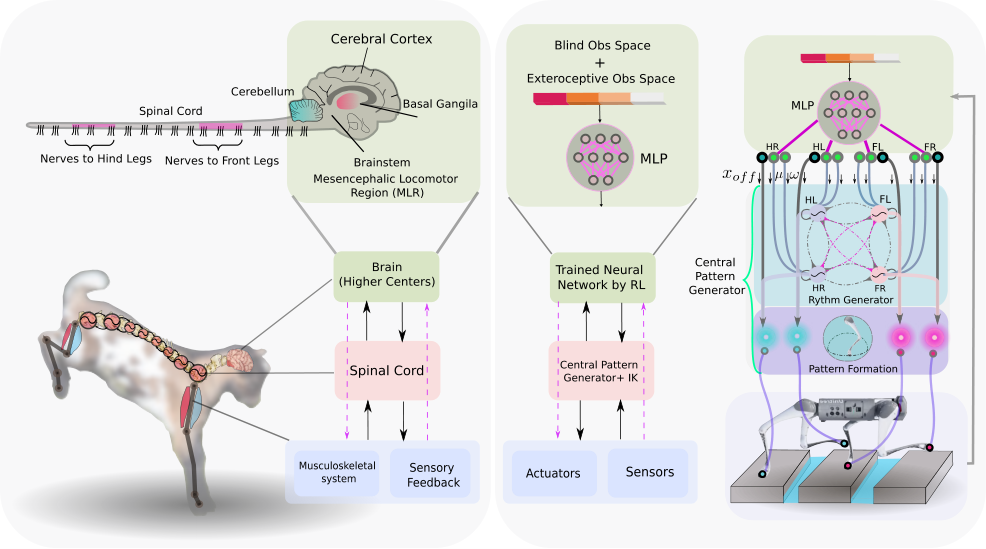
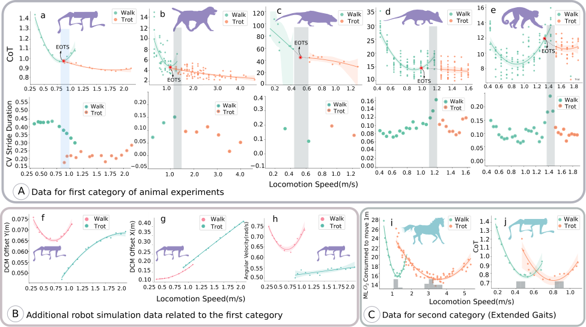
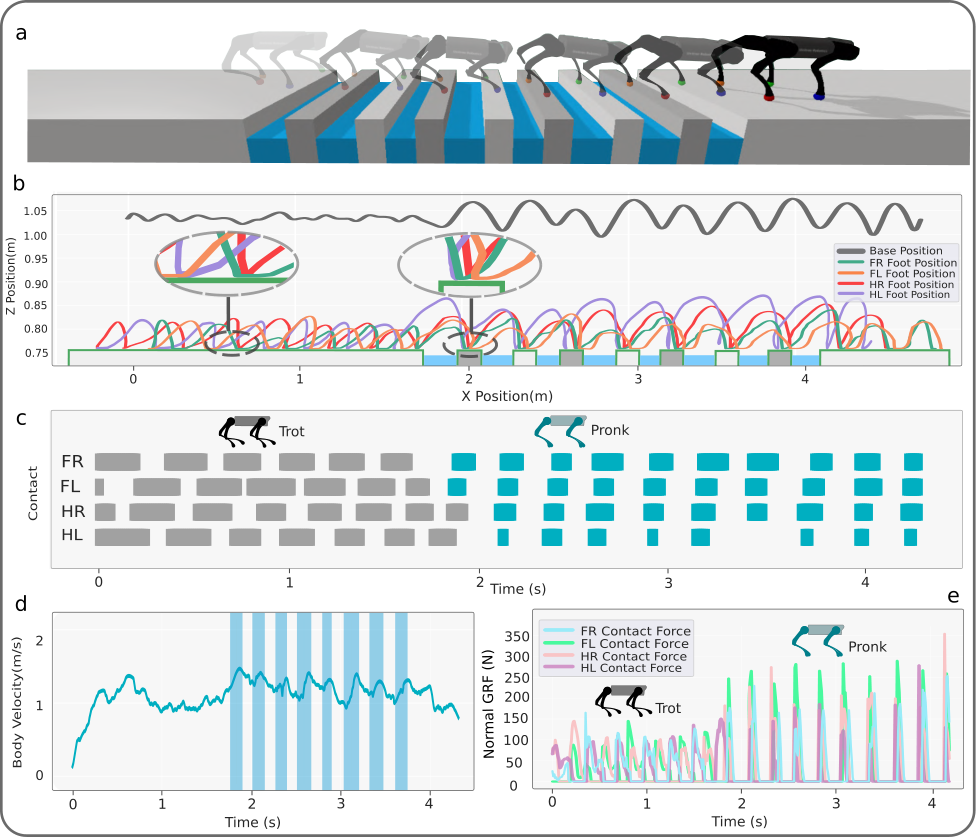
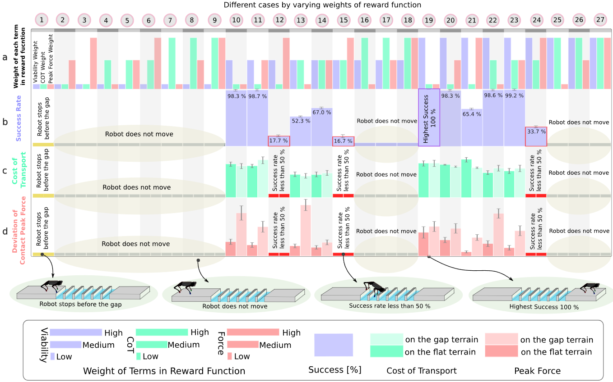
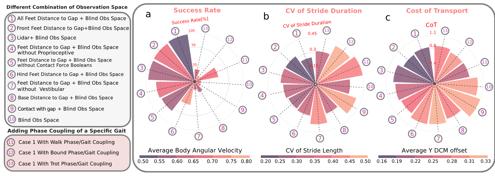

# Viability leads to the emergence of gait transitions in learning agile quadrupedal locomotion on challenging terrains

---

## 1. 立论核心

自然界中的四足动物在奔跑时，能根据速度和地形在**行走、小跑、快跑、跳跃**之间行云流水般切换。几十年来，生物力学界与机器人学界一直在争论：**触发步态切换的“First Principle”到底是什么？**在此之前，学术界主要存在三大流派假说：

```
                    ┌── 假说 1: 能量经济性假说
                    │   认为切换步态纯粹是为了在特定速度下“最省力、省氧气”
                    │
经典的步态切换假说 ──┼── 假说 2: 骨骼肌肉防损伤假说
                    │   认为速度加快时，原有步态的冲击力会折断骨头，切换是为了“削减峰值力”
                    │
                    └── 假说 3: 周期动力学稳定性假说
                        认为动物是为了降低步态离散方差、避免动力学发散摔倒
```

EPFL 团队通过高精度的“机器人 + 深度强化学习”仿真与生物学实验对照，提出了第四种全域统一假说：
> **“存活性（Viability）才是步态切换的第一性原理和首要目标；而能量节省与受力减轻仅仅是保持存活后的副产物，或者仅仅是存活性的代理指标（Surrogate）。”**

特别是在非连续复杂地形中，研究团队发现了一个震撼事实：**机器狗从 Trot 切换到 Pronk 之后，能量消耗急剧飙升，足端峰值冲击力显著增大！它冒着骨折和耗尽体力的风险也要切换步态，唯一的原因就是：不换步态就会摔进悬崖摔死。**

---

## 2. 仿生分层控制架构

论文构建了一套高度契合脊椎动物神经生理学解剖结构的**“大脑皮层下行信号 + 脊髓中枢模式发生器（CPG）”分层架构**：



### 2.1 结构解剖
*   **大脑高层神经中枢（Supraspinal Drive）**： 模拟脑干、基底核、小脑与运动皮层。采用结构为 $[512, 256, 128]$、ELU 激活函数的MLP，通过**PPO**进行强化学习训练，负责高层战略决策与下行调节信号下发。
*   **脊髓神经网络：两层式 CPG 发生器**： 根据神经生理学 Rybak 经典模型，将脊髓回路解耦为**节奏生成层（RG Layer）**与**模式形成层（PF Layer）**。

---

### 2.2 Rhythm Generator, RG Layer
RG 层负责产生纯粹的无量纲相位和振幅节律，采用**非线性振幅受控相位振荡器**建模：

$$
\dot{\theta}_i = \omega_i + \sum_{j} r_j w_{ij} \sin(\theta_j - \theta_i - \phi_{ij}) \\
\ddot{r}_i = \alpha \left( \frac{\alpha}{4} (\mu_i - r_i) - \dot{r}_i \right)
$$

1.  **$\theta_i$（第 $i$ 条腿振荡器的即时相位）**：其变化率 $\dot{\theta}_i$ 由两部分决定：
    *   $\omega_i$：振荡器的**固有角频率**，决定迈步快慢；
    *   $\sum_j r_j w_{ij} \sin(\dots)$：**相邻肢体振荡器之间的物理神经耦合项**。$w_{ij}$ 是耦合权重强度，$\phi_{ij}$ 是期望的**相位差偏置**。
        *   例如：在 Trot（对角小跑）步态中，左前腿与右后腿的相位差 $\phi = 0$（完全同相），而对角线两组腿之间的相位差强制设为 $\pi$（反相半个周期）。
2.  **$r_i$（振荡器的即时振幅）**：
    *   本质是一个**具有临界阻尼特性的二阶线弹性滤波器**；
    *   $\mu_i$ 是期望的目标目标振幅；
    *   $\alpha$ 是收敛速度常数。这个方程确保了当大脑下发新的振幅指令 $\mu_i$ 时，实际振幅 $r_i$ 会极其平滑、毫无冲击地过渡过去，**杜绝电机力矩发生阶跃跳跃**。

---

### 2.3 Pattern Formation, PF Layer
PF 层负责把 RG 层的抽象数学相位 $(\theta_i, r_i)$，物理投影为每只脚在三维空间中的期望轨迹坐标 $(x_{i,\text{foot}}, z_{i,\text{foot}})$：

$$
x_{i,\text{foot}} = x_{\text{off}, i} - L_{\text{step}}(r_i) \cos(\theta_i) \\
z_{i,\text{foot}} = \begin{cases} -h + L_{\text{clrnc}} \sin(\theta_i) & \text{if } \sin(\theta_i) > 0 \quad \text{（空中摆动相）} \\ -h + L_{\text{pntr}} \sin(\theta_i) & \text{otherwise} \quad \text{（地面支撑相）} \end{cases}
$$

*   **$h$**：机体名义站立高度；
*   **$L_{\text{clrnc}}$（Ground Clearance）**：摆动相时脚掌抬离地面的最大腾空高度（抬腿高度）；
*   **$L_{\text{pntr}}$（Virtual Penetration）**：支撑相时足端向地下虚拟渗透深度（利用虚拟下压深度换取足端触地力）；
* $L_{\text{step}}$ 名义步长基准尺度（Nominal Step Length）$L_{\text{step}}$ 是一个由工程师预先设定的几何长度物理常量，代表一条腿在标准状态下向前迈步的最大半步长（例如设为 $0.15\text{ m}$）。

  * 为什么写成函数形式 $L_{\text{step}}(r_i)$？在代码和物理实现中，它其实是**基准步长与当前振幅的乘积**：
    $$
    L_{\text{step}}(r_i) = L_{\text{step}} \times r_i
    $$
    其中 $r_i$ 是由 CPG 振荡器解算出来的**即时振幅**（取值范围在 $0 \sim 1$ 之间微调）。

* **$x_{\text{off}, i}$（大脑直通水平偏置量）**： 常规的步态生成必须严格等待振荡器按正弦波慢慢走完周期；但如果前向雷达突然看到脚下是一个深坑，机器狗必须立刻把脚往前迈或者往后抽！ 大脑策略可以直接输出 $x_{\text{off}, i}$，**完全绕过（Bypass）脊髓振荡器的相位周期，强行修改足部摆动的瞬时几何平衡位置**！赋予了系统在周期步态中瞬间插入非周期性紧急避险的能力。
* **横向坐标 $y$ 在这个特定的直线越障模型中，被简化为了一个恒定常数！**

  * 机器狗向前奔跑、跳跃跨越断崖的动作，主要发生在动物解剖学上所说的**“矢状面”（Sagittal Plane，即机身体侧垂直纵剖面，也就是 $X$-$Z$ 平面）**：

    * $X$ 轴：前后方向（负责向前推进跨越断崖）；
    * $Z$ 轴：垂直上下方向（负责抬腿离地与蹬地腾空）。

  * 而 $Y$ 轴是机器狗的**左右侧向（Lateral Plane）**。

    * 在直线跨越这组笔直平行的断崖木梁时，机器狗不需要频繁扭屁股或向两侧横向大劈叉。

    * 每一条腿在横向（$Y$ 轴）的位置，直接被死死锚定在髋关节电机的原始名义宽度常数上：
      $$
      y_{i,\text{foot}} = \text{Constant} \quad \text{（左腿为 }+y_{\text{hip}}\text{，右腿为 }-y_{\text{hip}}\text{）}
      $$

  * 算法不需要在横向上画复杂的运动轨迹。因此，生成器把珍贵的算力全部集中在前后 $X$ 与垂直 $Z$ 构成的纵向二维平面上，$Y$ 轴保持常数不动，由逆运动学直接代入默认外展角求解。

最后，由逆运动学（IK）将计算出的空间坐标转换为关节角度，交由底层 100 Hz PD 控制器驱动。

---

## 3. 平坦地形 Walk-Trot 切换

作者首先在平地场景下验证该框架能否复现生物界的经典步态规律。



### 3.1 动物对比与经济最优转换速度（EOTS）
*   **对比物种**：家犬（Canis lupus familiaris）、澳洲水鼠（Hydromys chrysogaster）、弗吉尼亚负鼠（Didelphis virginiana）、白头卷尾猴（Sapajus apella）及马（Equus caballus）。
*   **运输成本（Cost of Transport, CoT）**：
    $$
    \text{CoT} = \frac{P}{m g v}
    $$
    其中 $P$ 为消耗功率，$m$ 为自重，$g$ 为重力加速度，$v$ 为平均航速。CoT 是无量纲数，数值越低代表能效越高。
    
    **步频周期变异系数（CV of Stride Duration）**：
    $$
    \text{CV} = \frac{\sigma}{\mu} = \frac{\text{标准差}}{\text{平均值}}
    $$
    CV 越小，步态周期性越强。切换到 Trot 后，步长和周期的离散方差收敛，降低了肢体自身互别打架绊倒的概率。
* **现象复现**： 在低速时，Walk（行走）步态的 CoT 曲线低于 Trot；随着速度提升，两条二次多项式拟合曲线出现交叉点——该交叉点即为**经济最优切换速度**。在 EOTS 之后，Trot 的能耗显著低于 Walk。机器狗的训练结果与家犬、负鼠表现出高度一致的几何重合性。

---

### 3.2 存活性在平地上的量化度量
为了证明平地步态切换不仅仅是为了省能，论文引入了控制论中的**状态存活性（Viability Theory）**，并通过以下四个严苛指标量化评估：

1.  **横向运动发散分量偏移（Lateral DCM Offset）**：**DCM（Divergent Component of Motion）与捕获点**：基于线性倒立摆模型，质心运动可解耦为稳定收敛分量与不稳定发散分量。发散分量 $\boldsymbol{\xi} = \mathbf{x} + \frac{\dot{\mathbf{x}}}{\omega_0}$ 被称为 DCM。**DCM Offset** 是指 DCM 点与足底压力中心（CoP）之间的空间距离。DCM 偏离足底多边形越远，系统发散倾覆的风险呈指数级上升。
    实验显示：机器狗在提速时，若硬撑着保持 Walk，横向 DCM 偏移会剧烈恶化；**一旦切换为 Trot，横向 DCM 偏移大幅下降**，机体远离失稳边界（Fig.2f）。
    
2. **极限抗侧向推力测试（Max Lateral Push Force）**： 在 35 万次物理冲击样本实验中，从 190 N 到 400 N 侧向猛推机器狗。**在高速下切换至 Trot 步态的机器狗，能承受的极限侧推力高出 Walk 步态近一倍（Fig. 2g）**。

3.  **机体平均空间角速度（Average Body Angular Velocity, $\omega_{\text{body}}$）**： 
    $$
    \omega_{\text{body}} = \frac{1}{3N} \sum_{t=1}^N \left( |\omega_{x,t}| + |\omega_{y,t}| + |\omega_{z,t}| \right)
    $$
    切换到 Trot 后，三轴角速度显著平抑，步态更平稳。

---

### 3.3 拓展步态
生物学经典实验曾强迫马匹在非舒适速度下跑“拓展步态”（比如强迫马在极高速度下依然保持慢速 Walk，或者在极低速度下硬要 Trot）。马匹呈现出了**极陡峭的深 U 型 CoT 能耗曲率**。论文通过在机器人上限制步频、强行拉大步长 $L_{\text{step}}$ 模拟了该实验（Fig. 2j）：

*   **物理本质**：为什么拓展步态能耗急剧恶化？因为肢体运动完全脱离了自然物理摆动的共振频率，电机/肌肉被迫输出巨大的制动力矩来抗衡自然惯性。
*   **存活性边界收缩**：在这种非天然工况下，机器狗的存活速度区间急剧萎缩，极易发生摔跌。

---

## 4. 离散断崖地形

### 4.1 离散断崖环境设置
*   **赛道设置**：连续 8 处无底深渊断崖（Gap），间隙宽度在 $[14\text{ cm}, 20\text{ cm}]$ 之间随机生成；
*   **踩踏支撑面**：每个深渊之间的安全横梁宽度**仅有 $14\text{ cm}$**（宽度甚至小于一只脚掌完全平放的安全余量）。机器狗一旦失误踏空，落入 $z < 15\text{ cm}$ 的空间，直接判定为摔死死亡。

---

### 4.2 Trot 步态向 Pronk 步态的自发涌现
在没有任何人工规则引导的前提下，大脑强化学习策略在接近断崖的瞬间，自发完成了惊人重构：



```
[平地逼近阶段] ──> 【对角小跑步态 (Trot)】: 对角线腿交替，连续平稳推进
                     │
                     ▼ (接近连续断崖 14-20 cm 间隙)
[断崖腾空阶段] ──> 【自发突变为四足同相弹跳步态 (Pronk)】: 
                     四条腿完全同相位同步爆发蹬地，整机像羚羊一样离地腾跃飞过缝隙！
                     │
                     ▼ (跨越最后一处间隙)
[平地复归阶段] ──> 【自发复归为小跑步态 (Trot)】: 恢复对角节律，稳定减速巡航
```

---

### 4.3 支撑Viability结论

根据原论文 Table 1 与 Fig. 3c–e 的实测物理指标，切换为 Pronk 步态后的数据如下：

| 评估指标                  | 切换前 (平地 Trot 小跑) | 切换后 (断崖跨越 Pronk 弹跳)    | 物理参数走向              |                                                         |
| :------------------------ | :---------------------- | :------------------------------ | :------------------------ | :------------------------------------------------------ |
| **运输能耗 (CoT)**        | **0.84**                | **0.93**                        | **能耗显著上升 (+10.7%)** | 推翻“步态切换纯粹为了节省能量 (CoT Minimization)”假说！ |
| **法向峰值接触力 (GRF)**  | 约 $180\text{ N}$       | **飙升至 $350\text{ N}$**       | **冲击力翻倍 (+94.4%)**   | 彻底推翻“步态切换是为了避免骨骼肌肉承受大冲击”假说！    |
| **步态周期变异系数 (CV)** | 0.38                    | **0.31**                        | **周期方差收紧 (-18.4%)** | 证实切换有效提升了动作预测性与落地确定性。              |
| **纵向航速**              | $1.0\text{ m/s}$        | **主动加速至 $1.5\text{ m/s}$** | **强行超速突破指令限额**  | 证明速度变化是步态切换的结果，而不是引起切换的诱因。    |

**如果步态切换真的是由“省力”或“防骨折”驱动的，机器狗在面临断崖时绝不可能选择 Pronk！** Pronk 是一种极端费电、对关节冲击极具破坏性的高危步态；但机器狗毅然决然地切换到了 Pronk，唯一的物理因果就是：**在断崖这种不连续地形上，Trot 步态的离散落脚点必然踩入悬崖，只有 Pronk 能让四只脚同时起跳、跨越死局。存活性（Viability）是压倒一切的第一生存法则！**

---

### 4.4 猫步步态（Direct Registering ）
在断崖跳跃中，策略网络自主涌现出了一种极其经典的动物运动学特性——**直接注册（Direct Registering，Fig. 3b）**：
*   **生物学定义**：猫在踩过雪地或危险障碍时，后爪会**极其精确地踩在刚刚前爪踩过的同一个脚印坑里**。
*   **机器狗的自主涌现**：仿真中，机器狗后腿的着地三维坐标，与前一迈步周期前腿的着地坐标在空间上高度重合！
*   **物理意义**：前腿已经探明踩实的木梁是绝对安全可靠的支撑面；后腿直接复制前腿的脚印，将整机对未知地形的力学不确定性降到了绝对最低。

---

## 5. 奖励函数与多模态传感特征

### 5.1 奖励权重 64 组网格搜索



作者设计了包含 3 个核心变量的奖励函数权重排列组合（零、低 10%、中 50%、高 100%），训练了 **64 组独立策略**（每组跑 4400 次跨断崖测试）：

*   **Case 1~16（存活性权重为 0）**：机器狗从头到尾在起点死死趴着，一步都不肯走（零成功率）；
*   **Case 17~32（存活性权重很低）**：机器狗能走平地，但一走到断崖边缘直接原地刹车，宁死不跳；
*   **Case 36（高存活性权重，但强行施加超高受力惩罚）**：机器狗不敢爆发蹬地，跨越成功率不足 50%；
*   **Case 56 之后（高能量惩罚或高受力惩罚）**：成功率暴跌；
*   **Case 54（最高表现组：高存活性权重 + 低能耗惩罚 + 低受力惩罚）**：
    *   **成功率达到不可思议的 99.25%（2400 次跨越仅失误数次）**；
    *   该组在断崖处的 CoT 和冲击力全都显著恶化。
*   **结论**：在复杂地形中，**过分追求“省能”和“动作轻柔”是导致机器人丧失存活性跌落悬崖的罪魁祸首！**

---

### 5.2 感知特征消融


|    Case     | Observation Space                                            |        Success Rate        | 步态稳定性与物理指标表现                                     |                                                              |
| :---------: | :----------------------------------------------------------- | :------------------------: | :----------------------------------------------------------- | :----------------------------------------------------------- |
| **Case 1**  | **全足距离 + 完整本体感知**<br/>(四只脚到沟壑边缘的显式距离 + IMU + 编码器 + 触地信号) | **~99.2%**<br/>(基准 SOTA) | • 步长/步频变异系数 CV 最低<br/>• 横向 DCM 偏移最低 (~0.16)<br/>• 机体空间角速度最小、最平稳 | **全身四条腿拥有对前方地形的完整前瞻几何预测，策略能从容规划每一步的起跳点。** |
| **Case 2**  | **仅前足距离 + 完整本体感知**<br/>(后足到沟壑的视觉距离完全被剥离屏蔽，后半身全盲) |         **~98.1%**         | • 横向 DCM 偏移与 Case 1 相同<br/>• 步长 CV 保持极低水平<br/>• 运输能耗 CoT 保持最优 | **证明后足视觉完全多余！机器狗依靠前足探路，结合内部 CPG 记忆，后足自动复制前足踏点。** |
| **Case 3**  | **前向 3 线激光雷达 (LiDAR) 原始点云 + 完整本体感知**        |         **~95.3%**         | • 表现优秀，角速度平稳<br/>• 成功率略低于 Case 1/2 约 3~4%   | 原始稠密深度点云相比于提炼好的显式几何距离存在小幅测量方差，但依然足够大脑学会跳跃。 |
| **Case 4**  | **全足距离 + 移除足底触地力布尔信号 (Contact Force Booleans)** |         **~79.1%**         | • 落地冲击震颤增加<br/>• 步态周期方差明显扩大                | 策略知道沟在哪，但脚掌踩到地面瞬间缺乏明确的离散触觉信号，导致支撑相/摆动相时序切换发生微小迟滞，踏空滑落。 |
| **Case 5**  | **全足距离 + 移除肢体本体感觉 (Proprioception: 关节转角与角速度)** |         **~78.4%**         | • 腿部关节跟踪误差加大<br/>• 机体平均角速度显著上升          | 机器狗不知道自己的大腿和小腿当前弯曲到了什么确切角度，电机逆运动学输出产生累积相位偏差，导致起跳爆发力发飘。 |
| **Case 6**  | **仅后足距离 + 完整本体感知**<br/>(剥离前足距离，故意让前半身变成瞎子) |         **~48.2%**         | • 步长变异系数 CV 骤增<br/>• 身体发生剧烈俯仰颠簸            | 致命的反面证明！机器狗不能像汽车倒车一样行动，前腿是破局的第一触角。前腿一旦瞎盲，往往在后腿感知到沟壑前，前腿就已经一头栽进深坑。 |
| **Case 7**  | **全足距离 + 移除前庭平衡系统 (Vestibular / 移除机载 IMU 陀螺仪与加速度计)** |         **~16.3%**         | • 姿态角速度失控暴增<br/>• 翻滚/俯仰倾覆率达 80% 以上        | 机器狗虽然能跳起来，但由于没有 IMU 感知机身重力矢量，在腾空相（Aerial Phase）中无法对齐姿态，落地瞬间直接肚皮朝天仰翻摔碎。 |
| **Case 8**  | **仅机体底盘到沟的距离 + 完整本体感知**<br/>(剥离足端独立距离，只给机身中心到断崖的整体距离) |         **~23.1%**         | • 频繁在起跳边缘踩空<br/>• 落足点离散度极高                  | 机身坐标是宏观量，无法表达单只脚距离 14 cm 狭窄木梁边缘的毫米级几何裕度。差之毫厘，足尖直接踏入虚空。 |
| **Case 9**  | **仅保留踏空瞬时触碰检测 (Contact with gap)**<br/>(移除所有前瞻距离，只有脚踩进悬崖的那一毫秒才报警) |         **~4.2%**          | • 无法形成任何前瞻动作<br/>• 几乎在第一、第二个坑就坠毁      | 动力学滞后性注定了“踩空了再想办法”已晚。此时质心已经下坠，没有任何物理反力能把机器狗从重力深渊拉回来。 |
| **Case 10** | **纯盲态运行 (Pure Blind)**<br/>(完全不给任何环境几何感知，仅保留身体内部传感器) |         **~0.0%**          | • 彻底无法通过连续断崖                                       | 证实了在不连续的离散断崖地形上，**纯本体感知的“盲走”在数学和物理上是绝对不可行的**。必须依赖外感知预判。 |
| **Case 11** | **Case 1 观测 + 人为强行锁定 Walking（行走步态）相位耦合**   |         **~48.0%**         | • 动作极其僵硬、受阻<br/>• 无法产生高爆发四足腾跃            | Walk 步态要求随时有 3 只脚踩地。面对 20 cm 沟壑，死板的步态使得必然有脚被机械规则按在坑洞上方强行下踩。 |
| **Case 12** | **Case 1 观测 + 人为强行锁定 Bounding（前后窜跃步态）相位耦合** |         **~25.1%**         | • 机体发生剧烈的俯仰震颤（Pitching）<br/>• 后腿极易撞击木梁侧边缘 | 前后双腿交替跳跃产生的机体前后翘头摆动过大，导致后腿在狭窄木梁（14 cm）上发生剧烈的侧偏碰撞。 |
| **Case 13** | **Case 1 观测 + 人为强行锁定 Trotting（对角小跑步态）相位耦合** |         **~13.2%**         | • 在悬崖处频繁劈叉失稳<br/>• 横向 DCM 偏移巨大               | 对角线两条腿踩地、两条腿悬空。由于沟壑比支撑梁宽，对角线的两只脚不可能同时踩在断崖两侧的狭窄木梁上，必有一只踏空摔死。 |

