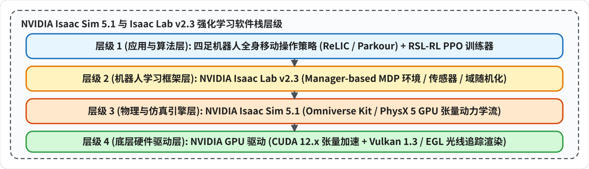

# NVIDIA Isaac Sim 5.1 + Isaac Lab v2.3

> **核心组件**：Ubuntu 22.04 LTS + Python 3.11 + PyTorch 2.7 (cu128) + NVIDIA Isaac Sim 5.1 + Isaac Lab v2.3.x (Core 0.48.0) + RSL-RL 3.0.1 
> **硬件配置验证**：双卡 NVIDIA GeForce RTX 3090 (24GB × 2) 
> **前置依赖**：请先按同目录下 [[Common Environment|Common Environment.md]] 修复容器 DNS 解析、Conda 协议与 Pip 镜像源。

---

## 一、 关键架构



### 1. Isaac Gym vs Isaac Sim vs Isaac Lab
- **Isaac Gym (Preview 4)**：已于 2023 年完全停止维护，仅支持 Python 3.7/3.8，无真实渲染器与传感器物理管线；
- **Isaac Sim (当前 5.1)**：NVIDIA 官方基于 Omniverse 开发的完整通用仿真器底座，负责 USD 场景图、光追渲染、Vulkan 管线和 PhysX 刚体动力学；
- **Isaac Lab (当前 v2.3.x)**：基于 Isaac Sim 构建的高性能并行强化学习框架。支持大规模张量环境向量化并行采集。

---

## 二、 基础运行环境

Isaac Sim 5.1 与 Isaac Lab 2.3 强制锁定 **Python 3.11**。

```bash
conda create -n isaaclab2 python=3.11 -y
conda activate isaaclab2

pip install --upgrade pip
pip config set global.timeout 120
```

---

## 三、 源码拉取 / 网络透明代理

国内服务器访问 GitHub 极易发生 TLS 握手中断

```bash
# 1. 全局配置 Git 透明代理（将所有 github.com 请求自动重定向至国内镜像节点）
git config --global url."https://ghproxy.net/https://github.com/".insteadOf "https://github.com/"

# 2. 数据盘
mkdir -p /opt/data/private/deja/IsaacSim
cd /opt/data/private/deja/IsaacSim

# 3. 克隆 Isaac Lab v2.3.x 稳定分支代码
git clone -b v2.3.1 https://github.com/isaac-sim/IsaacLab.git
cd IsaacLab
```

---

## 四、 工具链 / 依赖包常见问题

在运行官方安装脚本 `./isaaclab.sh --install` 之前，必须提前修补以下 3 个高频破坏性缺陷：

### 问题 1：Python 伪装 CMake 导致的编译失败
- **故障现象**：编译 `egl_probe` 轮子时报 `subprocess.CalledProcessError: Command '['cmake', '--version']' returned non-zero exit status 1`，并在堆栈中出现 `/usr/local/bin/cmake: ModuleNotFoundError: No module named 're'`。
- **根因分析**：容器内 `/usr/local/bin/cmake` 是一个旧版 pip 安装的 Python 包装脚本。当子进程启动时，由于环境变量路径与 Conda Python 3.11 冲突，导致 cmake 脚本连 Python 内置标准库 `re` 都无法加载直接崩溃。
- **修复方案**：安装纯 C++ 二进制原生 CMake，并清理环境干扰：
  ```bash
  # 安装纯 ELF 二进制版 CMake
  conda install -y -c conda-forge cmake
  
  # 清理可能干扰子进程的 Python 变量
  unset PYTHONPATH
  ```

### 问题 2：Setuptools 版本不兼容导致缺少 pkg_resources
- **故障现象**：安装 `source/isaaclab` 时，构建 `flatdict==4.0.1` 抛出 `ModuleNotFoundError: No module named 'pkg_resources'`。
- **根因分析**：`flatdict` 的 `setup.py` 依赖已废弃的 `pkg_resources`；而 pip 默认开启构建隔离（`--build-isolation`）在临时环境中拉取了最新版 `setuptools>=70`（已彻底移除该接口）。
- **修复方案**：锁定 setuptools 版本，并禁用构建隔离直接安装：
  
  ```bash
  pip install "setuptools<70"
  pip install --no-build-isolation flatdict==4.0.1
  ```

### 问题 3：容器缺失 X11 / OpenGL 共享库
- **故障现象**：运行时报错 `libXt.so.6: cannot open shared object file` 以及 `libGLU.so.1: cannot open shared object file`。
- **修复方案**：安装基础动态链接库与 Vulkan 工具集：
  
  ```bash
  apt-get update && apt-get install -y \
      libxt6 \
      libglu1-mesa \
      libgl1 \
      libxrandr2 \
      libxcursor1 \
      libxinerama1 \
      vulkan-tools
  ```

### 执行基础安装脚本
完成上述修补后，执行官方扩展包安装：
```bash
cd /opt/data/private/deja/IsaacSim/IsaacLab
./isaaclab.sh --install

# 补全核心可编辑安装
pip install --no-build-isolation -e source/isaaclab
```

---

## 五、 Vulkan 驱动缺失 / ERROR_INCOMPATIBLE_DRIVER

这是所有在Docker 容器部署 Isaac Sim 的工程师遇到最多的致命问题。

- **现象**：`torch.cuda.is_available()` 正常输出 `True`，但在启动 Isaac Sim 时报错：
  
  ```text
  [carb.graphics-vulkan.plugin] VkResult: ERROR_INCOMPATIBLE_DRIVER
  [carb.graphics-vulkan.plugin] vkCreateInstance failed. Vulkan 1.1 is not supported, or your driver requires an update.
  PhysXFoundation: Unable to get IGpuFoundation, GpuDevices or Graphics!
  ```
- **根因**：容器创建时环境变量只开放了 `NVIDIA_DRIVER_CAPABILITIES=compute,utility,video`。宿主机的 Vulkan ICD 描述文件和 OpenGL 用户态驱动动态库（`libGLX_nvidia.so` 等）**完全没有被挂载进容器**，导致系统回退到 CPU 软光栅驱动（`llvmpipe`）。
- **限制**：在托管集群中，容器无法随意重启或重新配置 Docker run 参数；且宿主机原有的 `nvidia-smi` 是只读挂载的，直接执行官方驱动安装脚本会触发 `Read-only file system` 报错。

无需重启容器，仅解压官方匹配版本的驱动包，将缺失的动态库精准注入系统目录：

```bash
cd /opt/data/private/deja

# 1. 查看宿主机显卡驱动的具体版本号 (本例为 575.64.05)
nvidia-smi | head -n 4

# 2. 伪装请求头直连下载对应版本的官方驱动安装包
curl -L -A "Mozilla/5.0 (X11; Linux x86_64)" -o NVIDIA-Linux-x86_64-575.64.05.run \
    https://download.nvidia.com/XFree86/Linux-x86_64/575.64.05/NVIDIA-Linux-x86_64-575.64.05.run

# 3. 赋予执行权限并仅解压 ，不运行全量安装程序
chmod +x NVIDIA-Linux-x86_64-575.64.05.run
./NVIDIA-Linux-x86_64-575.64.05.run -x
cd NVIDIA-Linux-x86_64-575.64.05

# 4. 批量复制所有缺失的用户态图形共享库 (自动跳过只读挂载文件)
for f in *.so.575.64.05; do
    cp -u "$f" /usr/lib/x86_64-linux-gnu/ 2>/dev/null || true
done

# 5. 建立关键驱动符号链接
ln -sf /usr/lib/x86_64-linux-gnu/libGLX_nvidia.so.575.64.05 /usr/lib/x86_64-linux-gnu/libGLX_nvidia.so.0
ln -sf /usr/lib/x86_64-linux-gnu/libEGL_nvidia.so.575.64.05 /usr/lib/x86_64-linux-gnu/libEGL_nvidia.so.0

# 6. 配置 Vulkan ICD 映射声明
mkdir -p /etc/vulkan/icd.d
cp -f nvidia_icd.json /etc/vulkan/icd.d/

# 7. 刷新系统动态库缓存
ldconfig
```

```bash
vulkaninfo --summary
```
**成功标志**：在 `Devices:` 中，`GPU0` 和 `GPU1` 正确显示为：
- `deviceType = PHYSICAL_DEVICE_TYPE_DISCRETE_GPU`
- `deviceName = NVIDIA GeForce RTX 3090`
- `driverInfo = 575.64.05`

---

## 六、 强化学习组件符号冲突修复

- **故障现象**：启动强化学习训练时抛出：
  
  ```text
  ImportError: cannot import name 'is_structseq_instance' from 'torch.utils._pytree'
  ```
- **根因分析**：PyPI 默认拉取的最新版 `tensordict 0.15.4` 是针对 PyTorch 2.11+ / nightly 设计的，而 Isaac Sim 5.1 锁定的是稳定版 `PyTorch 2.7.0`，此时 `torch.utils._pytree` 尚未导出该函数。
- **修复方案**：安装与 PyTorch 2.7 完美对齐的稳定版本：
  
  ```bash
  pip install tensordict==0.7.2
  ```

---

## 七、 无头仿真 / 四足 RL 自检

### 1. Python 核心组件 / GPU 识别校验
```bash
python -c "import isaaclab; print('Isaac Lab 版本:', isaaclab.__version__)"
python -c "import torch; print('CUDA 加速状态:', torch.cuda.is_available(), '| GPU 数量:', torch.cuda.device_count())"
python -c "from rsl_rl.runners import OnPolicyRunner; print('RSL-RL 导入成功!')"
```

### 2. 运行 Unitree Go2 四足机器人无头零动作测试 (Zero Agent)
验证 USD 资产导入、刚体碰撞与物理循环：
```bash
cd /opt/data/private/deja/IsaacSim/IsaacLab

./isaaclab.sh -p scripts/environments/zero_agent.py \
    --task Isaac-Velocity-Flat-Unitree-Go2-v0 \
    --num_envs 32 \
    --headless
```
### 3. 运行完整 PPO 强化学习步进训练 (RSL-RL)
验证多环境 GPU 并行张量计算与策略更新流水线：
```bash
python scripts/reinforcement_learning/rsl_rl/train.py \
    --task Isaac-Velocity-Flat-Unitree-Go2-v0 \
    --num_envs 64 \
    --headless \
    --max_iterations 10
```
*训练完成后，权重与 TensorBoard 日志将输出至 `logs/rsl_rl/unitree_go2_flat/`。*
