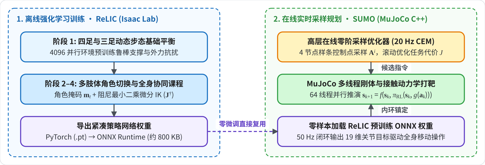

# ReLIC (CoRL 2025) 环境配置

> **核心组件**：Ubuntu 22.04 LTS + Python 3.11 + PyTorch 2.7 (CUDA 12.8) + NVIDIA Isaac Sim 5.1 + Isaac Lab v2.3.x + RSL-RL 3.0.1 + ReLIC (CoRL 2025) 
> **硬件配置验证**：双卡 NVIDIA GeForce RTX 3090 (24GB × 2)
> **前置依赖**：本教程**继承自同目录下的** [[IsaacLab_Setup_Guide]] 与 [[Common Environment]]。ReLIC 运行于 `IsaacLab_Setup_Guide.md` 所构建的 `isaaclab2` (Python 3.11) 虚拟环境内，复用其全部底座依赖，无需重建基础仿真器。

---

## 一、 关键架构概述

**ReLIC (Reinforcement Learning for Interlimb Coordination)** 发表并收录于 CoRL 2025，是波士顿动力人工智能研究院 (Boston Dynamics AI Institute, BD-AI) 提出的具身移动操作控制架构：



1. **灵活多肢体协同 (Flexible Interlimb Coordination)**：让四足机器人能够使用 **3 条腿稳定奔跑运动，同时将第 4 条腿与前置机械臂自由组合为复合操作器官**。
2. **多阶段课程学习 (Curriculum Learning)**：
   - **Phase 1（步态与平衡基座）**：强制随机单腿离地，利用剩余 3 腿在未知复杂地形上保持高速全向移动平衡；
   - **Phase 2 ~ Phase 4（全身动态操作）**：在 3 腿动态平衡的基础上，引入末端位姿跟踪、外力接触抗扰以及肢体防碰撞约束，逐步学会使用肢体与环境发生多接触交互。
3. 策略最终收敛为一个轻量级 MLP 神经网络，输出维度为 12 维腿部关节目标位置增量，模型权重体积仅约 **800 KB**。

---

## 二、 环境继承 / 就绪检查

本项目**深度依赖**同目录下的 [[IsaacLab_Setup_Guide]]。在进行 ReLIC 部署前，请先核验基础环境：

```bash
# 激活 Isaac Lab 虚拟环境
conda activate isaaclab2

# 验证 Isaac Sim 与 Isaac Lab 核心底座导入正常
python -c "import isaaclab; print('Isaac Lab Core Version:', isaaclab.__version__)"
# 预期输出: Isaac Lab Core Version: 0.48.0 (对应 Isaac Lab v2.3.x 标签)
```

---

## 三、 源码部署 / ReLIC 扩展安装

### 1. 官方源码目录结构
克隆官方开源仓库：
```bash
git clone https://github.com/bdaiinstitute/relic.git /opt/data/private/deja/relic
cd /opt/data/private/deja/relic
```

核心代码目录结构如下：
```text
relic/
├── pyproject.toml               # 项目元数据与依赖定义
├── source/
│   └── relic/                   # ReLIC 核心扩展包
│       ├── setup.py             # 标准 pip 安装入口
│       └── relic/
│           ├── assets/          # 机器人与场景模型资产
│           │   └── spot/
│           │       └── pretrained/  # 官方预训练权重 (policy.pt, policy.onnx)
│           ├── actuators/       # Spot 执行器与关节控制定义
│           └── tasks/           # Gym 任务环境与 MDP 奖励定义
├── scripts/
│   └── rsl_rl/                  # 强化学习训练与回放脚本 (基于 IsaacLabExtensionTemplate)
│       ├── cli_args.py          # 命令行参数解析器
│       ├── train.py             # 官方原生训练脚本
│       ├── play.py              # 官方策略回放与渲染评估脚本
│       └── zero_agent.py        # 零动作基准测试脚本
└── logs/
    └── rsl_rl/spot_interlimb/   # 训练产物输出目录 (Checkpoints, TensorBoard 日志)
```

### 2. 将 ReLIC 注册为 Isaac Lab 扩展包
官方说明支持使用标准 `pip` 以可编辑模式（Editable Mode）直接将 ReLIC 注册到当前的 `isaaclab2` 虚拟环境中：

```bash
cd /opt/data/private/deja/relic

# 以可编辑模式安装 ReLIC 扩展（复用环境内现有依赖）
pip install -e source/relic --no-deps

# 验证安装注册成功
pip list | grep relic
# 预期输出: relic  0.1.0  /opt/data/private/deja/relic/source/relic
```

---

## 四、 任务环境 / 训练

### 1. ReLIC 注册的 Gym 任务列表
ReLIC 在 Isaac Lab 任务注册表中预设了 4 个渐进式训练阶段与 1 个回放评估任务：

| 任务名称 (Task ID) | 说明 | 观测维度 (Obs) | 动作维度 (Act) | 默认环境数 (num_envs) |
| :--- | :--- | :---: | :---: | :---: |
| `Isaac-Spot-Interlimb-Phase-1-v0` | 阶段 1：3 腿动态奔跑与全向运动平衡基座 | 84 | 12 | 4096 |
| `Isaac-Spot-Interlimb-Phase-2-v0` | 阶段 2：3 腿全向移动 + 单腿/臂操作目标协同 | 84 | 12 | 4096 |
| `Isaac-Spot-Interlimb-Phase-3-v0` | 阶段 3：多接触力顺应性与外力抗扰微调 | 84 | 12 | 4096 |
| `Isaac-Spot-Interlimb-Phase-4-v0` | 阶段 4：高动态灵巧操作与步态收敛微调 | 84 | 12 | 4096 |
| `Isaac-Spot-Interlimb-Play-v0` | 策略评估与回放模式（支持交互式渲染） | 84 | 12 | 1 ~ 16 |

### 2. 原生训练 (`train.py`)
使用原生的 `scripts/rsl_rl/train.py` 脚本即可直接启动训练：

```bash
cd /opt/data/private/deja/relic

# 指定 GPU 设备并以无头模式启动 Phase 1 训练
export CUDA_VISIBLE_DEVICES=0
python scripts/rsl_rl/train.py \
    --task Isaac-Spot-Interlimb-Phase-1-v0 \
    --num_envs 4096 \
    --headless
```

### 3. 多阶段学习
ReLIC 通过多阶段权重继承实现最优性能。使用 RSL-RL 标准的 `--resume`、`--load_run` 与 `--checkpoint` 参数，可将前一阶段训练好的 Checkpoint 作为下一阶段的初始化权重进行微调：

```bash
# 从 Phase 1 的权重微调启动 Phase 2 训练
python scripts/rsl_rl/train.py \
    --task Isaac-Spot-Interlimb-Phase-2-v0 \
    --num_envs 4096 \
    --headless \
    --resume True \
    --load_run spot_interlimb/<phase1_run_folder> \
    --checkpoint <model_checkpoint.pt>
```

> **预训练权重**：源码仓库已在 `source/relic/relic/assets/spot/pretrained/` 目录下打包提供了完整收敛的权重文件：
>
> * `policy.pt`（PyTorch 权重，约 849 KB）
> * `policy.onnx`（ONNX 权重，约 838 KB）
>

---

## 五、 策略回放 / 渲染评估

运行评估脚本 `scripts/rsl_rl/play.py` 进行可视化回放：

```bash
cd /opt/data/private/deja/relic

# 回放指定的训练检查点
python scripts/rsl_rl/play.py \
    --task Isaac-Spot-Interlimb-Play-v0 \
    --load_run spot_interlimb/<run_folder> \
    --checkpoint <model_checkpoint.pt> \
    --num_envs 4 \
    --center
```

若在无图形界面的远程 Linux 服务器上运行，可添加 `--headless` 参数。
