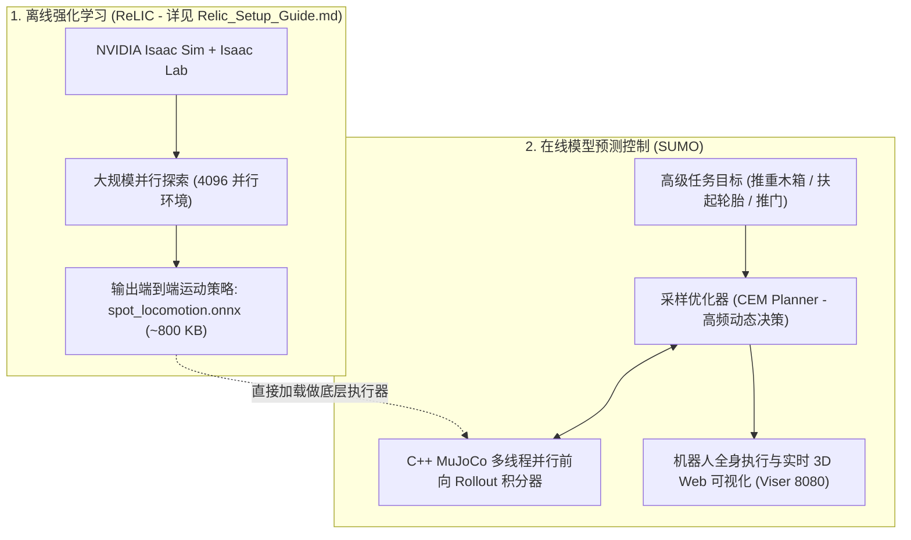

# SUMO (RAI Institute 2026) 环境配置

> **核心组件**：Ubuntu 22.04 LTS + Python 3.13 + MuJoCo 3.6.0 + ONNX Runtime (CPU Allocator) + Dora-rs 0.3.16 + Viser 0.2.7 + Pixi 0.84.1 
> **硬件配置验证**：双卡 NVIDIA GeForce RTX 3090 (24GB × 2)
> **前置依赖**：本教程**核心算法与控制策略继承自** [[Relic_Setup_Guide.md](file:///E:/Desktop/Documents/BIT/5_GoResearch/Nvidia-Sim/Relic_Setup_Guide.md)]。SUMO **直接复用 ReLIC 离线强化学习训练出的紧凑多肢体协同策略权重**，通过 C++ MuJoCo 仿真底座与交叉熵采样优化器（CEM）实现在线实时全身动态操作，**无需重新进行大规模强化学习训练**；网络与依赖镜像继承自 [[Common Environment.md](file:///E:/Desktop/Documents/BIT/5_GoResearch/Nvidia-Sim/Common%20Environment.md)]。

---

## 一、 关键架构

**分层具身智能架构（Hierarchical Embodied Control）**：



### 两种范式的本质差异
1. **ReLIC (离线学习)**：
   - 依赖 GPU 高度并行张量仿真；
   - 目标是让 Spot 学会“在受到外界推拉、缺一条腿的情况下依然绝对稳定地走跑与抬腿”。
2. **SUMO (在线规划)**：
   - **免训练**：直接读取 ReLIC 导出的轻量级 ONNX 策略权重作为下层执行器；
   - 上层由快速采样优化器（CEM）在数十毫秒内采样生成最优的机体速度与末端力旋量指令；
   - 实现了四足机器人像人类推车一样，根据前方木箱动态自适应调整身体倾角和步频。

---

## 二、Pixi

SUMO 与 JUDO 官方采用新一代基于 Rust 的包管理工具 **Pixi**：

1. **项目级独立空间（Project-local Environment）**：
   - 传统的 `conda create` 将虚拟环境存放在 `/root/miniconda3/envs/` 等系统公共目录；
   - Pixi 贯彻现代软件工程原则，将虚拟环境内聚在项目根目录内：
     ```text
     /opt/data/private/deja/sumo/.pixi/envs/default/
     ```
   - 彻底杜绝全局环境污染，即使删除或移动整个项目，也不会在系统留下残留垃圾。
2. **底层完全兼容 Conda 二进制**：
   - Pixi 调用的是 `conda-forge` 的 Python 3.13 预编译二进制包和 C++ 动态链接库；
   - 查看环境所有组件：
     ```bash
     cd /opt/data/private/deja/sumo && pixi list
     ```

---

## 三、 源码与国内透明代理

### 1. 源码部署拓扑
```text
/opt/data/private/deja/sumo/
├── sumo/                         # SUMO 核心算法层 (Controller, Dora 节点, MPC 任务定义)
├── .judo-src/                    # JUDO 动力学与优化底座 (Git 子模块映射)
├── g1_extensions/                # Unitree G1 人形机器人专用 C++ 原生扩展
├── pyproject.toml                # Pixi / Python 依赖声明清单
└── .pixi/envs/default/           # Pixi 自动创建的隔离运行时环境 (Python 3.13)
```

### 2. 国内代理配置
针对国内网络访问 GitHub 与 PyPI 的断流现象，部署以下全局透明重定向规则：

```bash
# 1. 写入 Pixi 清华镜像源加速配置
mkdir -p /root/.config/pixi
cat << 'EOF' > /root/.config/pixi/config.toml
[repodata-config]
use-cache = true

[mirrors]
"https://conda.anaconda.org/conda-forge" = ["https://mirrors.tuna.tsinghua.edu.cn/anaconda/cloud/conda-forge/"]
EOF

# 2. 写入全局 Pip 镜像配置
mkdir -p /root/.pip
cat << 'EOF' > /root/.pip/pip.conf
[global]
index-url = https://pypi.tuna.tsinghua.edu.cn/simple
trusted-host = pypi.tuna.tsinghua.edu.cn
timeout = 60
EOF

# 3. 配置 Git 将远程仓库透明重定向至本地源码与加速镜像
git config --global url.file:///opt/data/private/deja/sumo/.judo-src.insteadOf "https://github.com/rai-opensource/judo.git"
git config --global url.https://ghproxy.net/https://github.com/.insteadOf "https://github.com/"
```

---

## 四、 Pixi 独立开发环境初始化

```bash
# 1. 验证 Pixi 命令行工具
pixi --version

# 2. 进入项目主目录并执行一键环境同步
cd /opt/data/private/deja/sumo
pixi install -v

# 验证环境生成就绪
ls -la .pixi/envs/default/bin/python
```

---

## 五、 C++ 扩展编译 (`mujoco_extensions` 与 `g1_extensions`)

SUMO 高性能物理前向 Rollout 依赖编译的原生 C++ 动态链接库：

```bash
cd /opt/data/private/deja/sumo

# 1. 触发编译构建任务
pixi run build

# 2. 严格核验原生扩展导入健康度
pixi run python -c "
import sumo
import judo
import mujoco_extensions
import g1_extensions
print('SUCCESS: All C++ Extensions Imported Cleanly!')
"
# 预期输出: SUCCESS: All C++ Extensions Imported Cleanly!
```

---

## 六、 机器人与环境资产 (Meshes 与 Menagerie 缓存)

SUMO 在仿真启动时需要加载 Spot 机器人的 3D 网格文件和 MJCF 物理描述模型：

### 1. 部署 3D 网格模型 (`meshes.zip`)
```bash
# 解压预先准备的网格至两个指定位置
unzip -q -o /tmp/meshes.zip -d /opt/data/private/deja/sumo/.pixi/envs/default/lib/python3.13/site-packages/judo/models/
unzip -q -o /tmp/meshes.zip -d /opt/data/private/deja/sumo/.judo-src/judo/models/
```

### 2. 部署 Spot 机器人描述文件缓存 (`mujoco_menagerie`)
`robot_descriptions` 库要求将 DeepMind 的 `mujoco_menagerie`（Commit `bf756430b615819654b640f321c71ba5c3ebeef8`）放置在缓存目录：

```bash
mkdir -p /root/.cache/robot_descriptions
# 验证目录完整性
ls -la /root/.cache/robot_descriptions/mujoco_menagerie/boston_dynamics_spot/spot.xml

# 在 Python 中快速验证
pixi run python -c "from robot_descriptions import spot_mj_description; print('Spot MJCF:', spot_mj_description.MJCF_PATH)"
# 预期输出: Spot MJCF: /root/.cache/robot_descriptions/mujoco_menagerie/boston_dynamics_spot/spot.xml
```

---

## 七、 启动 Dora-rs 分布式数据流任务与后台守护

SUMO 采用现代化分布式数据流中间件 **Dora-rs**，启动后系统并发拉起 3 个协同节点：
- **`simulation` 节点**：高频 MuJoCo 动力学仿真步进；
- **`controller` 节点**：运行采样优化器（CEM）与 ReLIC 运动策略推理；
- **`visualization` 节点**：运行 Viser WebGL 3D 服务器（端口 8080）。

### 启动命令（前台调试）
```bash
cd /opt/data/private/deja/sumo

pixi run sumo task=spot_box_push
```

### 启动命令（生产环境后台守护）
```bash
export CUDA_VISIBLE_DEVICES=1
cd /opt/data/private/deja/sumo

nohup pixi run sumo task=spot_box_push > /opt/data/private/deja/sumo/sumo_run.log 2>&1 &

# 检查服务监听状态
netstat -tuln | grep 8080
# 确认输出: tcp 0 0 0.0.0.0:8080 0.0.0.0:* LISTEN
```

---

## 八、 3D 实时交互与 SSH 

由于服务器位于机房且无独立公网 IP，通过 SSH 本地端口转发在本地浏览器中直接访问 3D 可视化界面：

在本地 PowerShell 执行：
```powershell
ssh -N -L 8080:localhost:8080 -p 25615 -o ServerAliveInterval=15 -o ServerAliveCountMax=10 root@172.16.32.9
```

直接在电脑浏览器访问：  **http://localhost:8080**
